# Telescope

  

> **"텔레스코프로 보면, 인사이트가 보여요."**
>
> 흩어진 공시·IR·리포트·뉴스·사내 자료를 협업 캔버스에 모아 정리하면, AI가 근거의 충분성과 오류를 검토하고 애널리스트 예상 질문을 도출하며 다음 분기 실적·리포트로 예측을 사후 검증하는 **기업 재무 근거 협업 및 심층 분석 AI 플랫폼**입니다.

---

## 1. 서비스 소개

### 서비스 목적

기업 사업부서(CIC·본부)에서 예산서·사업기획서·투자계획서를 준비할 때는 DART 공시, IR 자료, 애널리스트 리포트, 뉴스, 사내 보고서가 각기 다른 단위와 기준으로 흩어져 있어 근거를 맞추고 심의·시장 질문에 대비하는 데 많은 시간이 듭니다.

**Telescope**는 이 과정을 **하나의 페이지(= 공유 캔버스 + AI 분석 화면)** 안에서 완결합니다.

- **한곳에서 찾고 비교하는 근거 수집**: 공시 표, 재무 대시보드, 3사 비교 인사이트, IR·AR·뉴스, 사내 자료를 캔버스 옆에서 바로 끌어다 놓고 회사별 다른 계정명을 개념 사전으로 맞춰 비교·시각화합니다.
- **맥락이 남는 실시간 부서 협업**: 같은 부서 담당자들이 실시간 동시 편집·커서 공유로 자료를 연결하고 메모를 남겨, 특정 수치를 선택한 이유와 맥락을 함께 보존합니다.
- **숫자 환각 없는 검토와 예상 질문**: 모든 숫자 계산과 단위 환산은 코드가 수행하고, AI 출력의 모든 수치에 **근거 ID**를 붙여 클릭 한 번으로 원문 카드를 검증합니다.
- **시점 통제 기반의 사후 검증**: 기준 시점(`as_of_date`) 이후 자료를 서버가 차단해 미래 정보 누수를 막고, 다음 분기 실적과 리포트가 들어오면 예상 질문 적중률과 가정 오차를 객관적으로 평가합니다.

> **단계적 적용 전략**: 현재 MVP는 통신 3사 + SKB(`SKT · SKB · KT · LGU+`)의 공개 데이터와 가상 사내 자료로 업무 흐름과 분석 정확도를 검증하며, 검증된 구조를 바탕으로 실제 **사내 예산·사업계획 검토**로 확장하는 것을 최종 목표로 합니다.

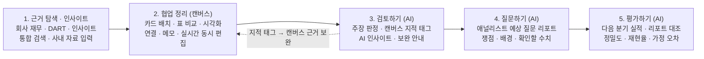

### 브랜딩

**Telescope = Tele(com) + Scope**

| 구성 | 의미 | 서비스에서의 역할 |
|---|---|---|
| **Tele ①** | Telecom (통신) | 분석 대상인 통신 3사(SKT·KT·LGU+) 및 SKB의 공시·IR·리포트·뉴스 |
| **Tele ②** | SK Telecom | 서비스를 도입·활용할 고객사를 함께 가리키는 중의적 표현 |
| **Scope** | 렌즈, 범위 | 흩어진 재무 수치를 한 렌즈로 당겨 근거의 원문 위치까지 정밀하게 확인 |

- **한 줄 설명**: 흩어진 3사 재무를 한 렌즈로 당겨 보면, 맨눈으로는 보이지 않던 흐름이 드러납니다.
- **캐릭터 세계관 — 스텔라(Stella)**: 망원경으로 바라보는 **별 하나(사실 근거)**를 짚고, 흩어진 별을 이어 **별자리(AI 해석)**를 그려 주는 브랜드 캐릭터입니다. ([브랜드 가이드 보기](docs/brand/bi.md))

---

## 2. 서비스 사용 과정 (화면별)

### Step 1. 로그인 · 페이지 홈 · 새 페이지 생성

<table>
  <tr>
    <th width="50%">로그인 (S00)</th>
    <th width="50%">페이지 홈 (C00)</th>
  </tr>
  <tr>
    <td>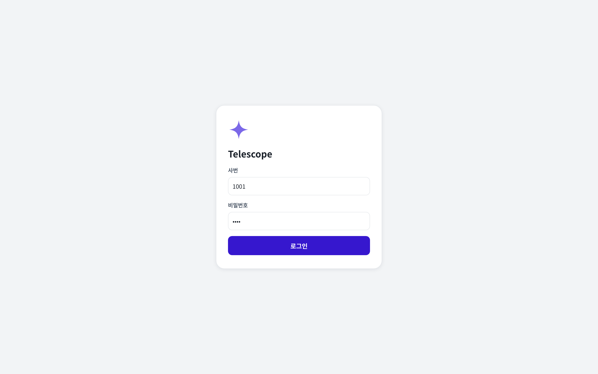</td>
    <td>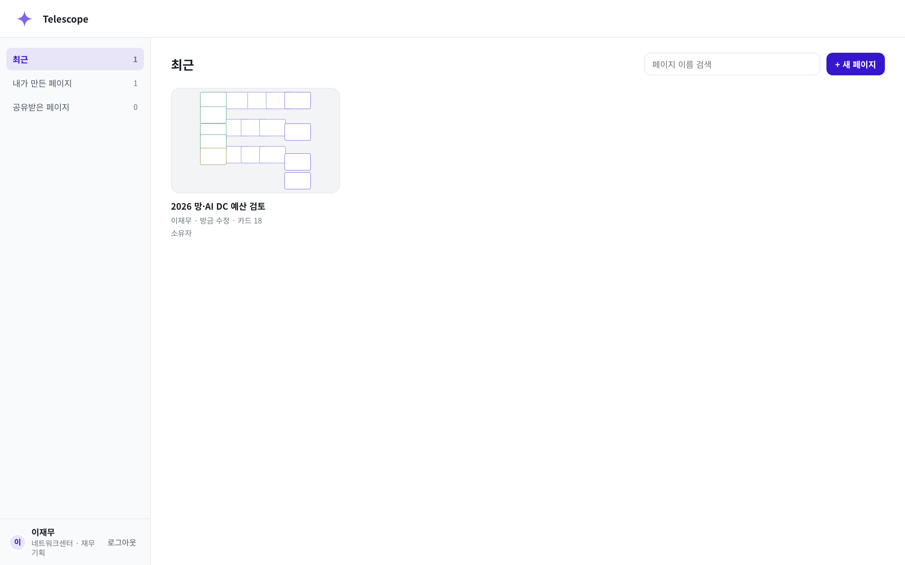</td>
  </tr>
  <tr valign="top">
    <td>
      <ul>
        <li>사번과 비밀번호를 입력해 로그인</li>
        <li>새로고침 시 기존 세션과 보던 페이지 자동 복원</li>
      </ul>
    </td>
    <td>
      <ul>
        <li><code>최근 / 내가 만든 / 공유받은</code> 필터와 검색창으로 페이지 탐색</li>
        <li>미리보기 타일 클릭으로 캔버스 열기, <code>+ 새 페이지</code>로 새 작업 시작</li>
      </ul>
    </td>
  </tr>
</table>

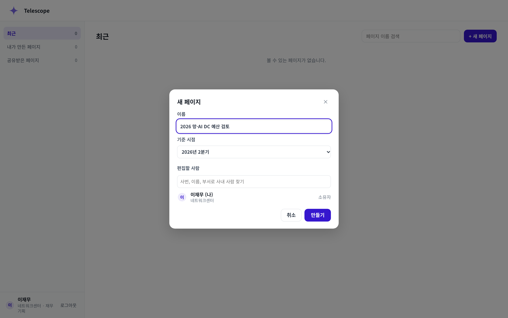

- **새 페이지 생성 (`C14`)**: 페이지 이름과 기준 시점(`2025년 1분기`~`2026년 4분기`)을 지정하고, 함께 편집할 사내 동료를 찾아 추가한 뒤 캔버스를 엽니다.

---

### Step 2. 근거 탐색 · 인사이트 확인 · 사내 자료 투입

캔버스 오른쪽 `자료 검색` 사이드바(`⌘K`)에서 재무 대시보드, DART 지표, 3사 비교 인사이트, 통합 검색 결과를 탐색하고 필요한 항목을 **캔버스로 끌어 놓거나 더블클릭**해 카드로 올립니다.

<table>
  <tr>
    <th width="50%">회사 재무 탭 (C11)</th>
    <th width="50%">DART 탭 (C11)</th>
  </tr>
  <tr>
    <td>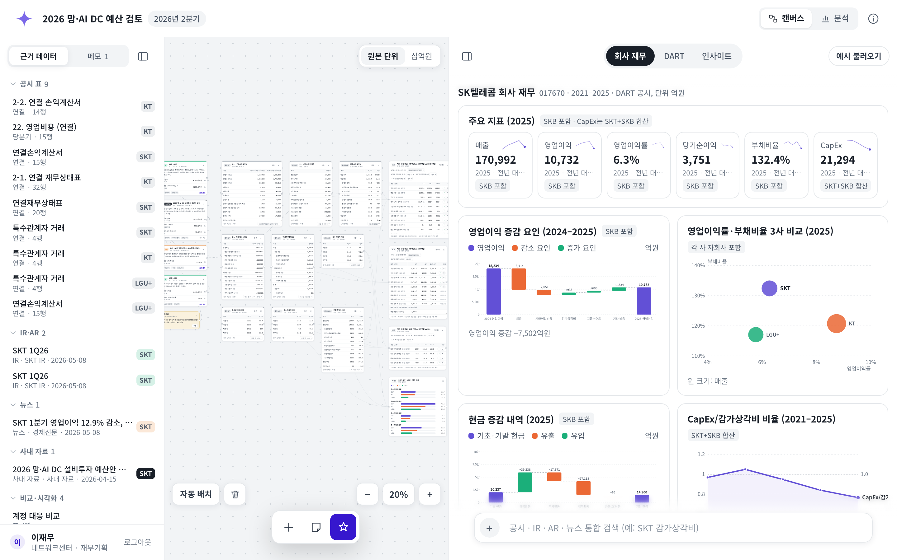</td>
    <td>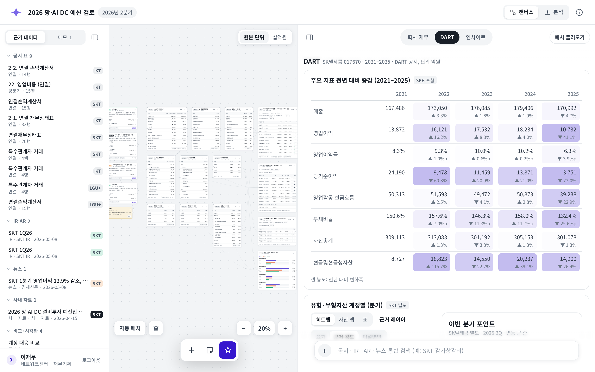</td>
  </tr>
  <tr valign="top">
    <td>
      <ul>
        <li>KPI 6·영업이익 증감 워터폴·3사 산점도·현금 증감·CapEx 비율 확인</li>
        <li>손익·재무상태·현금흐름·설비투자·동종사 비교 패널을 캔버스에 투입</li>
      </ul>
    </td>
    <td>
      <ul>
        <li>연도별 주요 지표 증감 히트맵(2021~2025)으로 급변 구간 파악</li>
        <li>SKT 별도 분기 유형·무형자산 계정을 히트맵·자산 맵·표로 탐색</li>
      </ul>
    </td>
  </tr>
</table>

<table>
  <tr>
    <th width="50%">인사이트 탭 (C11)</th>
    <th width="50%">하단 고정 통합 검색 (C11)</th>
  </tr>
  <tr>
    <td>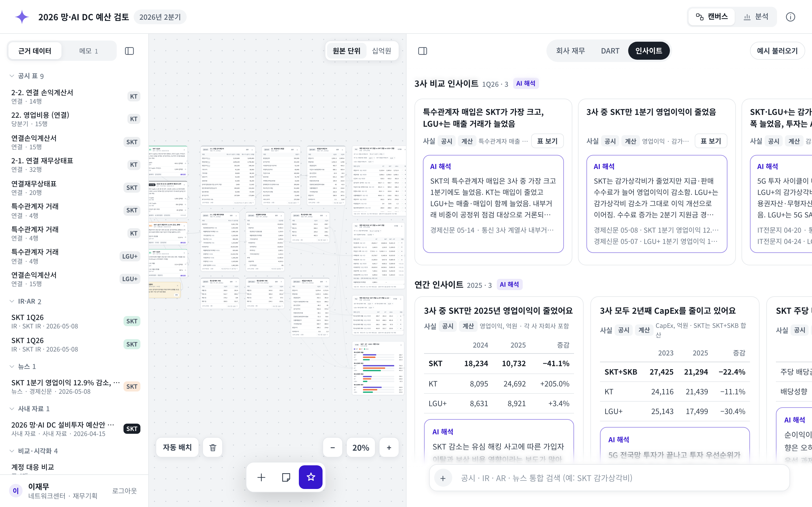</td>
    <td>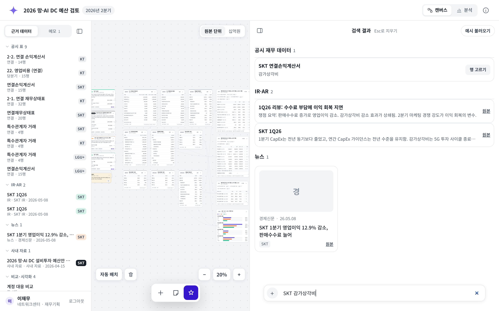</td>
  </tr>
  <tr valign="top">
    <td>
      <ul>
        <li>3사 비교 인사이트(<code>표 보기</code> 포함) 투입 시 3사 공시 표와 비교 카드 동시 생성</li>
        <li>연간 인사이트와 회사별 관련 뉴스(썸네일)를 캔버스로 끌어 놓기</li>
      </ul>
    </td>
    <td>
      <ul>
        <li>계정명·주제어 입력 즉시 공시 재무 데이터·IR·AR·뉴스 동시 검색</li>
        <li>공시 항목의 <code>행 고르기</code>로 원본 표 정밀 선택, <code>Esc</code>로 탭 복귀</li>
      </ul>
    </td>
  </tr>
</table>

<table>
  <tr>
    <th width="50%">원본 표 행·열 고르기 (C12)</th>
    <th width="50%">사내 자료 입력 (C16)</th>
  </tr>
  <tr>
    <td>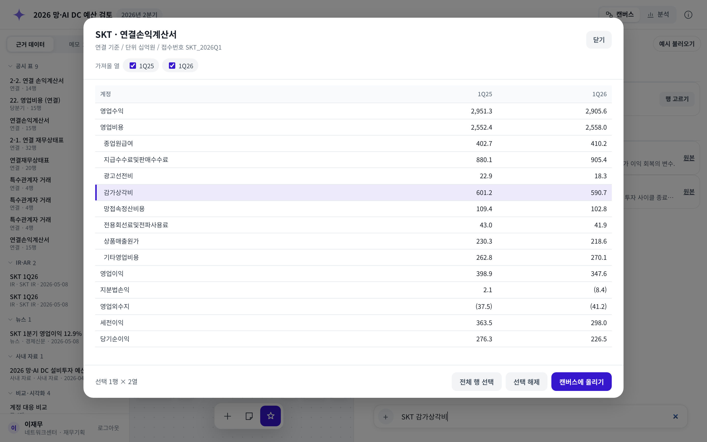</td>
    <td>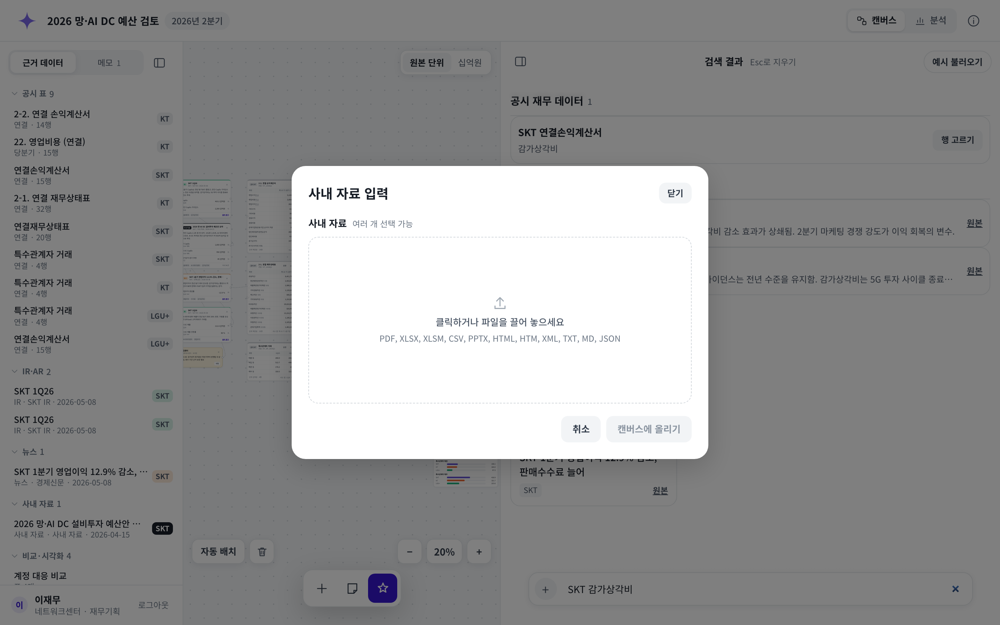</td>
  </tr>
  <tr valign="top">
    <td>
      <ul>
        <li>가져올 기간 열 체크 및 필요한 행 드래그 선택</li>
        <li>주석(<code>주n</code>) 링크로 연결 주석 표 이동 후 <code>캔버스에 올리기</code></li>
      </ul>
    </td>
    <td>
      <ul>
        <li>검색창 <code>+</code>에서 예산서·현장 수치 파일 업로드(11종 포맷·최대 50MB)</li>
        <li>포맷·대상 회사(4사) 검증 통과 파일만 파싱·요약해 사내 자료 카드로 등록</li>
      </ul>
    </td>
  </tr>
</table>

---

### Step 3. 공유 캔버스 협업 정리 및 권한 관리

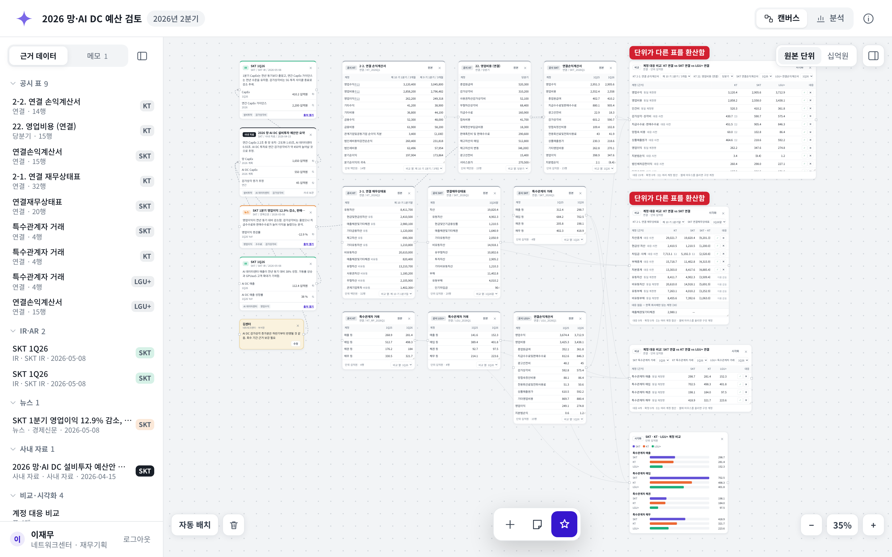

- **근거 정리 및 실시간 협업 (`C10` · `C24`)**:
  - 공시 표·비교·시각화·대시보드·문서·메모 카드 6종을 배치하고 좌우 점을 끌어 선으로 연결
  - `Shift+클릭` 다중 선택으로 `표 생성` / `시각화 생성` / `메모 연결` 실행
  - 왼쪽 사이드바(`근거 데이터` / `메모`)에서 항목 클릭 시 해당 카드·연결선으로 즉시 이동
  - 하단 ★(`분석하기`) 클릭으로 AI 분석 시작, 카드 위 빨간 지적 태그 클릭으로 해당 분석 항목 이동

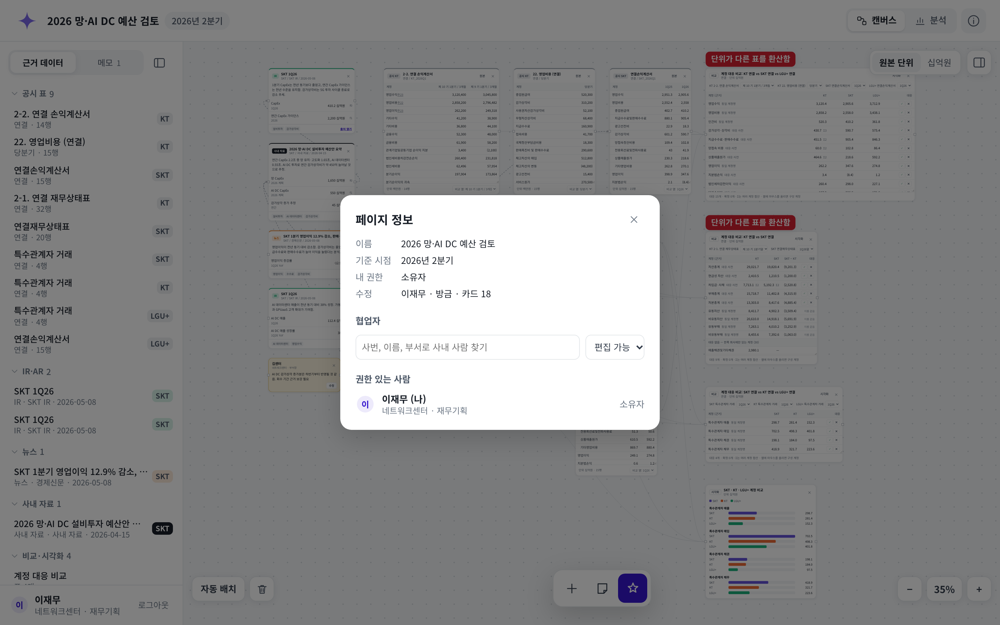

- **페이지 정보 및 공유 권한 (`C13`)**:
  - 헤더 `(i)` 아이콘에서 페이지 메타 정보 확인 및 사내 사용자 검색·초대(`편집 가능` / `보기 가능`)
  - 공유 설정 변경과 페이지 삭제는 소유자만 가능하며, `보기 가능` 사용자는 보기 전용으로 안전하게 열람

---

### Step 4. AI 분석 — 검토 · 애널리스트 예상 질문 · 다음 분기 사후 평가

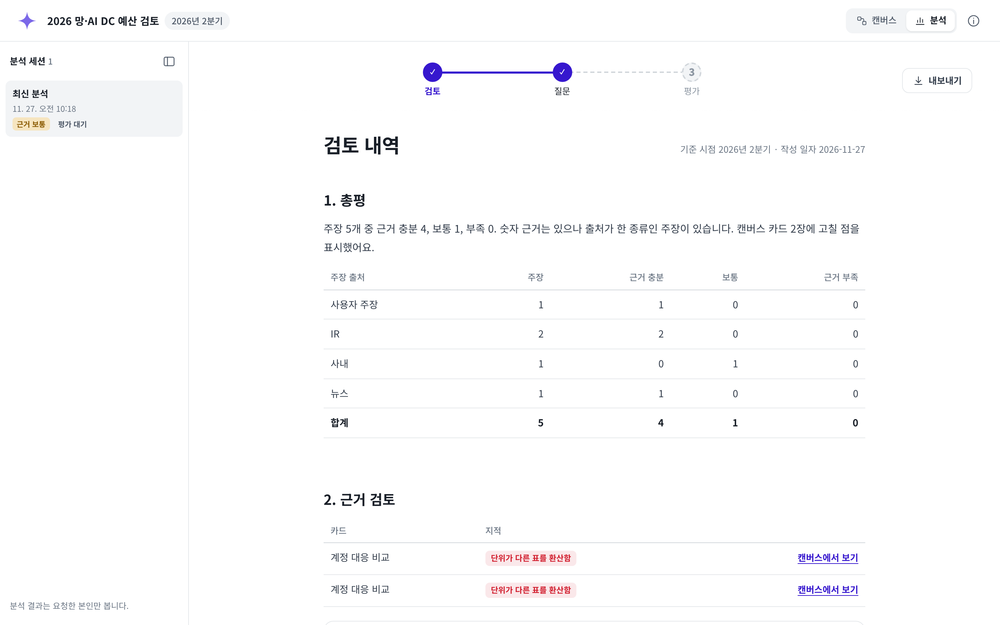

- **1단계 · 검토 내역 (`C21`)**:
  - 총평에서 출처별 주장 수와 `충분 / 보통 / 부족` 판정 확인
  - 지적 표의 `캔버스에서 보기`나 근거 ID 클릭으로 캔버스 카드로 돌아가 근거 보완
  - 캔버스 수정 시 `업데이트`(같은 세션 `v2`) 또는 `새로 분석하기`(새 세션) 선택, 상단 `내보내기`로 프롬프트 복사·Markdown 저장

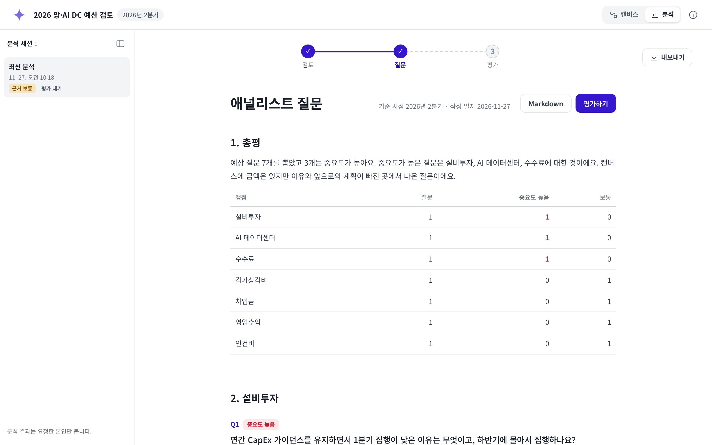

- **2단계 · 애널리스트 예상 질문 (`C22`)**:
  - 중요도 높은 쟁점부터 예상 질문(`Q1`, `Q2`…)과 질문 배경(`왜 묻나요`) 확인
  - `미리 준비할 근거`의 근거 ID를 눌러 캔버스 원문 수치 대조 및 `Markdown` 리포트 내려받기

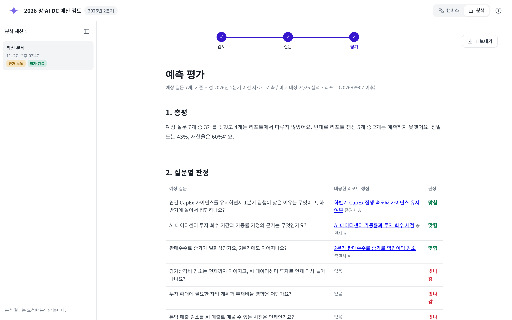

- **3단계 · 예측 평가 (`C23`)**:
  - 기준 시점 이후 다음 분기 실적·애널리스트 리포트가 반영되면 질문 정밀도·재현율 산출
  - 질문별 `맞힘` / `빗나감` 판정, 놓친 쟁점, 기준 분기 유지 가정 대비 실제 실적 오차(`유지` / `재검토`) 점검

---

## 3. 대상 사용자 및 기대 효과

### 대상 사용자

| 구분 | 사용자 | 소속 예시 (SKT 기준) | 서비스 활용 방식 |
|---|---|---|---|
| **핵심 사용자** | **부서 재무기획 담당자** | 네트워크센터, AIDC사업본부, 세일즈마케팅본부, 프로덕트브랜드본부 | 예산서·사업기획서 작성 책임자. 페이지 생성·협업자 초대, 근거 수집·정리, AI 검토·질문 확인 및 보완 |
| **부사용자** | **같은 부서 사업·기술·동료 담당자** | 핵심 사용자와 같은 사업 조직 | 현장 수치(사내 자료)와 공시·IR·뉴스를 함께 올리고 실시간 동시 편집·메모로 맥락 공유 |
| **관계자** | **부서장, 전사 재무기획, IR 담당** | 사업 조직, 코퍼레이트센터(CFO) | `보기 가능` 권한으로 근거와 맥락 확인 및 심의·컨펌. IR·시장 리포트는 예상 질문과 쟁점의 기준 |
| **시스템 관리자** | **플랫폼 운영 관리자 (`ADMIN`)** | 운영 담당 | 공용 문서(DART 공시·IR·리포트 등) 수집·적재·삭제 관리 |

### 기대 효과

| 영역 | 기대 효과 | 검증 기준 |
|---|---|---|
| **근거 수집 시간 단축** | 공시·대시보드·인사이트·IR·뉴스·사내 자료 탐색과 3사 계정 비교를 캔버스 한 화면에서 완결 | 외부 파일·사이트 왕복 최소화, 부서 내 중복 탐색 제거 |
| **수치 신뢰성과 추적성 확보** | 모든 계산·단위 환산은 코드가 처리하고, LLM 출력은 서버가 근거 ID 실존 여부를 검증 | 검토·질문 내 모든 수치의 **근거 ID 인용률 100%**, 원문 카드 즉시 추적 |
| **심의·시장 리스크 사전 대응** | 제출·발표 전에 근거 부족·기준 혼재(연결/별도)·사용자 수정값을 카드 단위로 지적받고 예상 질문 리포트 확보 | 모든 주장에 충분/보통/부족 판정과 보완 안내 제공, 심의 재제출 감소 |
| **객관적 사후 검증 루프** | 기준 시점 이후 자료를 원천 차단하고, 다음 분기 실적·리포트 대비 예측 정확도를 정량 기록 | 기준 시점 이후 자료 혼입 **0건**, 정밀도·재현율 및 가정 오차(±5% 기준) 지속 개선 |

---

## 4. 디렉토리 구조 및 주요 문서

### 디렉토리 구조

- `frontend/` — Vue 3 + TypeScript + Vue Flow 프론트엔드 (브라우저 / Electron)
- `backend/` — Spring Boot(Gradle, Java 21) 백엔드 API · JWT 인증 · WebSocket(STOMP) 실시간 협업
- `ai/` — Python FastAPI 기반 비동기 작업 서버(`ai/server/`) 및 분석·예측 서비스
- `mcp-server/` — FastMCP 기반 DuckDB·ChromaDB 읽기 전용 조회 도구
- `pipelines/` — 데이터 수집·파싱·적재 파이프라인
  - `collectors/` — OpenDART XBRL·원문 XML, 애널리스트 리포트 목록 수집
  - `parsers/` — 범용 문서 파서(11종 포맷, Docling PDF, VLM 라우팅, 표 검산, 마크다운 청킹)
  - `loaders/` — XBRL 재무 수치 DuckDB 적재 배치
- `infra/` — Kubernetes 배포 매니페스트 및 실행 환경
- `data/` — 로컬 데이터 저장 경로 (git 제외)
- `docs/` — 기획·화면설계·API·ERD·브랜드 문서

### 주요 문서

| 문서 | 경로 | 내용 |
|---|---|---|
| 서비스 기획서 | [docs/planning/기획서.md](docs/planning/기획서.md) | 문제 정의, 서비스 흐름, 화면·기능 명세(F-01~F-20), 구현 현황, 아키텍처, 미확정 사항 |
| 화면별 IA | [docs/frontend/ia.md](docs/frontend/ia.md) | 화면 ID(`S00~C25`), 화면별 인터랙션, 상태·예외, 값 표시 규칙 |
| 프런트엔드 API 명세 | [docs/frontend/api-spec.md](docs/frontend/api-spec.md) | 화면 호출 API 경로 및 요청/응답 스키마 |
| 백엔드 API 규약 | [docs/backend/api-spec.md](docs/backend/api-spec.md) | 공통 응답·에러 코드, JWT 인증, 캔버스 권한, STOMP 실시간 동기화 규약 |
| ERD (엔티티 정리) | [docs/erd/entities.md](docs/erd/entities.md) | PostgreSQL 8개 도메인 22개 엔티티 및 업무 흐름 |
| 브랜드 BI 가이드 | [docs/brand/bi.md](docs/brand/bi.md) | 서비스명 Telescope 의미 및 캐릭터 스텔라(Stella) 가이드 |
| 프론트엔드 실행 가이드 | [frontend/README.md](frontend/README.md) | 로컬 실행(`npm run dev`, Electron) 및 데모 흐름 확인 방법 |
