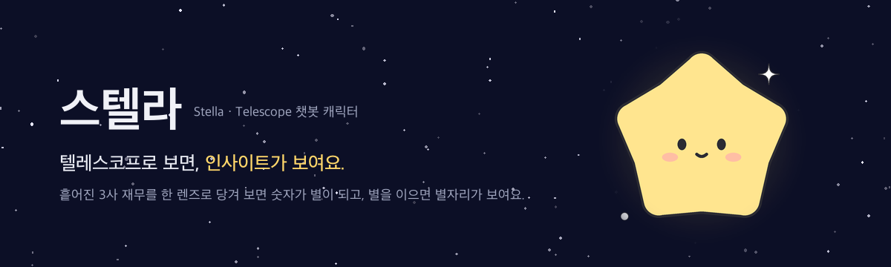
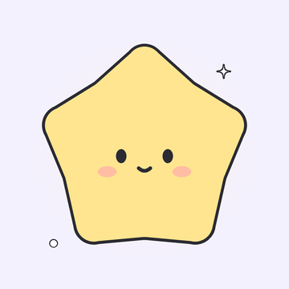
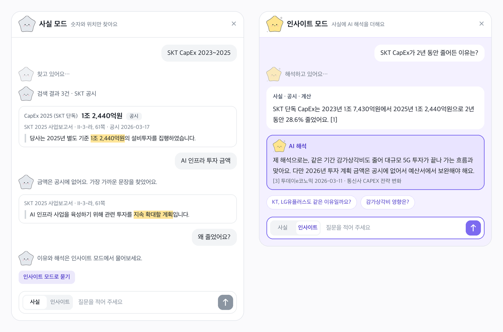
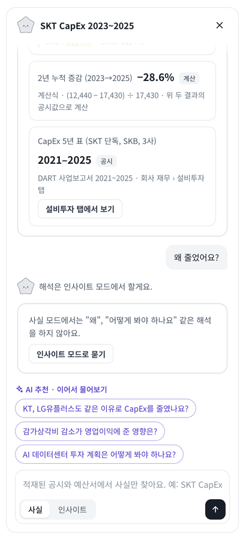
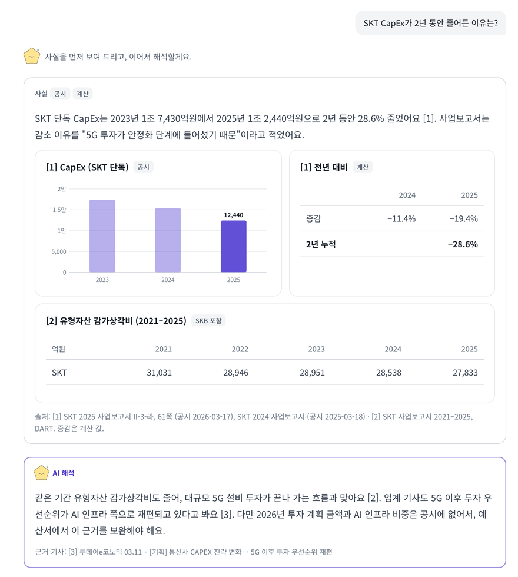
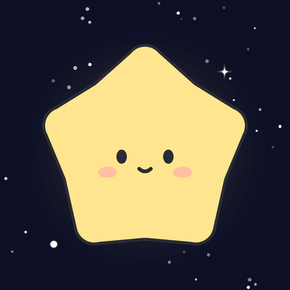

# Telescope BI: 서비스명과 챗봇 캐릭터 스텔라

> 서비스명 Telescope의 의미와 Chat Agent 캐릭터 스텔라(Stella)의 기준을 정의합니다.
> 관리 영역: `docs/brand/`. 작업 이슈는 #38, 작업 브랜치는 `docs/#38-brand-bi`입니다.
> 화면 용어와 화면 ID는 [IA](../frontend/demo/ia.md)를 따릅니다. 캐릭터 그림은 시안이며, 형태와 색을 확정한 뒤 최종 일러스트로 다듬습니다.

**한눈에 보기**

| 항목 | 내용 |
|---|---|
| 서비스명 | **Telescope** = Tele(com) + Scope |
| 태그라인 | 텔레스코프로 보면, 인사이트가 보여요. |
| 캐릭터 | **스텔라(Stella)**, 라틴어로 '별'. 사실 모드에서는 별을 짚고, 인사이트 모드에서는 별을 잇습니다 |
| 시안 기준 | 형태 v1(둥근 별), 인사이트 모드 몸 색 크림 노랑 `#FFE58F`. 서비스 UI 색은 바꾸지 않습니다 |

## 1. 서비스명

**Telescope = Tele(com) + Scope**

| 부분 | 뜻 | 서비스에서 |
|---|---|---|
| Tele ① | Telecom, 통신 | 분석 대상인 통신 3사(SKT, KT, LG유플러스)의 공시, IR 자료, 리포트, 뉴스 |
| Tele ② | SK Telecom | 이 서비스를 사용할 고객사. "Tele"가 업계와 고객사를 함께 가리키는 중의적 표현입니다 |
| Scope | 렌즈, 범위 | 흩어진 수치를 한 렌즈로 당겨 근거의 위치를 자세히 확인합니다 |

- **태그라인:** 텔레스코프로 보면, 인사이트가 보여요.
- **한 줄 설명:** 흩어진 3사 재무를 한 렌즈로 당겨 보면, 맨눈으로는 보이지 않던 흐름이 드러납니다.

## 2. 캐릭터를 정한 근거

망원경 → 별 → 별자리 → 스텔라로 이어집니다.

| 단계 | 연결 | 서비스에서 |
|---|---|---|
| 1 | 망원경으로 보는 것은 별 | 서비스명 Telescope에서 바로 이어지는 대상 |
| 2 | 별 하나 = 사실 하나 | 공시 수치 하나, 원문 위치 하나. Chat Agent **사실 모드**가 제시하는 내용 |
| 3 | 별자리 = 해석 | 흩어진 사실을 이어 의미를 만드는 일. Chat Agent **인사이트 모드**의 AI 해석 |
| 4 | 그래서 챗봇은 별, 스텔라 | 사실 모드에서는 별을 짚고, 인사이트 모드에서는 별을 잇습니다 |

서비스명, 캐릭터, 화면 구조(사실 / 인사이트)가 "텔레스코프로 바라본 인사이트"라는 하나의 이야기로 이어집니다.

## 3. 두 모드

Chat Agent의 `사실 | 인사이트` 토글(C10)과 같은 기준으로 캐릭터 모습을 바꿉니다.

<table>
  <tr>
    <th width="50%">사실 모드 · 찾는 중</th>
    <th width="50%">인사이트 모드 · 대기</th>
  </tr>
  <tr>
    <td align="center"></td>
    <td align="center"></td>
  </tr>
  <tr>
    <td>회색 몸, 효과 없음. 숫자와 위치만 짧게 말합니다</td>
    <td>크림 노랑 몸, 은은한 빛과 반짝이. 사실 위에 해석을 더합니다</td>
  </tr>
</table>

| 항목 | 사실 모드 | 인사이트 모드 |
|---|---|---|
| 몸 색 | 회색 `#E4E8ED` | 크림 노랑 `#FFE58F` (시안 기준, 4장 후보 중 B) |
| 효과 | 없음 | 은은한 빛, 하얀 반짝이 |
| 소품 | 찾을 때만 작은 돋보기 | 없음 |
| 말투 | 숫자와 위치만 짧게. 의견을 말하지 않습니다 | "제 해석으로는…"으로 시작하고 근거 기사를 인용합니다 |
| 해석 요청을 받으면 | `인사이트 모드로 묻기`로 안내합니다 | 사실 블록과 별도로 AI 해석 블록을 제시합니다 |

## 4. 형태와 색

### 4-1. 형태: v1 / v2

<table>
  <tr><th width="50%">v1 둥근 별 (유지)</th><th width="50%">v2 동그란 몸 (비교안)</th></tr>
  <tr>
    <td>둥근 별 몸, 얇은 외곽선, 콩알 눈, 작은 입, 연한 볼터치</td>
    <td>동그란 몸, 짧은 팔다리, 머리 위 작은 별</td>
  </tr>
  <tr>
    <td>👍 캐릭터 자체가 별이라 아이콘 크기에서도 별로 읽힙니다 👎 얼굴 영역이 좁아 표정 차이가 작습니다</td>
    <td>👍 표정이 크게 보이고 더 친근합니다 👎 아주 작게 쓰면 별 느낌이 약해집니다</td>
  </tr>
</table>

이 문서의 다른 이미지는 v1 기준입니다.

### 4-2. 별 색 후보 (인사이트 모드)

| 후보 | 이름 | 몸 색 | 비고 |
|---|---|---|---|
| A | 하양 | `#FFFFFF` | 가장 단순합니다. 인사이트 화면의 연보라 배경과 맞습니다 |
| **B** | **크림 노랑** | `#FFE58F` | **시안 기준.** 별로 바로 인식됩니다. 반짝이는 하양으로 바꿉니다 |
| C | 라벤더 | `#C9BFFF` | 연보라 배경과 맞습니다 |
| D | 보라 | `#9C8CF7` | 인사이트 모드의 보라 계열과 같습니다 |
| E | 민트 | `#A6EAD8` | 연보라 배경과 대비가 큽니다 |
| F | 피치 | `#FFC4B5` | 따뜻한 느낌이 강합니다 |

- 공통: 외곽선과 눈 `#2B2B33`, 볼터치 `#FF9EB5`(투명도 55%).
- 크림 노랑일 때: 빛 `#FFF0B8`, 반짝이 `#FFFFFF`.
- 사실 모드는 후보와 상관없이 회색입니다.
- 캐릭터 색만 바꾸고 서비스 UI 색(보라 AI 해석 블록, 회색 사실 블록 등)은 그대로 둡니다.

## 5. 표정과 상태

| 표정 | 모드 | 사용 시점 | 형태 |
|---|---|---|---|
| 기본 | 사실 | 대화를 시작하거나 안내할 때 | 콩알 눈, 작은 미소 |
| 찾는 중 | 사실 | 검색 결과를 불러오는 동안 | 눈을 옆으로, 일자 입, 돋보기, 말줄임 점 |
| 찾았어요 | 사실 | 검색 카드 위 결과 안내 | 웃는 눈, 돋보기 |
| 공시에 없어요 | 사실 | 요청한 값이 자료에 없을 때 | 일자 입, 땀방울, 돋보기 |
| 생각 중 | 인사이트 | AI 해석을 만드는 동안 | 감은 눈, 작은 입 |
| 해석했어요 | 인사이트 | AI 해석 블록 머리 | 웃는 눈, 미소 |

"공시에 없어요"는 IA 7-3의 원칙(찾을 수 없는 값은 추정하지 않고 자료 부재를 알림)을 표정으로 보여 주는 상태입니다.

## 6. 사용 규칙

<table>
  <tr><th width="40%">크기</th><th width="60%">배치</th></tr>
  <tr valign="top">
    <td>

| 크기 | 표현 |
|---|---|
| 32px 이상 | 얼굴, 소품, 반짝이 모두 |
| 25~31px | 얼굴만. 대화 줄 아바타 기본 30px |
| 24px 이하 | 별 모양만 |

  </td>
  <td>

| 둔다 | 두지 않는다 |
|---|---|
| C20 대화 줄 맨 앞 아바타 | 검색 카드, 사실 출처 표·차트 안 |
| 검색 결과 안내, 로딩, 자료 부재 안내 | 회색 사실 블록 안 |
| AI 해석 블록의 라벨 앞 | 사이드바, 헤더 버튼 아이콘(기존 선 아이콘 유지) |

  </td>
  </tr>
</table>

사실 정보가 장식으로 흐려지지 않도록, 캐릭터는 대화의 머리와 상태 안내에만 둡니다.

## 7. Chat Agent 적용 예시

<table>
  <tr><th width="50%">사실 모드</th><th width="50%">인사이트 모드</th></tr>
  <tr valign="top">
    <td>

1. 사용자: `SKT CapEx 2023~2025`
2. 스텔라(찾는 중): 찾고 있어요…
3. 스텔라(찾았어요): 검색 결과 3건, 아래에 검색 카드
4. 사용자: `AI 인프라 투자 금액`
5. 스텔라(공시에 없어요): 금액은 공시에 없어요. 가장 가까운 문장을 찾았어요.
6. 사용자: `왜 줄었어요?`
7. 스텔라(기본): 이유와 해석은 인사이트 모드에서 물어보세요. `인사이트 모드로 묻기`

  </td>
  <td>

1. 사용자: `SKT CapEx가 2년 동안 줄어든 이유는?`
2. 스텔라(생각 중): 해석하고 있어요…
3. 회색 사실 블록(캐릭터 없음): 2023년 1조 7,430억원 → 2025년 1조 2,440억원, 2년 누적 −28.6%
4. AI 해석 블록(라벨 앞 스텔라, 해석했어요): 해석 문단과 근거 기사 [3]
5. 입력창 위 이어서 물어보기 칩

  </td>
  </tr>
</table>

예시의 수치는 데모 데이터(`docs/frontend/demo/data/financials.json`)의 공시값이고, 해석 문장은 샘플입니다.

## 8. 서비스 적용 시안

현재 데모(`docs/frontend/demo/index.html`)를 복사한 [mockup/index.html](mockup/index.html)에 스텔라만 더했습니다. 캐릭터만 크림 노랑이고 화면 색과 구성은 데모와 같습니다. 원본 데모는 바꾸지 않았습니다.

<table>
  <tr><th width="35%">사이드 채팅 (C20, 사실 모드)</th><th width="65%">대화 화면 (I20, 인사이트 모드)</th></tr>
  <tr valign="top">
    <td align="center"></td>
    <td align="center"></td>
  </tr>
</table>

| 위치 | 시안에서 바뀐 점 |
|---|---|
| 채팅 머리 | 세션 제목 앞에 스텔라. 토글에 따라 회색 / 크림 노랑으로 바뀝니다 |
| 답변 앞 안내 줄 | 사실: 찾았어요 / 해석은 인사이트 모드에서 / 자료에서 찾지 못했어요. 인사이트: 사실 먼저, 이어서 해석 |
| AI 해석 라벨 | 반짝이 아이콘 대신 "해석했어요" 스텔라 |

시안을 직접 보려면 `docs/brand/mockup/index.html`을 브라우저로 엽니다(로그인 화면은 아무 값이나 넣고 넘어가면 됩니다).

## 9. 확장 콘셉트: 밤하늘

<table>
  <tr>
    <td width="40%" align="center"></td>
    <td width="60%">

인사이트 홈(I10)을 캐릭터 세계관으로 넓힌 안입니다. 확정 전 참고 콘셉트입니다.

- 어두운 밤하늘 배경. 망원경을 누르면 질문 입력창이 열립니다.
- 질문하면 망원경이 하늘을 향하고, 사실 별과 뉴스 별이 차례로 나타난 뒤 AI 해석 별로 이어지며 별자리가 됩니다.
- 별을 누르면 해당 사실, 기사, 해석을 보여 줍니다.

  </td>
  </tr>
</table>

## 10. 에셋

| 파일 | 내용 |
|---|---|
| [stella-banner.png](assets/stella-banner.png) | 대표 배너 (1200×360) |
| [stella-modes.png](assets/stella-modes.png) | 두 모드 비교 |
| [stella-fact-search.gif](assets/stella-fact-search.gif) | 사실 모드, 찾는 중 애니메이션 |
| [stella-insight.gif](assets/stella-insight.gif) | 인사이트 모드 대기 애니메이션 |
| [stella-v1-v2.png](assets/stella-v1-v2.png) | 형태 v1 / v2 비교 |
| [stella-palette.png](assets/stella-palette.png) | 별 색 후보 A~F |
| [stella-expressions.png](assets/stella-expressions.png) | 표정 6종 |
| [stella-chat.png](assets/stella-chat.png) | 대화창 적용 예시 (사실 / 인사이트) |
| [mockup-chat-fact.png](assets/mockup-chat-fact.png) | 서비스 시안 캡처, 사이드 채팅 |
| [mockup-chat-insight.png](assets/mockup-chat-insight.png) | 서비스 시안 캡처, 인사이트 대화 |
| [stella-night.gif](assets/stella-night.gif) | 밤하늘 콘셉트 애니메이션 |
| [mockup/index.html](mockup/index.html) | 서비스 적용 시안 (데모 복사본 + 스텔라) |

캐릭터 이미지는 360px 정사각형 단위이며 배경색이 포함되어 있습니다. 다른 배경에 쓰려면 해당 배경색으로 다시 만들어야 합니다.

## 11. 확정이 필요한 항목

| 항목 | 선택지 | 영향 범위 |
|---|---|---|
| 캐릭터 형태 | v1 둥근 별 / v2 동그란 몸 | 모든 에셋 |
| 별 색 | B 크림 노랑(시안 기준) / 다른 후보 | 인사이트 모드 캐릭터. UI 색은 유지 |
| 화면 반영 | Chat Agent C10·C20·I20에 아바타 적용 여부 | `docs/frontend/` IA와 데모 (frontend 담당과 논의) |
| 밤하늘 콘셉트 | I10에 적용 / 참고만 | 인사이트 홈 화면 구성 |
