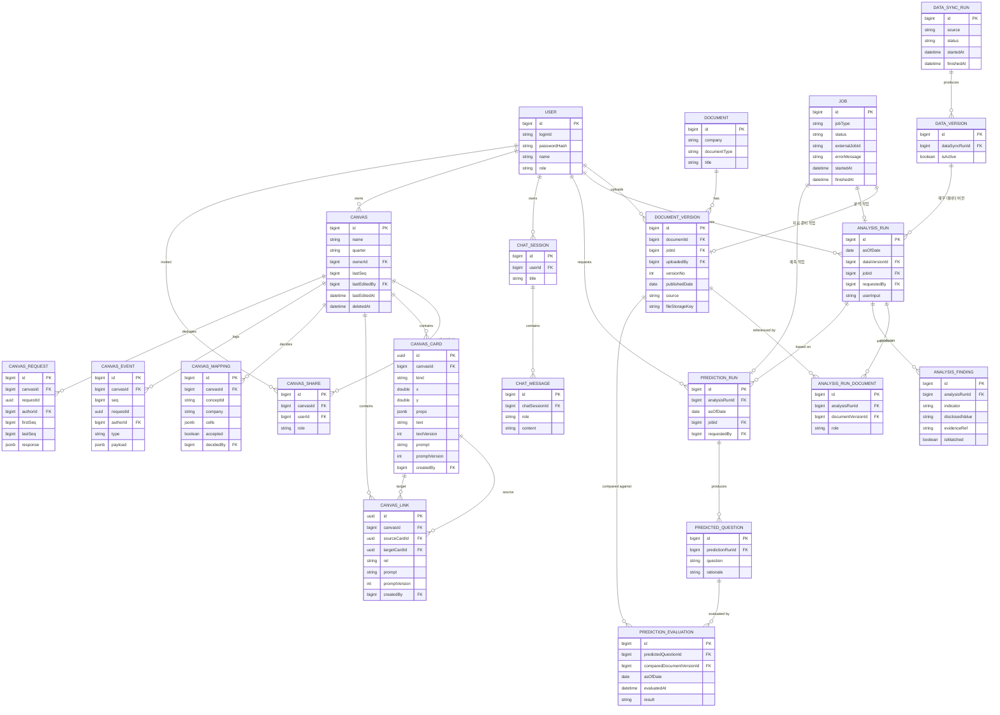

# ERD — 엔티티 정리

> 기준은 Flyway 마이그레이션(`backend/src/main/resources/db/migration`)이다. 이 문서와 마이그레이션이 다르면
> 마이그레이션이 맞고 이 문서를 고친다. 모든 테이블은 PostgreSQL의 `app` 스키마에 있다(#88).
> 이 문서는 PostgreSQL(backend가 쓰는 운영 데이터)만 다룬다. DuckDB(재무 수치)와 ChromaDB(문서 검색)는
> backend가 열지 않으며, 여기에는 "어느 버전을 썼는가" 같은 메타데이터만 남긴다.

## 1. 한눈에 보기

엔티티 21개, 도메인 8개.

| 도메인 | 엔티티 | 한 줄 역할 |
|---|---|---|
| user | `User` | 로그인 사용자와 역할(ADMIN/USER). 결과의 소유자 |
| document | `Document`, `DocumentVersion` | 문서(공시, IR, 리포트, 뉴스, 예산서)와 그 버전 |
| job | `Job` | 오래 걸리는 작업(자료 준비, 분석, 예측)의 상태. 폴링 대상 |
| datasync | `DataSyncRun`, `DataVersion` | 재무 데이터(DuckDB) 적재 이력과 데이터 버전 |
| analysis | `AnalysisRun`, `AnalysisRunDocument`, `AnalysisFinding` | 분석 실행, 사용 문서 스냅샷, 근거 점검 결과 |
| prediction | `PredictionRun`, `PredictedQuestion`, `PredictionEvaluation` | 애널리스트 질문 예측, 예측 결과, 사후 평가 |
| chat | `ChatSession`, `ChatMessage` | 대화와 메시지 |
| canvas | `Canvas`, `CanvasShare`, `CanvasCard`, `CanvasLink`, `CanvasMapping`, `CanvasEvent`, `CanvasRequest` | 협업 캔버스, 공유 권한, 카드·연결 상태, 편집 이벤트 기록 |

MVP에서 제외한 것: 팀 단위 프로필(설정), 팀 개념(`Team`), 콜백(작업 상태는 폴링), 사내 SSO.

## 2. 관계도

> `Job`은 공통 테이블이지만 대상을 범용으로 가리키지 않는다. 자료 준비/분석/예측을 시작하는
> 쪽(`DocumentVersion`/`AnalysisRun`/`PredictionRun`)이 각자 `jobId` FK로 `Job`을 가리키는
> 일대일 관계로 통일했다. `jobType`은 조인용이 아니라 필터링·표시용 메타데이터로만 쓴다.
>
> 관계 표기: 대상(`DocumentVersion`/`AnalysisRun`/`PredictionRun`)은 `jobId`로 `Job`을 반드시 하나 가진다.
> 반대로 `Job` 하나는 세 대상 중 **`jobType`에 맞는 정확히 하나**에만 연결된다(나머지 둘에는 연결되지 않는다).
> Mermaid로는 "셋 중 하나만"을 표현할 수 없어서 `Job` 쪽을 선택(`o|`)으로 표시하고 이 규칙은 서버가 검증한다.



> 캔버스 테이블의 작성자 FK(`lastEditedBy`, `createdBy`, `decidedBy`, `authorId`)도 모두 `User`를 가리킨다.
> 관계선이 너무 많아져 관계도에서는 소유자·공유만 그렸다.

## 3. 전체 흐름

### 3.1 인증

1. 사용자가 `loginId`와 비밀번호로 로그인하면 서버가 JWT를 발급한다.
2. 이후 요청은 JWT로 사용자와 역할(`role`)을 판별한다. 권한은 서버가 강제한다.
3. 사내 SSO 연동은 MVP 이후 과제다.

### 3.2 자료 준비 (문서 업로드·수집)

1. 문서가 들어온다. 들어오는 경로는 두 가지다.
   - 관리자가 공용 문서(공시 등)를 수집한다. `uploadedBy`는 비어 있다.
   - 사용자가 캔버스에서 예산서나 근거자료를 올린다. `uploadedBy`에 올린 사용자가 들어간다. 올린 파일은 그 캔버스에 속한다.
2. `Document`(없으면 새로)와 `DocumentVersion`(항상 새 row)을 만들고, `Job`을 만들어 `jobId`로 연결한다.
3. 원본 파일의 보관 위치는 경로마다 다르다(`docs/backend/ai-contract.md` 2.11).
   - 사용자 업로드: backend가 `FileStorage`에 저장하고, 반환된 key를 `fileStorageKey`에 넣는다. 배포에서는 S3이며 원본 보관용이다.
   - 공용 문서(공시 등): 원본은 ai 쪽 저장소에 둔다. **backend는 공용 문서 원본을 `FileStorage`(S3)에 저장하지 않는다.** 이때 `fileStorageKey`에 무엇을 넣을지는 미정이다(6장).
4. backend가 `PythonAiClient`로 ai 서비스에 자료 준비를 요청한다.
   - 사용자 업로드: ai가 원본을 파싱해 요약·수치·태그를 작업 결과로 돌려준다. **ChromaDB에 적재하지 않는다.**
   - 공용 문서(공시 등): ai 쪽이 수집·적재한다.
5. 클라이언트는 `GET /jobs/{id}`를 폴링한다. 연결된 `Job.status`가 `SUCCEEDED`이면 그 문서 버전은 준비가 끝난 것이다. 준비 상태를 `DocumentVersion`에 따로 저장하지 않으므로 문서 버전 row는 바뀌지 않는다.
   - 작업 응답(`GET /jobs/{id}`)에는 결과 본문이 없다. 사용자 업로드의 카드 데이터(요약·수치·태그)는 `SUCCEEDED` 뒤에 `GET /api/v1/documents/{id}`로 받는다(`docs/frontend/api-spec.md` 5.3).
   - 그러려면 backend가 ai 작업 결과를 받아 저장해 두어야 한다. 저장 위치와 저장 시점은 아직 정하지 않았다(6장, #111). 정해지기 전까지 업로드 → 카드 표시 흐름은 완성되지 않는다.
6. 준비가 끝나지 않은 문서 버전(연결된 `Job`이 `SUCCEEDED`가 아닌 것)은 분석 허용 문서에 넣지 않는다.

### 3.3 재무 데이터 적재

1. Spring 스케줄러가 적재를 시작한다. 이미 실행 중인 적재가 있으면 건너뛴다(한 번에 한 건).
2. `DataSyncRun`을 만들고 ai 서비스에 적재를 요청한다. ai의 loader가 새 DuckDB 파일을 만들고 검증한 뒤 교체한다.
3. 성공하면 `DataVersion`을 새로 만들고 이전 버전의 `isActive`를 끈다. 이 전환은 한 트랜잭션에서 한다.
4. 호출 계약(loader 실행 방식, 결과 파일 경로·버전 id 수신 방식)은 ai 담당자와 아직 맞추지 않았다.

전체 그림은 아래와 같다. `DataSyncRun`은 작업 일지이고, `DataVersion`은 쓸 수 있는 "판"에 붙는 이름표다.

```
[스케줄러] ─ 정해진 시간에 ─→ ① DataSyncRun 생성 (상태: 실행 중)
                                  │
                                  ▼
                      ② ai의 loader가 새 DuckDB 파일 생성·검증
                                  │ 성공
                                  ▼
                      ③ DataVersion 생성 (isActive = true)
                         이전 DataVersion은 isActive = false
                                  │
        (이후 사용자가 분석 요청)
                                  ▼
                      ④ AnalysisRun 생성
                         dataVersionId = 그 시점에 활성인 DataVersion
```

- ①: 이미 실행 중인 적재가 있으면 새로 시작하지 않는다. 이 row는 DuckDB 데이터가 아니라 작업 이력이다.
- ②: backend는 DuckDB를 열지 않고 ai에 요청만 한다. 기존 파일을 건드리지 않고 새 파일을 만들어 검증한 뒤 교체한다.
- ③: 성공했을 때만 `DataVersion`이 생긴다. 실패하면 `DataSyncRun`에만 실패가 남고 이전 버전이 계속 활성이다.
- ④: 이후 새 적재가 돌아도 `AnalysisRun.dataVersionId`는 바뀌지 않는다. 분석 결과가 어느 판의 수치로 만들어졌는지 설명할 수 있게 하는 기록이다. 다만 그 번호의 DuckDB 파일을 지우면 번호만 남으므로, 옛 파일 보관은 6장의 미정 항목이다.

### 3.4 분석 (근거 점검)

분석 입력은 세 가지다: 예산서 파일, 근거자료 파일, 검토 기준에 대한 사용자 컨텍스트(`userInput`).

1. 사용자가 예산서(1개)와 근거자료를 올리고 `userInput`을 적어 분석을 요청한다. 위 3.2의 업로드 흐름이 먼저 돈다.
2. 서버가 `AnalysisRun`을 만든다. 이때 `requestedBy`, `asOfDate`, `userInput`, 그 시점에 활성인 `dataVersionId`를 고정한다.
3. 허용 문서를 정해 `AnalysisRunDocument`로 스냅샷한다. 업로드한 파일과 DuckDB/ChromaDB의 공용 공시를 함께 쓰며, 예산서는 `BUDGET`, 나머지는 `EVIDENCE`로 표시한다.
4. `Job`을 만들고 ai 서비스에 분석을 요청한다(202와 `jobId`). 허용 문서와 기준 시점은 서버가 강제로 주입한다.
5. ai가 숫자를 코드로 계산하고 공시와 대조해 결과를 돌려주면, 서버가 지표별로 `AnalysisFinding`을 저장한다.
6. 같은 조건으로 다시 분석하면 기존 결과를 고치지 않고 새 `AnalysisRun`을 만든다.

### 3.5 예측 (애널리스트 질문 예측)

1. 사용자가 완료된 `AnalysisRun`을 골라 예측을 요청한다.
2. 서버가 `PredictionRun`을 만든다. `asOfDate`(필수)와 `requestedBy`를 고정하고 `Job`을 연결한다. 이때 예측의 `asOfDate`는 바탕이 되는 `AnalysisRun.asOfDate`보다 이르면 안 된다(`예측 ≥ 분석`). 어기면 서버가 거부한다. 분석에 쓰인 문서는 분석 기준 시점 이전 발행분뿐이라, 이 규칙이 있으면 예측 기준 시점 이후 정보가 분석 결과를 통해 섞이지 않는다.
3. ai는 기준 시점 이전에 발행된 자료만 사용한다. 이후 발행 문서는 서버가 허용 문서에서 제외한다. 결과가 비어도 전체 문서로 되돌아가지 않는다.
4. 결과로 `PredictedQuestion`(질문, 근거)이 여러 건 저장된다.

### 3.6 예측 평가

1. 예측의 기준 시점(`PredictionRun.asOfDate`) 이후에 새 리포트가 발행되어 `DocumentVersion`으로 들어온다.
2. 평가를 요청할 때 평가 기준 시점(`asOfDate`, 필수)을 정한다. 비교 대상은 예측 기준 시점 이후부터 평가 기준 시점까지 발행된 문서로 서버가 제한한다.
3. 예측했던 `PredictedQuestion`과 그 리포트를 견주어 맞았는지 평가한다.
4. 결과를 `PredictionEvaluation`(`predictedQuestionId`, `comparedDocumentVersionId`, `asOfDate`, `evaluatedAt`, `result`)으로 새로 쌓는다. 다시 평가하면 새 row를 추가한다.

### 3.7 채팅

1. 사용자가 `ChatSession`을 만든다(소유자 `userId`).
2. 주고받은 질문과 답변을 `ChatMessage`(role: USER/ASSISTANT)로 쌓는다.
3. 응답 방식(일반 JSON vs SSE)은 아직 정해지지 않았다.

### 3.8 협업 캔버스 편집

세부 규칙과 결정 이유는 `docs/backend/canvas.md`, API 규약은 `docs/backend/api-spec.md` 4·5장.

1. 사용자가 `Canvas`를 만들면 소유자(`ownerId`)가 된다. 소유자는 다른 사용자를 편집(`EDIT`) 또는 보기(`VIEW`)로 초대한다(`CanvasShare`). 소유자는 `CanvasShare`에 넣지 않는다.
2. 편집은 이벤트 묶음을 HTTP로 저장한다. 서버는 캔버스 행을 잠가 같은 캔버스의 요청을 한 줄로 세운다.
3. 같은 `requestId`가 다시 오면 `CanvasRequest`에 저장한 처음 응답을 그대로 돌려준다(중복 저장 없음).
4. 새 묶음이면 이벤트마다 캔버스 단위 `seq`를 1씩 올려 `CanvasEvent`로 쌓고, 현재 상태 테이블(`CanvasCard`, `CanvasLink`, `CanvasMapping`)을 갱신한 뒤 `Canvas.lastSeq`를 올린다.
5. 글(프롬프트 카드 본문, 카드·연결 프롬프트)을 고칠 때는 화면이 본 버전(`baseVersion`)과 저장된 버전(`textVersion`, `promptVersion`)을 비교한다. 다르면 `409`로 거절한다.
6. 커밋된 뒤 같은 캔버스를 보고 있는 사람에게 WebSocket으로 변경을 보낸다. 커서와 접속자는 저장하지 않는다.
7. 캔버스 삭제는 `deletedAt`만 표시한다. 그 캔버스로 만든 결과물은 남는다.

## 4. 엔티티별 스키마

> 타입은 개념 타입이다. 제약(NOT NULL, 유니크, 인덱스)은 마이그레이션 파일이 기준이며, 여기에는 주요한 것만 적었다.
> 모든 엔티티는 `BaseTimeEntity`(`createdAt`, `updatedAt`)를 상속한다.

### 4.1 user

**User** — 로그인 사용자

| 필드 | 타입 | 설명 |
|---|---|---|
| `id` | bigint PK | |
| `loginId` | string | 로그인 식별자 |
| `passwordHash` | string | 비밀번호 해시. 원문은 저장하지 않는다 |
| `name` | string | 이름 |
| `role` | string | `ADMIN` / `USER` |

- `ADMIN`만 공용 문서(공시 등)를 수집·삭제할 수 있다.
- 소유자 FK로 참조된다: `DocumentVersion.uploadedBy`, `AnalysisRun.requestedBy`, `PredictionRun.requestedBy`, `ChatSession.userId`, `Canvas.ownerId`.
- 캔버스 공유 대상(`CanvasShare.userId`)과 캔버스 작성자 FK(`lastEditedBy`, `createdBy`, `decidedBy`, `authorId`)로도 참조된다.

### 4.2 document

**Document** — 문서 한 건(버전과 무관한 정체성)

| 필드 | 타입 | 설명 |
|---|---|---|
| `id` | bigint PK | |
| `company` | string | 기업 |
| `documentType` | string | 공시 / IR / 리포트 / 뉴스 / 예산서 |
| `title` | string | 제목 |

**DocumentVersion** — 문서의 버전. 실제 파일과 발행 정보를 가진다

| 필드 | 타입 | 설명 |
|---|---|---|
| `id` | bigint PK | |
| `documentId` | bigint FK | 어느 `Document`의 버전인지 |
| `jobId` | bigint FK | 자료 준비 작업(`Job`). 1 : 1 |
| `uploadedBy` | bigint FK | 일회성 업로드의 소유자. 수집된 공용 문서는 비어 있다 |
| `versionNo` | int | 버전 번호 |
| `publishedDate` | date | 발행일. 모든 문서는 발행일과 출처를 가진다 |
| `source` | string | 출처 |
| `fileStorageKey` | string | `FileStorage`가 반환한 key |

- 불변이다. 새 버전은 새 row로 추가하고, 기존 row는 고치지 않는다. 모든 필드가 생성 시점에 정해지며 이후 바뀌지 않는다.
- 자료 준비 상태는 이 테이블에 두지 않고 `jobId`로 연결된 `Job.status`에서 읽는다(`SUCCEEDED` = 준비 완료).
- 예산서와 근거자료를 사용자가 올리면 여기에 저장된다(`uploadedBy` 있음).

### 4.3 job

**Job** — 비동기 작업 공통 테이블. 클라이언트가 `GET /jobs/{id}`로 폴링한다

| 필드 | 타입 | 설명 |
|---|---|---|
| `id` | bigint PK | |
| `jobType` | string | `DOCUMENT_PREPARATION` / `ANALYSIS` / `PREDICTION`. 필터링·표시용 |
| `status` | string | `QUEUED → RUNNING → SUCCEEDED/FAILED`. 역방향 전이 금지. 시작하지 못하고 실패한 작업을 위해 `QUEUED → FAILED`만 예외로 허용 |
| `externalJobId` | string | ai 서비스가 발급한 jobId. `PythonAiClient.JobStartResponse.jobId`와 매핑 |
| `errorMessage` | string | 실패 사유 |
| `startedAt` | datetime | 시작 시각 |
| `finishedAt` | datetime | 종료 시각 |

- `Job`은 대상을 가리키지 않는다. `DocumentVersion`/`AnalysisRun`/`PredictionRun`이 각자 `jobId` FK로 `Job`을 가리킨다. 대상은 `Job`을 반드시 하나 가지고, `Job` 하나는 `jobType`에 맞는 대상 정확히 하나에만 연결된다(서버가 검증).
- 재무 데이터 적재의 상태는 `DataSyncRun`이 따로 가진다.

### 4.4 datasync

**DataSyncRun** — 재무 데이터 적재 실행 1회의 이력

| 필드 | 타입 | 설명 |
|---|---|---|
| `id` | bigint PK | |
| `source` | string | 적재 원천 |
| `status` | string | 실행 상태 |
| `startedAt` | datetime | 시작 시각 |
| `finishedAt` | datetime | 종료 시각 |

**DataVersion** — 적재 결과로 생긴 데이터 버전

| 필드 | 타입 | 설명 |
|---|---|---|
| `id` | bigint PK | |
| `dataSyncRunId` | bigint FK | 이 버전을 만든 적재 실행 |
| `isActive` | boolean | 현재 활성 여부 |

- 적재 결과 하나가 데이터 버전 하나다. 활성 여부는 바뀌지만 row 자체가 그 버전의 식별자라서 `AnalysisRun.dataVersionId`가 가리킨다.
- DuckDB 파일은 backend가 열지 않는다. "어떤 버전이 활성인지"만 PostgreSQL 메타데이터로 보관한다.

### 4.5 analysis

**AnalysisRun** — 분석 실행 1회. 결과와 함께 고정되어 수정하지 않는다

| 필드 | 타입 | 설명 |
|---|---|---|
| `id` | bigint PK | |
| `asOfDate` | date | 기준 시점 |
| `dataVersionId` | bigint FK | 분석 시점에 사용한 재무 데이터(DuckDB) 버전 |
| `jobId` | bigint FK | 분석 작업(`Job`). 1 : 1 |
| `requestedBy` | bigint FK | 요청한 사용자(만든 사람). 조회 범위는 5장 |
| `userInput` | string | 검토 기준에 대한 사용자 컨텍스트. 요청할 때마다 입력한다 |

**AnalysisRunDocument** — 분석에 사용한 문서의 스냅샷(`AnalysisRun` ↔ `DocumentVersion` 다대다 연결)

| 필드 | 타입 | 설명 |
|---|---|---|
| `id` | bigint PK | |
| `analysisRunId` | bigint FK | |
| `documentVersionId` | bigint FK | |
| `role` | string | 이번 분석에서 맡은 역할. 현재 `BUDGET`(점검 대상 예산서) / `EVIDENCE`(근거자료). 이후 늘 수 있도록 열어 둔다 |

- 분석 1건에 `BUDGET`은 반드시 1개다. 서버가 분석 시작 때 검증한다.
- 근거는 두 곳에서 온다: 사용자가 올린 파일(`uploadedBy` 있음)과 공용 공시(`uploadedBy` 없음). 둘 다 여기에 들어간다.
- 분석을 시작할 때 허용 문서를 고정하므로, 이후 문서가 추가되어도 이 분석의 범위는 바뀌지 않는다.
- `(analysisRunId, documentVersionId)`는 유니크다. 같은 분석에 같은 문서 버전이 두 번 들어가지 않는다.

**AnalysisFinding** — 근거 점검 결과 한 줄(분석 1건에서 여러 건)

| 필드 | 타입 | 설명 |
|---|---|---|
| `id` | bigint PK | |
| `analysisRunId` | bigint FK | |
| `indicator` | string | 점검한 지표명 |
| `disclosedValue` | string | 공시에 나온 값 |
| `evidenceRef` | string | 근거 문서와 위치를 가리키는 참조. FK가 아니다 |
| `isMatched` | boolean | 일치 여부 |

- 숫자는 코드로 계산해 공시와 대조한다. LLM 응답을 그대로 신뢰하지 않는다.
- 수정하지 않고 새로 쌓는다. `PredictionRun`이 이 결과를 재료로 쓴다.

### 4.6 prediction

**PredictionRun** — 질문 예측 실행 1회

| 필드 | 타입 | 설명 |
|---|---|---|
| `id` | bigint PK | |
| `analysisRunId` | bigint FK | 어느 분석을 바탕으로 했는지 |
| `asOfDate` | date | 기준 시점. 필수. `AnalysisRun.asOfDate`보다 이르면 안 된다(예측 ≥ 분석) |
| `jobId` | bigint FK | 예측 작업(`Job`). 1 : 1 |
| `requestedBy` | bigint FK | 요청한 사용자(만든 사람). 조회 범위는 5장 |

**PredictedQuestion** — 애널리스트가 던질 것으로 예측한 질문

| 필드 | 타입 | 설명 |
|---|---|---|
| `id` | bigint PK | |
| `predictionRunId` | bigint FK | |
| `question` | string | 예측한 질문 |
| `rationale` | string | 그렇게 예측한 근거 |

**PredictionEvaluation** — 예측이 맞았는지 사후 평가

| 필드 | 타입 | 설명 |
|---|---|---|
| `id` | bigint PK | |
| `predictedQuestionId` | bigint FK | 평가 대상 질문 |
| `comparedDocumentVersionId` | bigint FK | 견준 대상. 예측 기준 시점 이후, 평가 기준 시점까지 발행된 리포트 |
| `asOfDate` | date | 평가 기준 시점. 필수. 예측의 `asOfDate`와 구분된다 |
| `evaluatedAt` | datetime | 평가를 실행한 시각 (기준 시점이 아니다) |
| `result` | string | 적중 여부 |

- 평가는 `prediction`의 결과를 다루므로 별도 패키지 대신 `prediction`에 포함한다.
- 수정하지 않고 새로 쌓는다.

### 4.7 chat

**ChatSession** — 대화

| 필드 | 타입 | 설명 |
|---|---|---|
| `id` | bigint PK | |
| `userId` | bigint FK | 소유자 |
| `title` | string | 제목 |

**ChatMessage** — 대화 안의 메시지

| 필드 | 타입 | 설명 |
|---|---|---|
| `id` | bigint PK | |
| `chatSessionId` | bigint FK | |
| `role` | string | `USER` / `ASSISTANT` |
| `content` | string | 내용 |

### 4.8 canvas

설계 이유(ID 방식, 위치·글 분리, 버전 비교, 행 잠금 등)는 `docs/backend/canvas.md` 4장 결정 기록을 따른다.

**Canvas** — 캔버스 한 장

| 필드 | 타입 | 설명 |
|---|---|---|
| `id` | bigint PK | |
| `name` | string | 이름 |
| `quarter` | string | 분기 |
| `ownerId` | bigint FK | 소유자(만든 사람). 한 명이며 바뀌지 않는다 |
| `lastSeq` | bigint | 마지막 이벤트 번호. 이벤트를 쌓을 때마다 올라간다 |
| `lastEditedBy` | bigint FK | 마지막으로 고친 사용자 |
| `lastEditedAt` | datetime | 마지막으로 고친 시각 |
| `deletedAt` | datetime | 삭제 표시. 값이 있으면 목록에서 숨긴다 |

**CanvasShare** — 직접 초대한 사람별 권한

| 필드 | 타입 | 설명 |
|---|---|---|
| `id` | bigint PK | |
| `canvasId` | bigint FK | |
| `userId` | bigint FK | 초대받은 사용자 |
| `role` | string | `EDIT` / `VIEW` |

- `(canvasId, userId)`는 유니크다. 소유자는 넣지 않는다(소유자는 `Canvas.ownerId`에만 있다).
- 공유 설정은 소유자만 바꾼다. 회사 전체 공개 같은 일반 액세스는 없다.

**CanvasCard** — 카드의 현재 상태

| 필드 | 타입 | 설명 |
|---|---|---|
| `id` | uuid PK | 화면이 만든 UUID |
| `canvasId` | bigint FK | |
| `kind` | string | `table` / `compare` / `doc` / `dash` / `chart` / `prompt` |
| `x` | double | 위치(가로) |
| `y` | double | 위치(세로) |
| `props` | jsonb | 종류별 필드(`canvas.md` 2장의 카드 종류 표) |
| `text` | string | 프롬프트 카드 본문(`prompt` 종류만) |
| `textVersion` | int | `text`의 버전. 동시 수정 비교에 쓴다 |
| `prompt` | string | 카드 프롬프트 |
| `promptVersion` | int | `prompt`의 버전 |
| `createdBy` | bigint FK | 만든 사용자 |

**CanvasLink** — 카드 사이 연결선의 현재 상태

| 필드 | 타입 | 설명 |
|---|---|---|
| `id` | uuid PK | 화면이 만든 UUID |
| `canvasId` | bigint FK | |
| `sourceCardId` | uuid FK | 시작 카드 |
| `targetCardId` | uuid FK | 끝 카드 |
| `rel` | string | 관계 종류 |
| `prompt` | string | 연결 프롬프트 |
| `promptVersion` | int | `prompt`의 버전 |
| `createdBy` | bigint FK | 만든 사용자 |

- 양 끝 카드가 지워지면 연결도 DB가 같이 지운다(`ON DELETE CASCADE`).

**CanvasMapping** — 계정 대응 확정 결과

| 필드 | 타입 | 설명 |
|---|---|---|
| `id` | bigint PK | |
| `canvasId` | bigint FK | |
| `conceptId` | string | 개념 ID |
| `company` | string | 회사 |
| `cells` | jsonb | 대응시킨 셀 목록 |
| `accepted` | boolean | 받아들였는지 |
| `decidedBy` | bigint FK | 결정한 사용자 |

- `(canvasId, conceptId, company)`는 유니크다. 마지막 결정 하나만 남는다(이력은 `CanvasEvent`).

**CanvasEvent** — 편집 이벤트 기록

| 필드 | 타입 | 설명 |
|---|---|---|
| `id` | bigint PK | |
| `canvasId` | bigint FK | |
| `seq` | bigint | 캔버스 단위 순번. 1씩 늘어난다 |
| `requestId` | uuid | 이 이벤트가 들어온 묶음 요청 |
| `authorId` | bigint FK | 작성자 |
| `type` | string | 이벤트 종류 |
| `payload` | jsonb | 이벤트 내용 |

- `(canvasId, seq)`는 유니크다. 고치지 않고 쌓는다. 활동 로그도 여기서 만든다.

**CanvasRequest** — 처리한 이벤트 묶음 요청

| 필드 | 타입 | 설명 |
|---|---|---|
| `id` | bigint PK | |
| `canvasId` | bigint FK | |
| `requestId` | uuid | 화면이 만든 요청 ID |
| `authorId` | bigint FK | 요청한 사용자 |
| `firstSeq` | bigint | 이 묶음이 만든 첫 이벤트 번호. 저장할 이벤트가 없었으면 비어 있다 |
| `lastSeq` | bigint | 처리 직후 캔버스의 마지막 이벤트 번호 |
| `response` | jsonb | 처음 돌려준 응답. 재전송에 그대로 돌려준다 |

- `(canvasId, requestId)`는 유니크다.

## 5. 공통 규칙

- 문서 버전, 분석·예측·평가 결과는 수정하지 않고 새로 쌓는다.
- 캔버스와 그 하위 데이터는 소유자와 초대받은 사람(편집·보기)만 본다. 서버가 HTTP와 WebSocket 모두에서 강제한다.
- 캔버스에서 만든 결과물(초안·질문·평가)은 만든 사람만이 아니라 그 캔버스에 권한이 있는 사람 모두가 조회한다. 공유가 풀리면 볼 수 없다(`docs/backend/api-spec.md` 4장, #79). 결과물과 캔버스를 잇는 칼럼은 아직 없다(6장).
- 캔버스의 카드·연결·대응 확정은 현재 상태 테이블이라 갱신된다. 바뀐 이력은 고치지 않는 `CanvasEvent`에 남는다.
- 예측과 평가는 `asOfDate`가 필수이고, 기준 시점 이후에 발행된 문서는 서버가 허용 문서에서 제외한다.
- 예측의 `asOfDate`는 바탕이 되는 분석의 `asOfDate`보다 이르면 안 된다(예측 ≥ 분석). 서버가 검증한다.
- 평가는 예측의 `asOfDate`와 평가 자신의 `asOfDate`를 구분한다. 비교 문서는 예측 기준 시점 이후부터 평가 기준 시점까지 발행된 것만 쓴다.
- 허용 문서 범위와 기준 시점 필터는 서버가 강제한다. 필터 결과가 비어도 전체 문서로 되돌아가지 않는다.
- 모든 문서는 발행일(`publishedDate`)과 출처(`source`)를 가진다.
- 저장소 경계: PostgreSQL은 backend만 쓰고, DuckDB는 loader 배치만, ChromaDB는 자료 준비(ingest)만 쓴다. backend는 DuckDB·ChromaDB를 열지 않는다.
- 모든 엔티티는 `BaseTimeEntity`(`createdAt`, `updatedAt`)를 상속한다.

## 6. 아직 정해지지 않은 것

| 항목 | 내용 |
|---|---|
| 문서 보관·삭제 정책 | 공용 문서와 일회성 업로드 문서(예산서, 근거자료)의 보관 기간, 삭제 범위, 삭제된 문서를 참조하는 결과의 처리, 지난 `DataVersion` 파일의 보관 |
| 일회성 업로드 문서의 접근 범위 | 올린 파일이 캔버스에 속한다는 방향은 정했다. 캔버스 권한자 모두가 볼지 등 세부 범위는 보관·삭제 정책과 함께 정한다 |
| 업로드 문서와 캔버스 연결, 파싱 결과 저장 | `DocumentVersion`에 캔버스를 잇는 칼럼과 파싱 결과(요약·수치·태그)를 둘 곳이 아직 없다. 결과는 작업이 끝난 뒤 생기므로, 생성 후 바뀌지 않는 `DocumentVersion`에 칼럼으로 두면 불변 규칙과 충돌한다(별도 테이블이 자연스럽다). 저장 시점은 "결과 저장 후 종료 확정"(#63)과 겹친다. 업로드 API(#111)에서 마이그레이션과 함께 정한다 |
| 공용 문서의 `fileStorageKey` | 공용 문서 원본은 ai 쪽 저장소에 있다. `DocumentVersion.fileStorageKey`(필수)에 ai 쪽 위치를 넣을지, 칼럼을 사용자 업로드 전용으로 바꿀지 ai 담당과 정한다 |
| loader 호출 계약 | 적재 실행 방식, 결과 파일 경로·버전 id 수신 방식. `PythonAiClient`에 적재 메서드가 없다 |
| `DataSyncRun`과 `DataVersion`의 관계 수 | 지금은 1 : N으로 그렸다. 적재 한 번이 여러 버전을 만들지 않는다면 1 : 1이 된다. ai 담당자와 확인이 필요하다 |
| 분석이 읽을 데이터 버전 전달 | `dataVersionId`를 ai 서비스가 실제로 읽도록 하는 방법 |
| 예산서 1개 보장 방식 | 지금은 `role` 값을 서버가 검증한다. `AnalysisRun`에 FK로 둘지는 미정 |
| `AnalysisFinding` | 예산서가 주장한 값을 담을 필드가 없다. `evidenceRef` 형식을 ai 담당자와 정해야 한다 |
| `PredictionRun` | 사용자 입력(`userInput`) 필요 여부 |
| 재무 데이터의 기준 시점 | `DataVersion`에는 기준 시점이 없다. 분석과 예측이 DuckDB의 재무 수치를 `asOfDate` 이전 것만 쓰도록 거르는 방법을 ai 담당자와 확인해야 한다 |
| 채팅 응답 방식 | 일반 JSON vs SSE |
| 결과물과 캔버스 연결 | `AnalysisRun`·`PredictionRun`(초안·질문)과 평가를 어느 캔버스에서 만들었는지 잇는 칼럼이 아직 없다. 5장의 조회 범위를 서버가 강제하려면 필요하다. 초안·질문 작업별 이슈에서 정한다 |
