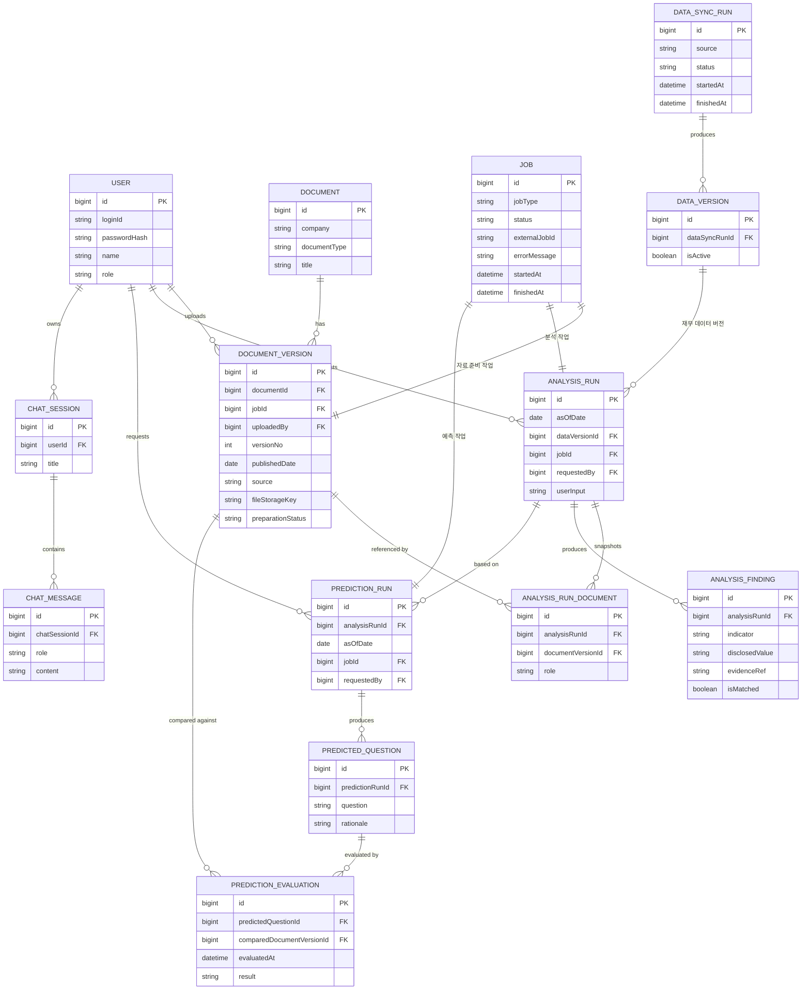

# ERD — 엔티티 정리 (초안)

> 확정 전 초안이며, 세부 필드는 Flyway 마이그레이션 작성 시 조정될 수 있다.
> 이 문서는 MySQL(backend가 쓰는 운영 데이터)만 다룬다. DuckDB(재무 수치)와 ChromaDB(문서 검색)는
> backend가 열지 않으며, 여기에는 "어느 버전을 썼는가" 같은 메타데이터만 남긴다.

## 1. 한눈에 보기

엔티티 14개, 도메인 7개.

| 도메인 | 엔티티 | 한 줄 역할 |
|---|---|---|
| user | `User` | 로그인 사용자와 역할(ADMIN/USER). 결과의 소유자 |
| document | `Document`, `DocumentVersion` | 문서(공시, IR, 리포트, 뉴스, 예산서)와 그 버전 |
| job | `Job` | 오래 걸리는 작업(자료 준비, 분석, 예측)의 상태. 폴링 대상 |
| datasync | `DataSyncRun`, `DataVersion` | 재무 데이터(DuckDB) 적재 이력과 데이터 버전 |
| analysis | `AnalysisRun`, `AnalysisRunDocument`, `AnalysisFinding` | 분석 실행, 사용 문서 스냅샷, 근거 점검 결과 |
| prediction | `PredictionRun`, `PredictedQuestion`, `PredictionEvaluation` | 애널리스트 질문 예측, 예측 결과, 사후 평가 |
| chat | `ChatSession`, `ChatMessage` | 대화와 메시지 |

MVP에서 제외한 것: 팀 단위 프로필(설정), 팀 개념(`Team`), 콜백(작업 상태는 폴링), 사내 SSO.

## 2. 관계도

> `Job`은 공통 테이블이지만 대상을 범용으로 가리키지 않는다. 자료 준비/분석/예측을 시작하는
> 쪽(`DocumentVersion`/`AnalysisRun`/`PredictionRun`)이 각자 `jobId` FK로 `Job`을 가리키는
> 일대일 관계로 통일했다. `jobType`은 조인용이 아니라 필터링·표시용 메타데이터로만 쓴다.



## 3. 전체 흐름

### 3.1 인증

1. 사용자가 `loginId`와 비밀번호로 로그인하면 서버가 JWT를 발급한다.
2. 이후 요청은 JWT로 사용자와 역할(`role`)을 판별한다. 권한은 서버가 강제한다.
3. 사내 SSO 연동은 MVP 이후 과제다.

### 3.2 자료 준비 (문서 업로드·수집)

1. 문서가 들어온다. 들어오는 경로는 두 가지다.
   - 관리자가 공용 문서(공시 등)를 수집한다. `uploadedBy`는 비어 있다.
   - 사용자가 예산서나 근거자료를 올린다. `uploadedBy`에 올린 사용자가 들어간다.
2. `Document`(없으면 새로)와 `DocumentVersion`(항상 새 row)을 만들고, `Job`을 만들어 `jobId`로 연결한다.
3. 원본 파일은 `FileStorage`에 저장하고, 반환된 key를 `fileStorageKey`에 넣는다.
4. backend가 `PythonAiClient`로 ai 서비스에 자료 준비(ingest)를 요청한다. ai가 파싱해 ChromaDB에 적재한다.
5. 클라이언트는 `GET /jobs/{id}`를 폴링한다. 성공하면 `preparationStatus`가 완료가 된다.
6. 준비가 끝나지 않은 문서 버전은 분석 허용 문서에 넣지 않는다.

### 3.3 재무 데이터 적재

1. Spring 스케줄러가 적재를 시작한다. 이미 실행 중인 적재가 있으면 건너뛴다(한 번에 한 건).
2. `DataSyncRun`을 만들고 ai 서비스에 적재를 요청한다. ai의 loader가 새 DuckDB 파일을 만들고 검증한 뒤 교체한다.
3. 성공하면 `DataVersion`을 새로 만들고 이전 버전의 `isActive`를 끈다. 이 전환은 한 트랜잭션에서 한다.
4. 호출 계약(loader 실행 방식, 결과 파일 경로·버전 id 수신 방식)은 ai 담당자와 아직 맞추지 않았다.

전체 그림은 아래와 같다. `DataSyncRun`은 작업 일지이고, `DataVersion`은 쓸 수 있는 "판"에 붙는 이름표다.

```
[스케줄러] ─ 정해진 시간에 ─→ ① DataSyncRun 생성 (상태: 실행 중)
                                  │
                                  ▼
                      ② ai의 loader가 새 DuckDB 파일 생성·검증
                                  │ 성공
                                  ▼
                      ③ DataVersion 생성 (isActive = true)
                         이전 DataVersion은 isActive = false
                                  │
        (이후 사용자가 분석 요청)
                                  ▼
                      ④ AnalysisRun 생성
                         dataVersionId = 그 시점에 활성인 DataVersion
```

- ①: 이미 실행 중인 적재가 있으면 새로 시작하지 않는다. 이 row는 DuckDB 데이터가 아니라 작업 이력이다.
- ②: backend는 DuckDB를 열지 않고 ai에 요청만 한다. 기존 파일을 건드리지 않고 새 파일을 만들어 검증한 뒤 교체한다.
- ③: 성공했을 때만 `DataVersion`이 생긴다. 실패하면 `DataSyncRun`에만 실패가 남고 이전 버전이 계속 활성이다.
- ④: 이후 새 적재가 돌아도 `AnalysisRun.dataVersionId`는 바뀌지 않는다. 분석 결과가 어느 판의 수치로 만들어졌는지 설명할 수 있게 하는 기록이다. 다만 그 번호의 DuckDB 파일을 지우면 번호만 남으므로, 옛 파일 보관은 6장의 미정 항목이다.

### 3.4 분석 (근거 점검)

분석 입력은 세 가지다: 예산서 파일, 근거자료 파일, 검토 기준에 대한 사용자 컨텍스트(`userInput`).

1. 사용자가 예산서(1개)와 근거자료를 올리고 `userInput`을 적어 분석을 요청한다. 위 3.2의 업로드 흐름이 먼저 돈다.
2. 서버가 `AnalysisRun`을 만든다. 이때 `requestedBy`, `asOfDate`, `userInput`, 그 시점에 활성인 `dataVersionId`를 고정한다.
3. 허용 문서를 정해 `AnalysisRunDocument`로 스냅샷한다. 업로드한 파일과 DuckDB/ChromaDB의 공용 공시를 함께 쓰며, 예산서는 `BUDGET`, 나머지는 `EVIDENCE`로 표시한다.
4. `Job`을 만들고 ai 서비스에 분석을 요청한다(202와 `jobId`). 허용 문서와 기준 시점은 서버가 강제로 주입한다.
5. ai가 숫자를 코드로 계산하고 공시와 대조해 결과를 돌려주면, 서버가 지표별로 `AnalysisFinding`을 저장한다.
6. 같은 조건으로 다시 분석하면 기존 결과를 고치지 않고 새 `AnalysisRun`을 만든다.

### 3.5 예측 (애널리스트 질문 예측)

1. 사용자가 완료된 `AnalysisRun`을 골라 예측을 요청한다.
2. 서버가 `PredictionRun`을 만든다. `asOfDate`(필수)와 `requestedBy`를 고정하고 `Job`을 연결한다.
3. ai는 기준 시점 이전에 발행된 자료만 사용한다. 이후 발행 문서는 서버가 허용 문서에서 제외한다. 결과가 비어도 전체 문서로 되돌아가지 않는다.
4. 결과로 `PredictedQuestion`(질문, 근거)이 여러 건 저장된다.

### 3.6 예측 평가

1. 기준 시점 이후에 새 리포트가 발행되어 `DocumentVersion`으로 들어온다.
2. 예측했던 `PredictedQuestion`과 그 리포트를 견주어 맞았는지 평가한다.
3. 결과를 `PredictionEvaluation`(`predictedQuestionId`, `comparedDocumentVersionId`, `evaluatedAt`, `result`)으로 새로 쌓는다. 다시 평가하면 새 row를 추가한다.

### 3.7 채팅

1. 사용자가 `ChatSession`을 만든다(소유자 `userId`).
2. 주고받은 질문과 답변을 `ChatMessage`(role: USER/ASSISTANT)로 쌓는다.
3. 응답 방식(일반 JSON vs SSE)은 아직 정해지지 않았다.

## 4. 엔티티별 스키마

> 타입은 개념 타입이다. 제약(NOT NULL, 유니크, 인덱스)은 Flyway 작성 때 정하며, 정해진 것만 적었다.
> 모든 엔티티는 `BaseTimeEntity`(`createdAt`, `updatedAt`)를 상속한다.

### 4.1 user

**User** — 로그인 사용자

| 필드 | 타입 | 설명 |
|---|---|---|
| `id` | bigint PK | |
| `loginId` | string | 로그인 식별자 |
| `passwordHash` | string | 비밀번호 해시. 원문은 저장하지 않는다 |
| `name` | string | 이름 |
| `role` | string | `ADMIN` / `USER` |

- `ADMIN`만 공용 문서(공시 등)를 수집·삭제할 수 있다.
- 소유자 FK로 참조된다: `DocumentVersion.uploadedBy`, `AnalysisRun.requestedBy`, `PredictionRun.requestedBy`, `ChatSession.userId`.

### 4.2 document

**Document** — 문서 한 건(버전과 무관한 정체성)

| 필드 | 타입 | 설명 |
|---|---|---|
| `id` | bigint PK | |
| `company` | string | 기업 |
| `documentType` | string | 공시 / IR / 리포트 / 뉴스 / 예산서 |
| `title` | string | 제목 |

**DocumentVersion** — 문서의 버전. 실제 파일과 발행 정보를 가진다

| 필드 | 타입 | 설명 |
|---|---|---|
| `id` | bigint PK | |
| `documentId` | bigint FK | 어느 `Document`의 버전인지 |
| `jobId` | bigint FK | 자료 준비 작업(`Job`). 1 : 1 |
| `uploadedBy` | bigint FK | 일회성 업로드의 소유자. 수집된 공용 문서는 비어 있다 |
| `versionNo` | int | 버전 번호 |
| `publishedDate` | date | 발행일. 모든 문서는 발행일과 출처를 가진다 |
| `source` | string | 출처 |
| `fileStorageKey` | string | `FileStorage`가 반환한 key |
| `preparationStatus` | string | PENDING / 준비중 / 완료 |

- 불변이다. 새 버전은 새 row로 추가하고, 기존 row는 고치지 않는다.
- 예산서와 근거자료를 사용자가 올리면 여기에 저장된다(`uploadedBy` 있음).

### 4.3 job

**Job** — 비동기 작업 공통 테이블. 클라이언트가 `GET /jobs/{id}`로 폴링한다

| 필드 | 타입 | 설명 |
|---|---|---|
| `id` | bigint PK | |
| `jobType` | string | `DOCUMENT_PREPARATION` / `ANALYSIS` / `PREDICTION`. 필터링·표시용 |
| `status` | string | `QUEUED → RUNNING → SUCCEEDED/FAILED`. 역방향 전이 금지 |
| `externalJobId` | string | ai 서비스가 발급한 jobId. `PythonAiClient.JobStartResponse.jobId`와 매핑 |
| `errorMessage` | string | 실패 사유 |
| `startedAt` | datetime | 시작 시각 |
| `finishedAt` | datetime | 종료 시각 |

- `Job`은 대상을 가리키지 않는다. `DocumentVersion`/`AnalysisRun`/`PredictionRun`이 각자 `jobId` FK로 `Job`을 가리킨다(1 : 1).
- 재무 데이터 적재의 상태는 `DataSyncRun`이 따로 가진다.

### 4.4 datasync

**DataSyncRun** — 재무 데이터 적재 실행 1회의 이력

| 필드 | 타입 | 설명 |
|---|---|---|
| `id` | bigint PK | |
| `source` | string | 적재 원천 |
| `status` | string | 실행 상태 |
| `startedAt` | datetime | 시작 시각 |
| `finishedAt` | datetime | 종료 시각 |

**DataVersion** — 적재 결과로 생긴 데이터 버전

| 필드 | 타입 | 설명 |
|---|---|---|
| `id` | bigint PK | |
| `dataSyncRunId` | bigint FK | 이 버전을 만든 적재 실행 |
| `isActive` | boolean | 현재 활성 여부 |

- 적재 결과 하나가 데이터 버전 하나다. 활성 여부는 바뀌지만 row 자체가 그 버전의 식별자라서 `AnalysisRun.dataVersionId`가 가리킨다.
- DuckDB 파일은 backend가 열지 않는다. "어떤 버전이 활성인지"만 MySQL 메타데이터로 보관한다.

### 4.5 analysis

**AnalysisRun** — 분석 실행 1회. 결과와 함께 고정되어 수정하지 않는다

| 필드 | 타입 | 설명 |
|---|---|---|
| `id` | bigint PK | |
| `asOfDate` | date | 기준 시점 |
| `dataVersionId` | bigint FK | 분석 시점에 사용한 재무 데이터(DuckDB) 버전 |
| `jobId` | bigint FK | 분석 작업(`Job`). 1 : 1 |
| `requestedBy` | bigint FK | 요청한 사용자. 이 사용자만 결과를 조회한다 |
| `userInput` | string | 검토 기준에 대한 사용자 컨텍스트. 요청할 때마다 입력한다 |

**AnalysisRunDocument** — 분석에 사용한 문서의 스냅샷(`AnalysisRun` ↔ `DocumentVersion` 다대다 연결)

| 필드 | 타입 | 설명 |
|---|---|---|
| `id` | bigint PK | |
| `analysisRunId` | bigint FK | |
| `documentVersionId` | bigint FK | |
| `role` | string | 이번 분석에서 맡은 역할. 현재 `BUDGET`(점검 대상 예산서) / `EVIDENCE`(근거자료). 이후 늘 수 있도록 열어 둔다 |

- 분석 1건에 `BUDGET`은 반드시 1개다. 서버가 분석 시작 때 검증한다.
- 근거는 두 곳에서 온다: 사용자가 올린 파일(`uploadedBy` 있음)과 공용 공시(`uploadedBy` 없음). 둘 다 여기에 들어간다.
- 분석을 시작할 때 허용 문서를 고정하므로, 이후 문서가 추가되어도 이 분석의 범위는 바뀌지 않는다.

**AnalysisFinding** — 근거 점검 결과 한 줄(분석 1건에서 여러 건)

| 필드 | 타입 | 설명 |
|---|---|---|
| `id` | bigint PK | |
| `analysisRunId` | bigint FK | |
| `indicator` | string | 점검한 지표명 |
| `disclosedValue` | string | 공시에 나온 값 |
| `evidenceRef` | string | 근거 문서와 위치를 가리키는 참조. FK가 아니다 |
| `isMatched` | boolean | 일치 여부 |

- 숫자는 코드로 계산해 공시와 대조한다. LLM 응답을 그대로 신뢰하지 않는다.
- 수정하지 않고 새로 쌓는다. `PredictionRun`이 이 결과를 재료로 쓴다.

### 4.6 prediction

**PredictionRun** — 질문 예측 실행 1회

| 필드 | 타입 | 설명 |
|---|---|---|
| `id` | bigint PK | |
| `analysisRunId` | bigint FK | 어느 분석을 바탕으로 했는지 |
| `asOfDate` | date | 기준 시점. 필수 |
| `jobId` | bigint FK | 예측 작업(`Job`). 1 : 1 |
| `requestedBy` | bigint FK | 요청한 사용자. 이 사용자만 결과를 조회한다 |

**PredictedQuestion** — 애널리스트가 던질 것으로 예측한 질문

| 필드 | 타입 | 설명 |
|---|---|---|
| `id` | bigint PK | |
| `predictionRunId` | bigint FK | |
| `question` | string | 예측한 질문 |
| `rationale` | string | 그렇게 예측한 근거 |

**PredictionEvaluation** — 예측이 맞았는지 사후 평가

| 필드 | 타입 | 설명 |
|---|---|---|
| `id` | bigint PK | |
| `predictedQuestionId` | bigint FK | 평가 대상 질문 |
| `comparedDocumentVersionId` | bigint FK | 견준 대상. 이후 발행된 리포트 |
| `evaluatedAt` | datetime | 평가 시점 |
| `result` | string | 적중 여부 |

- 평가는 `prediction`의 결과를 다루므로 별도 패키지 대신 `prediction`에 포함한다.
- 수정하지 않고 새로 쌓는다.

### 4.7 chat

**ChatSession** — 대화

| 필드 | 타입 | 설명 |
|---|---|---|
| `id` | bigint PK | |
| `userId` | bigint FK | 소유자 |
| `title` | string | 제목 |

**ChatMessage** — 대화 안의 메시지

| 필드 | 타입 | 설명 |
|---|---|---|
| `id` | bigint PK | |
| `chatSessionId` | bigint FK | |
| `role` | string | `USER` / `ASSISTANT` |
| `content` | string | 내용 |

## 5. 공통 규칙

- 문서 버전, 분석·예측·평가 결과는 수정하지 않고 새로 쌓는다.
- 분석·예측 결과(`AnalysisRun`, `PredictionRun`과 그 하위 결과)는 요청한 본인만 조회한다. `requestedBy`로 서버가 강제한다.
- 예측과 평가는 `asOfDate`가 필수이고, 기준 시점 이후에 발행된 문서는 서버가 허용 문서에서 제외한다.
- 허용 문서 범위와 기준 시점 필터는 서버가 강제한다. 필터 결과가 비어도 전체 문서로 되돌아가지 않는다.
- 모든 문서는 발행일(`publishedDate`)과 출처(`source`)를 가진다.
- 저장소 경계: MySQL은 backend만 쓰고, DuckDB는 loader 배치만, ChromaDB는 자료 준비(ingest)만 쓴다. backend는 DuckDB·ChromaDB를 열지 않는다.
- 모든 엔티티는 `BaseTimeEntity`(`createdAt`, `updatedAt`)를 상속한다 (이슈 #8 완료 후 반영).

## 6. 아직 정해지지 않은 것

| 항목 | 내용 |
|---|---|
| 문서 보관·삭제 정책 | 공용 문서와 일회성 업로드 문서(예산서, 근거자료)의 보관 기간, 삭제 범위, 삭제된 문서를 참조하는 결과의 처리, 지난 `DataVersion` 파일의 보관 |
| 일회성 업로드 문서의 접근 범위 | 올린 사용자만 볼지 여부 |
| loader 호출 계약 | 적재 실행 방식, 결과 파일 경로·버전 id 수신 방식. `PythonAiClient`에 적재 메서드가 없다 |
| `DataSyncRun`과 `DataVersion`의 관계 수 | 지금은 1 : N으로 그렸다. 적재 한 번이 여러 버전을 만들지 않는다면 1 : 1이 된다. ai 담당자와 확인이 필요하다 |
| 분석이 읽을 데이터 버전 전달 | `dataVersionId`를 ai 서비스가 실제로 읽도록 하는 방법 |
| 예산서 1개 보장 방식 | 지금은 `role` 값을 서버가 검증한다. `AnalysisRun`에 FK로 둘지는 미정 |
| `AnalysisRunDocument` 유니크 제약 | `(analysisRunId, documentVersionId)` 중복 방지 여부 |
| `AnalysisFinding` | 예산서가 주장한 값을 담을 필드가 없다. `evidenceRef` 형식을 ai 담당자와 정해야 한다 |
| `PredictionRun` | 사용자 입력(`userInput`) 필요 여부, `asOfDate`가 분석의 `asOfDate`와 같아야 하는지 |
| 채팅 응답 방식 | 일반 JSON vs SSE |
| ai 서비스의 작업 상태 저장 위치 | |
