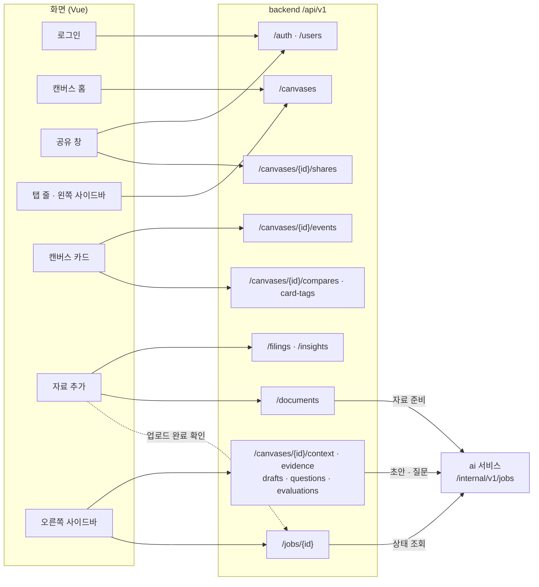
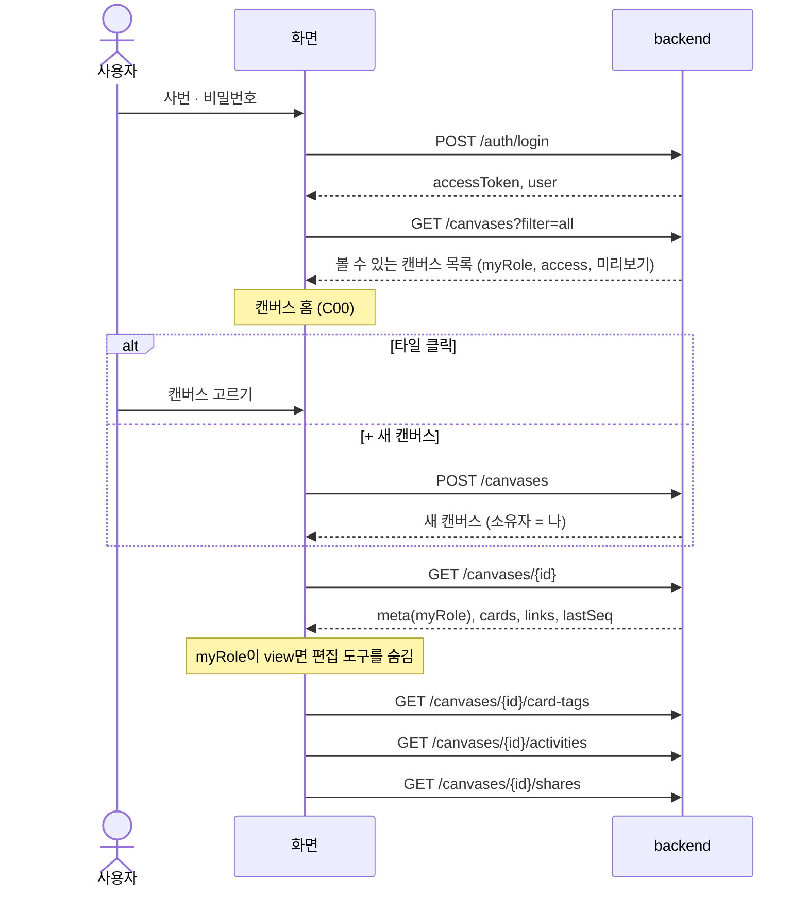
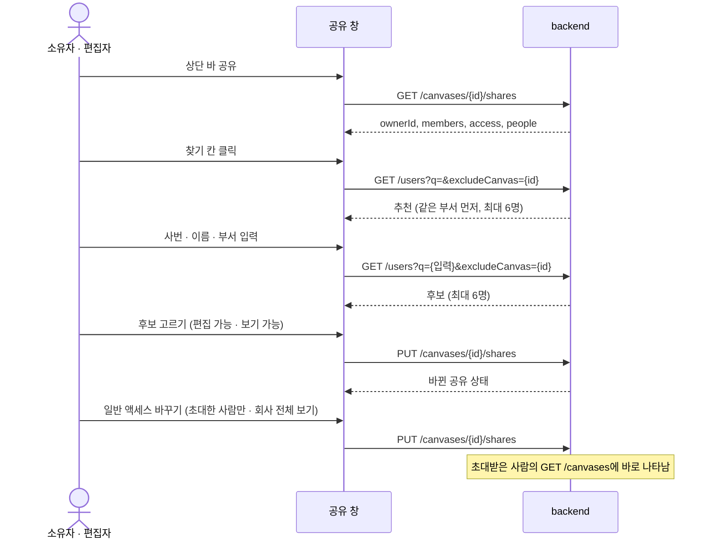
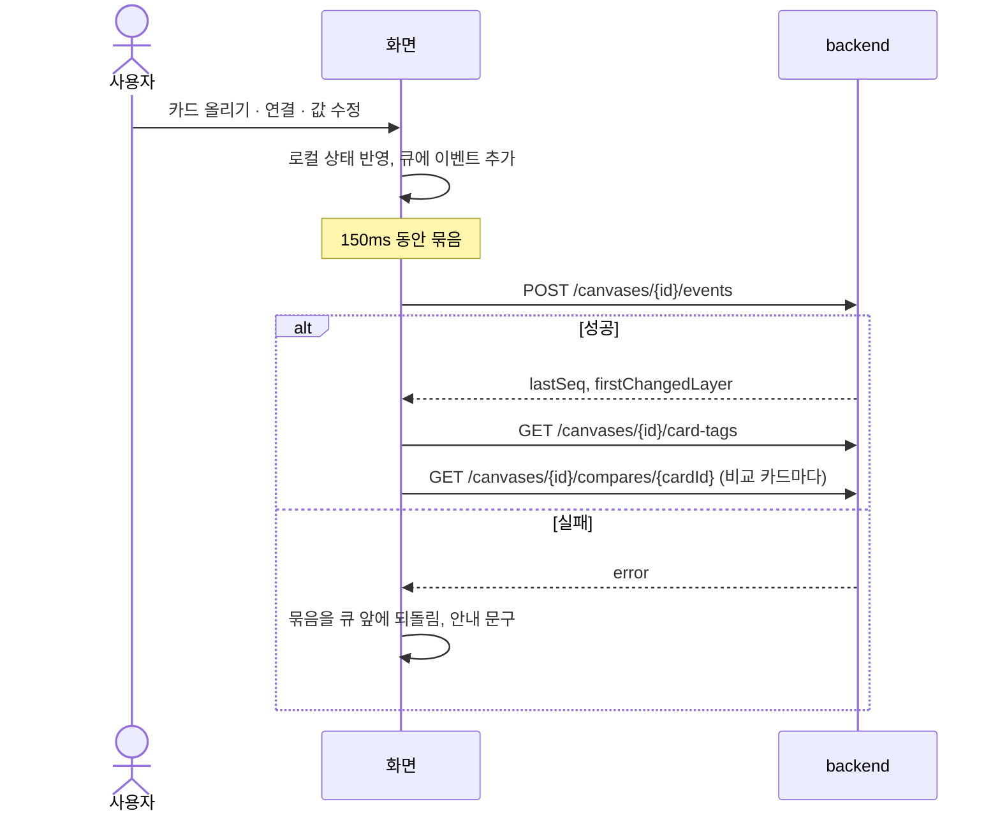
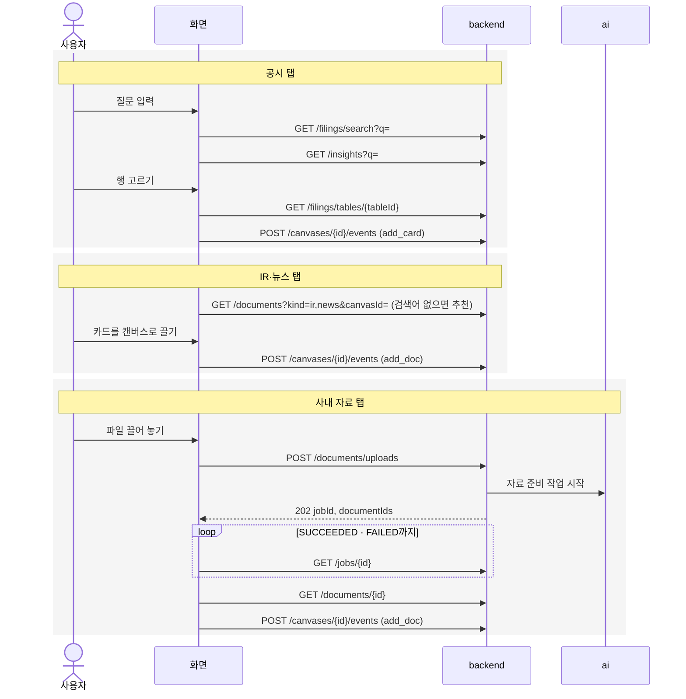
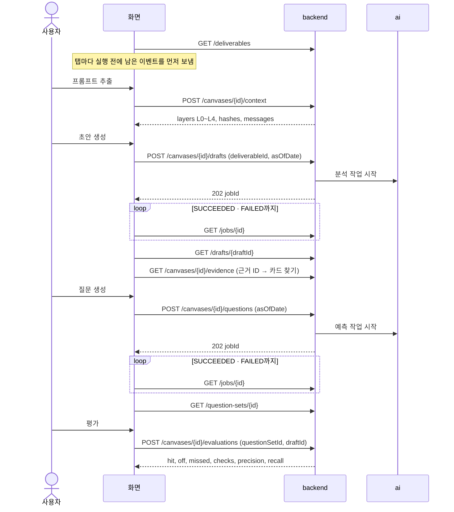
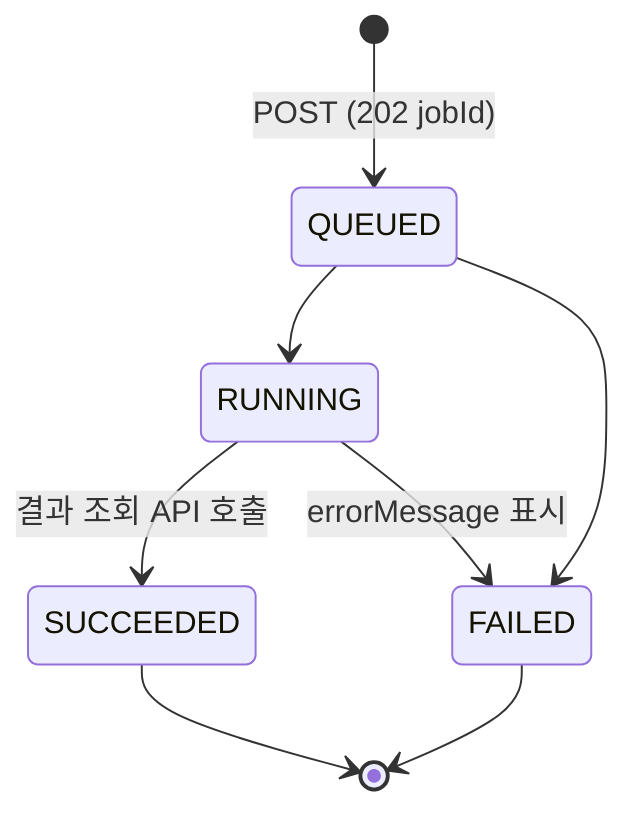

# 프런트엔드 API 다이어그램

[API 명세](api-spec.md)의 호출 흐름을 그림으로 정리했다. 경로와 흐름은 명세와 마찬가지로 제안이다. GitHub에서 Mermaid로 그려진다.

## 1. 화면과 API

## 2. 로그인, 캔버스 홈, 캔버스 열기

## 2-1. 공유 (C13)

## 3. 카드 조작 (이벤트 묶음 전송)

화면은 로컬 상태를 먼저 바꾸고, 150ms 동안 모은 이벤트를 한 번에 보낸다.

## 4. 자료 추가

## 5. 프롬프트 · 초안 · 질문 · 평가

## 6. 작업 상태 (job)

`docs/backend/job.md`의 상태 값을 따른다.

