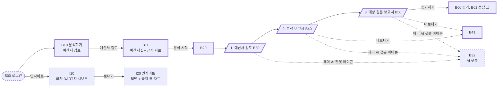
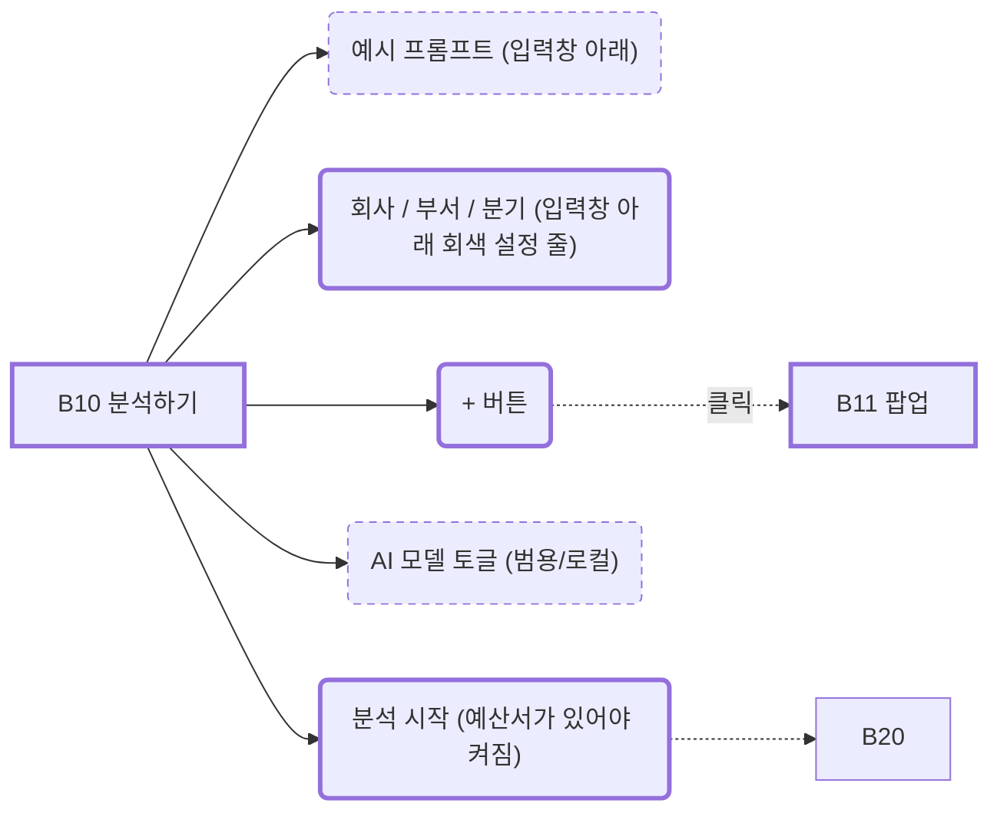
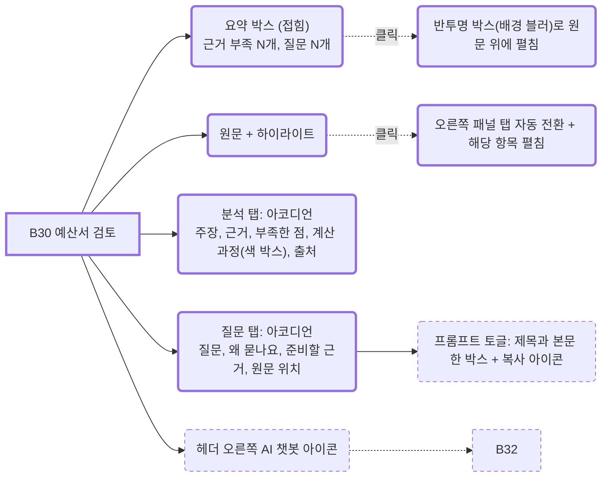
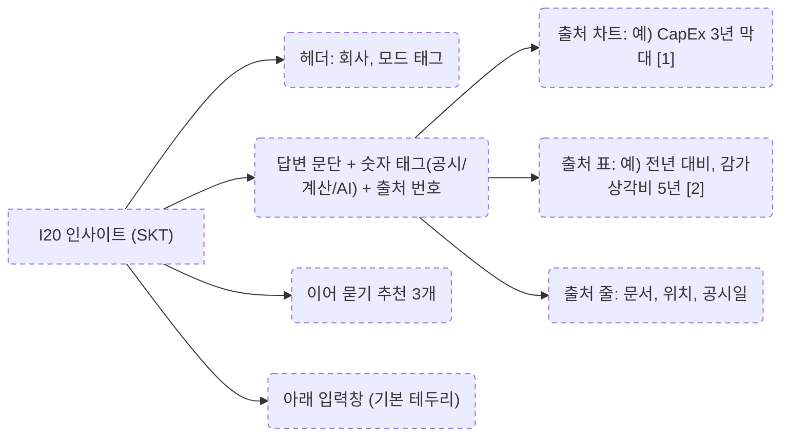
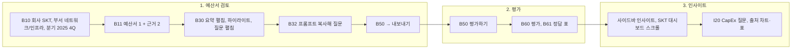

# Telescope IA (Information Architecture)

> 서비스의 화면 구조, 화면마다 할 수 있는 일, 화면 사이 이동을 정리해요.
> 화면 ID는 Figma 프레임 이름, 데모 화면, Vue route name을 잇는 공통 키예요.
> 함께 보는 문서: [departments.md](departments.md) (부서별 검토 포인트), [index.html](index.html) (HTML 데모, 해시 라우트가 화면 ID).

## 0. README ↔ 화면 ↔ 요구 수준

| README | 화면 | 수준 |
|---|---|---|
| 4장 자료 분석 화면 (주장과 근거, 숫자 → 계산 과정과 출처) | B30 원문 + `분석` 탭, B40 | **must** |
| 4장 예상 질문 리포트 | B30 `질문` 탭, B50 | **must** |
| 4장 평가 결과 (맞힌 것, 놓친 것, 빗나간 것) | B60, B61 | **must** |
| 3장 자료 파싱과 근거 점검 | B11, B30 하이라이트 | **must** |
| 3장 예측 평가 (기준 시점 이전 자료로만) | B60 | **must** |
| 3장 주제 불일치 알림, 기준 시점 이후 자료 경고 | B11-w (첨부 팝업 안 자료 점검 경고) | **must** |
| 6장 공시, 계산, AI 구분과 기준 시점 | 모든 숫자 | **must** |
| 3장 범용 설정 6항목 | 1장 표의 위치 | **should** (구현되는 데까지) |
| 인사이트 Agent, AI 챗봇 | I10, I20, B32 | 추가 |
| 로그인 | S00 | 추가 |

## 1. 범용 설정 (should): 어디서 바꾸나

검토 기준은 항상 애널리스트 관점이에요. 초기 설정은 B10의 회사, 부서, 분기 3개뿐이고, 나머지 범용 설정은 아래 위치에 흩어 둬요.

| README 항목 | 화면 위치 | 동작 |
|---|---|---|
| 입력 자료 종류 | B11 | 영역마다 받는 형식을 정해 둠. 예산서 PDF, HTML / 근거 자료 PDF, HTML, XLSX, CSV. 형식별로 파서를 고름 |
| 추출 항목 | B41 | 내보낼 분석 항목과 질문을 체크해서 고름 |
| 출력 양식 | B41 | Markdown, PDF |
| 검토 기준 | B10 `부서` 토글 | 애널리스트 고정 + 부서 집중 포인트 ([departments.md](departments.md) 2장) |
| 프롬프트 | B30 질문 항목 안 `프롬프트` 토글 | 질문마다 추가 조사용 프롬프트를 미리 써 둠. 제목과 본문이 한 박스에 있고, 복사 아이콘으로 복사해 챗봇이나 인사이트에 붙여 넣음 |
| AI 모델 | B10 입력창, 분석 시작 왼쪽 | `AI 모델` 토글(회사/부서/분기와 같은 칩). 누르면 범용 LLM / 로컬 LLM 목록이 펼쳐져요. 인사이트 Agent에는 없음 |

## 2. 전체 구조

서비스는 두 Agent로 나뉘어요.

- **① 분석 Agent (B):** 예산서 하나와 근거 자료를 올리면 예산서 검토 → 분석 보고서 → 예상 질문 보고서 → 예측 평가로 이어져요.
- **② 인사이트 Agent (I):** 회사의 DART 적재 데이터 대시보드를 보고, 숫자에 대해 질의응답해요.



## 3. 공통 셸

```
Telescope (로고)            → B10 (홈, 분석하기와 같음)
[분석하기]                 → B10 (분석 Agent)
[인사이트]                 → I10 (인사이트 Agent)
분석 단계 (예산서 검토 세션을 열었을 때만)
  1 예산서 검토              → B30
  2 분석 보고서              → B40
  3 예상 질문 보고서         → B50 (맨 아래 평가하기 → B60)
분석 세션                   → 예산서 검토 세션 목록. 누르면 B30
대화 세션 (점)              → 인사이트 대화 기록만. 누르면 그 대화(I20)
사용자 카드 + 역할 태그
```

- **메뉴:** `분석하기`, `인사이트`는 아이콘 + 글자 메뉴 줄이에요(버튼 모양 아님). 지금 화면의 메뉴만 연회색 배경이에요. 입력창에는 Agent 전환 버튼이 없어요.
- **분석 단계:** 단계 색은 대기 회색, 진행 중 파랑, 완료 진한 색이에요. 완료된 단계만 눌러 이동해요. 평가는 단계에 없고 B50 맨 아래 `평가하기`로 들어가요. B60, B61에서는 3단계가 활성으로 보여요.
- **최근 목록:** `분석 세션`(분석 Agent), `대화 세션`(인사이트 Agent)으로 나눠요. "검토", "분석 중" 같은 보조 글자는 없어요. 대화 세션에는 실제 대화 기록만 넣어요(샘플: `SKT CapEx가 줄어든 이유`). 대시보드 바로가기는 넣지 않아요.
- **헤더(B30~B61):** 왼쪽 제목 `SKT 2025 4Q 예산서`. 오른쪽 태그 `회사 SKT` `부서 네트워크/인프라` `분기 2025 4Q` `기준 시점 2026-03-17`, 맨 오른쪽 AI 챗봇 아이콘. 보고서의 `내보내기`는 헤더가 아니라 제목 아래 작성 일자 줄에 있어요.
- **색:** 테두리는 모두 기본 회색이에요. 입력창 테두리도 두 Agent 모두 회색이에요. 포인트 보라는 대화 세션 점과 I20 모드 태그에만 써요.
- **팝업 공통:** 팝업이 뜨면 팝업을 뺀 나머지 화면(사이드바, 헤더, 채팅 포함)을 검정 50% 덮개로 어둡게 해요(B11, B41).

## 4. 화면별 상세

### 4-1. B10 분석하기



B10은 화면 가운데에 인사 문구 → 입력창 → 입력창 아래에 붙은 연회색 받침(설정 줄: 회사, 부서, 분기를 테두리 없는 글자 선택으로) → 예시 프롬프트. 색은 넣지 않아요.
입력창 아랫줄: 왼쪽 `+`, 오른쪽 `AI 모델 토글` `분석 시작`.

| 상태 | 프레임 | 무엇이 다름 |
|---|---|---|
| 예산서 검토 | B10 | 기본 테두리, 문구 `어떤 예산서를 검토할까요?`, `+`, 토글 회사/부서/분기, AI 모델 토글 |
| 자료 첨부 팝업 | B11 | 가운데 팝업. 왼쪽 `예산서` 영역(1개만, PDF, HTML, 다른 파일을 끌어 놓거나 `바꾸기`로 교체), 오른쪽 `근거 자료` 영역(여러 개, PDF, HTML, XLSX, CSV, ×로 빼기). 두 영역 모두 클릭 또는 끌어 놓기. 아래 `취소` `첨부` |
| 자료 점검 경고 | B11-w | 아래 4-1-1 |

- 토글은 누르면 아래로 목록이 펼쳐지는 선택 칩이에요. 회사 SKT, KT, LG유플러스 / 부서 8개([departments.md](departments.md)) / 분기 2025 1Q~4Q.
- 예산서는 하나뿐이라 B30 헤더에 예산서 선택 목록이 없어요.

#### 4-1-1. B11-w 자료 점검 경고 (must)

파일을 넣는 순간 점검해요. 문제가 있으면 팝업 위 경고 띠(`확인이 필요한 자료가 N개 있어요`)와 해당 파일 줄에 사유, `빼기` / `그대로 두기`를 보여 줘요. 경고 색은 주의 노랑(근거 부족 빨강과 구분).

| 사유 | 조건 | 문구 | 버튼 |
|---|---|---|---|
| 회사 불일치 | 파일 회사 ≠ 설정 줄 회사 | 회사가 달라요. KT 자료예요 (선택한 회사 SKT) | 빼기 / 그대로 두기 |
| 기준 시점 이후 | 공시·작성일 > 기준 시점(2026-03-17) | 기준 시점(2026-03-17) 이후 자료예요. 예측 평가가 공정하지 않아요 | 빼기 / 그대로 두기 |
| 형식 불일치 | 예산서 영역에 PDF·HTML 외 | 예산서는 PDF, HTML만 받아요 | 빼기 |

- `그대로 두기`: 경고가 접히고 파일 줄에 `경고 확인함`. B10 입력창 파일 칩에 경고 아이콘이 남아요.
- 확인하지 않은 경고가 하나라도 있으면 `첨부`가 꺼지고 `경고를 먼저 확인해 주세요`가 보여요.
- 데모는 파일명으로 판단해요(`KT_`, `LG`, `2026_1Q` 등). 실제는 파싱한 회사명과 공시일로 판단해요.

### 4-2. B30 예산서 검토



- **요약:** 접힌 상태도 펼쳤을 때와 같은 디자인의 한 줄 `요약  근거 부족 2개 질문 2개  펼치기`. 누르면 반투명 박스(박스 뒤만 블러)가 원문 위에 겹쳐 열려요. 원문을 아래로 밀지 않아요(B31 프레임). 주장 줄을 누르면 해당 하이라이트로 가요.
- **원문:** 사업보고서는 절 제목과 표를 원문 순서대로, IR은 쪽 단위로 보여 줘요. 쪽마다 위에 절 경로와 `214쪽 중 61쪽`. 자르거나 다시 쓰지 않아요. 원문 배경은 연회색 `#F2F2F3`, 원문 카드는 흰색 단색(그라데이션 없음)이에요.
- **하이라이트:** 평소 점선 밑줄(빨강 근거 부족, 노랑 질문), 누르면 같은 계열 배경. 색만으로 구분하지 않도록 끝에 글자 표식(`근거`, `질문`). 빨강을 누르면 `분석` 탭, 노랑을 누르면 `질문` 탭의 해당 항목이 펼쳐져요.
- **오른쪽 탭 `분석 / 질문`:** 항목 줄을 누르면 그 줄 바로 아래로 내용이 열리는 아코디언이에요. 줄 끝 화살표가 돌아가고, 카드 테두리나 그림자는 없어요. 한 번에 하나만 열려요.
  - 분석: ① 주장(인용 + 원문 위치) ② 근거(값 + 공시/계산/AI 태그, 없으면 `예산서에 제시된 근거가 없어요`) ③ 부족한 점 ④ 계산 과정 ⑤ 출처.
  - 질문: 질문, 왜 묻나요, 미리 준비할 근거, 원문 위치, `프롬프트` 토글.
- **계산 과정:** 큰 숫자와 식을 테두리 없는 연한 회색 박스 안에 넣어요.

### 4-3. AI 챗봇 (B32, 보고서·평가 화면)

- 헤더 오른쪽 끝 AI 챗봇 아이콘으로 열어요(팝업 아님). 텍스트 위주 질의응답만 해요. 차트나 기업 시각화는 없어요.
- **B32:** 오른쪽 분석/질문 패널이 위아래로 나뉘어 아래 절반(높이 418)에 채팅이 열려요. 위 절반은 분석/질문 그대로.
- **B40, B50, B60, B61(, B41):** 오른쪽 채팅 사이드바(폭 400)가 열려요. Figma는 열린 상태로 그렸어요. 본문과 목차는 왼쪽으로 줄어요(본문 폭 760~816).
- 열린 동안 아이콘은 눌린 상태. 닫기는 채팅 오른쪽 위 X, 아이콘 다시 누르기, 또는 Esc.
- 창 제목 줄: AI 로고 + `AI 챗봇`. 내용은 대화 말풍선(답변에는 출처 글자), 아래 입력창.
- 대화(질문, 답변, 출처)는 입력창 바로 위로 아래 정렬돼요. 내가 보낸 말풍선은 회색, 글자 길이에 맞춘 폭이에요. 질문 탭 프롬프트는 복사 아이콘으로 복사해 붙여 넣어요.

### 4-4. B40 분석 보고서, B50 예상 질문 보고서

왼쪽 고정 목차 + 본문 폭을 제한한 보고서 레이아웃이에요. 상자나 카드를 쓰지 않아요.

- 제목 바로 아래 줄에 `작성 일자: 2026-03-20`(왼쪽)과 `내보내기`(오른쪽). 제목과 이 줄은 본문을 스크롤해도 위에 고정돼요. `내보내기`를 누르면 B41.
- 헤더 AI 챗봇 아이콘으로 오른쪽 채팅 사이드바를 열어요.

```
B40 분석 보고서
1. 총평 (문단)
2. 점검 항목별 검토
   2.1 투자 효과 (CapEx)
   2.2 전년 대비 증감
   2.3 재무 영향 (감가상각)
       주장 / 받쳐 준 근거 / 판정 / 부족한 근거 / 원문 위치
3. 보완하면 좋을 근거 (목록)
출처

B50 예상 질문 보고서
(총평 문단: 질문 N개)
1. 투자 효과 (CapEx)
   Q1. 질문 문장
       왜 묻나요 / 원문 위치 / 미리 준비할 근거
2. 재무 영향 (감가상각)
[평가하기] → B60
```

- 원문 위치를 누르면 B30의 해당 하이라이트로 가요.
- B50 질문 순서는 점검 항목 순서, 항목 안에서는 중요도 순서예요. 중요도는 `높음`, `보통` 글자로만 표시해요.

### 4-5. B41 내보내기 팝업

```
내보내기
  내보낼 항목                    [모두 선택]
    분석   ☑ 1. 5G 투자 안정화로 효율적 집행
           ☑ 2. 감가상각비 점진 감소
           ☐ 3. 네트워크 운영비 절감
    질문   ☑ Q1. AI 인프라 투자 규모
           ☑ Q2. CapEx 2년 연속 감소와 5G 품질
           ...
  형식   (•) Markdown  ( ) PDF
                                  [취소] [내보내기]
```

### 4-6. B60 예측 평가, B61 정답 표

예상 질문을 다음 분기에 나온 애널리스트 리포트와 견줘요. B50의 `평가하기`로 들어와요. 탭은 두지 않고, 제목 줄 오른쪽 버튼으로 오가요. 제목 줄은 B40처럼 스크롤해도 고정돼요.

| 화면 | 제목 줄 버튼 | 본문 |
|---|---|---|
| B60 | `정답 표 확인하기` → B61 | 1. 총평 / 2. 질문별 판정 / 3. 놓친 쟁점 / 4. 근거 부족 추적 |
| B61 | `예측 평가 보기` → B60 (추가), `쟁점 추가` | 판정 기준(`기준 고치기`) / 리포트 쟁점 |

| 항목 | 내용 |
|---|---|
| 총평 | 숫자 상자가 아니라 문장. 기준 시점, 비교한 리포트, 결과 |
| 질문별 판정 | **맞힘**: 같은 쟁점 / **부분**: 쟁점은 같고 초점이 다름 / **빗나감**: 예측했지만 리포트가 다루지 않음. 판정 이유, 판정자(AI 1차, 평가 담당자 확정) |
| 놓친 쟁점 | **놓침**: 리포트의 쟁점인데 예측에 없음. 왜 놓쳤는지 |
| 근거 부족 추적 | B30 빨강 하이라이트가 다음 분기 IR, 사업보고서에서 보완됐는지: `보완됨`, `여전히 없음`, `확인 불가` |
| 리포트 쟁점 (B61) | 리포트별(증권사, 발행일, 출처 링크) 쟁점 요약과 대응 질문. 원문은 저장하지 않아요 |
| 결과 지표 | 정밀도 = (맞힘 + 부분 × 0.5) ÷ 예상 질문 수, 재현율 = 잡은 쟁점 ÷ 리포트 쟁점 수 |

### 4-7. I10 인사이트 대시보드

회사(MVP는 SKT)의 DART 적재 데이터 대시보드를 위아래로 스크롤해서 봐요. 입력창은 한 줄 높이로 화면 아래에 고정되고(뒤는 흰색으로 흐려짐), 안 왼쪽에 회사 칩, 오른쪽에 보내기가 있어요. `+`, AI 모델 토글, 예시 질문은 없어요.

**기준 표기 (화면에 "연결 / 별도"는 쓰지 않음)**

| 태그 | 뜻 | 공시 용어 |
|---|---|---|
| `SKB 포함` | SKT와 SK브로드밴드 등 자회사를 합친 회사 전체 수치 | 연결 |
| `SKT 단독` | SKT 법인만의 수치 | 별도 |
| `SKT+SKB 합산` | SKT 단독 + SKB를 더한 값. CapEx 비교에 씀 (12,440 + 8,854 = 21,294) | 동등 비교 |
| `각 사 자회사 포함` | 동종사(KT, LGU+)의 회사 전체 수치 | 연결 |

**상단 컨트롤 (헤더, 스크롤해도 고정):** 첫 줄에 회사명과 기준 토글(`SKB 포함` / `SKT 단독`), 기간 토글(연간 / 분기), 둘째 줄에 보기 탭 6개, 아래 구분선. 차트마다 제목 옆 기준 태그와 `질문하기`(차트 맥락을 입력창에 넣음).

| 탭 | 프레임 | 시각화 |
|---|---|---|
| 한눈에 | I10 | 주요 지표 6개(값, 전년 대비, 5년 추이선) / 영업이익 증감 요인 (2024–2025) / 영업이익률·부채비율 3사 비교 (2025) / 현금 증감 내역 (2025) / CapEx/감가상각비 비율 / 주요 지표 전년 대비 증감 (2021–2025) |
| 손익 | I11 | 매출 / 영업이익 / 영업이익률 / 영업비용 구성비 (2021–2025) / 영업비용 구성 (2025) / 손익계산서 (2021–2025) |
| 재무상태 | I12 | 부채·자본 (2021–2025) / 부채비율 / 유동자산·유동부채 / 유형자산·무형자산·현금 / 재무상태표 (2021–2025) |
| 현금흐름 | I13 | 활동별 현금흐름 / 잉여현금흐름 / 현금및현금성자산 / 배당·자사주 / 현금흐름표 (2021–2025) |
| 설비투자 | I14 | CapEx (SKT·SKB) / CapEx·유형자산 감가상각비 / CapEx/감가상각비 비율 / 누적 CapEx 3사 비교 / CapEx (2021–2025) |
| 동종사 비교 | I15 | 매출 지수 3사 비교 (2021=100) / 영업이익률 3사 비교 (2025) / 부채비율 3사 비교 / CapEx 3사 비교 / 주요 지표 3사 비교 (2025) |

- 차트 제목은 문장이 아니라 지표 이름(명사)으로 써요. 기간은 괄호로 붙여요.
- 색은 무채색 + SKT 강조만. 증감은 ▲▼와 부호로 보여요.
- 숫자는 DART 공시값이에요(데모는 `demo/data/financials.json`, 분기·배당은 DuckDB 적재값).

### 4-8. I20 인사이트 답변

대화가 중심이고, 답에 쓴 숫자의 출처를 답 바로 아래에 보여 줘요. 오른쪽 레퍼런스 패널은 없어요.



- 첨부와 AI 모델 선택은 없어요.
- 차트와 표의 값은 DART 공시의 실제 값이에요.

## 5. 값 표시 규칙

| 규칙 | 표시 |
|---|---|
| 값 유형 | 숫자마다 공시, 계산, AI 태그 |
| 기준 시점 | 숫자마다 기준일 |
| 근거 상태 | 하이라이트 점선 색 + 글자 표식 |
| 리포트 | 원문 대신 쟁점 요약과 출처 링크만 |

## 6. 데모 시나리오



- 데모: [index.html](index.html). 브라우저에서 바로 열려요. 로그인부터 시작하고, `#b10` 같은 해시로 화면에 바로 갈 수 있어요.
- 샘플 값: 대시보드와 출처 차트의 숫자는 DART 실제 공시값이에요. 원문 문장, 질문, 판정, 리포트 쟁점, 챗봇과 I20 답변 문장은 샘플이에요.

## 7. 화면 목록

**ID 규칙:** Agent 접두어 + 흐름 순서 번호. `B` = 분석 Agent(예산서 검토, Budget), `I` = 인사이트 Agent(Insight), `S00` = 공통. 10 단위가 단계, 1 단위가 같은 단계 안의 상태·팝업·탭이에요. 이 ID를 Figma 프레임, 데모 해시, Vue route name에 같이 써요.

| ID | Agent | 화면 | 요구사항 | Figma node |
|---|---|---|---|---|
| S00 | 공통 | 로그인 | 추가 | |
| B10 | 분석 | 분석하기 | **must** | `193:405` |
| B11 | 분석 | 자료 첨부 팝업 | **must** | `193:481` |
| B11-w | 분석 | 자료 첨부 팝업, 자료 점검 경고 | **must** | `226:716` |
| B20 | 분석 | 분석 진행 | **must** | |
| B30 | 분석 | 예산서 검토 (분석 펼침) | **must** | `186:56` |
| B31 | 분석 | 요약 펼침, 질문 펼침, 프롬프트 | **must** | `186:206` |
| B32 | 분석 | AI 챗봇 열림 (패널 아래 절반) | 추가 | `186:350` |
| B40 | 분석 | 분석 보고서 (챗봇 열림) | **must** | `186:758` |
| B41 | 분석 | 내보내기 팝업 | should | `187:480` |
| B50 | 분석 | 예상 질문 보고서 (챗봇 열림, 평가하기) | **must** | `186:1031` |
| B60 | 분석 | 예측 평가 (챗봇 열림) | **must** | `186:1267` |
| B61 | 분석 | 정답 표 (챗봇 열림) | **must** | `186:1578` |
| I10 | 인사이트 | 인사이트, 대시보드 한눈에 | 추가 | `193:597` |
| I11~I15 | 인사이트 | 손익 / 재무상태 / 현금흐름 / 설비투자 / 동종사 비교 탭 | 추가 | `215:586` `215:947` `215:1308` `215:1669` `215:2030` |
| I20 | 인사이트 | 인사이트 답변 (질의응답) | 추가 | `193:731` |

### 7-1. Figma

- 파일: https://www.figma.com/design/Rkb5EPMzqkdENuzD5bQR6y/Telescope (페이지 `v03`, `179:1940`). 위쪽에 IA 다이어그램 `195:481`과 요구사항 범례 `218:900`.
- 프레임은 Agent별 줄로, 흐름 순서대로 왼쪽에서 오른쪽에 놓고 화살표에 이동 조건을 적었어요.

| 줄 | 프레임 (흐름 순서) |
|---|---|
| ① 분석 Agent, 검토 | B10 → B11 → B11-w → B30 → B31 → B32 |
| ① 분석 Agent, 보고서와 평가 | B40 → B41 → B50 → B60 → B61 |
| ② 인사이트 Agent | I10 → I20 |
| ② 인사이트 Agent, I10 보기 탭 | I11 · I12 · I13 · I14 · I15 |

- 주석은 `✎` 그룹(번호, 번호 설명, 제목과 요구사항 배지, 흐름)으로 화면과 분리돼 있어요. 요구사항 표기는 `must`(파랑 `#3A46CD`) / `should`(주황 `#C77700`) / `추가`(회색).

## 8. 권한 후보 (현업 확인 필요)

MVP에서는 모든 계정이 모든 기능을 써요.

| 기능 | 화면 | 나눈다면 | 확인할 질문 |
|---|---|---|---|
| 예산서 올리기, 분석 실행 | B10 | 분석 담당자 | 평가 담당자가 직접 분석을 돌릴 일이 있나요? |
| AI 모델 전환 | B10 | 모두 | 보안상 특정 부서는 로컬만 쓰게 강제해야 하나요? |
| 판정 수정 | B60, B61 | 평가 담당자 | 판정을 고칠 사람을 제한해야 하나요? |

## 9. 열린 질문

- 부서 목록과 부서별 집중 포인트가 현업과 맞는지 ([departments.md](departments.md) 4장)
- 로컬 LLM으로 돌릴 때 품질 차이를 화면에 알릴지
- 인사이트 답변의 출처를 DART 적재 데이터로만 한정할지, 뉴스와 리포트 요약까지 넣을지
- 부분 일치 점수(0.5)와 "같은 쟁점"의 범위

## 10. 전체 흐름도 (Figma IA 다이어그램)

Figma `v03` 페이지 IA 다이어그램(`195:481`)의 항목을 그대로 옮겼어요. `Telescope → 메뉴 → 화면 → 기능(클릭 → 결과)` 순서예요. 테두리 색은 요구사항이에요: 파랑 실선 `must`, 주황 실선 `should`, 회색 점선 `추가`.

```mermaid
flowchart LR
  classDef must fill:#FFFFFF,color:#1F1F1F,stroke:#3A46CD,stroke-width:2px
  classDef should fill:#FFFFFF,color:#1F1F1F,stroke:#C77700,stroke-width:2px
  classDef extra fill:#FFFFFF,color:#1F1F1F,stroke:#9A9A9A,stroke-dasharray:5 4
  classDef menu fill:#1F1F1F,color:#FFFFFF,stroke:#1F1F1F
  classDef root fill:#3617CE,color:#FFFFFF,stroke:#3617CE

  T(["Telescope<br/>로그인 S00 뒤"]):::root

  %% 메뉴
  T --> M1["분석하기"]:::menu
  T --> M2["인사이트"]:::menu
  T --> M3["1 예산서 검토"]:::menu
  T --> M4["2 분석 보고서"]:::menu
  T --> M5["3 예상 질문 보고서"]:::menu
  T --> M6["최근 세션"]:::menu

  %% 분석하기
  M1 --> B10["B10 분석하기"]:::must
  M1 --> B11["B11 자료 첨부"]:::must
  B10 --> b10a("입력창 (화면 가운데, 기본 테두리): 프롬프트 + 분석 시작"):::must
  B10 --> b10b("+ 클릭 → B11 팝업"):::must
  B10 --> b10c("왼쪽 바 분석하기 / 인사이트로 Agent 선택"):::extra
  B10 --> b10d("AI 모델 토글: 범용 LLM / 로컬 LLM 고르기"):::should
  B10 --> b10e("입력창 아래 회색 설정 줄: 회사 / 부서 / 분기"):::should
  B10 --> b10f("입력창 아래 예시 프롬프트 클릭 → 입력창"):::extra
  B10 --> b10g("Telescope 로고 클릭 → B10 (홈, 분석하기와 같음)"):::extra
  B11 --> b11a("왼쪽 예산서 영역: 1개만, 끌어 놓으면 바꿈"):::must
  B11 --> b11b("오른쪽 근거 자료 영역: 여러 개, 끌어 놓기"):::must
  B11 --> b11c("영역마다 받는 형식 = 입력 자료 종류"):::should
  B11 --> b11d("자료 점검 경고: 회사 불일치, 기준 시점 이후, 형식 → 빼기 / 그대로 두기 (B11-w)"):::must

  %% 인사이트
  M2 --> I10["I10 인사이트"]:::extra
  M2 --> I20["I20 인사이트"]:::extra
  I10 --> i10a("입력창 안 회사 칩 (MVP: SKT)"):::extra
  I10 --> i10b("DART 대시보드: 탭 6개, SKB 포함/SKT 단독, 연간/분기"):::extra
  I10 --> i10c("스크롤 대시보드: 지표 6, 차트 9, 5년 표"):::extra
  I10 --> i10d("헤더(회사명~보기 탭·기준·기간) 스크롤 고정"):::extra
  I10 --> i10e("차트 질문하기 → 입력창에 차트 맥락"):::extra
  I10 --> i10f("화면 아래 작은 입력창, 회사 칩 포함"):::extra
  I10 --> i10g("보내기 → I20"):::extra
  I20 --> i20a("답변 문단 + 공시/계산/AI 태그"):::extra
  I20 --> i20b("답변 아래 출처를 표, 차트로 + 출처 문서와 공시일"):::extra
  I20 --> i20c("이어 묻기 추천 클릭 → 질문"):::extra

  %% 1 예산서 검토
  M3 --> B30["B30 예산서 검토"]:::must
  M3 --> B32["B32 AI 챗봇"]:::extra
  B30 --> b30a("요약 박스 클릭 → 반투명 박스(배경 블러)로 원문 위에 펼침"):::must
  B30 --> b30b("하이라이트 클릭 → 분석/질문 탭 전환 + 펼침"):::must
  B30 --> b30c("분석 항목 → 아코디언: 주장, 근거, 부족한 점, 계산 과정(색 박스), 출처"):::must
  B30 --> b30d("질문 항목 → 아코디언: 질문, 왜 묻나요, 준비할 근거, 위치"):::must
  B30 --> b30e("프롬프트 토글 (제목과 본문 한 박스) + 복사 아이콘"):::should
  B32 --> b32a("헤더 AI 챗봇 아이콘 → B30은 패널 아래 절반, 보고서·평가는 오른쪽 사이드바"):::extra
  B32 --> b32b("채팅 영역 오른쪽 위 X로 닫기"):::extra
  B32 --> b32c("텍스트 질의응답 + 출처 글자, 내 말풍선은 회색"):::extra

  %% 2 분석 보고서
  M4 --> B40["B40 분석 보고서"]:::must
  B40 --> b40a("작성 일자, 총평, 점검 항목별 검토, 보완할 근거"):::must
  B40 --> b40b("원문 위치 클릭 → B30 하이라이트"):::must
  B40 --> b40c("제목·작성 일자·내보내기 줄 스크롤 고정"):::extra
  B40 --> b40d("제목 아래 작성 일자 줄의 내보내기 → B41, 헤더 AI 아이콘 → 챗봇"):::should

  %% 3 예상 질문 보고서
  M5 --> B50["B50 예상 질문 보고서"]:::must
  M5 --> B41["B41 내보내기"]:::should
  M5 --> B60["B60 예측 평가"]:::must
  M5 --> B61["B61 정답 표"]:::must
  B50 --> b50a("질문, 왜 묻나요, 준비할 근거"):::must
  B50 --> b50b("원문 위치 클릭 → B30 하이라이트"):::must
  B50 --> b50c("제목 아래 작성 일자 줄의 내보내기 → B41, 헤더 AI 아이콘 → 챗봇"):::should
  B50 --> b50d("맨 아래 평가하기 → B60"):::must
  B50 --> b50e("제목·작성 일자·내보내기 줄 스크롤 고정"):::extra
  B41 --> b41a("분석 항목, 질문 체크 선택"):::should
  B41 --> b41b("형식: Markdown / PDF"):::should
  B60 --> b60a("질문별 판정: 맞힘, 부분, 빗나감"):::must
  B60 --> b60b("놓친 쟁점, 근거 부족 추적"):::must
  B60 --> b60c("리포트 없음 → 평가 대기"):::must
  B60 --> b60d("제목 줄 오른쪽 정답 표 확인하기 → B61"):::must
  B61 --> b61a("리포트별 쟁점 요약과 출처 링크, 판정 기준 메모"):::must
  B61 --> b61b("예측 평가 보기 → B60, 쟁점 추가, 기준 고치기"):::must

  %% 최근 세션
  M6 --> S1["분석 세션 목록"]:::extra
  M6 --> S2["대화 세션 목록"]:::extra
  S1 --> s1a("분석 세션 클릭 → B30"):::extra
  S2 --> s2a("대화 기록 클릭 → I20 (실제 대화 기록만)"):::extra
```


