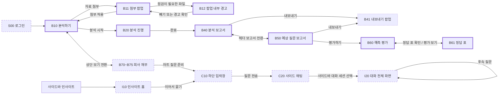
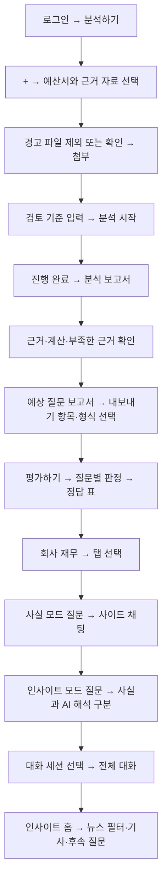

# Telescope IA (Information Architecture)

> 분석 Agent와 Chat Agent의 화면 구조, 화면별 기능, 입력·출력과 이동 조건을 정의합니다. 현재 설계 전체를 이 문서에서 확인할 수 있습니다.
> 기준 자료: v05 IA와 HTML 데모. 데모의 실제 화면·동작을 함께 대조했습니다.
> [HTML 데모](index.html) · [재무 데이터](data/financials.json) · [뉴스 목록](data/news.json) · [부서별 검토 포인트](data/departments.md)
> 관리 영역: `docs/frontend/`. 화면설계 작업 이슈는 #23이며, 작업 브랜치는 `docs/#21-frontend`를 재사용합니다.

## 1. 서비스와 Agent

Telescope는 예산서의 주장과 근거를 검토하고, 검토자가 물을 만한 질문을 예측한 뒤 실제 리포트의 쟁점과 비교하는 서비스입니다. 공개 공시와 IR 자료를 활용하며, 통신 3사의 재무 수치와 관련 뉴스를 함께 확인합니다.

| 구분 | 목적 | 입력 | 결과와 진입 위치 |
|---|---|---|---|
| 분석 Agent | 예산서의 근거 점검과 예상 질문 생성·평가 | 예산서 1개, 근거 자료 여러 개, 검토 기준 프롬프트, AI 모델 | 분석하기 B10 → 분석 보고서 B40 → 예상 질문 보고서 B50 → 평가 B60·정답 표 B61 |
| Chat Agent | 적재 데이터에 대한 사실 조회와 AI 해석 | 질문, 사실/인사이트 모드 | 하단 입력창 C10 → 사이드 채팅 C20, 대화 기록 I20 |
| 회사 재무 | 공시 수치를 표·차트로 탐색 | 보기 탭 선택 | 분석하기의 회사 재무 B70~B75 |
| 인사이트 홈 | 통신 3사의 재무 사실과 AI 해석·관련 뉴스 탐색 | 뉴스 회사 필터, 이어서 묻기 | 인사이트 I10 → Chat Agent |

Chat Agent의 모드는 질문마다 선택합니다. 사실 모드는 숫자·문서·위치·원문 발췌를 제시하고, 인사이트 모드는 사실에 AI 해석과 추천을 더합니다. 인사이트 홈은 Chat Agent와 연결되는 탐색 화면입니다.

### 1-1. 요구 수준과 범위

`must`는 필수 흐름, `should`는 구현 범위에 따라 제공하는 설정, `추가`는 확장 기능입니다.

| 기능 | 화면 또는 산출물 | 수준 |
|---|---|---|
| 예산서와 근거 자료 입력, 자료 점검 경고 | B10, B11, B12 | must |
| 자료 파싱과 근거 점검, 숫자 계산·공시 대조 | B20, B40 | must |
| 예상 질문, 질문 이유와 준비할 근거 제시 | B50 | must |
| 보고서 내보내기 진입과 산출물 제공 | B40·B50의 내보내기 | must |
| 항목 선택과 출력 양식 등 범용 설정 | B41 및 아래 설정표 | should |
| 기준 시점 이전 자료로 예측, 이후 리포트와 비교 평가 | B60, B61 | must |
| 공시·계산·AI 구분, 출처·기준 시점 표시 | 숫자가 표시되는 모든 화면 | must |
| 회사 재무 탐색 | B70~B75 | 추가 |
| 사실/인사이트 대화 | C10, C20, I20 | 추가 |
| 3사 비교 인사이트와 관련 뉴스 | I10 | 추가 |
| 로그인 화면 | S00 | 추가 |

예산서 원문 하이라이트 검토 화면은 MVP 범위에 포함하지 않습니다. 보고서의 원문 위치는 문서명·장·쪽을 표시하는 텍스트입니다. 인증·인가 구현과 사내 데이터 연동은 MVP 범위 밖입니다.

### 1-2. 범용 설정 위치

| 설정 | 위치 | 동작 | 수준 |
|---|---|---|---|
| 입력 자료 종류 | B11 자료 첨부 | 예산서 PDF·HTML, 근거 자료 PDF·HTML·XLSX·CSV에 맞는 파서 적용 | should |
| 추출·내보내기 항목 | B41 | 분석 항목과 질문을 선택 | should |
| 출력 양식 | B41 | Markdown 또는 PDF | should |
| 검토 기준 | B10 검토 기준 입력 | 사용자가 작성한 기준으로 분석 | should |
| 프롬프트 | B10 검토 기준 입력 | 직접 작성 또는 예시 프롬프트 선택 | should |
| AI 모델 | B10 입력창 | 범용 LLM·로컬 LLM 선택 | should |

회사·부서·분기를 선택하는 입력 폼은 두지 않습니다. 회사·분기·기준 시점은 예산서에서 식별해 결과 헤더에 표시합니다. 부서별 검토 포인트 문서는 검토 기준을 작성할 때 참고하는 자료이며, 부서 토글이나 자동 적용 설정을 의미하지 않습니다.

## 2. 전체 정보 구조와 이동 흐름

분석 보고서·예상 질문 보고서·평가·정답 표·회사 재무·인사이트 홈에는 C10을 제공합니다. C20이 열리면 입력창은 사이드 채팅 하단으로 옮겨집니다. I20에는 전체 대화와 하단 입력창을 제공합니다. 로그인·분석 입력·분석 진행 화면에는 Chat 입력창을 두지 않습니다.

## 3. 화면 목록과 ID

`B`는 분석과 회사 재무, `C`는 공통 Chat 요소, `I`는 인사이트 홈과 대화 화면, `S`는 공통 진입 화면입니다. 화면 ID는 설계·Figma·구현 화면을 연결하는 키입니다. 팝업·탭·공통 요소는 독립 페이지와 구분합니다.

| ID | 이름 | 형태 | 진입 | 결과·다음 동작 | 수준 |
|---|---|---|---|---|---|
| S00 | 로그인 | 페이지 | 첫 진입·로그아웃 | 로그인 후 B10 | 추가 |
| B10 | 분석하기 | 페이지 | 로고·분석하기 메뉴·예산서 검토 전환 | B11 첨부, B20 실행, B70 전환 | must |
| B11 | 자료 첨부 | 팝업 | B10의 + | 첨부 초안을 B10에 적용 | must |
| B12 | 자료 점검 경고 | B11 내부 상태 | 파일 점검 결과 | 파일 제외·경고 확인 | must |
| B20 | 분석 진행 | 페이지 | B10 분석 시작 | 완료 후 B40 | must |
| B40 | 분석 보고서 | 페이지 | 분석 완료·분석 세션·보고서 전환 | B41, B50, Chat | must |
| B41 | 내보내기 | 팝업 | 보고서 목차 아래 | 항목·형식 선택 후 내보내기 | should |
| B50 | 예상 질문 보고서 | 페이지 | 보고서 전환 | B41, B60, Chat | must |
| B60 | 예측 평가 | 페이지 | B50 평가하기 | 판정 확인·확정, B61 | must |
| B61 | 정답 표 | 페이지 | B60 정답 표 확인하기 | 기준 수정·쟁점 추가, B60 | must |
| B70 | 회사 재무 한눈에 | 페이지·탭 | 회사 재무 전환 | 재무 탭·Chat | 추가 |
| B71 | 손익 | B70 내부 탭 | 손익 탭 | 손익 차트·표 | 추가 |
| B72 | 재무상태 | B70 내부 탭 | 재무상태 탭 | 재무상태 차트·표 | 추가 |
| B73 | 현금흐름 | B70 내부 탭 | 현금흐름 탭 | 현금흐름·배당 차트·표 | 추가 |
| B74 | 설비투자 | B70 내부 탭 | 설비투자 탭·대화 결과 | CapEx 차트·표 | 추가 |
| B75 | 동종사 비교 | B70 내부 탭 | 비교 탭·인사이트 카드 | 3사 비교 차트·표 | 추가 |
| C10 | Chat 입력창 | 공통 요소 | 지원 화면 하단 | 모드 선택·질문 전송 | 추가 |
| C20 | 사이드 채팅 | 공통 패널 | C10에서 첫 질문 전송 | 후속 질문·닫기 | 추가 |
| I10 | 인사이트 홈 | 페이지 | 인사이트 메뉴 | 뉴스 원문·재무 탭·Chat | 추가 |
| I20 | 대화 화면 | 페이지 | 대화 세션 선택 | 기존 대화 확인·후속 질문 | 추가 |

### 3-1. 데모 경로

| 설계 ID | 데모 경로·상태 |
|---|---|
| S00 | `#login` |
| B10, B20, B40, B50, B60, B61 | `#b10`, `#b20`, `#b40`, `#b50`, `#b60`, `#b61` |
| B70~B75 | `#b70` 내부의 `over`, `pl`, `bs`, `cf`, `capex`, `peer` 탭 상태 |
| B11, B12, B41 | 부모 페이지의 팝업·점검 상태. 독립 해시 없음 |
| C10, C20 | 부모 페이지의 입력창·패널 상태. 독립 해시 없음 |
| I10, I20 | `#i10`, `#i20` |

로그인 전에는 데모 경로를 직접 입력해도 로그인 화면으로 이동합니다. Figma에는 현재 설계에 맞춘 프레임과 화면별 node 연결을 별도로 반영해야 합니다. 문서·데모가 Figma와 일치하는지는 아직 검증하지 않았습니다.

## 4. 공통 셸과 시각 규칙

### 4-1. 사이드바

| 요소 | 동작 |
|---|---|
| Telescope 로고 | B10으로 이동 |
| 분석하기 | B10으로 이동 |
| 인사이트 | I10으로 이동 |
| 분석 세션 | 해당 분석의 B40으로 이동 |
| 대화 세션 | 해당 세션을 선택하고 I20으로 이동 |
| 다크 모드·라이트 모드 | 테마 전환, 브라우저에 선택값 저장 |
| 사용자 카드 | 사용자 이름과 역할 표시 |
| 로그아웃 | S00으로 이동 |

- 메뉴는 아이콘과 글자 줄로 구성하고, 현재 메뉴를 회색 배경으로 표시합니다.
- 현재 보고 있는 분석 세션 또는 열려 있는 대화 세션의 오른쪽 끝에 보라 점을 표시합니다.
- 새 대화 세션은 대화 목록 맨 위에 쌓입니다. 긴 제목은 사이드바에서 한 줄로 줄이고 툴팁에 전체 제목을 표시합니다.
- 세션 목록에는 실제 분석·대화 기록을 넣습니다. 분석 진행 단계를 사이드바 메뉴로 나열하지 않습니다.

### 4-2. 헤더와 보고서 공통 배치

- B10·B70 상단 가운데에 `예산서 검토 | 회사 재무` 전환을 고정합니다.
- B40·B50·B60·B61 상단 가운데에 `분석 보고서 | 예상 질문 보고서` 전환을 둡니다. 평가와 정답 표에서는 예상 질문 보고서가 선택됩니다.
- 분석 결과의 헤더 왼쪽에는 세션 제목, 오른쪽에는 회사·분기·기준 시점 태그를 둡니다. 이 값은 예산서에서 읽은 정보입니다.
- 보고서는 왼쪽 목차와 오른쪽 본문으로 나누고, 목차를 세션 제목의 왼쪽 시작선에 맞춥니다. 기본 본문 폭은 760px입니다.
- 현재 읽는 목차 항목을 굵게 표시합니다. 보고서 내보내기는 목차 아래에 둡니다.
- 보고서 제목과 작성 일자를 스크롤 상단에 고정하고 본문 첫 줄이 겹치지 않도록 여백을 둡니다.
- 주요 고정 헤더 아래는 그라데이션으로 내용이 흐려지게 처리합니다.
- 팝업은 검정 50% 덮개 위에 표시합니다. 취소·닫기·바깥 영역 클릭·Esc로 닫습니다.

### 4-3. 값과 색의 의미

| 대상 | 표시 원칙 |
|---|---|
| 공시 숫자 | `공시` 태그, 단위·기간·재무 기준·출처 표시 |
| 코드 계산값 | `계산` 태그, 계산식과 원본 수치·출처 표시 |
| Chat 사실 블록 | 회색 테두리, 문장·검색 카드·표·차트·출처 배치 |
| B40 부족한 근거 | 보라 테두리 박스와 `부족한 근거 · AI 판단` 라벨 |
| B40 근거 부족 판정 | 항목 제목 바로 옆 빨강 태그 |
| B50 예상 질문 | 질문 번호·현재 목차를 보라로 강조. 제목은 기본 글자색 |
| 질문 중요도 | 높음은 빨강 태그, 보통은 회색 태그 |
| B60 AI 판정 이유 | `AI 판단` 보라 태그 |
| AI 해석 | 보라 테두리 블록과 `AI 해석` 라벨. 공시 표·차트는 사실 블록에 배치 |
| AI 추천 후속 질문 | 보라 라벨과 보라 테두리 칩 |
| B12 자료 경고 | 주의 노랑. 근거 부족 판정과 구분 |
| 페이지 배경 | 밝은 테마는 흰색·회색, 어두운 테마는 대응하는 어두운 면 |
| 리포트 | 원문 대신 쟁점 요약과 출처 링크 관리 |

색만으로 의미를 전달하지 않고 태그·문구를 함께 표시합니다. 숫자의 기준 시점과 자료 발행일을 구분하고, 예측에 허용되는 자료 범위를 서버에서 제한합니다.

### 4-4. 반응형과 키보드

- 데스크톱 사이드 채팅의 기본 폭은 400px이며 본문은 남은 폭에 재배치합니다. 1180px 이하에서는 채팅 폭이 340px입니다.
- 960px 이하에서는 사이드바를 메뉴 버튼으로 열고, 보고서 목차를 본문 위 가로 목록으로 배치합니다. 차트는 한 열, 지표는 두 열로 배치합니다.
- 960px 이하의 사이드 채팅은 화면 전체를 덮습니다. 파일 첨부의 두 영역과 출처 차트도 세로로 배치합니다.
- Enter는 입력창 제출, Esc는 열린 예시·팝업·선택 메뉴·사이드 채팅 닫기에 사용합니다.
- 입력 필드와 아이콘 버튼에는 이름을 제공하고, 탭의 선택 상태와 판정 행의 펼침 상태를 전달합니다.

## 5. 분석 Agent

### 5-1. B10 분석하기

가운데 인사 문구 `어떤 예산서를 검토할까요?` 아래에 한 줄 입력창을 둡니다.

| 요소 | 기본 상태 | 사용자 동작과 결과 |
|---|---|---|
| 자료 첨부 + | 활성 | B11 열기 |
| 검토 기준 입력 | 빈 값, 안내 문구 | 직접 작성. 포커스하면 예시 프롬프트 3개 표시 |
| 예시 프롬프트 | 입력창 포커스 시 표시 | 선택하면 검토 기준에 채우고 예시 목록 닫기 |
| AI 모델 | 범용 LLM | 범용 LLM·로컬 LLM 선택 |
| 분석 시작 | 예산서 미첨부 시 비활성 | 예산서가 있고 미확인 경고가 없으면 B20으로 이동 |
| 첨부 파일 칩 | 파일 첨부 후 입력창 아래 표시 | 예산서·근거 라벨, 파일명, 경고 아이콘 확인. ×로 파일 제외 |

예시 목록은 입력창 아래로 펼쳐지며 바깥 클릭·Esc로 닫습니다. Enter로도 분석을 시작할 수 있습니다. 근거 자료와 검토 기준이 빈 상태의 처리 중, 현재 데모에서 분석 시작을 막는 조건은 예산서 부재와 미확인 경고입니다. 검토 기준 필수 여부는 별도 확정 대상입니다.

예시 프롬프트:

- CapEx가 줄어든 근거가 충분한지 봐 주세요
- 애널리스트가 물을 만한 감가상각 질문을 뽑아 주세요
- AI 데이터센터 투자 계획의 근거를 점검해 주세요

### 5-2. B11 자료 첨부

팝업 왼쪽은 예산서 1개, 오른쪽은 근거 자료 여러 개를 받습니다.

| 영역 | 허용 형식 | 동작 |
|---|---|---|
| 예산서 | PDF, HTML | 클릭·끌어 놓기로 1개 선택. 새 파일 선택 시 예산서 교체 |
| 근거 자료 | PDF, HTML, XLSX, CSV | 클릭·끌어 놓기로 여러 파일 추가. 파일별 제외 |
| 첨부 | 파일이 있고 미확인 경고가 없을 때 활성 | 첨부 초안을 B10에 적용하고 닫기 |
| 취소·닫기 | 활성 | 팝업의 초안을 적용하지 않고 닫기 |

영역에는 파일명·형식·분량 또는 크기를 표시하고, 업로드 안내와 허용 형식을 계속 제공합니다. B11의 초안과 B10에 적용된 파일 목록을 분리합니다.

### 5-3. B12 자료 점검 경고

파일을 넣는 순간 형식·회사·발행일을 점검합니다. 경고가 있으면 팝업 상단에 `확인이 필요한 자료가 N개 있어요`를 표시하고 각 파일 줄에 사유와 처리 버튼을 둡니다.

| 점검 | 조건 | 표시 | 처리 |
|---|---|---|---|
| 회사 불일치 | 근거 자료 회사와 예산서 회사가 다름 | 자료 회사와 예산서 회사 안내 | 빼기·그대로 두기 |
| 기준 시점 이후 | 발행일이 분석 기준 시점보다 늦음 | 이후 자료이며 예측 평가에 영향을 줄 수 있음 안내 | 빼기·그대로 두기 |
| 형식 불일치 | 해당 영역의 허용 형식에 해당하지 않음 | 허용 형식 안내 | 빼기 |

- 미확인 경고가 있으면 `첨부`를 비활성화하고 `경고를 먼저 확인해 주세요`를 표시합니다.
- `그대로 두기`를 선택하면 파일에 `경고 확인함`을 표시합니다.
- 파일 유지와 분석 근거로의 사용 허용은 별도입니다. 경고 확인이 기준 시점 이후 자료를 예측에 사용하도록 허용하지 않습니다. 실제 분석·평가에서 허용 문서 범위를 서버가 강제해야 합니다.
- 회사명과 발행일을 식별하지 못한 파일의 처리와 기준 시점 확정 방식은 11장의 확인 사항으로 관리합니다.

### 5-4. B20 분석 진행

`예산서를 검토하고 있어요` 제목과 진행률, 단계별 상태를 표시합니다.

1. 예산서 읽기
2. 주장과 숫자 뽑기
3. 근거 자료, DART와 대조
4. 예상 질문 만들기

각 단계는 대기·진행 중·완료로 구분합니다. 완료하면 B40으로 이동합니다. 실제 작업 실패·취소·재시도와 중복 실행 방지의 세부 동작은 확정이 필요하며, 데모에는 시간 기반 완료 흐름을 제공합니다.

### 5-5. B40 분석 보고서

목차는 `1. 총평`, `2. 점검 항목별 검토`, `3. 보완하면 좋을 근거`, `출처`로 구성합니다.

| 영역 | 표시 내용 |
|---|---|
| 총평 문단 | 주장 수, 근거 충분·부족, 주요 쟁점과 우선 보완 사항 |
| 총평 표 | 점검 항목, 주장 수, 근거 충분·부족 수, 질문 수 |
| 점검 항목별 검토 | 주장, 판정, 원문 위치, 공시 근거, 계산 과정, 부족한 근거 |
| 보완하면 좋을 근거 | 제출 전에 준비할 자료 목록 |
| 출처 | 문서명, 공시·발행일, 근거 위치 |

점검 항목 하나는 다음 순서로 구성합니다.

1. 항목 번호·제목과 바로 옆 `근거 부족` 빨강 태그, 같은 줄 오른쪽 원문 위치
2. 예산서 주장을 설명하는 문단
3. `근거`: 지표명, 연도, 금액·단위, 재무 기준과 `공시` 태그
4. `계산 과정`: 회색 박스 안 계산값·계산식과 `계산` 태그
5. `부족한 근거 · AI 판단`: 보라 테두리 박스 안 보완할 항목

근거가 없는 주장에는 `예산서에 제시된 근거가 없어요`를 표시하고 계산 과정은 생략합니다. 원문 위치는 회색 텍스트 영역이며 누를 수 있는 버튼으로 표시하지 않습니다. 서술·표·근거·계산·AI 판단 영역은 같은 본문 폭을 사용합니다.

### 5-6. B50 예상 질문 보고서

목차는 `1. 총평`, 이후 점검 항목별 질문 장으로 구성합니다. 총평에는 질문 수와 중요 쟁점을 설명하고, 점검 항목별 질문 수·중요도 높음·보통을 표로 보여 줍니다.

질문 하나는 아래 순서를 따릅니다.

1. 보라색 질문 번호와 중요도 태그
2. 예상 질문 문장
3. `왜 묻나요`: 질문이 나온 점검 기준과 부족한 근거
4. `미리 준비할 근거`: 질문에 답하기 위해 필요한 자료
5. 맨 아래 원문 위치 텍스트

문서 제목은 기본 글자색으로 표시하고 질문 번호와 현재 목차에 보라 강조를 사용합니다. 질문마다 `AI 질문` 태그를 반복하지 않습니다. 제목 오른쪽 `평가하기`로 B60에 진입합니다.

### 5-7. B41 내보내기

분석 보고서와 예상 질문 보고서 모두 목차 아래의 `내보내기`로 엽니다.

| 요소 | 동작 |
|---|---|
| 분석·질문 그룹 | 내보낼 항목을 체크박스로 선택 |
| 모두 선택·모두 해제 | 항목 전체 선택 상태 변경 |
| 형식 | Markdown·PDF 중 하나 선택. 기본 Markdown |
| 내보내기 | 선택 항목이 1개 이상일 때 활성 |
| 취소·닫기 | 파일 생성 없이 팝업 닫기 |

실제 결과의 항목 목록으로 선택지를 구성해야 합니다. 생성 중·실패·다운로드 완료 상태는 별도 구현 명세가 필요합니다. 데모의 내보내기는 안내 메시지를 표시하며 파일을 생성하지 않습니다.

### 5-8. B60 예측 평가

기준 시점 이전 자료로 만든 예상 질문과 이후 발행된 리포트의 쟁점을 비교합니다. 보고서 헤더에는 분석 대상과 기준 시점을, 본문에는 질문 수·비교 리포트 수·발행 기간을 표시합니다.

| 장 | 내용과 동작 |
|---|---|
| 1. 총평 | 맞힘·부분·빗나감·놓침, 정밀도·재현율과 근거 보완 요약 |
| 2. 질문별 판정 | 질문, 대응 리포트 쟁점, 판정, 판정자. 행 선택 시 이유와 수정·확정 영역 펼침 |
| 3. 놓친 쟁점 | 예측하지 못한 리포트 쟁점, 출처, 놓친 이유 |
| 4. 근거 부족 추적 | 분석 보고서에서 지적한 근거 부족, 다음 분기 자료, 보완 상태 |

- 판정은 `맞힘 / 부분 / 빗나감`, 판정 주체는 `AI 1차 / 평가 담당자 확정`으로 구분합니다.
- 펼친 행에 AI 판정 이유, 판정 선택, 메모 입력과 `확정` 버튼을 제공합니다.
- 근거 보완 상태는 `보완됨 / 여전히 없음 / 확인 불가`입니다.
- 제목 오른쪽 `정답 표 확인하기`로 B61에 이동합니다.
- 평가 지표 계산식과 부분 일치 점수의 정책은 기획 문서에서 관리하며, 판정 변경 후 결과의 일관성을 보장해야 합니다.

### 5-9. B61 정답 표

정답 표는 비교 리포트의 쟁점 요약과 판정 기준을 관리합니다.

| 영역·동작 | 결과 |
|---|---|
| 판정 기준 | 현재 기준 문장 표시 |
| 기준 고치기 | 기준 입력창으로 전환 |
| 저장 | 수정 기준을 적용하고 읽기 상태로 복귀 |
| 리포트 쟁점 표 | 증권사·발행일, 쟁점 요약, 대응한 예상 질문 표시 |
| 쟁점 추가 | 증권사·발행일과 쟁점 입력 행 표시. 다시 누르면 접기 |
| 추가 | 쟁점이 비면 안내. 입력하면 목록 맨 위에 추가 |
| 대응 질문 선택·예측 평가 보기 | B60으로 이동 |

리포트 원문은 보관하지 않고 쟁점 요약과 출처 링크를 관리합니다. 기준 수정과 사람의 판정 결과는 버전을 구분해 기록하는 것이 필요합니다. 저장 API와 이력 관리 방식은 후속 설계 대상입니다.

## 6. 회사 재무 B70~B75

분석하기 상단 `회사 재무`로 진입합니다. 회사명, 종목코드, 기간, 데이터 출처와 단위를 보여 주고, 제목 오른쪽에 보기 탭 6개를 둡니다. 페이지 제목·탭은 스크롤해도 고정합니다.

기본 표시는 SK텔레콤의 2021~2025년 연간 데이터입니다. 재무 기준과 기간을 선택하는 토글은 두지 않고 차트 제목 옆 태그로 기준을 표시합니다.

| 태그 | 의미 |
|---|---|
| SKB 포함 | SKT와 SK브로드밴드 등 자회사를 포함한 회사 전체 수치 |
| SKT 단독 | SKT 법인의 수치 |
| SKT+SKB 합산 | SKT 단독과 SKB 금액의 합. CapEx 비교에 사용 |
| 각 사 자회사 포함 | KT·LG유플러스의 자회사 포함 수치 |

| 화면 | 탭 | 시각화·표 |
|---|---|---|
| B70 | 한눈에 | 매출·영업이익·영업이익률·당기순이익·부채비율·CapEx 지표 6개, 전년 대비와 5년 추이; 영업이익 증감 요인; 영업이익률·부채비율 3사 비교; 현금 증감; CapEx/감가상각비; 주요 지표 증감 |
| B71 | 손익 | 매출, 영업이익, 영업이익률, 영업비용 구성비·구성, 손익계산서 |
| B72 | 재무상태 | 부채·자본, 부채비율, 유동자산·유동부채, 유형자산·무형자산·현금, 재무상태표 |
| B73 | 현금흐름 | 활동별 현금흐름, 잉여현금흐름, 현금및현금성자산, 주당 배당금, 현금흐름표 |
| B74 | 설비투자 | SKT·SKB CapEx, CapEx·유형자산 감가상각비, 두 값의 비율, 누적 CapEx 3사 비교, 연도별 표 |
| B75 | 동종사 비교 | 매출 지수, 영업이익률, 부채비율, CapEx와 주요 지표의 3사 비교 |

- 탭 선택 시 해당 내용을 표시하고 스크롤을 맨 위로 이동합니다.
- 차트 제목은 지표명과 기간으로 구성합니다. 단위·기준·출처를 함께 표시하고 툴팁으로 값을 확인합니다.
- 차트의 `인사이트에 묻기`는 Chat을 인사이트 모드로 바꾸고 `(차트 제목)을(를) 어떻게 봐야 하나요?`를 입력창에 준비합니다. 전송은 사용자가 수행합니다.
- 회사 재무 화면의 숫자와 Chat·보고서에서 인용하는 숫자는 같은 재무 기준을 사용해야 합니다.

## 7. Chat Agent

### 7-1. 모드와 입력창 C10

| 모드 | 입력창 | 답변 원칙 |
|---|---|---|
| 사실 | 기본 회색 테두리, 무채색 보내기 버튼 | 적재 데이터의 숫자·문서·위치·원문 발췌와 코드 계산값 제시 |
| 인사이트 | 보라 테두리, 보라 보내기 버튼 | 사실 블록과 별도로 AI 해석·추천 제시 |

입력창 앞에 `사실 | 인사이트` 토글, 가운데 질문, 오른쪽 보내기 버튼을 둡니다. 기본 모드는 사실입니다. 모드 변경 시 입력 중인 질문을 유지합니다. Chat에 별도의 회사 선택·파일 첨부·AI 모델 선택은 두지 않습니다.

빈 질문은 전송하지 않고 `질문을 적어 주세요`를 안내합니다. 버튼과 Enter로 전송합니다. 사실 모드의 해석 요청에는 `인사이트 모드로 묻기`를 제공하며, 사용자가 선택하면 모드를 바꾸고 같은 질문을 전송합니다.

### 7-2. 사이드 채팅 C20과 세션

- 지원 화면에서 첫 질문을 보내면 새 대화 세션을 만들고 오른쪽에 C20을 엽니다. 제목은 첫 질문 전체를 사용합니다.
- 패널은 회색 테두리의 둥근 영역입니다. 상단에는 세션 제목 전체와 닫기 X, 가운데에는 대화, 아래에는 후속 질문과 입력창을 둡니다.
- 질문·답변은 현재 세션에 추가합니다. 사용자 말풍선은 회색이며 글자 길이에 맞춥니다.
- 패널이 열리면 본문은 남은 폭에 재배치합니다. 다른 지원 페이지로 이동해도 패널 상태와 대화를 유지합니다.
- X 또는 Esc로 패널을 닫아도 세션은 사이드바 대화 목록에 남습니다.
- 대화 세션을 선택하면 I20으로 이동합니다. I20은 해당 대화 전체를 본문으로 보여 주며 C20을 겹쳐 표시하지 않습니다.
- 로그인·B10·B20에서는 패널과 Chat 입력창을 표시하지 않습니다.

### 7-3. 답변 구조

| 구성 | 필드·동작 |
|---|---|
| 사실 문장 | 지표, 기간, 금액·단위와 자료에서 확인한 사실 |
| 검색 카드 | 값, 공시·계산 태그, 문서, 장·쪽, 발행일, 원문 발췌. 해당 자료가 있는 필드만 표시 |
| 사실 출처 표·차트 | 인용 번호 [1]·[2], 값·기간·재무 기준, 문서·공시일·계산 여부 |
| 관련 화면 이동 | `설비투자 탭에서 보기`로 B74 이동 |
| AI 해석 블록 | 보라 테두리, AI 해석 라벨, 해석 문단과 근거 기사 [3] |
| AI 추천·이어서 물어보기 | 답변이 있을 때 입력창 바로 위에 질문 칩 표시. 선택 시 현재 모드로 즉시 전송 |

사실 표·차트와 출처는 회색 사실 블록에 넣습니다. AI 해석 블록에는 해석과 근거 기사를 배치합니다. 공시에서 찾을 수 없는 값은 추정값처럼 제시하지 않고 자료 부재를 알립니다.

### 7-4. I20 대화 화면

사이드바 대화 목록에서 들어옵니다. 헤더는 세션 제목 전체이며 사실·인사이트 두 모드의 대화를 시간순으로 보여 줍니다. 화면 하단에는 C10, 그 위에는 답변 이후 후속 질문을 제공합니다. 페이지를 바꾸더라도 선택한 세션의 문맥을 이어갑니다. 보고 있는 분석 자료를 Chat의 허용 맥락으로 자동 연결할지는 확인이 필요합니다.

## 8. I10 인사이트 홈

헤더 왼쪽에 `인사이트`, 오른쪽에 뉴스 회사 필터를 둡니다. 본문은 `3사 비교 인사이트` 카드와 `관련 뉴스`로 구성합니다.

### 8-1. 비교 인사이트 카드

각 카드는 제목 → 사실 표 → 재무 기준·단위와 회사 재무 이동 → AI 해석과 근거 뉴스 → 이어서 묻기로 구성합니다.

| 주제 | 사실 비교 | 연결 화면 | 후속 질문 예시 |
|---|---|---|---|
| 영업이익 | SKT·KT·LG유플러스의 2024·2025년 값과 증감 | B75 동종사 비교 | SKT 영업이익 감소 중 일회성 비용은 얼마인가요? |
| CapEx | SKT+SKB·KT·LG유플러스의 2023·2025년 값과 증감 | B74 설비투자 | 3사 AI 데이터센터 투자 계획을 비교해 주세요 |
| SKT 배당 | 2024·2025년 주당 배당금과 배당성향 | B73 현금흐름 | SKT 배당은 언제 회복될 수 있을까요? |

사실은 재무 데이터로 표시하고 해석은 AI 해석 블록으로 구분합니다. `이어서 묻기`는 인사이트 모드를 선택하고 질문을 입력창에 채우며 바로 전송하지 않습니다.

### 8-2. 관련 뉴스

- 회사 필터는 `전체 / SKT / KT / LG유플러스 / 3사 공통`입니다. 필터는 관련 뉴스 목록에 적용합니다.
- 결과 건수를 표시하고 카드를 한 줄 가로 스크롤로 배치합니다.
- 카드 순서는 언론사·발행일 → 제목 2줄 → 회사 태그 → 아래쪽 전체 폭 16:9 썸네일입니다.
- 이미지가 없으면 이미지 없는 카드로 표시합니다. 기사 선택 시 원문을 새 창으로 엽니다.
- 회사 태그·발행일·기사 주소·이미지 주소는 [뉴스 목록](data/news.json)에서 확인합니다.

## 9. 상태와 예외

다음 표는 정상 흐름과 구분해 구현 시 보장할 상태입니다. 정적 데모가 제공하는 범위는 10장에 별도로 명시합니다.

| 영역 | 정상·빈 상태 | 처리 중 | 오류·복구 |
|---|---|---|---|
| B10 | 빈 입력과 첨부 후 파일 칩, 예산서 없으면 시작 비활성 | 분석 실행 요청 중 중복 제출 방지 필요 | 실행 실패 시 입력·첨부 보존 및 재시도 명세 필요 |
| B11·B12 | 파일 없음 안내, 파일별 경고·확인 상태 | 실제 업로드·점검 진행 상태 명세 필요 | 미확인 경고는 첨부 차단. 비허용 형식은 파일 제외 |
| B20 | 단계별 대기·진행·완료 | 단계·진행률 표시 | 실패·취소·재시도 정책 미확정 |
| B40·B50 | 보고서·질문 표시, 자료 부재 안내 | 결과 로딩 상태 필요 | 결과 조회 실패와 재조회 동작 미확정 |
| B41 | 선택 항목 없음은 내보내기 비활성 | 파일 생성 상태 필요 | 생성 실패·다운로드 재시도 명세 필요 |
| B60·B61 | 판정·정답 쟁점 표시, 빈 쟁점 추가 차단 | 평가·저장 진행 상태 필요 | 저장 실패 시 입력 보존·재시도와 버전 충돌 정책 미확정 |
| B70~B75 | 데이터 표·차트. 결측을 0으로 치환하지 않음 | 데이터 조회 상태 필요 | 조회 오류·데이터 없음 구분 필요 |
| C10·C20·I20 | 빈 질문 전송 차단, 사실 부재와 데모 미지원 안내 | 답변 대기·스트림 상태 미확정 | 응답 실패·재전송·세션 복원 명세 필요 |
| I10 뉴스 | 필터별 건수와 카드, 이미지 부재 대체 | 이미지 지연 로딩 | 필터 결과 없음과 기사 조회 실패 문구 미확정 |

## 10. 데이터와 데모 확인 기준

### 10-1. 데이터 및 구현 범위

- [재무 데이터](data/financials.json)는 공시 기반 재무 수치와 배당 데이터의 참고 파일입니다. 데모 HTML은 재무 데이터를 내부에 포함합니다.
- [뉴스 목록](data/news.json)은 2026-03-17 이전 발행 기사 13건의 참고 목록입니다. HTML에는 뉴스 목록을 포함하며 썸네일은 외부 기사 서버에서 불러옵니다.
- 보고서 주장 문구·쪽 번호·예상 질문·리포트 쟁점·평가 판정·AI 해석은 시나리오 샘플입니다. 고정된 개수와 문장은 기능의 완료 조건이 아닙니다.
- 로그인은 화면 진입용이며 실제 인증을 수행하지 않습니다. 분석은 단계별 시간을 사용해 완료되고 보고서는 준비된 결과를 보여 줍니다.
- 빈 첨부 영역을 처음 선택하면 샘플 자료를 넣고, 그다음부터 로컬 파일을 선택합니다. 파일명으로 회사·기간을 판별하며 실제 문서 파싱은 하지 않습니다.
- Chat은 CapEx 질문의 준비된 답변을 제공합니다. 그 밖의 질문에는 데모 지원 범위를 안내합니다. 해석 요청 판별은 단어 패턴 기반입니다.
- 내보내기는 안내 메시지만 표시합니다. 판정 변경은 Q4를 대상으로 하며 확정·기준 수정·쟁점 추가는 서버 저장이나 재평가를 수행하지 않습니다.
- 보고서·내보내기·평가 샘플의 질문 개수는 서로 다를 수 있습니다. 실제 구현에서는 같은 분석 실행의 질문 목록과 평가 결과를 연결해야 합니다.
- 대화·첨부·평가 변경은 메모리 상태입니다. 테마 선택만 브라우저 저장소에 유지되며 새로고침 후 업무 데이터 복원은 제공하지 않습니다.

### 10-2. 대표 사용자 시나리오

확인할 조건은 첨부 전 시작 비활성, 미확인 경고 차단, 취소 시 초안 미적용, 보고서 전환, 내보내기 무선택 차단, 판정 행 펼침, 빈 쟁점 추가 차단, Chat 빈 질문 차단, 모드 유지, 세션 선택, 뉴스 필터와 테마 유지입니다.

## 11. 확정과 검증이 필요한 사항

현재 자료만으로 확정할 수 없는 항목은 아래와 같습니다. 설계·데모에 없는 동작을 완료된 기능으로 간주하지 않습니다.

| 항목 | 현재 기준 | 확인할 내용 |
|---|---|---|
| 검토 프롬프트 | 사용자 입력과 예시 제공 | 필수 여부, 빈 값의 기본 기준, 기획·부서별 기준 적용 방식 |
| 분석 범위 | 예산서에서 회사·분기·기준 시점 식별 | 식별 실패 시 확인 방법, 기준 시점 정의와 수정 허용 여부 |
| 자료 경고 | 사용자 확인 후 파일 유지 가능 | 미래 자료를 예측에서 제외하는 서버 정책, 회사 불명·날짜 불명·근거 형식 검증 |
| 분석·보고서 작업 | 진행 후 결과 화면 제공 | 취소·오류·재실행·폴링 상태 계약 |
| Chat 모드 | 사용자가 사실·인사이트 선택 | 해석 요청을 자동 분류할지, 모드 전환 제안으로 처리할지 |
| Chat 맥락 | 같은 세션 대화 지속 | 현재 예산서·허용 문서·기준 시점을 Chat에 연결하는 방식 |
| 세션 | 첫 질문 제목, 사이드바 기록 | 제목 요약, 영속 저장, 새로고침·재접속 복원 |
| 평가 | AI 1차 후 사람 확정 | 같은 쟁점의 범위, 부분 일치 가중치, 수정 후 재계산과 이력 |
| 로컬 LLM | B10에서 선택 | 실제 엔드포인트와 미연결·품질 차이 안내 |
| 뉴스 | 발행일·회사 태그 기반 목록 | 수집 범위, 자동 태그 기준과 필터별 빈 상태 |
| Figma | 화면 ID를 연결 키로 사용 | 현재 설계 프레임 작성과 문서·데모 일치 검증 |
| 권한 | MVP에서 역할별 기능 제한 없음 | 분석 실행·모델 전환·평가 수정 권한을 나눌지 |
