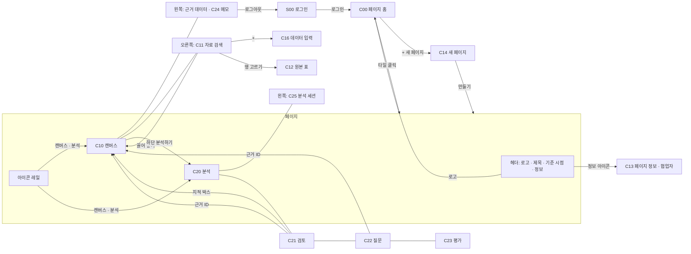
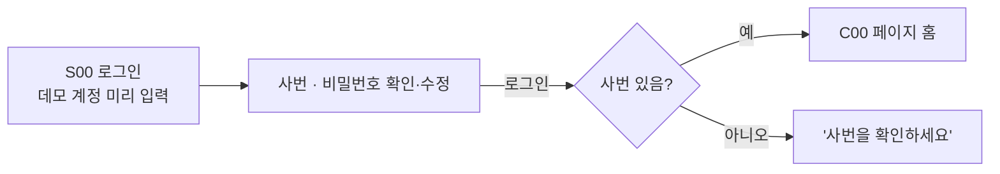
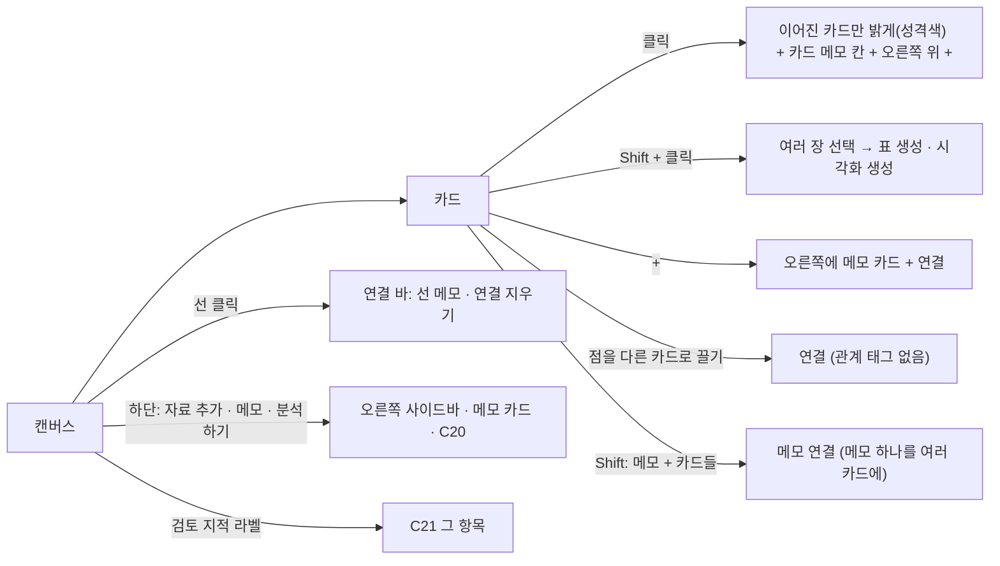
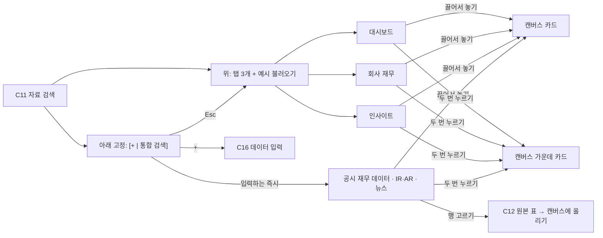
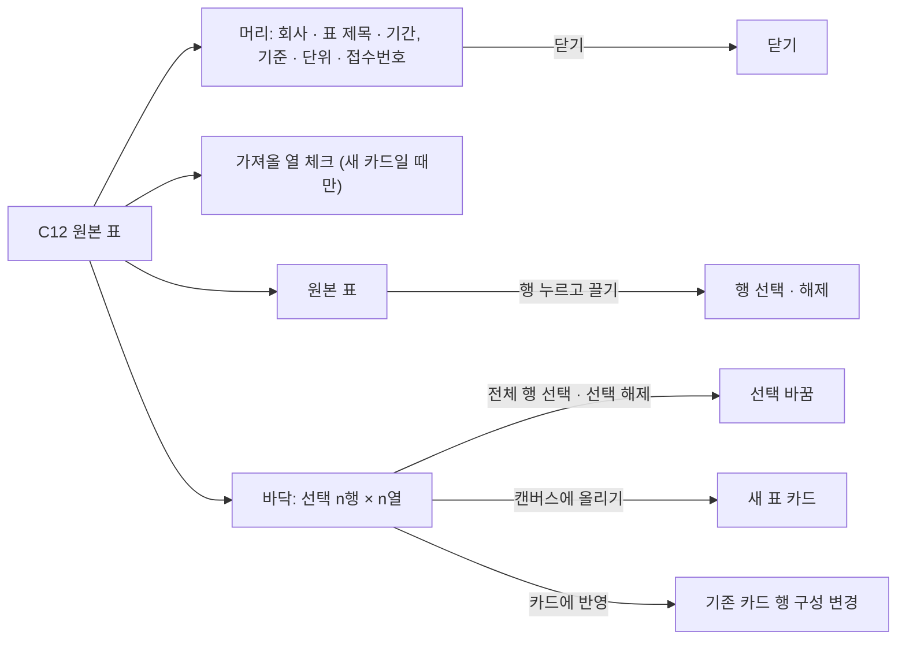
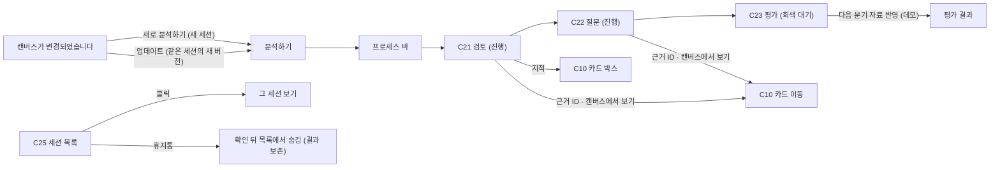
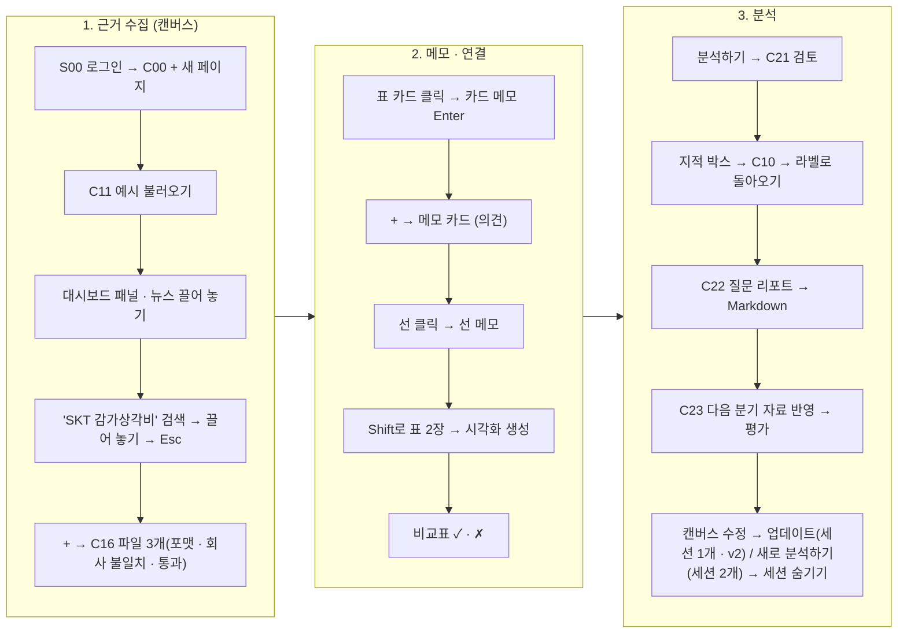

# 화면별 Information Architecture (IA)

v02-canvas 데모(코드 `frontend/`, 빌드 `docs/frontend/demo.html`) 화면을 기준으로, 메뉴 → 화면 → 기능(클릭 → 결과)을 정리했다. 화면에서 부르는 API는 [API 명세](api-spec.md)의 절 번호로 적고, 호출 흐름은 [API 다이어그램](api-diagram.md)을 본다.

- 기준 코드: `frontend/src` (`App.vue`, `components/*.vue`, `components/nodes/*.vue`, `local/ai.ts`, `local/validate.ts`)
- 기능 ID(F-xx), 등급(must / should / 추가), 데모 시나리오는 [기획서](../planning/기획서.md)를 따른다.
- 화면 ID는 Figma 프레임 이름, 데모 화면, Vue route name을 잇는 공통 키다(기획서 7장).
- `데모 전용`으로 표시한 항목은 실제 서비스에서 빠지거나 바뀐다.

## 변경 이력

| 날짜 | 내용 |
|---|---|
| 2026-11-26 (4) | develop 병합: 동시 편집(#84)을 메모 구조로 맞춤(다른 사람 커서 · 헤더 접속자 수 · 메모 글 충돌 안내, 시각화 카드는 `create_compare`(`view: chart`)로 저장). 공유 설정은 소유자만 바꾸고 일반 액세스 · 공유 범위 표기 삭제(#100), 편집 가능은 C13을 보기만 |
| 2026-11-26 (3) | 캔버스 · 분석 전환을 최좌측 아이콘 레일에서 헤더(정보 아이콘 옆)로 옮김. 하단 도구를 아이콘만(호버 설명)으로, 선 범례 삭제. 카드 메모 입력칸 삭제(카드 오른쪽 위 `+`로 메모 카드만, 예전 카드 메모는 읽기만). 연결 바: 제목 `{출발} → {도착}` 굵게, `연결 해제` · `메모 입력` 같은 위계, 메모 입력은 아래 펼침, 선 메모 → 메모(노랑). 선은 카드 위치에 맞춰 좌우 점끼리만 이음. 사이드바 접기 버튼을 사이드바 안으로(닫혔을 때만 플로팅). 오른쪽 사이드바는 처음 캔버스 영역의 절반, 경계선을 끌어 폭 조정, 탭 가운데, 머리 · 아래 입력창 그라데이션 블러, 주요 지표 한 줄 · 카드 그림자 없음(v01), 차트 높이 축소. 탭 순서를 회사 재무 · DART · 인사이트로 바꾸고 대시보드 → DART, 주요 지표 · 영업이익 증감 · 3사 영업이익률/부채비율 · 현금 증감 · CapEx/감가상각비를 회사 재무 맨 위로 옮김. 패널은 한 줄에 2개 이상. ⌘K로 열고 닫기. 지적 박스는 모두 빨강. 분석 화면을 v01 보고서 모양(문서: 검토 · 예상 질문 보고서 · 예측 평가, 목차 없음)으로, 상단 그라데이션 블러, 프로세스 바는 검토 ─ 질문이 끝까지 채워지고 평가는 점선 뒤 별도 단계, 캔버스 정리 글은 상단 `내보내기` 팝업(프롬프트로 추출 · Markdown). 데이터 입력 창은 v01 자료 첨부 모양. 모든 팝업 화면 가운데. 홈에도 같은 헤더 표 생성 · 시각화 생성은 고른 표에 공통 계정이 없으면 행을 그대로 모아 보여 줌("표 모음"). 분석 세션 목록에서 세션 지우기(휴지통, 확인 후 삭제). 메모 카드 하나를 여러 카드에 연결(어느 점끼리도 연결, Shift로 메모 + 카드들을 고르면 `메모 연결`). 분석 세션: 캔버스가 바뀌면 `업데이트`(같은 세션의 새 버전, 이전 버전 보존) · `새로 분석하기`(새 세션) 중 고름, 지우기는 목록에서 숨김(결과 보존), 하단 분석하기는 세션이 없을 때만 새로 시작. 메모 추가 버튼은 노란 둥근 박스에 흰 메모 아이콘. |
| 2026-11-26 (2) | 페이지 구조로 전환. 시작 단위를 캔버스 → **페이지**로(홈 · 새 페이지), 페이지 안에 캔버스(C10) · 분석(C20) 두 화면을 두고 최좌측 아이콘 레일로 오감. 헤더는 로고(홈) · 제목 · 기준 시점 · 페이지 정보 아이콘(C13: 정보 + 협업자 편집). C15 메뉴 팝업 삭제. 캔버스: 좌우 사이드바를 헤더 아래 플로팅 버튼으로 열고 닫음, 오른쪽 사이드바 = 자료 검색(C11, 탭 3개 + 아래 고정 통합 검색, Esc로 검색 지움, 끌어서 올림, 선택 칩 · 추가하기 삭제), 검색창 `+` = 데이터 입력 창(C16, 포맷 · 4사 회사 검증). 하단 도구 `자료 추가` · `메모` · `분석하기`. 프롬프트 · 메모 종류를 메모 하나로 통일(카드 메모 · 메모 카드(+) · 선 메모, Enter · 입력 완료 · 수정), C24 프롬프트 목록 → 메모 목록. 선 관계 태그 삭제. Shift 다중 선택 → 표 생성 · 시각화 생성. 카드 강조색을 카드 성격색으로. 비교표 확정 · 거부 동작 반영, 노란 경고 목록 · 시각화 계정 칩 삭제. 분석(C20): 분석하기마다 세션을 쌓고(본인만), 프로세스 바(검토 · 질문 실시간, 평가는 다음 분기 자료 전까지 회색), 검토(C21: 메모 분류 · 주장 · 근거 충분/부족 · 지적 · AI 인사이트, 지적은 캔버스 카드 박스로), 질문(C22: 애널리스트 리포트), 평가(C23: 데모 버튼으로 다음 분기 자료 반영), 캔버스가 바뀌면 "캔버스가 변경되었습니다. 새로 분석하기" |
| 2026-11-26 | #97 추가 수정: 프롬프트 카드(상단 `프롬프트` 버튼) 삭제, 상단 `메모` 버튼과 메모 카드(메모 · 보완 요청) 복원. 프롬프트는 카드 프롬프트 · 선 프롬프트만. C11 자료 검색을 대시보드 · 회사 재무 · 인사이트 3탭으로(v01-stella DART 대시보드의 KPI · 워터폴 · 산점도 · 히트맵 · 자산 계정, 손익 · 재무상태 · 현금흐름 · 설비투자 · 동종사 비교, 연간 인사이트 이식), 입력창은 탭과 무관한 통합 검색(입력 즉시 공시 · IR·AR · 뉴스), `추가하기`를 입력창 오른쪽 바깥으로, 뉴스 썸네일. 생성하기 1단계를 결과물 대신 캔버스 정리 글(컨텍스트, 편집 · 복사 · Markdown)로, 근거 부족 판정 삭제. 결과물 종류 선택 · PDF · 프롬프트 복사 삭제. 생성 · 질문 · 평가를 박스 대신 프로세스 바로, 결과 패널 접기 · 펴기 |
| 2026-11-26 | #84 동시 편집 연동: 카드·연결 ID를 UUID로, 시각화 카드도 저장(`add_chart`). 서버 연동 모드(`VITE_CANVAS_SYNC=server`)에서 다른 사람 변경 반영, 글 충돌 안내, 다른 사람 커서와 이름, 상단 바 접속자 수. 기본은 목업 |
| 2026-11-26 | #100 공유 설정은 소유자만 바꾸고(편집 · 보기 권한은 공유 창 읽기 전용), 일반 액세스(회사 전체 보기) 삭제. 캔버스 홈 · 메뉴의 공유 범위 표기 삭제 (backend API 규약 #36 4장) |
| 2026-11-25 | #97 기능 최종 수정: 상단 바를 `자료 검색`(회색) · `프롬프트` · `생성하기`(보라)로. 공유 · 사이드바 버튼 삭제, 로고 → C15 메뉴 팝업(홈 · 나의 캔버스, 정보 수정 → C13). C11을 자료 검색(검색 · 인사이트 탭, 대시보드 3개, 선택 칩 + 추가하기, 길게 눌러 끌기, + 사내 자료 첨부)으로. 메모 → 프롬프트(프롬프트 카드, 카드 프롬프트, 선 프롬프트), C24 활동 로그 → 프롬프트 목록. 오른쪽 결과 패널은 생성하기로만 열리고 화면 절반, 결과물 → 질문 → 평가 프로세스 바(C20 프롬프트 탭 삭제, 프롬프트 복사만 남김). 결과물은 예산서 · 사업기획서, PDF · Markdown, 질문 Markdown 내보내기. `표 비교` 삭제, `비우기`를 캔버스 도구로. 카드 색을 데이터 성격별로 |
| 2026-11-25 | CodeRabbit(PR #96) 반영: 권한이 사라진 캔버스는 홈으로, 보기 권한에서 키보드 · 끌어 놓기로도 편집 안 됨, 공유 창 Enter로 첫 후보 초대, C14 행을 7장으로 이동 |
| 2026-11-25 | 탭 줄 삭제(홈은 상단 로고로). 새 캔버스 창(C14) 추가: 이름 · 분기 · 편집할 사람. 캔버스 제목 옆은 분기만 표시, 제목은 두 번 눌러 이름 변경. 공유 창 일반 액세스를 초대한 사람만 / 회사 전체(보기)로 줄이고 찾기 칸 추천 표시. 아이콘 색을 연하게 |
| 2026-11-25 | C11에서 Tab · Shift+Tab 탭 전환 복원 |
| 2026-11-25 | 화면에서 데모 · 목업 언급 삭제: 상단 부제, 로그인 안내 문구, 활동 로그 안내, 자료의 "(목업)" 표기. 빈 캔버스 안내 창, 탭 · 사이드바 · 카드의 설명 문구 삭제. 이름을 `Telescope`로 통일 |
| 2026-11-25 | 캔버스 홈(C00)과 공유 창(C13) 추가. 로그인 뒤 캔버스 홈으로 감. 상단 바 팀원 아바타 · 작성자 선택과 왼쪽 사이드바 캔버스 목록을 지우고, 캔버스마다 소유자 · 편집 · 보기 권한을 둠 |
| 2026-11-25 | C11 · C12를 빈 곳 클릭으로 닫던 동작 제거 |
| 2026-11-25 | v01-stella v05 IA 형식으로 재구성. 기획서 대응표, 범용 설정 위치, 공통 셸, 상태와 예외, 값 표시 규칙, 데모 시나리오, 권한 후보, 열린 질문 추가. 화면 ID를 기획서 7장 예시(C10~C24)로 바꿈(예전 ID는 7장 표). 기능 ID를 기획서 4장에 맞춤(질문 F-13, 평가 F-14·F-15) |
| 2026-11-25 | 로그인: 데모 계정 펼치기 대신 데모 계정(1001)을 미리 입력 |

## 0. 기획서 기능 ↔ 화면 ↔ 등급

| 기능 | 등급 | 화면 | 데모 |
|---|---|---|---|
| F-01 공시 재무 데이터 검색·올리기 | **must** | C11 통합 검색 공시 재무 데이터 리스트, C12 원본 표, C10 공시 표 카드 | 구현 |
| F-02 IR·AR·뉴스 검색·올리기 | **must** | C11 통합 검색 IR·AR · 뉴스 리스트, 인사이트 탭 관련 뉴스(썸네일), C10 문서 카드 | 구현 |
| F-03 사내 자료 첨부·요약 | **must** | C11 검색창 `+` → C16 데이터 입력(포맷 · 회사 검증), C10 문서 카드 | 목업 (텍스트 파일만 본문 요약) |
| F-04 공시 임베딩 검색 | should | C11 통합 검색 (키워드 + 개념 사전으로 대신) | 미구현 |
| F-05 계정 대응 비교 | should | C10 Shift 다중 선택 → `표 생성`, 비교 카드 확정 · 거부, 인사이트에서 생성 | 구현 |
| F-06 관계 연결 | **must** | C10 연결선(관계 태그 없음) · 연결 바. 같은 개념 자동 점선은 없앰 | 구현 |
| F-07 메모 | **must** | C10 메모 카드(카드 오른쪽 위 `+`, 하단 메모 아이콘) · 연결 메모(연결 바 `메모 입력`), C24 메모 목록 | 구현 |
| F-08 동시 편집·권한 | must | C00 페이지 홈, C13 페이지 정보(협업자 · 권한, 소유자만 변경), C10 다른 사람 커서 · 접속자 · 글 충돌 안내 | 권한은 목업. 동시 편집은 서버 연동 모드에서 동작(로그인 #34 전에는 목업) |
| F-09 컨텍스트 복사 | 추가 | C20 상단 `내보내기` 팝업: 프롬프트로 추출(복사) · Markdown으로 내보내기 | 구현 |
| F-10 근거 검토 | **must** | 하단 `분석하기` → C20 분석, C21 검토(주장 · 근거 충분/부족 · 지적 · AI 인사이트), C10 지적 박스 | 목업 (규칙 기반) |
| F-11 근거 추적 | **must** | C21 · C22 근거 ID → C10 카드 이동 | 구현 |
| F-12 양식·기준 설정 | should | 1장 표의 위치 (`analysis.json`) | 구현 |
| F-13 애널리스트 예상 질문 | **must** | C22 질문 (애널리스트 리포트 형식) | 목업 (질문 뱅크) |
| F-14 다음 분기 평가 | **must** | C23 평가 (다음 분기 자료가 들어온 뒤) | 목업 (데모 버튼으로 자료 반영) |
| F-15 시점 통제 | **must** | 헤더 기준 시점, C23 평가, 데이터 분리 | 데이터 분리로 표현 |
| F-16 정답표 관리 | should | 화면 없음 | 미구현 |
| F-17 인사이트(3사 비교 AI 해석) | **must** | C11 인사이트 탭, C21 AI 인사이트 | 목업 (`analysis.json`, `local/dart.ts`) |
| F-18 비교 시각화·대시보드 | should | C11 회사 재무 · DART 탭, C10 대시보드 · 시각화 카드(Shift 다중 선택 → `시각화 생성`) | 구현 |
| F-19 로그인·페이지 메뉴 | should | S00, C00, 헤더 로고 · 아이콘 레일 | 목업 (브라우저 저장) |
| F-20 근거 데이터·메모 목록 | should | C10 왼쪽 사이드바 | 구현 |

## 1. 범용 설정 (F-12, should): 어디서 바꾸나

기획서 3장 "회사·양식·평가 기준은 코드가 아닌 설정에서 바꿈"에 대응한다. 데모는 화면에서 바꾸지 않고 설정 파일을 고친다.

| 설정 | 데모 위치 | 화면에 드러나는 곳 |
|---|---|---|
| 평가할 가정 계정 | `data/demo/analysis.json` `deliverables[].assume` (합집합) | C23 가정과 실적 |
| 질문 기준 (질문 뱅크, 중요도, 확인할 근거) | `data/demo/analysis.json` `questions` | C22 |
| 평가 기준 (다음 분기 실적, 리포트 쟁점) | `data/demo/analysis.json` `next_quarter` | C23 |
| 개념 태그 이름 | `data/demo/analysis.json` `tag_names` | C10 문서 카드 개념 태그, 같은 개념 점선, C21 근거 부족 안내 |
| 3사 비교 분석 카드 | `data/demo/analysis.json` `insights` (분기), `frontend/src/local/dart.ts` `ANNUAL_INSIGHTS` (연간) | C11 인사이트 탭, C21 AI 인사이트 |
| 대시보드 · 회사 재무 값 | `frontend/src/local/dart.ts` (v01-stella DART 공시값, 실제 서비스는 DuckDB 조회), 패널 구성은 `local/dashboard.ts` `LAYOUT` | C11 회사 재무 · DART 탭, C10 대시보드 카드 |
| 뉴스 (썸네일) | `frontend/src/local/news.json` (v01-stella 실제 헤드라인) + `data/demo` 뉴스 | C11 인사이트 탭 · 통합 검색, C10 문서 카드 |
| 데이터 입력 검증 (형식, 대상 4사) | `frontend/src/local/validate.ts` `FORMATS`, `COMPANIES4` | C16 |
| 대상 회사 · 공시 표 | `data/demo/manifest.json`, `data/demo/*.csv · *.xml` | C11 통합 검색, 인사이트 탭 뉴스 회사 필터 |

## 2. 전체 구조

**페이지** = 캔버스(사용자가 근거를 모음) + 분석(AI가 검토 → 질문 → 평가). 흐름은 (사용자) 근거 데이터 수집 → (AI) 검토하기 → 질문하기 → 평가하기다.



## 3. 공통 셸

로그인하면 C00 페이지 홈으로 가고, 페이지를 고르면 그 페이지의 캔버스(C10)가 열린다. 페이지 안에서는 최좌측 아이콘 레일로 캔버스와 분석(C20)을 오간다. 다른 페이지로 가려면 로고를 눌러 홈으로 간다.

```
┌ 헤더: 로고(홈) · 페이지 제목 · [기준 시점 2026년 2분기] ················· [캔버스 | 분석] (i) 페이지 정보 ┐
├────┬───────────────┬──────────────────────────────────────┬──────────────────────────┤
│레일 │ 왼쪽 사이드바   │ [▯] 캔버스            자동 배치·비우기·단위 [▯] │ 오른쪽 사이드바: C11 자료 검색 │
│캔버스│ 근거 데이터     │                                        │ [대시보드|회사 재무|인사이트] 예시│
│분석 │ C24 메모       │                                        │  패널 · 리스트 (끌어서 올림)    │
│    │               │ 범례   [ 자료 추가 | 메모 | 분석하기 ]   − % + │ [+ | 통합 검색]  (아래 고정)   │
│    │ 사용자·로그아웃 │                                        │                          │
└────┴───────────────┴──────────────────────────────────────┴──────────────────────────┘
분석 화면: 레일 · [▯] C25 분석 세션 목록 · (캔버스 변경 안내) · 프로세스 바 검토 ─ 질문 ─ 평가 · C21 / C22 / C23
```

- 위 그림의 왼쪽 레일은 없앴다. 캔버스 · 분석 전환은 헤더 정보 아이콘 옆 `[캔버스 | 분석]`이다.
- 사이드바 접기 버튼은 사이드바 머리 안에 있고, 접혀 있을 때만 헤더 아래 플로팅 버튼 `[▯]`으로 연다(캔버스 왼쪽 · 오른쪽, 분석 세션 목록).
- 오른쪽 사이드바는 처음 캔버스 영역의 절반 폭으로 열리고, 왼쪽 경계선을 끌어 360px ~ 75%로 조정한다.
- 하단 도구는 아이콘만(`+` 자료 추가, 메모, ★ 분석하기)이고 마우스를 올리면 설명이 뜬다. 선 범례는 없앴다.
- 팝업(C12 · C13 · C14 · C16 · 내보내기)은 모두 화면 가운데에 뜬다. 홈(C00)도 페이지와 같은 헤더를 쓴다.
- 페이지마다 권한이 있다: 소유자(만든 사람), 편집 가능, 보기 가능. 권한은 직접 초대(C13, 또는 만들 때 C14)로만 주고, 공유 설정은 소유자만 바꾼다. 일반 액세스(회사 전체 보기)는 없어서 페이지는 소유자와 초대한 사람만 볼 수 있다.
- 분석 결과(세션)는 분석을 요청한 본인만 본다. 같은 페이지라도 다른 사람의 세션은 보이지 않는다.
- 작성자는 항상 로그인 사용자다. 다른 사람 입장은 다른 사번으로 다시 로그인해 본다(데모).
- 캔버스 조작은 모두 이벤트로 저장하고(API 3.6), 새로고침하면 저장된 사용자 · 페이지 · 분석 세션을 복원한다.
- 겹침 화면: C12 · C16은 화면 위 창, C13은 헤더 아래 오른쪽 팝오버. C12는 `닫기`, C13은 `✕` · Esc · 바깥 클릭, C14 · C16은 `✕` · `취소`로 닫는다.
- 색: 배경 흰색, 주 버튼 보라(`--primary`). 카드 강조(고른 카드 · 이어진 카드 · 다중 선택)는 보라가 아니라 카드 성격색(5장). 검토 지적은 빨강(근거 부족) · 노랑 점선(점검).

## 4. 화면별 상세

### 4.1 S00 로그인



| 구성 요소 | 조작 | 결과 | API |
|---|---|---|---|
| 로고, 제목 `Telescope` | — | — | — |
| 사번 입력 | 입력 | 오류 문구 지움. 데모는 데모 계정 사번 `1001`(이재무, 네트워크센터 · 재무기획)이 미리 들어 있음 | — |
| 비밀번호 입력 | 입력 | 오류 문구 지움. 데모는 값이 미리 들어 있고 아무 값이나 통과 | — |
| `로그인` 버튼 | 클릭 · Enter | 성공: C00 페이지 홈으로 이동. 실패: 빈 칸이면 "사번과 비밀번호를 입력하세요", 없는 사번이면 "사번을 확인하세요" | 2.1, 3.1 |

새로고침하면 저장된 사용자로 자동 로그인하고, 보던 페이지가 있고 아직 볼 수 있으면 그 페이지를, 아니면 C00을 연다(API 2.2).

### 4.2 C00 페이지 홈

Figma 파일 목록처럼 내가 볼 수 있는 페이지를 모두 모아 보는 화면이다. 페이지 하나에 캔버스와 분석이 함께 들어 있다.

| 영역 | 구성 요소 | 조작 | 결과 | API | 기능 ID |
|---|---|---|---|---|---|
| 왼쪽 메뉴 | 로고 `Telescope` | — | — | — | — |
| | `최근` · `내가 만든 페이지` · `공유받은 페이지`, 메뉴별 개수 | 클릭 | 목록 거르기. 처음은 `최근` | 3.1 `filter` | F-08 |
| | 맨 아래 사용자(이름, 부서 · 직무), `로그아웃` | 클릭 | S00으로 | — | — |
| 위 | 제목(고른 메뉴 이름), 검색 `페이지 이름 검색` | 입력 | 입력하는 대로 이름으로 거름 | 3.1 `q` | — |
| | `+ 새 페이지` | 클릭 | C14 새 페이지 창 | — | — |
| 타일 격자 | 미리보기(캔버스 카드 위치를 작은 사각형으로), 이름, `{수정자} · {시각} 수정 · 카드 {n}`, `{내 권한}` | 클릭 | 그 페이지의 C10을 엶. 보기 권한이면 보기 전용 | 3.4 | — |
| | `✕` (소유자 타일에 마우스를 올리면) | 클릭 | "공유받은 사람 모두에게서 지워집니다" 확인 후 삭제 | 3.3 | — |
| 빈 상태 | — | — | "볼 수 있는 페이지가 없습니다." 검색 결과가 없으면 "검색어와 맞는 페이지가 없습니다." 카드가 없는 타일은 "빈 페이지" | — | — |

내 권한 표기: `소유자`, `편집 가능`, `보기 가능`.

### 4.3 페이지 헤더 · 아이콘 레일

| 구성 요소 | 조작 | 결과 | API | 기능 ID |
|---|---|---|---|---|
| 로고 | 클릭 | 남은 조작을 저장하고 C00 페이지 홈으로 | — | F-19 |
| 페이지 제목 | 두 번 클릭 → 입력 → Enter · 포커스 해제 | 이름 변경. 빈 값이면 "제목 없는 페이지". 보기 권한이면 바꿀 수 없음 | 3.3 | — |
| 기준 시점 칩 | — | 만들 때 고른 기준 시점(예: `2026년 1분기`, "기준 시점" 글자는 없음). 툴팁 "이 시점 이전에 발행된 자료만 예측에 씀" | 3.1 `quarter` | F-15 |
| `보기 전용` (보기 권한일 때만) | — | 정보 아이콘 왼쪽에 표시 | — | F-08 |
| 정보 아이콘 (i) | 클릭 | C13 페이지 정보 팝오버 열기 · 닫기 | 3.9 | F-08 |
| 헤더 `[캔버스 | 분석]` (정보 아이콘 옆) | 클릭 | C10 캔버스 · C20 분석 화면. 마지막 분석 뒤 캔버스가 바뀌었으면 `분석`에 빨간 점 | — | F-10 |

### 4.4 C10 캔버스

#### 4.4.1 왼쪽 사이드바 (근거 데이터 · C24 메모 목록)

| 영역 | 구성 요소 | 조작 | 결과 | API | 기능 ID |
|---|---|---|---|---|---|
| 근거 데이터 탭 | 성격별 묶음: 공시 표, IR·AR, 뉴스, 사내 자료, 비교·시각화(비교 · 시각화 · 대시보드). 항목 앞 성격색 점 | 유형 머리 클릭 | 접기 · 펴기 | — | F-20 |
| | 항목 (제목, 부가 정보, 회사 칩) | 클릭 | 그 카드로 화면 이동, 강조 | — | F-11 |
| C24 메모 탭 | 메모 개수, 항목(사람 아바타 · 이름, 내용, 연결: 대상 카드 이름 또는 `연결 없음`). 종류 표시 · 노란 박스 없음 | 클릭 | 카드 메모 · 메모 카드는 그 카드로, 선 메모는 양 끝 카드로 이동하고 연결 바를 엶. 없으면 "아직 메모가 없습니다. 카드를 눌러 메모를 적거나, 카드 오른쪽 위 +로 메모 카드를 달거나, 선을 눌러 메모하세요." | — | F-07, F-20 |
| 맨 아래 | 사용자 (이름, 부서 · 직무), `로그아웃` | 클릭 | 남은 조작을 보내고 S00으로 | — | — |

#### 4.4.2 캔버스 공통



| 구성 요소 | 조작 | 결과 | API | 기능 ID |
|---|---|---|---|---|
| 플로팅 버튼 (왼쪽 위 · 오른쪽 위) | 클릭 | 왼쪽 사이드바 · 오른쪽 사이드바(C11) 열기 · 닫기 | — | — |
| 카드 | 끌기 | 위치 이동. 컨텍스트는 바뀌지 않음 | 3.6 `move_card` | — |
| | 클릭 | 그 카드와 선 하나로 이어진 카드만 밝게, 나머지는 흐리게. 강조 테두리는 카드 성격색(공시 회색, IR · AR 초록, 뉴스 주황, 사내 검정, 비교 · 시각화 · 대시보드 파랑, 메모 노랑). 카드 메모 칸이 펼쳐지고 오른쪽 위에 `+` | — | F-06, F-07 |
| | Shift + 클릭 | 여러 장 고르기 · 빼기. 고른 카드는 성격색 이중 테두리 | — | F-05, F-18 |
| | 카드의 점(왼쪽 · 오른쪽 어느 쪽이든)을 다른 카드의 점으로 끌기 | 연결. 관계 종류는 고르지 않음(분석에서 에이전트가 판단). 메모 카드도 여러 카드에 이을 수 있음 | 3.6 `add_link` | F-06, F-07 |
| 다중 선택 바 (두 장 이상) | `{n}장 선택`, (메모 1장 + 다른 카드) 노란 `메모 연결`, `표 생성`, `시각화 생성`, `✕` | 클릭 | `메모 연결`: 고른 메모를 함께 고른 카드 모두에 선으로 이음. `표 생성` · `시각화 생성`: 고른 공시 표 카드로 비교 카드 · 시각화 카드를 만들고 그 카드로 이동. 공통 계정이 있으면 계정별로 맞춰 비교, 하나도 없으면 고른 표의 행을 그대로 모아 보여 줌(비교 카드 제목 `표 모음`, 시각화 제목 `계정별 값`). 공시 표가 2장보다 적으면 두 버튼 비활성, "공시 표를 2장 이상 고르세요" | 3.6 `create_compare`, `add_link` | F-05, F-07, F-18 |
| 카드 바깥 오른쪽 위 노란 `+` (고른 카드 하나일 때) | 클릭 | 카드 오른쪽에 빈 메모 카드를 만들고 선으로 이음. 입력칸에 포커스 | 3.6 `add_memo`, `add_link` | F-07 |
| 카드 메모 (예전 저장본) | — | 카드 안 입력칸은 없앰. 예전 저장본의 카드 메모만 읽기 전용으로 보임 | — | F-07 |
| 연결선 | 클릭 | 위쪽에 연결 바. 메모가 없으면 회색 점선, 메모가 있으면 진한 실선 + 가운데에 메모 단 사람 아바타(피그마 댓글처럼, 마우스를 올리면 이름 · 메모, 누르면 연결 바) | — | F-06 |
| 연결 바 | 제목 `**{출발}** → **{도착}**`, `✕` / `연결 해제` · `메모 입력`(같은 위계) | `메모 입력`을 누르면 아래에 노랑 메모 칸(Enter · 입력 완료). 메모가 있으면 `메모 보기`로 바로 펼쳐짐 | 3.6 `set_link_memo`, `remove_link` | F-06, F-07 |
| 선 모양 | 카드 위치 | 출발 카드가 도착 카드보다 왼쪽이면 오른쪽 점 → 왼쪽 점, 반대면 왼쪽 점 → 오른쪽 점. 위아래 점 없음 | — | F-06 |
| 검토 지적 | 카드 위 빨간 태그만(`근거 부족`, `연결 · 별도 기준이 섞임`, `단위가 다른 표를 환산함`, `사용자 수정값 n개`, `다른 카드와 연결 없음`), 카드 테두리는 바꾸지 않음. 지적된 카드도 선 연결 가능. 태그와 `+`는 확대 · 축소와 상관없이 같은 크기 | 라벨 클릭 | C20 분석 화면의 그 카드 항목으로 이동(강조 표시 없음). 최신 분석 세션 기준 | — | F-10 |
| 왼쪽 아래 `자동 배치` · 휴지통 아이콘 (확대 · 축소와 같은 높이), 오른쪽 위 `원본 단위` · `십억원` | 클릭 | 카드 정렬 / 휴지통을 누르면 위로 메뉴: `전체 지우기`(카드 수, 확인 뒤 모두 지움), `근거 부족 지우기`(최신 분석에서 근거 부족으로 판정한 카드를 확인 뒤 지움, 없으면 비활성) / 표시 단위만 바꿈 | 3.6 `remove_card` | F-10 |
| 하단 도구 (아이콘, 호버 설명) | `+` 자료 추가 | 오른쪽 사이드바를 열고 검색창에 포커스 | — | F-01~03 |
| | `메모` | 화면 가운데 빈 메모 카드, 입력칸에 포커스 | 3.6 `add_memo` | F-07 |
| | ★ `분석하기` (보라, 카드 없으면 비활성) | C20으로 바꿈. 세션이 없으면 새 분석 세션 시작, 있으면 화면만 열고 캔버스가 바뀌었으면 변경 안내 바에서 고름 | 7.2~7.5 | F-10, F-13 |
| 오른쪽 아래 `−` · `{n}%` · `+` | 클릭 | 축소, 화면에 맞추기, 확대 | — | — |
| 오류 바 | `닫기` | 이벤트 반영 · 페이지 복원 실패 안내 닫기 | — | — |
| 끌어 놓기 | C11 항목을 캔버스에 놓기 | 놓은 자리에 카드 추가 | 3.6 | F-01~03, F-17, F-18 |

#### 4.4.3 카드 6종 (색은 데이터 성격별, 5장)

| 카드 | 구성 요소 | 조작 | 결과 | API | 기능 ID |
|---|---|---|---|---|---|
| 공시 표 (회색 윗선) | 머리: `공시 {회사}` · 표 제목, `원본`, `✕` | `원본` | C12를 이 카드의 행 고르기로 엶 | 4.2 | F-01 |
| | 표: 계정 · 기간 열 | 열 머리 클릭 · 값 셀 고치기 · 행 `✕` · `주n` | 정렬, 수정값 저장(원본은 툴팁), 행 제거, 주석 표를 C12로 | 3.6 `sort_card`, `edit_cell`, `remove_row` | F-01 |
| | 바닥: 단위 · 행 수, `비교 열` 선택 | 기간 고르기 | 비교 기준 열 변경 | 3.6 `select_period` | F-05 |
| 비교 (흰 블러) | 머리: 회사 · 기준, 부제(`연결 · 별도 섞임` 또는 기준, 단위 십억원), `시각화`, `✕` | `시각화` | 같은 표로 시각화 카드 생성 | 3.6 `create_compare` | F-18 |
| | 원본 표별 기간 선택 | 고르기 | 원본 카드의 비교 열 변경 | 3.6 `select_period` | F-05 |
| | 계정 줄 `✓` · `✗` | `✓` | 대응 확정: 버튼이 초록으로 눌리고 줄이 옅은 초록. 다시 누르면 취소 | 3.6 `confirm_mapping`, 6.1 | F-05 |
| | | `✗` | 대응 거부: 그 줄이 "대응 없음"으로 내려가 회사별 행으로 나뉨(`거부함`). `되돌리기`로 취소 | 3.6 `confirm_mapping`, 6.1 | F-05 |
| | 바닥 | — | `대응 {n}개 · 확정 {n}개`. 노란 경고 목록은 없음 | — | — |
| 시각화 (흰 블러) | 계정별 회사 막대, `✕` | — | 고른 표의 계정 대응 결과를 그림. 계정 칩 없음 | 3.6 `create_compare` (`view: chart`), 6.1 | F-18 |
| 대시보드 (흰 블러) | 패널 제목 · 기준, 차트 · 표 · KPI · 히트맵 · 자산 계정, `✕` | 자산 계정 보기 전환 | C11 패널과 같은 그림. 컨텍스트에 패널 값 표가 들어감 | 3.6 `add_dash` | F-18 |
| 문서 (IR · AR 초록, 뉴스 주황, 사내 검정) | 종류, 제목, 회사 / 발행처 / 발행일, 뉴스 썸네일, 요약, 수치 표(f번호), 개념 태그, `출처 열기` 또는 `사내 보관`, `✕` | `출처 열기` | 새 탭으로 원문. 자료를 못 찾으면 "자료를 찾을 수 없습니다" 상태 카드 | 5.2 | F-02, F-03 |
| 메모 카드 (노란 배경 · 얇은 노란 테두리) | 머리: 작성자 · 부서 · 직무, `✕` / 본문 (`메모` 태그 없음) | 입력 → Enter · `입력 완료` / `수정` | 저장. 종류 구분 없음. 다른 카드와 선으로 이음 | 3.6 `add_memo`, `edit_memo` | F-07 |

메모 카드를 뺀 모든 카드 아래에 카드 메모 칸이 붙는다. 모든 카드의 `✕`는 카드를 지운다(API 3.6 `remove_card`).

### 4.5 C11 자료 검색 (캔버스 오른쪽 사이드바)



| 구성 요소 | 조작 | 결과 | API |
|---|---|---|---|
| 위 탭 `회사 재무` · `DART` · `인사이트` (가운데) | 클릭 | 탭 전환. 검색어가 있으면 탭 대신 `검색 결과 · Esc로 지우기` | — |
| `예시 불러오기` (데모 전용, 편집 권한) | 클릭 | 공시 표 · 비교 · 시각화 · 문서 · 메모 카드 · 연결이 든 예시 캔버스 | — |
| 아래 고정 검색창 | 입력 (Enter 필요 없음, 약 0.15초 묶음) | 탭 내용 대신 통합 검색 결과. 입력을 모두 지우면 탭 화면으로 | 4.1, 5.1 |
| | Esc | 검색어를 지우고 탭 화면으로. 비어 있으면 포커스만 해제 | — |
| 검색창 왼쪽 `+` (편집 권한) | 클릭 | C16 데이터 입력 창 | 5.3 |
| 패널 · 결과 항목 | 끌기 | 놓은 자리에 카드로 추가. 패널 안 조작 버튼(보기 전환 · 분기 · 칸)은 끌기 아님 | 3.6 |
| | 두 번 누르기 | 캔버스 가운데에 카드로 추가 | 3.6 |

선택 칩 · `추가하기` · 길게 누르기는 삭제했다. 패널은 한 줄에 2개 이상(넓으면 3개), 주요 지표 줄만 전체 폭. 3사 비교 인사이트 · 뉴스 카드는 사이드바 폭에 맞춰 늘어난다.

**탭별 (입력 없음).** 값은 v01-stella DART 대시보드와 같은 DART 공시값(억원). 비율 · 합계 · 증감은 코드로 계산한다. 패널 하나가 끌기 단위이고, 캔버스에는 대시보드 카드로 올라간다(API 4.4).

| 탭 | 패널 | 기준 | 기능 ID |
|---|---|---|---|
| 회사 재무 (처음 열리는 탭) | 맨 위(하위 탭과 상관없이): 주요 지표 KPI 6(한 줄), 영업이익 증감 요인 워터폴, 영업이익률 · 부채비율 3사 산점도, 현금 증감 내역 워터폴, CapEx/감가상각비 비율 | SKB 포함, 산점도는 각 사 자회사 포함 | F-18 |
| | 하위 탭 `손익`(연간 · 분기) · `재무상태` · `현금흐름`(배당 포함) · `설비투자` · `동종사 비교` | SKB 포함, 배당 · 분기 일부 SKT 단독 | F-18 |
| DART | 각각 한 줄 전체: 주요 지표 전년 대비 증감 히트맵(2021~2025), 자산 계정(SKT 별도 분기: 히트맵 · 자산 맵 · 표, 근거 레이어, 근거 패널. 근거 칸 상태는 화면 설명용 예시) | SKB 포함, 자산 계정은 SKT 별도 | F-18, F-11 |
| 인사이트 | 3사 비교 인사이트(1Q26, 사실 표는 접혀 있고 `표 보기` → 화면 가운데 팝업) → 3사 공시 표 카드 + 비교 카드, 연간 인사이트(2025) 3개 → 대시보드 카드, 관련 뉴스(썸네일, 회사 필터) | 공시 · 계산 + AI 해석 | F-17, F-05, F-02 |

**통합 검색 (입력 있음)**

| 구성 요소 | 조작 | 결과 | API | 기능 ID |
|---|---|---|---|---|
| 공시 재무 데이터 리스트: 회사 · 표 제목, 찾은 계정, `행 고르기` | 끌기 · 두 번 누르기 | 찾은 행으로 공시 표 카드. 없으면 "일치하는 계정이 없습니다." | 4.1 | F-01 |
| | `행 고르기` | C12에서 찾은 행을 표시한 채로 엶. `캔버스에 올리기`로 고른 행 · 열을 바로 카드로 | 4.2 | F-01 |
| IR·AR 리스트: 종류, 제목 · 요약, `원본` | 끌기 · 두 번 누르기 | 문서 카드. 없으면 "맞는 IR·AR 자료가 없습니다." | 5.1 | F-02 |
| 뉴스 카드(썸네일) | 끌기 · 두 번 누르기 | 문서 카드. 없으면 "맞는 뉴스가 없습니다." | 5.1 | F-02 |

### 4.6 C16 데이터 입력

C11 검색창 왼쪽 `+`로 여는 창이다. 소유자와 편집자가 사내 자료 파일을 골라 캔버스에 올린다.

| 구성 요소 | 조작 | 결과 | API | 기능 ID |
|---|---|---|---|---|
| `사내 자료 입력`, `닫기` | 클릭 · 바깥 클릭 | 창 닫기 | — | F-03 |
| `대상 회사` | 회사 선택 | 서버 모드에서 SKT · SKB · KT · LGU+ 중 하나를 고른 뒤 파일을 선택할 수 있다 | 5.3 | F-03 |
| `발행일 (선택)` | 날짜 선택 | 서버 모드에서 이번에 고르는 파일에 적용. 비어 있으면 업로드한 날 | 5.3 | F-03 |
| `클릭하거나 파일을 끌어 놓으세요` | 클릭 · 끌어 놓기 | 여러 파일을 고를 수 있다. 서버 모드에서는 선택한 회사로 파일마다 하나씩 올리고 작업이 끝날 때까지 기다린다 | 5.3 | F-03 |
| 파일 목록 | `빼기` · `✕` | 파일명, 회사, 크기 또는 실패 사유를 표시한다. 실패한 파일을 목록에서 뺄 수 있다 | 5.3 | F-03 |
| `캔버스에 올리기 {n}` | 클릭 | 처리가 끝나고 실패 항목을 빼면 성공한 파일을 카드로 올린다 | 5.3 | F-03 |

파일 선택창은 pdf · xlsx · xlsm · csv · pptx · html · htm · xml · txt · md · json을 표시한다. 서버 모드는 파일별 요청 오류 또는 작업 실패 사유를 표시한다. 업로드가 거절되면 서버가 보낸 사유에 따라 ‘포맷 불일치’ 또는 ‘회사 불일치’를 표시한다. 로컬 데모는 파일 헤더와 읽을 수 있는 텍스트를 검사하고 파일명이나 본문의 대상 회사 항목으로 회사를 확인한다.

### 4.7 C12 원본 표



| 구성 요소 | 조작 | 결과 | API | 기능 ID |
|---|---|---|---|---|
| 머리: 회사 · 표 제목 · 기간, 연결/별도 · 단위 · 접수번호, `닫기` | `닫기` | 닫기. 바깥 클릭으로는 닫히지 않음 | 4.2 | F-01 |
| 가져올 열 체크 (C11에서 열었을 때만) | 체크 · 해제 | 카드에 넣을 기간 열 | — | F-01 |
| `캔버스에 올리기` (C11 `행 고르기`로 열었을 때) | 클릭 | 고른 행 · 열로 공시 표 카드를 캔버스 가운데에 바로 올림 | 3.6 `add_card` | F-01 |
| 표 위 설명, 원본 표 | 행 누르고 끌기 | 여러 행 선택 · 해제. 검색으로 찾은 행은 표시됨 | — | F-01 |
| 바닥: `선택 n행 × n열` | — | 선택 개수 | — | — |
| `전체 행 선택`, `선택 해제` | 클릭 | 선택 바꿈 | — | — |
| `카드에 반영` (표 카드 `원본`에서 열었을 때) | 클릭 | 기존 카드에 행 추가 · 제거 | 3.6 `add_rows`, `remove_row` | F-01 |

### 4.8 C13 페이지 정보

헤더 오른쪽 정보 아이콘을 누르면 헤더 아래 오른쪽에 뜨는 팝오버다. 내 페이지 정보와 협업자 편집을 한곳에서 한다. 홈 버튼은 없다(홈은 로고).

| 영역 | 구성 요소 | 조작 | 결과 | API | 기능 ID |
|---|---|---|---|---|---|
| 머리 | `페이지 정보`, `✕` | `✕` · Esc · 바깥 클릭 | 닫기 | — | — |
| 정보 | 이름, 기준 시점, 내 권한, 수정(수정자 · 시각 · 카드 수) | — | — | 3.4 | F-08 |
| 협업자 | 초대 줄: 입력 "사번, 이름, 부서로 사내 사람 찾기", 권한 선택(편집 가능 / 보기 가능) | 클릭 · 입력 · Enter(첫 후보) | 빈 칸이면 추천(같은 부서 먼저, 최대 6명), 입력하면 후보. 고르면 바로 추가 | 2.3, 3.9 `PUT` | F-08 |
| 권한 있는 사람 | 이니셜, 이름(나), 부서 · 직무, 권한 | 권한 선택 | 편집 가능 · 보기 가능 · 권한 삭제. 소유자는 고정 | 3.9 `PUT` | F-08 |
| 소유자가 아닐 때 (편집 · 보기 권한) | "공유 설정은 소유자만 바꿀 수 있습니다." | — | 초대 줄 없음, 권한은 글자로만 | 3.9 `GET` | F-08 |

권한 계산 순서는 소유자 → 직접 초대다. 둘 다 아니면 권한이 없다.

**보기 권한으로 연 페이지**

| 구성 요소 | 표시 |
|---|---|
| 헤더 | `보기 전용`. 제목 이름 바꾸기 안 됨 |
| 캔버스 | 도구(자동 배치 · 비우기 · 단위) · 하단 `자료 추가` · `메모` · 카드 `+` 숨김. 메모는 읽기만. 카드 이동 · 연결 · 입력 막힘("보기 권한만 있습니다." 오류 바). 끌어 놓은 자료 받지 않음. 카드 고르기 · 강조, 범례, 확대 · 축소, `분석하기`는 됨 |
| C11 | 탭 · 검색은 되지만 끌기 · `+` · `예시 불러오기` 없음 |
| 분석 | 그대로 실행. 세션은 본인만 봄 |

### 4.9 C14 새 페이지

C00의 `+ 새 페이지`로 여는 창이다. 이름, 기준 시점, 편집할 사람을 정해 만들고 바로 C10으로 연다.

| 구성 요소 | 조작 | 결과 | API | 기능 ID |
|---|---|---|---|---|
| 머리 `새 페이지`, `✕` | `✕` | 닫기 | — | — |
| 이름 | 입력 | 기본값 `{부서} 페이지 {n}`(내가 만든 페이지 수 + 1). 비우면 기본값 | 3.2 `name` | — |
| 기준 시점 | 고르기 | `2025년 1분기` ~ `2026년 4분기`, 기본 `2026년 2분기`. 헤더 기준 시점 칩에 표시 | 3.2 `quarter` | F-15 |
| 편집할 사람 찾기 · 사람 목록 | 클릭 · 입력 · Enter · `✕` | C13과 같은 추천 · 찾기. 나(소유자) + 추가한 사람(편집 가능) | 2.3 | F-08 |
| `취소` · `만들기` | 클릭 | 만들기: 페이지를 만들고 C10으로 엶 | 3.2 | — |

### 4.10 C20 분석

캔버스 하단 `분석하기`를 누르면 이 화면으로 바뀐다. 세션이 없으면 새 분석 세션을 시작한다. 분석은 검토(C21) → 질문(C22)을 바로 진행하고, 평가(C23)는 다음 분기 자료가 들어온 뒤 한다. 캔버스가 바뀌면 `업데이트`(보고 있는 세션에 지금 캔버스로 만든 새 버전을 쌓음)와 `새로 분석하기`(새 세션) 중 고른다. 결과는 고치지 않는다: 업데이트해도 이전 버전과 그 평가가 그대로 남는다. 세션은 요청한 본인만 보고, 지우면 목록에서 숨길 뿐 결과는 남는다.



| 영역 | 구성 요소 | 조작 | 결과 | API | 기능 ID |
|---|---|---|---|---|---|
| 플로팅 버튼 (왼쪽 위) | — | 클릭 | C25 세션 목록 보이기 · 숨기기 | — | — |
| C25 세션 목록 | 세션마다 `최신 분석` 또는 `분석 {n}`, 시각, `근거 {충분 · 보통 · 부족}`, `평가 완료` · `평가 대기`. 그 세션 뒤 캔버스가 바뀌었으면 `이전 캔버스` | 클릭 | 그 세션의 검토를 봄 | 7.1 | F-10 |
| | 버전이 둘 이상이면 제목 옆 `v{n}`, 보고 있는 세션 아래 `v1` `v2` … | 클릭 | 그 버전의 검토 · 질문 · 평가를 봄(줄을 누르면 최신 버전) | 7.1 | F-10 |
| | 줄에 마우스를 올리면 오른쪽 위 휴지통 | 클릭 | "이 분석을 목록에서 지울까요?" 확인 뒤 세션(모든 버전)을 내 목록에서 숨김. 결과는 지우지 않음. 보던 세션이면 최신 세션으로. 분석 진행 중에는 비활성 | 7.1 숨김 | F-10 |
| | 바닥 "분석 결과는 요청한 본인만 봅니다." | — | — | — | — |
| 변경 안내 바 | "캔버스가 변경되었습니다." `업데이트`(흰 버튼) · `새로 분석하기`(보라). 보고 있는 세션 기준 | 클릭 | `업데이트`: 그 세션의 새 버전(v2, v3 …)을 쌓음. 이전 버전 · 평가는 그대로, 새 버전은 평가 대기. `새로 분석하기`: 새 세션 시작 | 7.2 | F-10 |
| 빈 상태 | "캔버스를 분석합니다" 설명, `분석하기` (카드 없으면 비활성, "캔버스에 근거 카드를 먼저 올리세요.") | 클릭 | 새 세션 시작 | 7.2 | F-10 |
| 상단 (그라데이션 블러) | 프로세스 바 `검토` ─ `질문`(검토 · 질문이 끝나면 바가 끝까지 채워짐) ┄ `평가`(점선 뒤 별도 단계, 다음 분기 자료 전까지 회색) | 끝난 단계 클릭 | 그 보고서로 전환. 고른 단계 이름은 진한 보라 굵은 글자 | — | F-10, F-13, F-14 |
| | `내보내기` | 클릭 | 화면 가운데 팝업. 위 전환 `프롬프트로 추출` / `Markdown으로 내보내기`, 아래 미리보기와 버튼. 프롬프트: 주장 · 근거 · 지시 메모 · 캔버스 컨텍스트를 묶고 LLM에게 판정 · 보완 자료 · 질문을 묻는 프롬프트(`프롬프트 복사`). Markdown: 검토 → 질문(평가가 있으면 평가까지) 한 파일(`Markdown 내려받기`, `{페이지}_분석_{날짜}.md`) | — | F-09 |
| 보고서 (v01 모양) | 문서 한 칸(목차 없음, 제목 오른쪽 같은 줄에 기준 시점 · 작성 일자): 검토 내역(총평 · 근거 검토(지적 표 먼저, 주장마다 박스, 근거별 평가) · AI 인사이트 · 보완하면 좋을 근거. 메모 분류 · 지적 절은 없앰), 애널리스트 질문(총평 · 쟁점별 Q · 왜 묻나요 · 미리 준비할 근거, Markdown · 평가하기), 예측 평가(총평 · 질문별 판정 · 놓친 쟁점 · 가정과 실적) | — | — | — | F-10, F-13, F-14 |

#### 4.10.1 C21 검토

| 구성 요소 | 내용 | 조작 | 기능 ID |
|---|---|---|---|
| 전체 판정 | `근거 {충분 · 보통 · 부족}` + "주장 {n}개 중 근거 충분 a, 보통 b, 부족 c. …" | — | F-10 |
| 주장과 근거 | 주장마다: 판정(충분 초록 · 보통 노랑 · 부족 빨강), 출처(`메모 카드 · {작성자}`, `카드 메모 · {카드}`, `IR · {자료}` 등), 주장 문장, 근거 칩(`{출처} · {회사} {계정} {값}`), 보완 안내 | 근거 칩 클릭 → C10 그 카드. `캔버스에서 보기` → 주장이 나온 카드 | F-10, F-11 |
| 캔버스에 표시한 지적 | 카드별 지적 라벨(C10 박스와 같음) | `캔버스에서 보기` | F-10 |
| 메모 분류 | `지시 {n} · 근거 {n} · 의견 {n}`, 문장마다 분류 칩 · 문장 · 위치 | — | F-07, F-10 |
| AI 인사이트 | `AI 해석` 태그. 캔버스 표에서 크게 움직인 계정(코드 계산, 근거 ID), 3사 비교 인사이트(사실: 회사별 값 · 전년 동기 대비), 연간 인사이트, 근거 뉴스 링크 | 근거 ID 클릭 → C10 | F-17 |
| 캔버스 정리 글 | 상단 `내보내기` 팝업으로 옮김 | 프롬프트로 추출 · Markdown (`{페이지}_컨텍스트_{날짜}.md`) | F-09 |

**검토 규칙 (데모 목업, 규칙 기반)**

| 단계 | 규칙 |
|---|---|
| 메모 분류 | 메모(카드 메모 · 메모 카드 · 선 메모)를 문장으로 나눔. 명령형 · 요청 어미(~할 것, ~해 줘, ~필요, ~보강 등)는 지시, 숫자 + 단위나 출처(공시 · IR · 리포트 · 기사)가 있으면 근거, 나머지는 의견 |
| 주장 | 메모는 그대로 주장이 아님(분류 규칙, 화면에는 적지 않음). 메모를 지시 · 근거 · 의견으로 나눈 뒤 사실을 단정하는 의견 문장만 `사용자 주장 · {작성자}`로, 문서 카드(IR · AR · 뉴스 · 사내) 요약 첫 문장도 주장으로. 지시 메모는 검토하지 않음 |
| 근거 찾기 | 주장의 개념 태그(문장 낱말 → 개념 사전, 없으면 이어진 카드의 태그)와 같은 태그의 근거 줄. 주장에 회사가 있으면 그 회사 값만(SKB는 SKT 연결 포함) |
| 근거별 평가 | 근거 하나하나: 같은 계정의 공시 값(직접 근거), 연결된 카드의 값(간접), 비교 값 · 다른 회사 값, 정성 근거(숫자 없음), 사용자 수정값(원본 대조 필요) |
| 판정 | 직접 근거인 공시 숫자 + 다른 출처가 함께 있으면 충분, 직접 근거만 있거나 간접 · 비교 값뿐이면 보통, 없으면 부족(무엇을 더 올릴지 안내) |
| 지적 | 근거 부족 주장의 카드, 연결 · 별도 기준이 섞인 비교, 단위가 다른 표를 환산한 비교, 사용자 수정값이 있는 표, 다른 카드와 연결 없는 카드 |

#### 4.10.2 C22 질문 (애널리스트 리포트)

| 구성 요소 | 내용 | 조작 | 기능 ID |
|---|---|---|---|
| 리포트 머리 (진한 바탕) | `EQUITY RESEARCH · 예상 질문 리포트`, `{회사} {기준 시점} 실적 — 애널리스트가 물을 것들`, 작성 · 날짜 · 근거 카드 수 | `Markdown` (`{페이지}_예상질문리포트_{날짜}.md`) | F-13 |
| 요지 | "예상 질문 {n}개 중 중요도 높음 {n}개. {쟁점} 쟁점이 컨퍼런스콜에서 먼저 나올 가능성이 큽니다." | — | F-13 |
| 핵심 쟁점 | 번호 목록: 쟁점 이름 — 질문, 중요도 | — | F-13 |
| 쟁점별 절 | 번호 · 쟁점 이름 · 중요도, 인용 블록 질문, 질문 배경, 확인할 수치(근거 ID) | 근거 ID 클릭 → C10 | F-11, F-13 |

#### 4.10.3 C23 평가

| 구성 요소 | 내용 | 조작 | 기능 ID |
|---|---|---|---|
| 대기 (빗금 회색) | "다음 분기 자료를 기다리는 중", "{다음 분기} 실적과 애널리스트 리포트가 올라오면 이 세션의 질문 n개와 가정 n개를 대조합니다." | `다음 분기 자료 반영 (데모)` → 평가를 그 세션에 붙임 | F-14, F-15 |
| 결과 | 정밀도 · 재현율, 적중(쟁점 링크) · 놓침 · 빗나감, 기준 분기 값 유지 가정과 실적 표(유지 · 재검토) | — | F-14 |

### 4.11 상태와 예외

| 상황 | 화면 | 표시 |
|---|---|---|
| 빈 캔버스 | C10 | `분석하기` · `비우기` 비활성 |
| 메모 없음 | C24 | "아직 메모가 없습니다. …" |
| 분석 전 | C20 | 빈 상태 `분석하기` |
| 분석 중 | C20 프로세스 바 | 진행 중 단계 점이 깜빡이고 `진행 중`. 검토 · 질문은 결과가 나오는 대로 보임 |
| 캔버스 변경 후 | C20, 아이콘 레일 | "캔버스가 변경되었습니다." `업데이트` · `새로 분석하기`, 레일 `분석` 빨간 점, 세션 목록 `이전 캔버스` |
| 평가 전 | C23 | 회색 대기 + `다음 분기 자료 반영 (데모)` |
| 주장 없음 | C21 | "검토할 주장이 없습니다." |
| 질문 근거 없음 | C22 | "질문을 만들 근거가 없습니다. 공시 표나 IR 자료를 캔버스에 올리세요." |
| 가정 없음 | C23 | "캔버스에 {회사} 기준 분기 공시값이 없어 가정을 대조하지 않았습니다." |
| 다중 선택에 공시 표가 2장 미만 | C10 | `표 생성` · `시각화 생성` 비활성, "공시 표를 2장 이상 고르세요" |
| 검색 결과 없음 | C11 | "일치하는 계정이 없습니다.", "맞는 IR·AR 자료가 없습니다.", "맞는 뉴스가 없습니다." |
| 업로드 검증·처리 실패 | C16 | 파일 줄에 요청 오류나 처리 실패 사유 표시 |
| 뉴스 썸네일 없음 · 실패 | C11 · C10 | 언론사 첫 글자 |
| 자료를 찾을 수 없음 | C10 문서 카드 | "자료를 찾을 수 없습니다" |
| 이벤트 반영 · 복원 실패 | C10 | 오류 바, `닫기` |
| 로그인 실패 | S00 | "사번과 비밀번호를 입력하세요", "사번을 확인하세요" |
| 볼 수 있는 페이지 없음 · 검색 결과 없음 | C00 | "볼 수 있는 페이지가 없습니다.", "검색어와 맞는 페이지가 없습니다." |
| 보기 권한으로 편집 시도 | C10 | 오류 바 "보기 권한만 있습니다." |
| 권한이 풀린 페이지 | C10 | 데모: 바로 C00으로. 실제 서비스: "이 페이지를 볼 권한이 없습니다." 후 C00 (API 3.4 403) |

## 5. 값 표시 규칙

| 내용 | 표시 |
|---|---|
| 공시 원본 숫자 | 공시 표 카드 셀. 셀 ID `표ID#r행c열`. 대시보드 값은 `dash:패널ID#인코딩된행이름@열인덱스` |
| 사용자가 고친 값 | 셀에 수정값, 원본은 툴팁. C21 지적 `사용자 수정값 n개`, 정리 글 "사용자 수정값", C23 가정 대조에서 제외 |
| 문서 수치 | 문서 카드 f번호, 근거 ID `[doc:문서ID#f번호]` |
| 계산값 | 코드로 계산(비교 합계 · 대시보드 비율 · C21 변화율 · 단위 환산). LLM에 맡기지 않음 |
| AI 해석 | `AI 해석` 태그 (C11 인사이트, C21 AI 인사이트) |
| 메모 | 노랑(카드 메모 칸, 메모 카드, 선 라벨 `메모`, 연결 바 선 메모 칸). 지시 · 근거 · 의견은 C21에서 에이전트가 가림. 의견은 주장으로 검토하고 사실 근거로 쓰지 않음 |
| 근거 판정 | 충분 초록, 보통 노랑, 부족 빨강 |
| 검토 지적 | 카드 위 라벨 + 테두리: 근거 부족 빨강 실선, 점검 노랑 점선 |
| 카드 강조 | 카드 성격색 테두리: 공시 회색, IR · AR 초록, 뉴스 주황, 사내 검정, 비교 · 시각화 · 대시보드 파랑, 메모 노랑. 보라는 쓰지 않음 |
| 근거 ID | 회색 바탕 고정폭. 누르면 C10의 해당 카드로 이동 · 강조 |
| 표시 단위 | `원본 단위` · `십억원` 전환은 화면 표시만 바꿈 |
| 기준 시점 | 헤더 칩. 기준 시점 이후 자료는 C23 평가에만 씀 (F-15) |

## 6. 데모 시나리오

SKT 네트워크센터 재무기획 담당자(1001 이재무)가 KT · LGU+와 비교하며 예산서 근거를 모으고 검토한다.



## 7. 화면 목록

**ID 규칙:** `S00` = 공통(로그인), `C` = 페이지. C0x 홈, C1x 캔버스와 자료 · 공유, C2x 분석. Figma node는 아직 없어 비워 둔다.

| ID | 예전 ID | 화면 | 들어가는 법 | 형태 | 요구사항 |
|---|---|---|---|---|---|
| S00 | S1 | 로그인 | 첫 진입, 로그아웃 | 전체 화면 | 기획서 미정의 |
| C00 | — | 페이지 홈 | 로그인 성공, 헤더 로고 | 전체 화면 | 추가 (F-08) |
| C10 | S2 | 캔버스 (헤더 · 아이콘 레일 · 좌우 사이드바 · 하단 도구) | C00 타일, C14 `만들기`, 레일 `캔버스` | 페이지 화면 | **must** |
| C11 | S3 | 자료 검색 (회사 재무 · DART · 인사이트, 통합 검색) | 캔버스 오른쪽 사이드바, `자료 추가`, ⌘K | 사이드바 | **must** |
| C12 | S4 | 원본 표 | C11 `행 고르기`, 표 카드 `원본` · `주n` | 창 | **must** |
| C13 | — | 페이지 정보 (정보 · 협업자) | 헤더 정보 아이콘 | 팝오버 | 추가 (F-08) |
| C14 | — | 새 페이지 | C00 `+ 새 페이지` | C00 위 창 | 추가 (F-08) |
| C16 | — (새로 추가) | 데이터 입력 (포맷 · 회사 검증) | C11 검색창 `+` | 창 | **must** (F-03) |
| C20 | — (새로 추가) | 분석 (세션 목록 · 프로세스 바) | 레일 `분석`, 하단 `분석하기` | 페이지 화면 | **must** |
| C21 | C21 정리 글 | 검토 | C20 프로세스 바 | 분석 파트 | **must** (F-10) |
| C22 | C22 | 질문 (애널리스트 리포트) | C20 프로세스 바 | 분석 파트 | **must** (F-13) |
| C23 | C23 | 평가 | C20 프로세스 바 | 분석 파트 | **must** (F-14) |
| C24 | C24 프롬프트 목록 | 메모 목록 | C10 왼쪽 사이드바 탭 | 탭 | should (F-20) |
| C25 | — (새로 추가) | 분석 세션 목록 | C20 왼쪽 | 사이드바 | should (F-10) |

없앤 ID: C15 메뉴 팝업(→ 로고 = 홈, C13 페이지 정보). 오른쪽 결과 패널(→ C20 분석 화면).

## 8. 권한

페이지마다 소유자 · 편집 가능 · 보기 가능 세 권한을 둔다(F-08 중 권한 부분, 데모 목업). 동시 편집(다른 사람 변경 · 커서 · 접속자)은 서버 연동 모드에서만 동작한다.

| 기능 | 소유자 | 편집 가능 | 보기 가능 |
|---|---|---|---|
| 페이지 열기, 카드 고르기 · 강조, 분석하기 | ○ | ○ | ○ |
| 분석 세션 보기 | 내 세션만 | 내 세션만 | 내 세션만 |
| 카드 · 연결 · 메모 편집, 자료 올리기(C11 · C16), 이름 바꾸기 | ○ | ○ | — |
| 협업자 바꾸기 (C13) | ○ | 보기만 | 보기만 |
| 페이지 지우기 (C00) | ○ | — | — |

**남은 확인 (현업)**

| 기능 | 화면 | 확인할 질문 |
|---|---|---|
| 협업자 바꾸기 | C13 | 편집 권한자도 다른 사람을 초대할 수 있어야 하나요? (데모는 가능) |
| 분석 세션 공유 | C20 | 같은 페이지 협업자에게 내 분석 결과를 보여 줄 방법이 필요한가요? (지금은 본인만) |
| 사내 자료 올리기 | C16 | 올린 자료를 다른 부서도 볼 수 있나요? |
| 평가 자료 · 정답표 | C23 | 정답표를 누가 쓰고 최종 판정하나요? (F-16) |

## 9. 열린 질문

- 사내 자료 접근 범위: 올린 사용자만 볼지, 부서 전체가 볼지
- 데이터 입력 검증의 회사 범위를 4사(SKT · SKB · KT · LGU+) 밖으로 넓힐지, 형식 · 회사 외 검증(기준 시점 이후 자료 등)을 넣을지
- 다음 분기 자료가 "올라왔다"를 무엇으로 판단할지 (리포트 수집 시점, 관리자 등록 등). 데모는 버튼
- 메모 분류 · 주장 판정 규칙을 LLM으로 바꿀 때 근거 ID 검증과 판정 기준 (기획서 8장)
- 검토 지적을 사용자가 "확인함"으로 끌 수 있게 할지
- 공시 임베딩 검색(F-04)을 넣으면 IR·AR · 뉴스도 같은 검색으로 합칠지
- 대시보드 · 회사 재무를 KT · LGU+로도 펼칠지
- 예상 질문 적중 판정 기준과 정답표 작성 주체

## 10. 단축키

| 키 | 화면 | 동작 |
|---|---|---|
| ⌘K / Ctrl+K | 페이지 | 오른쪽 사이드바 열기(검색창 포커스) · 닫기 (보기 권한이면 동작 안 함) |
| Esc | C11 검색창 | 검색어 지우고 탭 화면으로 |
| Tab · Shift+Tab | C11 검색창 (검색어가 비었을 때) | 회사 재무 → DART → 인사이트 탭 순환 |
| Enter / Shift+Enter / Esc | 메모 칸 | 저장 / 줄바꿈 / 취소 |
| Shift + 클릭 | C10 카드 | 여러 장 고르기 |
| Esc | C10 | 연결 바 닫기, 카드 강조 · 선택 해제 |
| Esc | C13 | 페이지 정보 닫기 |
