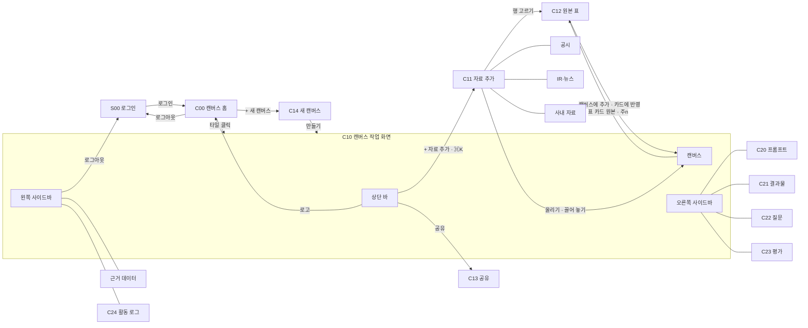
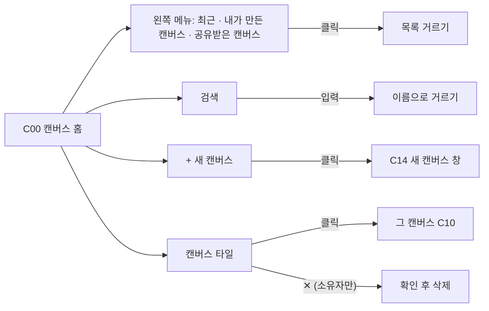
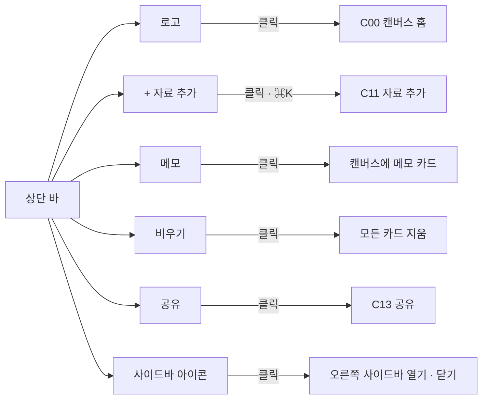
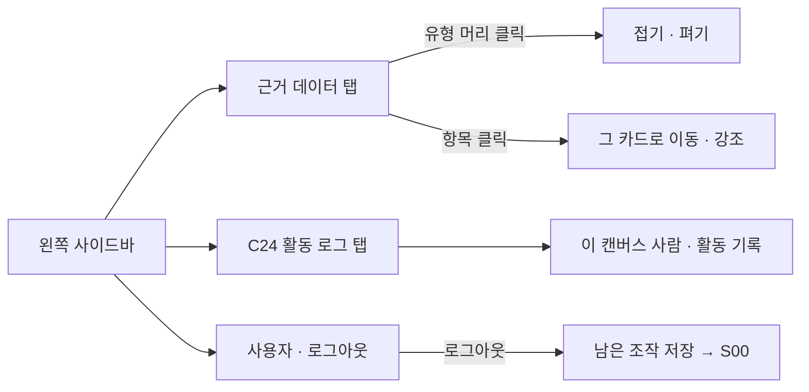
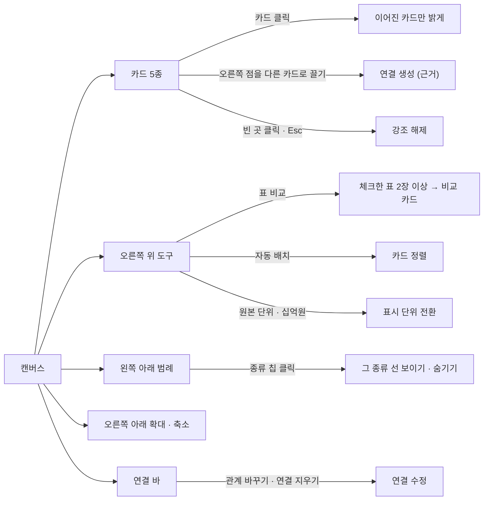
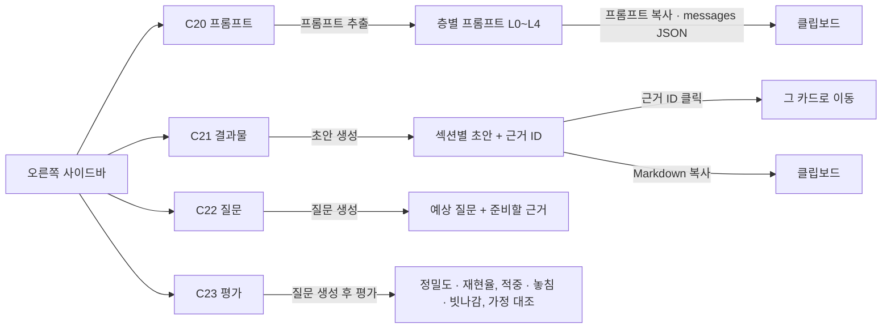
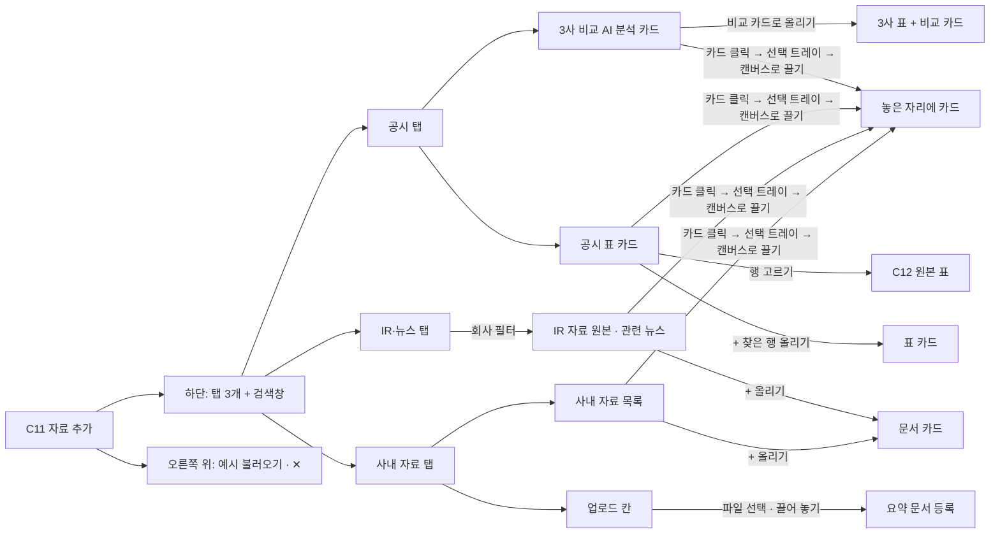
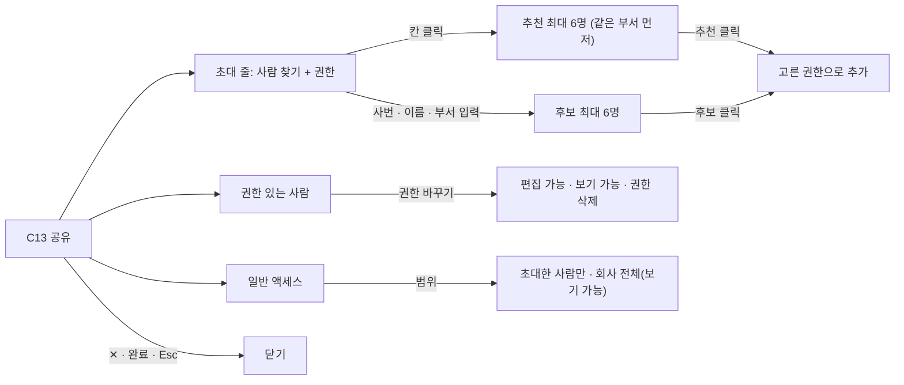
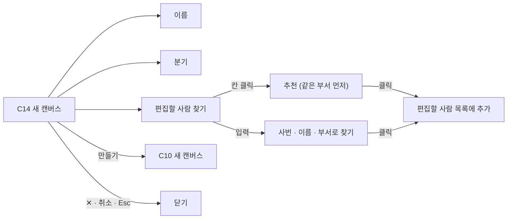
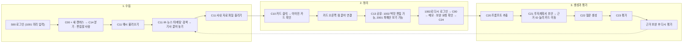

# 화면별 Information Architecture (IA)

v02-canvas 데모(코드 `frontend/`, 빌드 `docs/frontend/demo.html`) 화면을 기준으로, 메뉴 → 화면 → 기능(클릭 → 결과)을 정리했다. 화면에서 부르는 API는 [API 명세](api-spec.md)의 절 번호로 적고, 호출 흐름은 [API 다이어그램](api-diagram.md)을 본다.

- 기준 코드: `frontend/src` (`App.vue`, `components/*.vue`, `components/nodes/*.vue`)
- 기능 ID(F-xx), 등급(must / should / 추가), 데모 시나리오는 [기획서](../planning/기획서.md)를 따른다.
- 화면 ID는 Figma 프레임 이름, 데모 화면, Vue route name을 잇는 공통 키다(기획서 7장).
- `데모 전용`으로 표시한 항목은 실제 서비스에서 빠지거나 바뀐다.

## 변경 이력

| 날짜 | 내용 |
|---|---|
| 2026-11-25 | CodeRabbit(PR #96) 반영: 권한이 사라진 캔버스는 홈으로, 보기 권한에서 키보드 · 끌어 놓기로도 편집 안 됨, 공유 창 Enter로 첫 후보 초대, C14 행을 7장으로 이동 |
| 2026-11-25 | 탭 줄 삭제(홈은 상단 로고로). 새 캔버스 창(C14) 추가: 이름 · 분기 · 편집할 사람. 캔버스 제목 옆은 분기만 표시, 제목은 두 번 눌러 이름 변경. 공유 창 일반 액세스를 초대한 사람만 / 회사 전체(보기)로 줄이고 찾기 칸 추천 표시. 아이콘 색을 연하게 |
| 2026-11-25 | C11에서 Tab · Shift+Tab 탭 전환 복원 |
| 2026-11-25 | 화면에서 데모 · 목업 언급 삭제: 상단 부제, 로그인 안내 문구, 활동 로그 안내, 자료의 "(목업)" 표기. 빈 캔버스 안내 창, 탭 · 사이드바 · 카드의 설명 문구 삭제. 이름을 `Telescope`로 통일 |
| 2026-11-25 | 캔버스 홈(C00)과 공유 창(C13) 추가. 로그인 뒤 캔버스 홈으로 감. 상단 바 팀원 아바타 · 작성자 선택과 왼쪽 사이드바 캔버스 목록을 지우고, 캔버스마다 소유자 · 편집 · 보기 권한을 둠 |
| 2026-11-25 | C11 · C12를 빈 곳 클릭으로 닫던 동작 제거 |
| 2026-11-25 | v01-stella v05 IA 형식으로 재구성. 기획서 대응표, 범용 설정 위치, 공통 셸, 상태와 예외, 값 표시 규칙, 데모 시나리오, 권한 후보, 열린 질문 추가. 화면 ID를 기획서 7장 예시(C10~C24)로 바꿈(예전 ID는 7장 표). 기능 ID를 기획서 4장에 맞춤(질문 F-13, 평가 F-14·F-15) |
| 2026-11-25 | 로그인: 데모 계정 펼치기 대신 데모 계정(1001)을 미리 입력 |

## 0. 기획서 기능 ↔ 화면 ↔ 등급

| 기능 | 등급 | 화면 | 데모 |
|---|---|---|---|
| F-01 공시 표 검색·올리기 | **must** | C11 공시 탭, C12 원본 표, C10 공시 표 카드 | 구현 |
| F-02 IR·뉴스 검색·올리기 | **must** | C11 IR·뉴스 탭, C10 문서 카드 | 구현 |
| F-03 사내 자료 업로드·요약 | **must** | C11 사내 자료 탭, C10 문서 카드 | 목업 (텍스트 파일만) |
| F-04 임베딩 통합 검색 | should | C11 하단 검색창 (탭별 검색만) | 미구현 |
| F-05 계정 대응 비교 | should | C10 표 비교 · 비교 카드 | 구현 |
| F-06 관계 연결 | **must** | C10 연결선 · 연결 바 · 범례 · 같은 개념 점선 | 구현 |
| F-07 메모·팀 공유 | **must** | C10 메모 카드, C13 공유, C24 활동 로그 | 목업 (다른 사번으로 다시 로그인) |
| F-08 동시 편집·권한 | 추가 | C00 캔버스 홈, C13 공유(소유자 · 편집 · 보기 권한) | 권한만 목업, 동시 편집 미구현 |
| F-09 컨텍스트 추출 | **must** | C20 프롬프트 | 구현 |
| F-10 결과물 초안 생성 | **must** | C21 결과물 | 목업 (규칙 기반) |
| F-11 근거 추적 | **must** | C21 · C22 근거 ID → C10 카드 이동 | 구현 |
| F-12 양식·기준 설정 | should | 1장 표의 위치 (`analysis.json`) | 구현 |
| F-13 애널리스트 예상 질문 | **must** | C22 질문 | 목업 (질문 뱅크) |
| F-14 다음 분기 평가 | **must** | C23 평가 | 목업 |
| F-15 시점 통제 | **must** | C23 평가, 데이터 분리 | 데이터 분리로 표현 |
| F-16 정답표 관리 | should | 화면 없음 | 미구현 |
| F-17 3사 비교 AI 분석 | should | C11 공시 탭 분석 카드 | 목업 (`analysis.json`) |
| F-18 비교 시각화 | 추가 | C10 비교 카드 `시각화` · 시각화 카드 | 구현 |
| 로그인 (인증) | 기획서 미정의 | S00 | 목업 (사번 + 아무 비밀번호) |
| 캔버스 홈 | 기획서 미정의 (F-08에 가까움) | C00 | 목업 (브라우저 저장) |

## 1. 범용 설정 (F-12, should): 어디서 바꾸나

기획서 3장 "회사·양식·평가 기준은 코드가 아닌 설정에서 바꿈"에 대응한다. 데모는 화면에서 바꾸지 않고 설정 파일을 고친다.

| 설정 | 데모 위치 | 화면에 드러나는 곳 |
|---|---|---|
| 결과물 양식 (사업기획서 · 투자계획서 · 예산서 섹션, 목표) | `data/demo/analysis.json` `deliverables` | C20 · C21 `결과물 유형` 선택, C21 섹션 |
| 질문 기준 (질문 뱅크, 중요도, 준비할 근거) | `data/demo/analysis.json` `questions` | C22 |
| 평가 기준 (다음 분기 실적, 리포트 쟁점) | `data/demo/analysis.json` `next_quarter` | C23 |
| 개념 태그 이름 | `data/demo/analysis.json` `tag_names` | C10 문서 카드 개념 태그, 같은 개념 점선 |
| 3사 비교 분석 카드 | `data/demo/analysis.json` `insights` | C11 공시 탭 |
| 대상 회사 · 공시 표 | `data/demo/manifest.json`, `data/demo/*.csv · *.xml` | C11 공시 탭, IR·뉴스 회사 필터 |

## 2. 전체 구조



## 3. 공통 셸

로그인하면 C00 캔버스 홈으로 가고, 캔버스를 고르면 C10 캔버스 작업 화면이 열린다. C10은 아래 틀을 항상 유지하고, C11 · C12 · C13은 그 위에 겹쳐 뜬다. C14는 C00 위에 뜬다. 다른 캔버스로 가려면 상단 로고로 C00에 돌아가 고른다.

```
┌ 상단 바: 로고(홈) · 캔버스 제목 · 분기 · + 자료 추가 · 메모 · 비우기 · 공유 · 사이드바 ┐
├──────────────┬───────────────────────────────────┬──────────────────────┤
│ 왼쪽 사이드바 │ 캔버스                             │ 오른쪽 사이드바       │
│ 근거 데이터   │  오른쪽 위: 표 비교·자동 배치·단위   │ C20 프롬프트          │
│ C24 활동 로그 │  왼쪽 아래: 선 종류 범례            │ C21 결과물            │
│              │  오른쪽 아래: 확대·축소             │ C22 질문 · C23 평가   │
│ 사용자·로그아웃│                                   │ 맨 아래 실행 버튼      │
└──────────────┴───────────────────────────────────┴──────────────────────┘
```

- 캔버스마다 권한이 있다: 소유자(만든 사람), 편집 가능, 보기 가능. 편집 가능은 직접 초대(C13, 또는 만들 때 C14)로만 주고, 일반 액세스는 초대한 사람만 / 회사 전체(보기 가능) 둘 중 하나다. 새 캔버스는 초대한 사람만으로 시작한다.
- 작성자는 항상 로그인 사용자다. 다른 사람 입장은 다른 사번으로 다시 로그인해 본다(데모).
- 조작은 모두 이벤트로 저장하고(API 3.6), 새로고침하면 저장된 사용자와 캔버스를 복원한다.
- 겹침 화면: C11은 흰 전체 화면, C12 · C13은 캔버스 위 창. C11은 `✕` · Esc, C12는 `닫기`, C13은 `✕` · `완료` · Esc, C14는 `✕` · `취소` · Esc로 닫는다. 빈 곳을 눌러도 닫히지 않는다.
- 색: 배경은 흰색, 강조는 보라(`--primary`). 선 아이콘(홈 · 사이드바 · 접기 · 업로드 · ✕)은 글자보다 연한 회색(`--icon`), 로고 별은 연한 보라(`--logo`), 내 아바타는 연보라 바탕. 회사색(SKT 보라, KT 주황, LGU+ 초록)과 자료 종류색은 5장 규칙에만 쓴다.

## 4. 화면별 상세

### 4.1 S00 로그인


| 구성 요소 | 조작 | 결과 | API |
|---|---|---|---|
| 로고, 제목 `Telescope` | — | — | — |
| 사번 입력 | 입력 | 오류 문구 지움. 데모는 데모 계정 사번 `1001`(이재무, 네트워크센터 · 재무기획)이 미리 들어 있음 | — |
| 비밀번호 입력 | 입력 | 오류 문구 지움. 데모는 값이 미리 들어 있고 아무 값이나 통과 | — |
| `로그인` 버튼 | 클릭 · Enter | 성공: C00 캔버스 홈으로 이동. 실패: 빈 칸이면 "사번과 비밀번호를 입력하세요", 없는 사번이면 "사번을 확인하세요" | 2.1, 3.1 |

새로고침하면 저장된 사용자로 자동 로그인하고, 보던 캔버스가 있고 아직 볼 수 있으면 그 캔버스를, 아니면 C00을 연다(API 2.2).

### 4.2 C00 캔버스 홈

Figma 파일 목록처럼 내가 볼 수 있는 캔버스를 모두 모아 보는 화면이다.



| 영역 | 구성 요소 | 조작 | 결과 | API | 기능 ID |
|---|---|---|---|---|---|
| 왼쪽 메뉴 | 로고 `Telescope` | — | — | — | — |
| | `최근` · `내가 만든 캔버스` · `공유받은 캔버스`, 메뉴별 개수 | 클릭 | 목록 거르기. 처음은 `최근` | 3.1 `filter` | F-08 |
| | 맨 아래 사용자(이름, 부서 · 직무), `로그아웃` | 클릭 | S00으로 | — | — |
| 위 | 제목(고른 메뉴 이름), 검색 `캔버스 이름 검색` | 입력 | 입력하는 대로 이름으로 거름 | 3.1 `q` | — |
| | `+ 새 캔버스` | 클릭 | C14 새 캔버스 창 | — | — |
| 타일 격자 | 미리보기(카드 위치를 작은 사각형으로, 자료 종류색), 이름, `{수정자} · {시각} 수정 · 카드 {n}`, `{내 권한} · {공유 범위}` | 클릭 | 그 캔버스를 C10으로 엶. 보기 권한이면 보기 전용 | 3.4 | — |
| | `✕` (소유자 타일에 마우스를 올리면) | 클릭 | "공유받은 사람 모두에게서 지워집니다" 확인 후 삭제 | 3.3 | — |
| 빈 상태 | — | — | "볼 수 있는 캔버스가 없습니다." 검색 결과가 없으면 "검색어와 맞는 캔버스가 없습니다." | — | — |

공유 범위 표기: `초대한 사람만`, `회사 전체 보기`. 내 권한 표기: `소유자`, `편집 가능`, `보기 가능`.

### 4.3 C10 캔버스 작업 화면

#### 4.3.1 상단 바



| 구성 요소 | 조작 | 결과 | API | 기능 ID |
|---|---|---|---|---|
| 로고 | 클릭 | C00 캔버스 홈 | 3.1 | — |
| 캔버스 제목 | 두 번 클릭 → 입력 → Enter · 포커스 해제 | 이름 변경. 빈 값이면 "제목 없는 캔버스". 보기 권한이면 바꿀 수 없음 | 3.3 | — |
| 분기 | — | 만들 때 고른 분기(예: `2026년 1분기`). 회사 이름은 넣지 않음 | 3.1 `quarter` | — |
| `보기 전용` (보기 권한일 때만) | — | `+ 자료 추가` · `메모` · `비우기` 대신 표시 | — | F-08 |
| `+ 자료 추가` | 클릭 · ⌘K | C11 열기 (다시 ⌘K면 닫기) | — | F-01~03 |
| `메모` | 클릭 | 빈 메모 카드 추가 | 3.6 `add_memo` | F-07 |
| `비우기` | 클릭 (카드 없으면 비활성) | 캔버스의 모든 카드 지움 | 3.6 `remove_card` | — |
| `공유` | 클릭 | C13 공유 창 열기. 보기 권한이면 읽기만 | 3.9 | F-07, F-08 |
| 오른쪽 사이드바 아이콘 | 클릭 | 오른쪽 사이드바 열기 · 닫기. 닫아도 결과와 입력은 남음 | — | — |

`+ 자료 추가`, `메모`, `비우기`는 편집 권한 이상에만 보인다.

#### 4.3.2 왼쪽 사이드바 (근거 데이터 · C24 활동 로그)



| 영역 | 구성 요소 | 조작 | 결과 | API | 기능 ID |
|---|---|---|---|---|---|
| 근거 데이터 탭 | 유형 묶음: 공시 표, IR·뉴스, 사내 자료, 비교·시각화, 메모 | 유형 머리 클릭 | 접기 · 펴기 | — | F-11 |
| | 항목 (제목, 부가 정보, 회사 표시) | 클릭 | 그 카드로 화면 이동, 강조 | — | F-11 |
| C24 활동 로그 탭 | 이 캔버스 사람 (이름, 부서 · 직무 · 권한) | — | 이 캔버스에 권한 있는 사람 전원(소유자 먼저) | 3.9 | F-07 |
| | 활동 기록 (작성자, 한 일, 시각) | — | 최근 80건. 없으면 "아직 기록이 없습니다." | 3.7 | F-07 |
| 맨 아래 | 사용자 (이름, 부서 · 직무), `로그아웃` | 클릭 | 남은 조작을 보내고 S00으로 | — | — |

캔버스 목록은 C00 캔버스 홈으로 옮겼다.

#### 4.3.3 캔버스



**캔버스 공통**

| 구성 요소 | 조작 | 결과 | API | 기능 ID |
|---|---|---|---|---|
| 카드 | 끌기 | 위치 이동. 프롬프트는 바뀌지 않음 | 3.6 `move_card` | — |
| | 클릭 | 그 카드와 선 하나로 이어진 카드만 밝게, 나머지는 흐리게 | — | F-06 |
| | 오른쪽 점을 다른 카드로 끌기 | `근거` 관계로 연결 | 3.6 `add_link` | F-06 |
| 연결선 | 클릭 | 위쪽에 연결 바 표시 | — | F-06 |
| 연결 바 | `{카드} → {카드}`, 관계 선택(근거 · 설명 · 반박 · 관련), `연결 지우기`, `✕` | 관계 변경, 연결 삭제, 바 닫기 | 3.6 `set_link`, `remove_link` | F-06 |
| 같은 개념 자동 점선 | 카드 고르기 | 고른 카드에 닿는 점선만 개념 이름과 함께 표시 | 3.8 | F-06 |
| 오른쪽 위 `표 비교` | 클릭 (체크한 표 2장 미만이면 비활성) | 체크한 표 카드로 비교 카드 생성 | 3.6 `create_compare`, 6.1 | F-05 |
| 오른쪽 위 `자동 배치` | 클릭 | 카드 자동 정렬 | 3.6 `move_card` | — |
| 오른쪽 위 `원본 단위` · `십억원` | 클릭 | 표시 단위만 바꿈 | — | — |
| 왼쪽 아래 범례 | 근거 · 설명 · 반박 · 관련 · 비교 원본 · 같은 개념(자동) 칩 클릭 | 종류별 선 보이기 · 숨기기. 같은 개념은 기본 꺼짐 | — | F-06 |
| 오른쪽 아래 `−` · `{n}%` · `+` | 클릭 | 축소, 화면에 맞추기, 확대 | — | — |
| 오류 바 | `닫기` | 이벤트 반영 · 캔버스 복원 실패 안내 닫기 | — | — |
| 파일 · 카드 끌어 놓기 | C11에서 끌어 캔버스에 놓기 | 놓은 자리에 카드 추가 | 3.6 | F-01~03 |

**카드 5종**

| 카드 | 구성 요소 | 조작 | 결과 | API | 기능 ID |
|---|---|---|---|---|---|
| 공시 표 | 머리: 회사 · 표 제목, `비교` 체크, `원본`, `✕` | `비교` 체크 | 표 비교 대상에 넣음 | — | F-05 |
| | | `원본` | C12를 이 카드의 행 고르기로 엶 | 4.2 | F-01 |
| | 표: 계정 · 기간 열 | 열 머리 클릭 | 정렬 (오름 → 내림 → 해제) | 3.6 `sort_card` | — |
| | | 값 셀 고치기 | 수정값 저장, 원본 값은 툴팁 | 3.6 `edit_cell` | — |
| | | 행 `✕` | 행 제거 | 3.6 `remove_row` | — |
| | | `주n` | 주석 표를 C12로 엶 | 4.2 | F-01 |
| | 바닥: 단위 · 행 수, `비교 열` 선택 | 기간 고르기 | 비교 기준 열 변경 | 3.6 `select_period` | F-05 |
| 비교 | 머리: `시각화`, `✕` | `시각화` | 아래에 시각화 카드 생성 | — | F-18 |
| | 원본 표별 기간 선택 | 고르기 | 원본 카드의 비교 열 변경 | 3.6 `select_period` | F-05 |
| | 계정 줄 (회사별 값, 맞춘 이유) | `✓` · `✗` | 계정 대응 확정 · 거부 | 3.6 `confirm_mapping`, 6.1 | F-05 |
| 시각화 | 계정 칩, 막대그래프, `✕` | 칩 클릭 | 그 계정 막대 보이기 · 숨기기. 화면 전용, 프롬프트에 안 들어감 | 6.1 | F-18 |
| 문서 (IR · 뉴스 · 사내) | 종류, 제목, 회사 / 발행처 / 발행일, 요약, 수치 표(f번호), 개념 태그, `출처 열기` 또는 `사내 보관`, `✕` | `출처 열기` | 새 탭으로 원문 | 5.2 | F-02, F-03 |
| | 자료를 찾을 수 없을 때 | — | "자료를 찾을 수 없습니다" 상태 카드 | — | — |
| 메모 | 머리: `메모 \| 보완 요청`, `✕` / 작성자 / 본문 | `메모` · `보완 요청` | 종류 변경. 보완 요청은 빨간 테두리 | 3.6 `set_memo_type` | F-07 |
| | | 본문 입력 | 메모 저장 | 3.6 `edit_memo` | F-07 |

모든 카드의 `✕`는 카드를 지운다(API 3.6 `remove_card`). 비교 카드를 지우면 그 시각화 카드도 함께 지운다.

#### 4.3.4 오른쪽 사이드바 (C20~C23)



탭마다 맨 아래 가운데 버튼으로 실행한다. 카드가 없으면 비활성. 실행 뒤 캔버스가 바뀌면 "캔버스가 바뀌었습니다. 다시 생성하세요."를 띄운다.

| 탭 | 구성 요소 | 조작 | 결과 | API | 기능 ID |
|---|---|---|---|---|---|
| 공통 (C20 · C21) | `결과물 유형` 선택 | 고르기 | 초안 양식 변경 | 7.1 | F-10, F-12 |
| C20 프롬프트 | `추가 요청` 입력 | 입력 | L4 요청 층에 들어감 | — | F-09 |
| | `프롬프트 추출` | 클릭 | 층별(L0 시스템 ~ L4 요청) 내용, 해시, 글자 수. 최근 바뀐 층 표시 | 7.2 | F-09 |
| | `프롬프트 복사`, `messages JSON` | 클릭 | 클립보드 복사 | — | F-09 |
| C21 결과물 | `초안 생성` · `초안 다시 생성` | 클릭 | 양식 이름 · 목표, 근거 인용 줄 수 · 근거 부족 항목 수, 섹션별 문장과 값 유형(공시 · IR · 뉴스 · 사내 · AI 해석 · 근거 부족) | 7.3, 7.4 | F-10 |
| | 근거 ID | 클릭 | 그 카드로 이동 · 강조 | — | F-11 |
| | `Markdown 복사` | 클릭 | 초안을 Markdown으로 복사 | — | F-10 |
| C22 질문 | `질문 생성` · `질문 다시 생성` | 클릭 | 중요도, 질문, 이유, 준비할 근거 ID | 7.5 | F-13 |
| | 근거 ID | 클릭 | 그 카드로 이동 · 강조 | — | F-11 |
| | `질문 생성 후 평가` | 클릭 | 정밀도 · 재현율 막대, 적중(쟁점 링크) · 놓침 · 빗나감 목록 | 7.5, 7.6 | F-14 |
| | 초안 가정과 실적 표 | — | 항목 · 가정 · 실적 · 차이 · 판정(유지 · 재검토). 사용자가 고친 값은 가정에서 뺌 | 7.6 | F-14 |

### 4.4 C11 자료 추가



**공통**

| 구성 요소 | 조작 | 결과 | API |
|---|---|---|---|
| 하단 탭 `공시` · `IR·뉴스` · `사내 자료` | 클릭 · Tab · Shift+Tab · ⌘/Ctrl+1~3 | 탭 전환. 처음 열면 `공시` | — |
| 하단 검색창 | 입력 | 입력하는 대로 결과가 바뀜 (버튼 없음). 탭마다 안내 문구가 다름 | 4.1, 4.3, 5.1 |
| `예시 불러오기` (데모 전용) | 클릭 | 공시 표 · 비교 · 시각화 · 문서 · 보완 요청 메모 · 연결이 든 예시 캔버스 | — |
| `✕`, Esc | 클릭 · 키 | 닫기. 빈 곳 클릭으로는 닫히지 않음 | — |
| 결과 카드 | 클릭 | 선택. 선택한 카드는 아래 트레이에 모임 | — |
| | 캔버스로 끌기 | 놓은 자리에 카드 추가 | 3.6 |
| 선택 트레이 | `선택한 n개를 캔버스로 끌어다 놓으세요`, `카드 더 고르기`, `선택 해제`, 항목별 `✕` | 트레이를 끌어 놓으면 한꺼번에 추가 | 3.6 |

**탭별**

| 탭 | 구성 요소 | 조작 | 결과 | API | 기능 ID |
|---|---|---|---|---|---|
| 공시 | 3사 비교 AI 분석 카드: 제목, 사실 표(1Q25 · 1Q26 · 증감, 십억원), AI 해석, 근거 뉴스 링크 2건 | 검색어 입력 | 검색어가 닿는 개념의 카드만. 없으면 "검색어와 닿는 비교 분석이 없습니다." | 4.3 | F-17 |
| | | `비교 카드로 올리기 · 3사 표 n개` | 3사 공시 표 카드와 비교 카드를 올림 | 4.2, 3.6 | F-17, F-05 |
| | 공시 표 카드: 회사, 표 제목, 연결/별도 · 기간, 찾은 행과 이유, 회사 · 단위 | (검색어가 있을 때만 표시) | 점수 순. 없으면 "일치하는 계정이 없습니다." | 4.1 | F-01 |
| | | `행 고르기` | C12에서 찾은 행을 표시한 채로 엶 | 4.2 | F-01 |
| | | `+ 찾은 행 올리기` | 찾은 행만 표 카드로 올림 | 4.2, 3.6 | F-01 |
| IR·뉴스 | 회사 필터: 전체 · SKT · KT · LGU+ · 3사 공통 | 클릭 | 그 회사 자료만 | 5.1 | F-02 |
| | `IR 자료 원본` 줄, `관련 뉴스` 줄의 문서 카드: 종류, 제목, 요약, 수치 2개, 추천 이유, 회사 · 발행처 · 날짜, 원문 링크, `+ 올리기` | 검색어 없음 | 캔버스의 회사 · 개념과 많이 겹치는 순 | 5.1 | F-02 |
| | | `+ 올리기` | 문서 카드 추가. 이미 있으면 `올림`(비활성) | 3.6 `add_doc` | F-02 |
| 사내 자료 | 목록 줄: `사내`, 제목 · 요약, 수치 2개, 발행처 · 날짜, `+ 올리기` | `+ 올리기` | 문서 카드 추가 | 3.6 `add_doc` | F-03 |
| | 업로드 칸: "클릭하거나 파일을 끌어 놓으세요", 허용 형식 안내 | 클릭 · 화면 어디든 파일 끌어 놓기 | "요약하는 중" → 목록에 요약 문서 추가. 실패하면 "파일을 읽지 못했습니다: {사유}" | 5.3 | F-03 |

### 4.5 C12 원본 표


| 구성 요소 | 조작 | 결과 | API | 기능 ID |
|---|---|---|---|---|
| 머리: 회사 · 표 제목 · 기간, 연결/별도 · 단위 · 접수번호, `닫기` | `닫기` | 닫기. 바깥 클릭으로는 닫히지 않음 | 4.2 | F-01 |
| 가져올 열 체크 (C11에서 열었을 때만) | 체크 · 해제 | 카드에 넣을 기간 열 | — | F-01 |
| 표 위 설명, 원본 표 | 행 누르고 끌기 | 여러 행 선택 · 해제. 검색으로 찾은 행은 표시됨 | — | F-01 |
| 바닥: `선택 n행 × n열` | — | 선택 개수 | — | — |
| `전체 행 선택`, `선택 해제` | 클릭 | 선택 바꿈 | — | — |
| `캔버스에 추가` (C11에서 열었을 때) | 클릭 | 고른 행 · 열로 새 표 카드 | 3.6 `add_card` | F-01 |
| `카드에 반영` (표 카드 `원본`에서 열었을 때) | 클릭 | 기존 카드에 행 추가 · 제거 | 3.6 `add_rows`, `remove_row` | F-01 |

### 4.6 C13 공유

상단 바 `공유`로 여는 창이다. 사내 사람을 찾아 권한을 주고, 일반 액세스 범위를 정한다.



| 영역 | 구성 요소 | 조작 | 결과 | API | 기능 ID |
|---|---|---|---|---|---|
| 머리 | `'{캔버스}' 공유`, `✕` | `✕` | 닫기 | — | — |
| 초대 줄 | 입력 "사번, 이름, 부서로 사내 사람 찾기", 권한 선택(편집 가능 / 보기 가능) | 클릭 · 포커스 | 빈 칸이면 `추천` 목록(이미 권한 있는 사람을 뺀 같은 부서 사람 먼저, 최대 6명). 아래 내용을 밀지 않는 드롭다운 | 2.3 | F-08 |
| | | 입력 | 이미 권한 있는 사람을 뺀 후보(이니셜, 이름, 사번 · 부서 · 직무). 없으면 "찾는 사람이 없거나 이미 권한이 있습니다." | 2.3 | F-08 |
| | 추천 · 후보 | 클릭 · Enter(첫 후보) | 고른 권한으로 바로 추가, 입력 비우고 목록 닫음. 활동 로그에 "공유 권한을 바꿈" | 3.9 `PUT` | F-07, F-08 |
| 권한 있는 사람 | 이니셜, 이름(나), 부서 · 직무, 권한 | 권한 선택 | 편집 가능 · 보기 가능으로 바꾸거나 권한 삭제. 소유자는 `소유자` 글자로 고정 | 3.9 `PUT` | F-08 |
| 일반 액세스 | 범위 선택(초대한 사람만 / 회사 전체). 권한 선택 없음 | 고르기 | 회사 전체면 회사 사람 누구나 보기 권한 | 3.9 `PUT` | F-08 |
| 바닥 | `완료` | 클릭 | 닫기 (바꾼 내용은 고를 때마다 이미 저장됨) | — | — |
| 보기 권한일 때 | "보기 권한이라 공유 설정을 바꿀 수 없습니다." | — | 초대 줄 없음, 권한 · 범위는 글자나 비활성 선택으로만 | 3.9 `GET` | F-08 |

권한 계산 순서는 소유자 → 직접 초대 → 일반 액세스다. 일반 액세스로 권한을 받은 사람은 이 목록에 따로 나오지 않고 C24 "이 캔버스 사람"에 나온다.

**보기 권한으로 연 C10**

| 구성 요소 | 표시 |
|---|---|
| 상단 바 | `+ 자료 추가` · `메모` · `비우기` 대신 `보기 전용`. `공유`는 남음 |
| 캔버스 | 오른쪽 위 도구(표 비교 · 자동 배치 · 단위) 숨김. 카드 이동 · 연결 · 카드 안 버튼과 입력 막힘(키보드로 눌러도 바뀌지 않고 "보기 권한만 있습니다." 오류 바). 다른 창에서 끌어 놓은 자료도 받지 않음. 원본 보기는 됨. 카드 고르기 · 강조, 범례, 확대 · 축소는 됨 |
| 캔버스 제목 | 두 번 눌러도 이름 바꾸기 안 됨 |
| 오른쪽 사이드바 | C20~C23 모두 그대로 실행 |
| ⌘K | 동작 안 함 |

### 4.7 C14 새 캔버스

C00의 `+ 새 캔버스`로 여는 창이다. 이름, 분기, 편집할 사람을 정해 만들고 바로 C10으로 연다.



| 구성 요소 | 조작 | 결과 | API | 기능 ID |
|---|---|---|---|---|
| 머리 `새 캔버스`, `✕` | `✕` | 닫기 | — | — |
| 이름 | 입력 | 기본값 `{부서} 캔버스 {n}`(내가 만든 캔버스 수 + 1). 비우면 기본값 | 3.2 `name` | — |
| 분기 | 고르기 | `2025년 1분기` ~ `2026년 4분기`, 기본 `2026년 1분기`. C10 상단 제목 옆에 표시 | 3.2 `quarter` | — |
| 편집할 사람 찾기 | 클릭 · 입력 · Enter | C13과 같은 추천 · 찾기 드롭다운. Enter는 첫 후보 추가. 고르면 목록 닫음 | 2.3 | F-07, F-08 |
| 사람 목록 | 나(소유자) + 추가한 사람(편집 가능), 사람마다 `✕` | `✕` | 목록에서 뺌 | — | F-08 |
| `취소` · `만들기` | 클릭 | 만들기: 캔버스를 만들고(일반 액세스는 초대한 사람만) C10으로 엶 | 3.2 | — |

### 4.8 상태와 예외

| 상황 | 화면 | 표시 |
|---|---|---|
| 빈 캔버스 | C10 | 안내 없이 빈 캔버스. 상단 `비우기`, 오른쪽 사이드바 실행 버튼 비활성 |
| 근거 데이터 없음 | C10 왼쪽 사이드바 | 빈 목록 |
| 활동 기록 없음 | C24 | "아직 기록이 없습니다." |
| 실행 전 | C20~C23 | 빈 탭과 맨 아래 실행 버튼만 |
| 캔버스 변경 후 | C21~C23 | "캔버스가 바뀌었습니다. 다시 생성하세요." |
| 근거 부족 | C21 | 근거 부족 항목 수, 해당 줄은 빨강 `근거 부족` |
| 질문 근거 없음 | C22 | "질문을 만들 근거가 없습니다." |
| 초안 없이 평가 | C23 | 가정 대조 자리에 "초안에 {회사} 공시값 가정이 없습니다." |
| 검색 결과 없음 | C11 공시 탭 | "일치하는 계정이 없습니다.", "검색어와 닿는 비교 분석이 없습니다." |
| 업로드 중 · 실패 | C11 사내 자료 탭 | "요약하는 중", "파일을 읽지 못했습니다: {사유}" |
| 자료를 찾을 수 없음 | C10 문서 카드 | 빨간 윗선, "자료를 찾을 수 없습니다" |
| 이벤트 반영 · 복원 실패 | C10 | 캔버스 위 오류 바, `닫기` |
| 로그인 실패 | S00 | "사번과 비밀번호를 입력하세요", "사번을 확인하세요" |
| 볼 수 있는 캔버스 없음 | C00 | "볼 수 있는 캔버스가 없습니다." |
| 검색 결과 없음 | C00 | "검색어와 맞는 캔버스가 없습니다." |
| 미리보기 없음 | C00 타일 | 카드가 없으면 미리보기 자리에 "빈 캔버스" |
| 보기 권한 | C10 | 상단 `보기 전용`, 캔버스 위 안내, 편집 도구 숨김 (4.6) |
| 보기 권한으로 편집 시도 | C10 | 오류 바 "보기 권한만 있습니다." |
| 권한이 풀린 캔버스 | C10 | 실제 서비스: "이 캔버스를 볼 권한이 없습니다." 후 C00 (API 3.4 403). 데모: 보던 중 권한이 사라지면(공유 창에서 내 권한 삭제 등) 바로 C00으로, 새로고침 때 볼 수 없으면 C00으로 |
| 초대 후보 없음 | C13 | "찾는 사람이 없거나 이미 권한이 있습니다." |

## 5. 값 표시 규칙

기획서 3장 설계 원칙(근거 ID, 값 유형 4종)을 화면에 옮긴 규칙이다.

| 내용 | 표시 |
|---|---|
| 공시 원본 숫자 | 공시 표 카드 셀. 셀 ID `표ID#r행c열`. C21에서는 회사색 `공시` 태그 |
| 사용자가 고친 값 | 셀에 수정값, 원본 값은 툴팁. C21 초안 줄에 "사용자 수정값" 표시, C23 가정 대조에서 제외 |
| IR · 뉴스 · 사내 문서 수치 | 문서 카드 수치 표의 f번호, 근거 ID `[doc:문서ID#f번호]`. 종류색: IR 보라, 뉴스 초록, 사내 노랑 |
| 계산값 (비교 증감 등) | 코드로 계산. 비교 카드 · 3사 비교 사실 표에 숫자로만 표시 |
| AI 해석 | 보라 `AI 해석` 태그 (C21 줄, C11 3사 비교 분석 카드) |
| 근거 부족 | 빨강 글자 + `근거 부족` 태그 (C21) |
| 근거 ID | 회색 바탕 보라 글자 고정폭. 누르면 C10의 해당 카드로 이동 · 강조 |
| 보완 요청 메모 | 빨간 테두리와 윗선 |
| 회사 | 카드 윗선과 회사 칩 색: SKT 보라, KT 주황, LGU+ 초록 |
| 권한 · 공유 범위 | 상자 없이 평범한 회색 글자 (`소유자 · 네트워크센터 전체 편집`) |
| 홈 미리보기 | 카드 위치를 사각형으로, 윗선 대신 테두리색: 공시 표 회사색(보라), 문서 초록, 메모 노랑, 비교 · 시각화 보라 |
| 선택한 카드 | 진한 테두리, 이어진 카드는 옅은 강조, 나머지와 선은 흐리게 |
| 표시 단위 | `원본 단위` · `십억원` 전환은 화면 표시만 바꾸고 원본과 프롬프트는 그대로 |
| 평가 자료 | 기준 분기(1Q26) 이후 자료는 C23에서만 씀 (F-15) |

## 6. 데모 시나리오

기획서 6장 시나리오를 화면 순서로 옮겼다. SKT 네트워크센터 재무기획 담당자(1001 이재무)가 KT · LGU+와 비교하며 투자계획서 초안을 만든다.



| 순서 | 화면 | 기획서 순서 | 기능 |
|---|---|---|---|
| 1 | S00 → C00 `+ 새 캔버스` → C14(분기, 편집할 사람 1002) → C10 → C11 `예시 불러오기` | 1 | F-01, F-05, F-06, F-18 |
| 2 | C11 IR·뉴스 검색 → 끌어 놓기 → C10 같은 개념 점선 | 2 | F-02, F-06 |
| 3 | C11 사내 자료 업로드 → C10 문서 카드 | 3 | F-03 |
| 4 | C10 연결 → C13 공유 → 다른 사번으로 로그인해 C00 `공유받은 캔버스` · 메모 · 보완 요청 → C24 활동 기록. 보기 권한(2001)으로 열면 보기 전용 | 4 | F-06, F-07, F-08 |
| 5 | C20 | 5 | F-09 |
| 6 | C21 → C10 카드 이동 | 6 | F-10, F-11 |
| 7 | C22 → C23 | 7 | F-13, F-14, F-15 |
| 8 | C11 자료 추가 → C23 다시 평가 | 8 | F-14 |

## 7. 화면 목록

**ID 규칙:** 기획서 7장 예시를 따른다. `S00` = 공통(로그인), `C` = 캔버스. 10 단위가 영역(C0x 홈, C1x 캔버스와 자료 · 공유, C2x 패널), 1 단위가 같은 영역 안의 화면 · 창 · 탭이다. C00 · C13은 기획서 7장 예시에 없어 새로 붙였다. 예전 ID는 이 문서의 이전 판 ID다.

Figma node는 v02 캔버스 프레임이 아직 없어 비워 둔다.

| ID | 예전 ID | 화면 | 들어가는 법 | 형태 | 요구사항 | Figma node |
|---|---|---|---|---|---|---|
| S00 | S1 | 로그인 | 첫 진입, 로그아웃 | 전체 화면 | 기획서 미정의 | — |
| C00 | — (새로 추가) | 캔버스 홈 (최근 · 내가 만든 · 공유받은 캔버스) | 로그인 성공, 상단 로고 | 전체 화면 | 추가 (F-08) | — |
| C10 | S2 | 캔버스 작업 화면 (상단 바, 왼쪽 사이드바, 캔버스, 오른쪽 사이드바) | C00 타일, C14 `만들기` | 전체 화면 | **must** | — |
| C11 | S3 | 자료 추가 (공시 · IR·뉴스 · 사내 자료) | 상단 `+ 자료 추가`, ⌘K/Ctrl+K | 캔버스 위 흰 전체 화면 | **must** | — |
| C12 | S4 | 원본 표 | C11 `행 고르기`, 표 카드 `원본` · `주n` | 캔버스 위 창 | **must** | — |
| C13 | — (새로 추가) | 공유 (초대 · 권한 · 일반 액세스) | 상단 `공유` | 캔버스 위 창 | **must** (F-07) · 추가 (F-08 권한) | — |
| C14 | — (새로 추가) | 새 캔버스 (이름 · 분기 · 편집할 사람) | C00 `+ 새 캔버스` | C00 위 창 | 추가 (F-08) | — |
| C20 | S2-5 프롬프트 | 프롬프트 (컨텍스트) | 오른쪽 사이드바 탭 | 탭 | **must** | — |
| C21 | S2-5 결과물 | 결과물 | 오른쪽 사이드바 탭 | 탭 | **must** | — |
| C22 | S2-5 질문 | 질문 | 오른쪽 사이드바 탭 | 탭 | **must** | — |
| C23 | S2-5 평가 | 평가 | 오른쪽 사이드바 탭 | 탭 | **must** | — |
| C24 | S2-3 활동 로그 | 활동 로그 | 왼쪽 사이드바 탭 | 탭 | **must** | — |

없앤 ID: S2-1 탭 줄, S2-2 상단 바, S2-3 왼쪽 사이드바, S2-4 캔버스, S2-5 오른쪽 사이드바(→ C10 공통 셸, C20~C24).

## 8. 권한

캔버스마다 소유자 · 편집 가능 · 보기 가능 세 권한을 둔다(F-08 중 권한 부분, 데모 목업). 동시 편집은 아직 없다.

| 기능 | 소유자 | 편집 가능 | 보기 가능 |
|---|---|---|---|
| 캔버스 열기, 카드 고르기 · 강조, C20~C23 실행 | ○ | ○ | ○ |
| 카드 · 연결 · 메모 편집, 자료 추가, 이름 바꾸기 | ○ | ○ | — |
| 공유 바꾸기 (C13) | ○ | ○ | 보기만 |
| 캔버스 지우기 (C00) | ○ | — | — |

**남은 확인 (현업)**

| 기능 | 화면 | 나눈다면 | 확인할 질문 |
|---|---|---|---|
| 공유 바꾸기 | C13 | 소유자만 | 편집 권한자도 다른 사람을 초대할 수 있어야 하나요? (데모는 가능) |
| 새 캔버스 기본 범위 | C14 | 초대한 사람만 (만들 때 편집할 사람 지정) | 부서 사람에게는 자동으로 권한을 줘야 하나요? |
| 카드 · 연결 편집 | C10 | 담당자, 같은 부서 공동 편집자 | 관계자(부서장 · 전사 재무기획)는 보기 권한으로 주나요? |
| 보완 요청 메모 | C10 메모 | 관계자(부서장 · 전사 재무기획) | 공동 편집자끼리도 보완 요청을 남기나요? |
| 사내 자료 올리기 | C11 사내 자료 | 같은 부서 모두 | 올린 자료를 다른 부서도 볼 수 있나요? |
| 평가 자료 · 정답표 | C23 | 담당자 | 정답표를 누가 쓰고 최종 판정하나요? (F-16) |

## 9. 열린 질문

- 팀 공유를 실시간 동시 편집까지 할지, 저장 · 불러오기 수준으로 할지 (기획서 8장 6)
- 사내 자료 접근 범위: 올린 사용자만 볼지, 부서 전체가 볼지
- 공유 알림: 초대받은 사람에게 알릴지, 알린다면 메일 · 사내 메신저 중 무엇으로
- 소유권 넘기기, 소유자 퇴사 · 부서 이동 시 처리
- 공유 링크 복사를 둘지 (Figma처럼)
- 임베딩 통합 검색(F-04)을 넣으면 하단 탭을 유지할지, 탭 없이 한 검색창으로 합칠지
- 예상 질문 적중 판정 기준과 정답표 작성 주체 (기획서 8장 4)
- 결과물 실제 섹션 양식 (기획서 8장 2, `analysis.json` `deliverables`)

## 10. 단축키

| 키 | 화면 | 동작 |
|---|---|---|
| ⌘K / Ctrl+K | C10, C11 | 자료 추가 열기 · 닫기 (보기 권한이면 동작 안 함) |
| ⌘/Ctrl+1 · 2 · 3 | C11 | 공시 · IR·뉴스 · 사내 자료 탭 |
| Tab · Shift+Tab | C11 | 공시 → IR·뉴스 → 사내 자료 순으로 탭 전환 (Shift+Tab은 반대로) |
| Esc | C11 | 자료 추가 닫기 |
| Esc | C10 | 연결 바 닫기, 카드 강조 해제 |
| Esc | C13 | 공유 창 닫기 |
