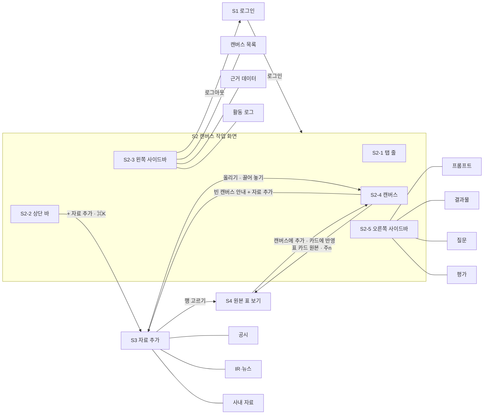
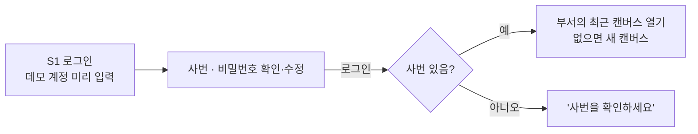
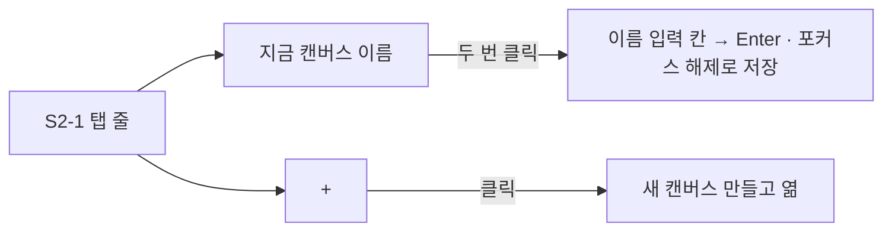
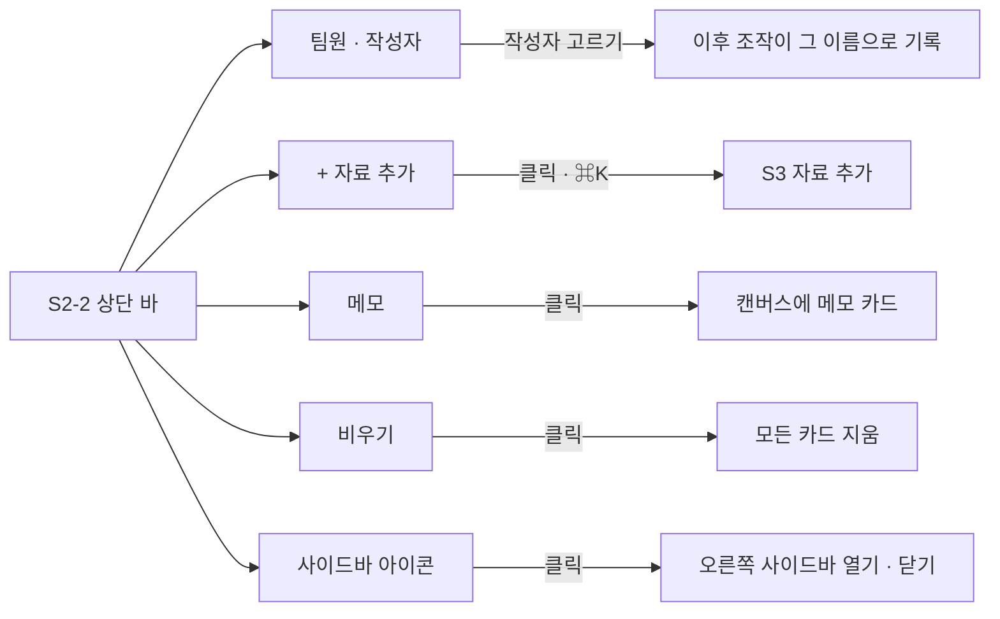
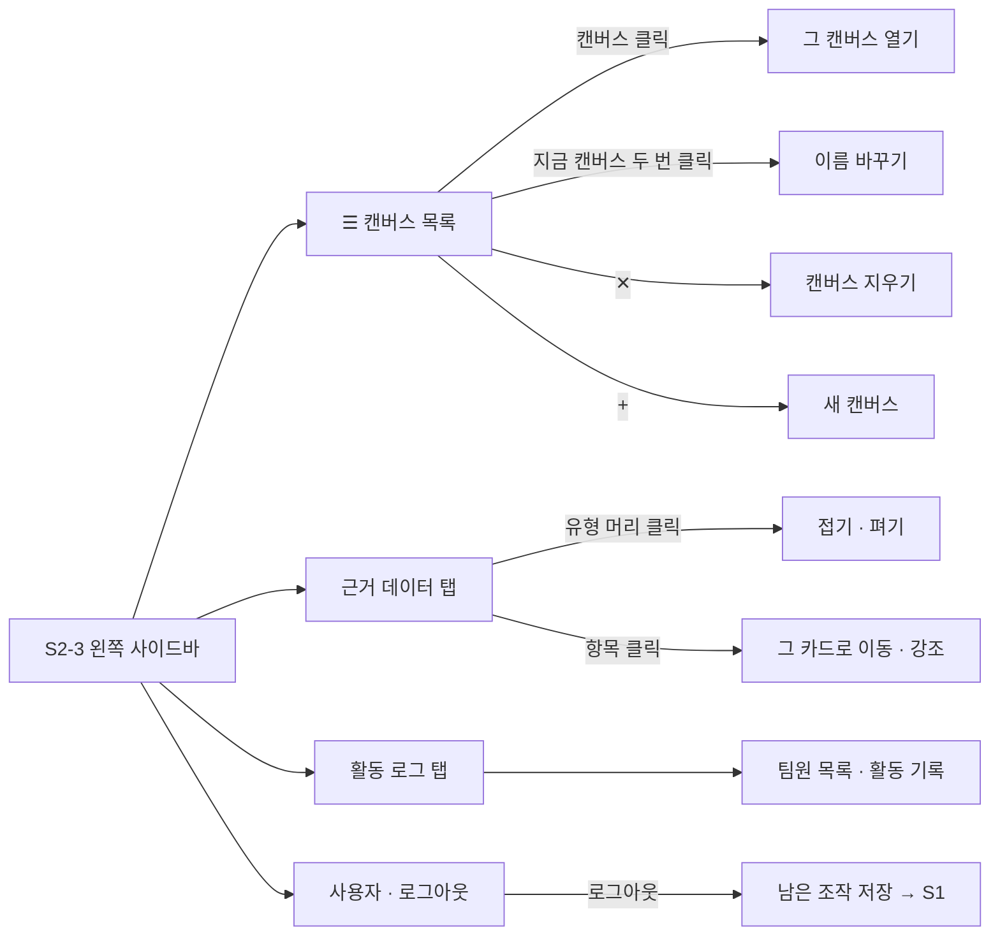
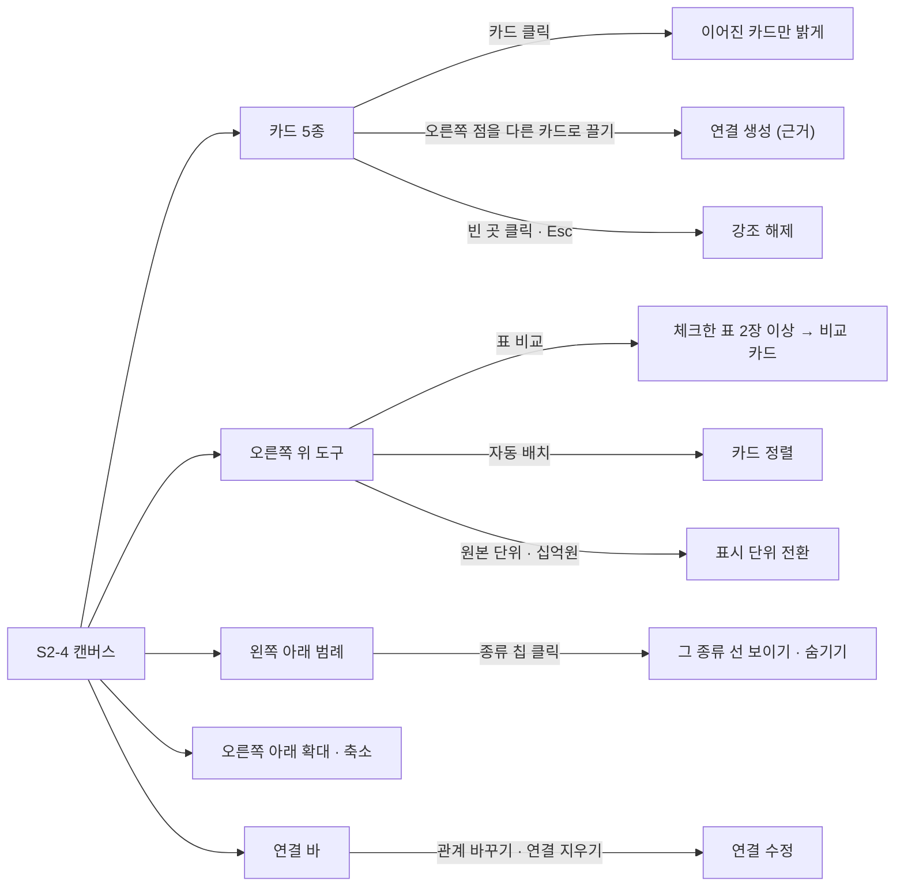
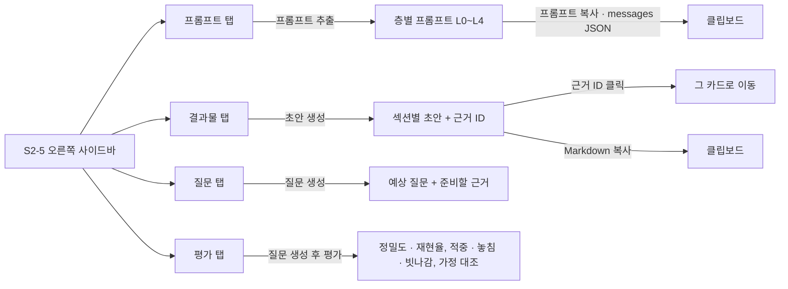
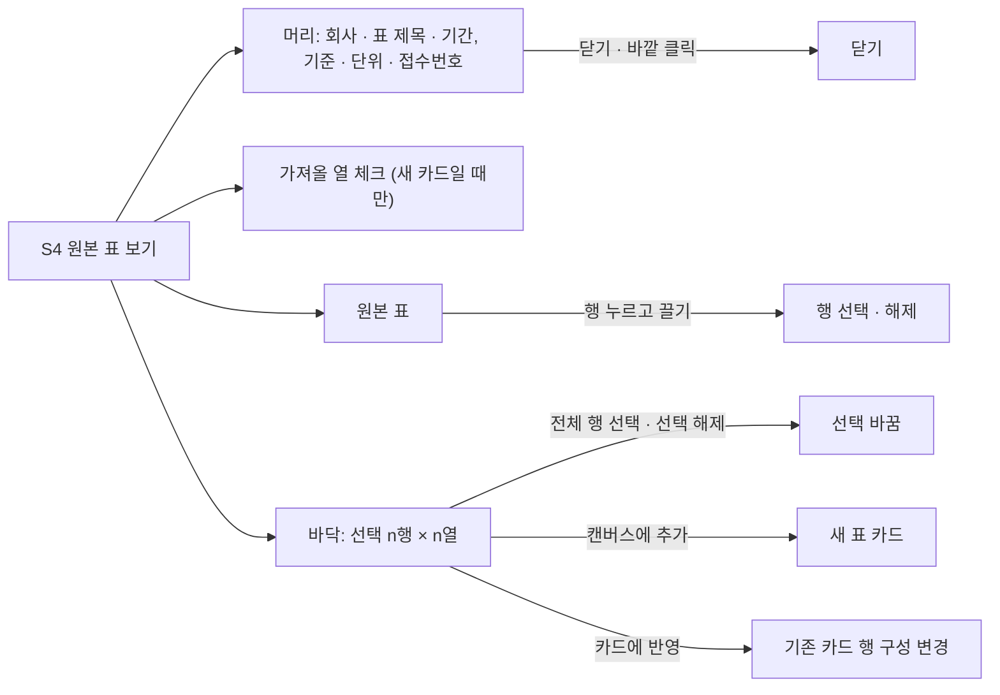

# 화면별 Information Architecture (IA)

v02-canvas 데모(`docs/planning/demo`) 화면을 기준으로, 메뉴 → 화면 → 기능(클릭 → 결과)을 정리했다. 화면에서 부르는 API는 [API 명세](api-spec.md)의 절 번호로 적고, 호출 흐름은 [API 다이어그램](api-diagram.md)을 본다.

- 기준 코드: `docs/planning/demo/_build/src` (`App.vue`, `components/*.vue`, `components/nodes/*.vue`)
- 기능 ID(F-xx)는 [기획서](../planning/기획서.md)의 ID다.
- `데모 전용`으로 표시한 항목은 실제 서비스에서 빠지거나 바뀐다.

## 1. 화면 목록

| ID | 화면 | 들어가는 법 | 형태 |
|---|---|---|---|
| S1 | 로그인 | 첫 진입, 로그아웃 | 전체 화면 |
| S2 | 캔버스 작업 화면 | 로그인 성공 | 전체 화면 (탭 줄, 상단 바, 왼쪽 사이드바, 캔버스, 오른쪽 사이드바) |
| S3 | 자료 추가 | 상단 `+ 자료 추가`, 빈 캔버스 안내의 `+ 자료 추가`, ⌘K/Ctrl+K | 캔버스 위 겹침 화면 |
| S4 | 원본 표 보기 | 자료 추가의 `행 고르기`, 표 카드의 `원본`, 표 행의 `주n` | 캔버스 위 겹침 화면 |

## 2. 전체 구조



## 3. S1 로그인



| 구성 요소 | 조작 | 결과 | API |
|---|---|---|---|
| 로고, 제목 `Telescope 캔버스`, 한 줄 설명 | — | — | — |
| 사번 입력 | 입력 | 오류 문구 지움. 데모는 데모 계정 사번 `1001`(이재무, 네트워크센터 · 재무기획)이 미리 들어 있음 | — |
| 비밀번호 입력 | 입력 | 오류 문구 지움. 데모는 값이 미리 들어 있고 아무 값이나 통과 | — |
| `로그인` 버튼 | 클릭 · Enter | 성공: S2로 이동, 그 사람 부서의 최근 캔버스(없으면 새 캔버스)를 엶. 실패: 빈 칸이면 "사번과 비밀번호를 입력하세요", 없는 사번이면 "사번을 확인하세요" | 2.1, 3.1, 3.4 |
| 안내 문구 (데모 전용) | — | 미리 입력된 데모 계정(사번 · 이름 · 부서 · 직무)과 실제 서비스는 사내 계정(SSO)이라는 안내. 다른 부서로 보려면 사번을 바꿔 입력 | — |

새로고침하면 저장된 사용자로 자동 로그인한다(API 2.2).

## 4. S2 캔버스 작업 화면

```
┌ S2-1 탭 줄: 부서 이름 · 지금 캔버스 이름 · + ──────────────────────────────────┐
├ S2-2 상단 바: 로고 · 캔버스 제목 · 팀원/작성자 · + 자료 추가 · 메모 · 비우기 · 사이드바 ┤
├──────────────┬───────────────────────────────────┬──────────────────────┤
│ S2-3         │ S2-4 캔버스                        │ S2-5                 │
│ 왼쪽 사이드바 │  오른쪽 위: 표 비교·자동 배치·단위   │ 오른쪽 사이드바       │
│              │  왼쪽 아래: 선 종류 범례            │ 프롬프트·결과물·질문·평가│
│              │  오른쪽 아래: 확대·축소             │                      │
└──────────────┴───────────────────────────────────┴──────────────────────┘
```

### 4.1 S2-1 탭 줄



| 구성 요소 | 조작 | 결과 | API |
|---|---|---|---|
| 부서 이름 | — | 로그인 사용자의 부서 | — |
| 지금 캔버스 이름 | 두 번 클릭 → 입력 → Enter · 포커스 해제 | 이름 변경. 빈 값이면 "제목 없는 캔버스" | 3.3 |
| `+` | 클릭 | `{부서} 캔버스 {n}`을 만들고 엶 | 3.2 |

### 4.2 S2-2 상단 바



| 구성 요소 | 조작 | 결과 | API | 기능 ID |
|---|---|---|---|---|
| 로고, 캔버스 제목 | — | 지금 캔버스 이름 | — | — |
| 팀원 아바타 | 마우스 올리기 | 이름 · 부서 · 직무 | 2.3 | F-07 |
| 작성자 선택 (데모 전용) | 같은 부서 사람 고르기 | 이후 조작과 활동 로그가 그 이름으로 기록. 실제 서비스는 로그인 사용자 | — | F-07 |
| `+ 자료 추가` | 클릭 · ⌘K | S3 열기 (다시 ⌘K면 닫기) | — | F-01~03 |
| `메모` | 클릭 | 빈 메모 카드 추가 | 3.6 `add_memo` | F-07 |
| `비우기` | 클릭 (카드 없으면 비활성) | 캔버스의 모든 카드 지움 | 3.6 `remove_card` | — |
| 오른쪽 사이드바 아이콘 | 클릭 | S2-5 열기 · 닫기. 닫아도 결과와 입력은 남음 | — | — |

### 4.3 S2-3 왼쪽 사이드바



| 영역 | 구성 요소 | 조작 | 결과 | API |
|---|---|---|---|---|
| 머리 | ☰ 캔버스 목록 아이콘 | 클릭 | 캔버스 목록으로 바꿈. 다시 누르면 원래 탭으로 | 3.1 |
| 캔버스 목록 | 제목 `{부서} 캔버스`, 개수, `+` | `+` 클릭 | 새 캔버스 | 3.2 |
| | 캔버스 항목 (이름, 카드 수 · 마지막 수정자 · 시각) | 클릭 | 그 캔버스 열기 (지금 캔버스의 남은 조작은 먼저 저장) | 3.4 |
| | | 지금 캔버스 두 번 클릭 | 이름 바꾸기 | 3.3 |
| | `✕` | 클릭 | 캔버스 지우기. 보고 있던 캔버스면 목록 첫 캔버스를 엶 | 3.3 |
| 근거 데이터 탭 | 유형 묶음: 공시 표, IR·뉴스, 사내 자료, 비교·시각화, 메모 | 유형 머리 클릭 | 접기 · 펴기 | — |
| | 항목 (제목, 부가 정보, 회사 표시) | 클릭 | 그 카드로 화면 이동, 강조 | — |
| | 빈 상태 | — | "캔버스에 올린 자료가 여기에 쌓입니다." | — |
| 활동 로그 탭 | 팀원 목록 (이름, 부서 · 직무) | — | 같은 부서 사용자 | 2.3 |
| | 활동 기록 (작성자, 한 일, 시각) | — | 최근 80건. 없으면 "아직 기록이 없습니다." | 3.7 |
| 맨 아래 | 사용자 (이름, 부서 · 직무), `로그아웃` | 클릭 | 남은 조작을 보내고 S1로 | — |

### 4.4 S2-4 캔버스



**캔버스 공통**

| 구성 요소 | 조작 | 결과 | API | 기능 ID |
|---|---|---|---|---|
| 빈 캔버스 안내 | `+ 자료 추가` | S3 열기 | — | — |
| 카드 | 끌기 | 위치 이동 | 3.6 `move_card` | — |
| | 클릭 | 그 카드와 선 하나로 이어진 카드만 밝게, 나머지는 흐리게 | — | — |
| | 오른쪽 점을 다른 카드로 끌기 | `근거` 관계로 연결 | 3.6 `add_link` | F-06 |
| 연결선 | 클릭 | 위쪽에 연결 바 표시 | — | F-06 |
| 연결 바 | `{카드} → {카드}`, 관계 선택(근거 · 설명 · 반박 · 관련), `연결 지우기`, `✕` | 관계 변경, 연결 삭제, 바 닫기 | 3.6 `set_link`, `remove_link` | F-06 |
| 같은 개념 자동 점선 | 카드 고르기 | 고른 카드에 닿는 점선만 개념 이름과 함께 표시 | 3.8 | F-06 |
| 오른쪽 위 `표 비교` | 클릭 (체크한 표 2장 미만이면 비활성) | 체크한 표 카드로 비교 카드 생성 | 3.6 `create_compare`, 6.1 | F-05 |
| 오른쪽 위 `자동 배치` | 클릭 | 카드 자동 정렬 | 3.6 `move_card` | — |
| 오른쪽 위 `원본 단위` · `십억원` | 클릭 | 표시 단위만 바꿈 | — | — |
| 왼쪽 아래 범례 | 근거 · 설명 · 반박 · 관련 · 비교 원본 · 같은 개념(자동) 칩 클릭 | 종류별 선 보이기 · 숨기기 | — | F-06 |
| 범례 옆 문구 | — | "마지막 조작이 바꾼 프롬프트 층: {층}" | 3.6 응답 | — |
| 오른쪽 아래 `−` · `{n}%` · `+` | 클릭 | 축소, 화면에 맞추기, 확대 | — | — |
| 오류 바 | `닫기` | 이벤트 반영 · 캔버스 복원 실패 안내 닫기 | — | — |
| 파일 · 카드 끌어 놓기 | S3에서 끌어 캔버스에 놓기 | 놓은 자리에 카드 추가 | 3.6 | F-01~03 |

**카드 5종**

| 카드 | 구성 요소 | 조작 | 결과 | API | 기능 ID |
|---|---|---|---|---|---|
| 공시 표 | 머리: 회사 · 표 제목, `비교` 체크, `원본`, `✕` | `비교` 체크 | 표 비교 대상에 넣음 | — | F-05 |
| | | `원본` | S4를 이 카드의 행 고르기로 엶 | 4.2 | F-01 |
| | 표: 계정 · 기간 열 | 열 머리 클릭 | 정렬 (오름 → 내림 → 해제) | 3.6 `sort_card` | — |
| | | 값 셀 고치기 | 수정값 저장, 원본 값은 툴팁 | 3.6 `edit_cell` | — |
| | | 행 `✕` | 행 제거 | 3.6 `remove_row` | — |
| | | `주n` | 주석 표를 S4로 엶 | 4.2 | — |
| | 바닥: 단위 · 행 수, `비교 열` 선택 | 기간 고르기 | 비교 기준 열 변경 | 3.6 `select_period` | F-05 |
| 비교 | 머리: `시각화`, `✕` | `시각화` | 아래에 시각화 카드 생성 | — | F-18 |
| | 원본 표별 기간 선택 | 고르기 | 원본 카드의 비교 열 변경 | 3.6 `select_period` | F-05 |
| | 계정 줄 (회사별 값, 맞춘 이유) | `✓` · `✗` | 계정 대응 확정 · 거부 | 3.6 `confirm_mapping`, 6.1 | F-05 |
| 시각화 | 계정 칩, 막대그래프, `✕` | 칩 클릭 | 그 계정 막대 보이기 · 숨기기. 화면 전용, 프롬프트에 안 들어감 | 6.1 | F-18 |
| 문서 (IR · 뉴스 · 사내) | 종류, 제목, 회사 / 발행처 / 발행일, 요약, 수치 표(f번호), 개념 태그, `출처 열기` 또는 `사내 보관`, `✕` | `출처 열기` | 새 탭으로 원문 | 5.2 | F-02, F-03 |
| | 자료를 찾을 수 없을 때 | — | "자료를 찾을 수 없습니다" 상태 카드 | — | — |
| 메모 | 머리: `메모 \| 보완 요청`, `✕` / 작성자 / 본문 | `메모` · `보완 요청` | 종류 변경. 보완 요청은 빨간 테두리 | 3.6 `set_memo_type` | F-07 |
| | | 본문 입력 | 메모 저장 | 3.6 `edit_memo` | F-07 |

모든 카드의 `✕`는 카드를 지운다(API 3.6 `remove_card`). 비교 카드를 지우면 그 시각화 카드도 함께 지운다.

### 4.5 S2-5 오른쪽 사이드바



탭마다 맨 아래 가운데 버튼으로 실행한다. 카드가 없으면 비활성. 실행 뒤 캔버스가 바뀌면 "캔버스가 바뀌었습니다. 다시 생성하세요."를 띄운다.

| 탭 | 구성 요소 | 조작 | 결과 | API | 기능 ID |
|---|---|---|---|---|---|
| 공통 (프롬프트 · 결과물) | `결과물 유형` 선택 | 고르기 | 초안 양식 변경 | 7.1 | F-09 |
| 프롬프트 | `추가 요청` 입력 | 입력 | L4 요청 층에 들어감 | — | F-09 |
| | `프롬프트 추출` | 클릭 | 층별(L0 시스템 ~ L4 요청) 내용, 해시, 글자 수. 최근 바뀐 층 표시 | 7.2 | F-09 |
| | `프롬프트 복사`, `messages JSON` | 클릭 | 클립보드 복사 | — | F-09 |
| 결과물 | `초안 생성` · `초안 다시 생성` | 클릭 | 양식 이름 · 목표, 근거 인용 줄 수 · 근거 부족 항목 수, 섹션별 문장과 값 유형(공시 · IR · 뉴스 · 사내 · AI 해석 · 근거 부족) | 7.3, 7.4 | F-10~11 |
| | 근거 ID | 클릭 | 그 카드로 이동 · 강조 | — | F-11 |
| | `Markdown 복사` | 클릭 | 초안을 Markdown으로 복사 | — | F-10 |
| 질문 | `질문 생성` · `질문 다시 생성` | 클릭 | 중요도, 질문, 이유, 준비할 근거 ID. 근거가 없으면 안내 | 7.5 | F-12 |
| | 근거 ID | 클릭 | 그 카드로 이동 · 강조 | — | F-12 |
| 평가 | 평가 자료 안내 | — | 다음 분기 실적 · 리포트 쟁점, 평가에서만 씀 | — | F-13~14 |
| | `질문 생성 후 평가` | 클릭 | 정밀도 · 재현율 막대, 적중(쟁점 링크) · 놓침 · 빗나감 목록 | 7.5, 7.6 | F-13 |
| | 초안 가정과 실적 표 | — | 항목 · 가정 · 실적 · 차이 · 판정(유지 · 재검토). 초안이 없으면 안내 | 7.6 | F-14 |

## 5. S3 자료 추가


**공통**

| 구성 요소 | 조작 | 결과 | API |
|---|---|---|---|
| 하단 탭 `공시` · `IR·뉴스` · `사내 자료` | 클릭 · ⌘/Ctrl+1~3 | 탭 전환. 처음 열면 `공시` | — |
| 하단 검색창 | 입력 | 입력하는 대로 결과가 바뀜 (버튼 없음). 탭마다 안내 문구가 다름 | 4.1, 4.3, 5.1 |
| `예시 불러오기` (데모 전용) | 클릭 | 공시 표 · 비교 · 시각화 · 문서 · 보완 요청 메모 · 연결이 든 예시 캔버스 | — |
| `✕`, 흐린 배경 클릭, Esc | 클릭 | 닫기 | — |
| 결과 카드 | 클릭 | 선택. 선택한 카드는 아래 트레이에 모임 | — |
| | 캔버스로 끌기 | 놓은 자리에 카드 추가 | 3.6 |
| 선택 트레이 | `선택한 n개를 캔버스로 끌어다 놓으세요`, `카드 더 고르기`, `선택 해제`, 항목별 `✕` | 트레이를 끌어 놓으면 한꺼번에 추가 | 3.6 |

**탭별**

| 탭 | 구성 요소 | 조작 | 결과 | API | 기능 ID |
|---|---|---|---|---|---|
| 공시 | 3사 비교 AI 분석 카드: 제목, 사실 표(1Q25 · 1Q26 · 증감, 십억원), AI 해석, 근거 뉴스 링크 2건 | 검색어 입력 | 검색어가 닿는 개념의 카드만. 없으면 "검색어와 닿는 비교 분석이 없습니다." | 4.3 | F-17 |
| | | `비교 카드로 올리기 · 3사 표 n개` | 3사 공시 표 카드와 비교 카드를 올림 | 4.2, 3.6 | F-17 |
| | 공시 표 카드: 회사, 표 제목, 연결/별도 · 기간, 찾은 행과 이유, 회사 · 단위 | (검색어가 있을 때만 표시) | 점수 순. 없으면 "일치하는 계정이 없습니다. 다른 표현으로 검색해 보세요." | 4.1 | F-01 |
| | | `행 고르기` | S4에서 찾은 행을 표시한 채로 엶 | 4.2 | F-01 |
| | | `+ 찾은 행 올리기` | 찾은 행만 표 카드로 올림 | 4.2, 3.6 | F-01 |
| IR·뉴스 | 회사 필터: 전체 · SKT · KT · LGU+ · 3사 공통 | 클릭 | 그 회사 자료만 | 5.1 | F-02 |
| | `IR 자료 원본` 줄, `관련 뉴스` 줄의 문서 카드: 종류, 제목, 요약, 수치 2개, 추천 이유, 회사 · 발행처 · 날짜, 원문 링크, `+ 올리기` | 검색어 없음 | 캔버스의 회사 · 개념과 많이 겹치는 순 | 5.1 | F-02 |
| | | `+ 올리기` | 문서 카드 추가. 이미 있으면 `올림`(비활성) | 3.6 `add_doc` | F-02 |
| 사내 자료 | 목록 줄: `사내`, 제목 · 요약, 수치 2개, 발행처 · 날짜, `+ 올리기` | `+ 올리기` | 문서 카드 추가 | 3.6 `add_doc` | F-03 |
| | 업로드 칸: "클릭하거나 파일을 끌어 놓으세요", 허용 형식 안내 | 클릭 · 화면 어디든 파일 끌어 놓기 | "요약하는 중" → 목록에 요약 문서 추가. 실패하면 "파일을 읽지 못했습니다: {사유}" | 5.3 | F-03 |

## 6. S4 원본 표 보기



| 구성 요소 | 조작 | 결과 | API | 기능 ID |
|---|---|---|---|---|
| 머리: 회사 · 표 제목 · 기간, 연결/별도 · 단위 · 접수번호, `닫기` | `닫기` · 바깥 클릭 | 닫기 | 4.2 | F-01 |
| 가져올 열 체크 (S3에서 열었을 때만) | 체크 · 해제 | 카드에 넣을 기간 열 | — | F-01 |
| 표 위 설명, 원본 표 | 행 누르고 끌기 | 여러 행 선택 · 해제. 검색으로 찾은 행은 표시됨 | — | F-01 |
| 바닥: `선택 n행 × n열` | — | 선택 개수 | — | — |
| `전체 행 선택`, `선택 해제` | 클릭 | 선택 바꿈 | — | — |
| `캔버스에 추가` (S3에서 열었을 때) | 클릭 | 고른 행 · 열로 새 표 카드 | 3.6 `add_card` | F-01 |
| `카드에 반영` (표 카드 `원본`에서 열었을 때) | 클릭 | 기존 카드에 행 추가 · 제거 | 3.6 `add_rows`, `remove_row` | F-01 |

## 7. 단축키

| 키 | 화면 | 동작 |
|---|---|---|
| ⌘K / Ctrl+K | S2, S3 | 자료 추가 열기 · 닫기 |
| ⌘/Ctrl+1 · 2 · 3 | S3 | 공시 · IR·뉴스 · 사내 자료 탭 |
| Tab | S3 | 버튼 · 입력 사이 포커스 이동 |
| Esc | S3 | 자료 추가 닫기 |
| Esc | S2 | 연결 바 닫기, 카드 강조 해제 |
