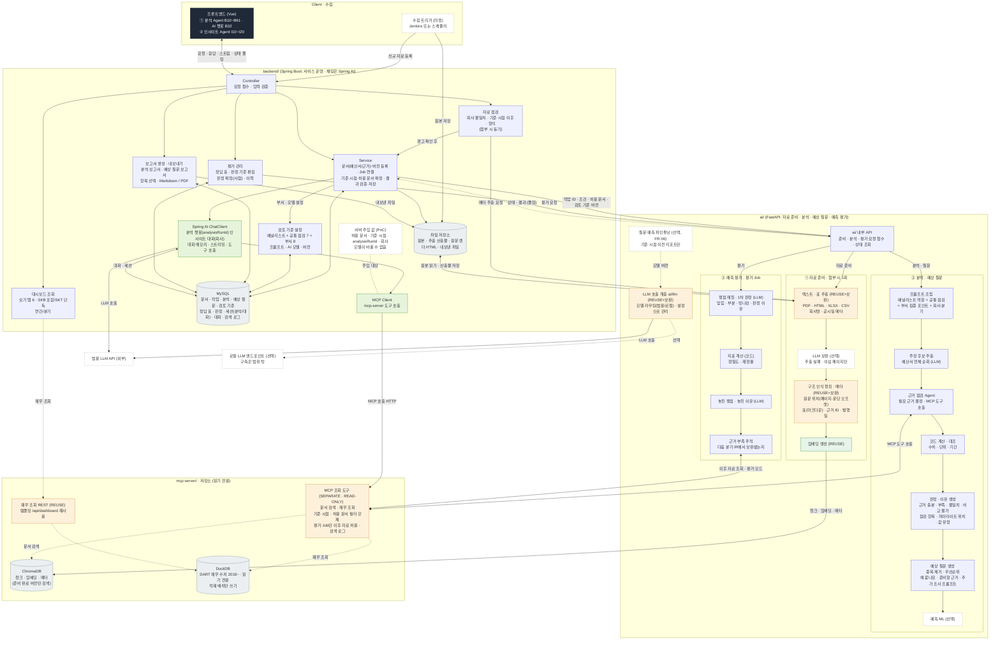
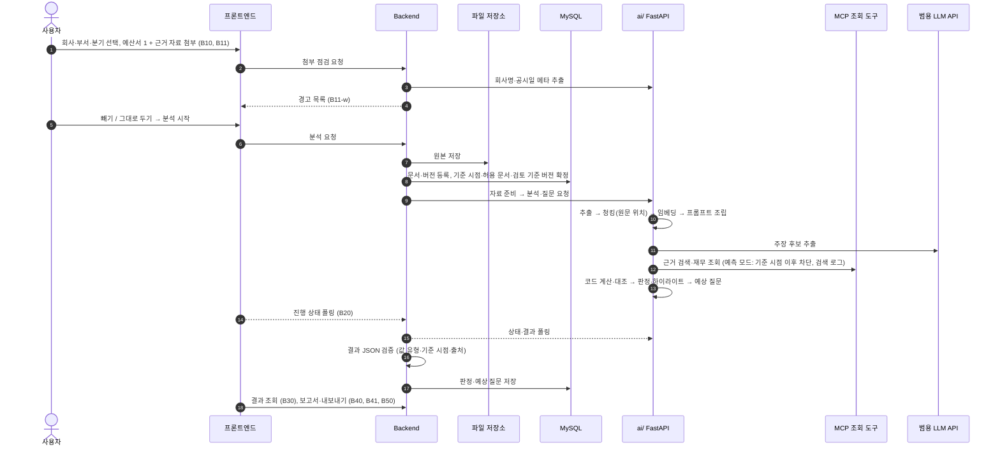
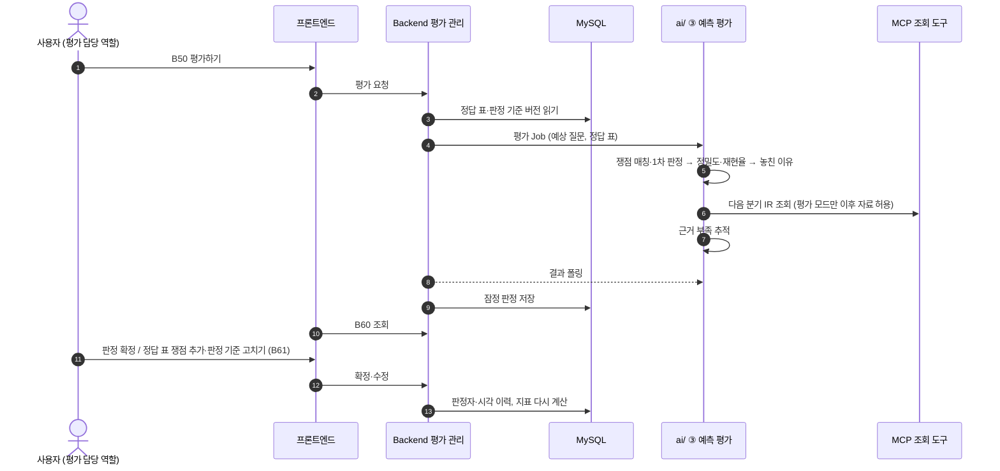
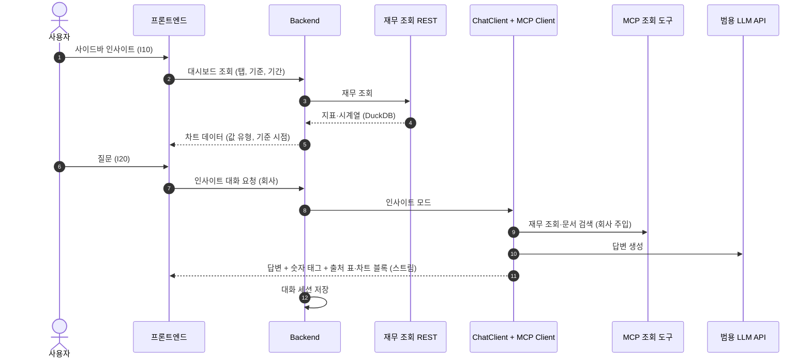

# 아키텍처 정의서 (v3.1)

> 관련 문서: [1. 프로젝트정의요구사항서](1.%20프로젝트정의요구사항서.md), [3. 설계서](3.%20설계서.md)
> 근거: 화면 설계 IA v03([../frontend/demo/ia.md](../frontend/demo/ia.md)). 3장 Mermaid 구성도가 기준 그림입니다.

## 표지

| 항목 | 내용 |
|---|---|
| 팀명 | Vamos |
| 프로젝트명 | Telescope \| 기업 경영실적 다면·심층 분석 AI Agent |
| 팀원 및 역할 | 아래 표 ([정의·요구사항서](1.%20프로젝트정의요구사항서.md#표지)과 같음) |
| 작성일 / 버전 | 2026.11.12 / v3.1 |
| 프로젝트 기간 | 2026.10.30 ~ 2026.12.16 |

| 이름 | 역할 | 아키텍처 관련 담당 |
|---|---|---|
| 김준영 | PM, FE, BE | 범위·일정 총괄, 분석 Agent 화면 구현과 E2E 흐름 연결 |
| 성민기 | BE, AI, FE | 수집·적재 파이프라인, 계정 매핑표, 인사이트 대시보드 화면 |
| 윤혜정 | BE, Infra | 백엔드 API(업로드·점검, 분석, 보고서, 평가, 채팅), 스키마·DB 설계 |
| 안중범 | AI | 주장-근거 추출·근거 점검, 질문 예측 Agent, 평가 기준·정답 표, 파인튜닝 |
| 임진섭 | AI, Infra | 파싱 로직, 검토 기준·프롬프트, MCP 도구, 평가 모듈, 아키텍처 정의 |
| 주윤겸 | Infra, AI | 서버 배포, 환경변수·키 관리, 로그, 자료 점검 로직, 테스트·검증 |

---

## 1. 아키텍처 기본정보

| 항목 | 내용 |
|---|---|
| 프로젝트명 | Telescope \| 기업 경영실적 다면·심층 분석 AI Agent |
| 작성일 / 버전 | 2026.11.12 / v3.1 (화면 설계 v03 반영) |
| 작성 담당 | 임진섭(아키텍처 정의), 주윤겸(Infra 구성), 김준영(화면 설계 대응) |
| 기준 요구사항 ID | `must` FR-01, FR-02, FR-03, FR-05 / `should` FR-04, FR-06, NFR-01, NFR-02 / `추가` AI 챗봇, 인사이트 Agent, 로그인 |
| 아키텍처 유형 | ■ Frontend/Backend ■ AI/RAG ■ 데이터 분석 ☐ 단일 애플리케이션 ☐ 자동화 ☐ 기타 |
| 배포/실행 환경 | 서비스 분리 배포(frontend: Vue, backend: Spring Boot, ai: FastAPI, mcp-server: 별도 서비스), 빌드·배포 Jenkins·Docker Compose, 수집 트리거 Jenkins 또는 스케줄러 (서버 환경 미정) |

## 2. 아키텍처 개요

| 항목 | 작성 내용 |
|---|---|
| 아키텍처 목표 | 예산서 1개와 근거 자료(PDF·HTML·엑셀·CSV)를 첨부 시 점검하고 1회 준비한 뒤, 애널리스트 관점 + 부서 집중 포인트로 주장의 근거를 재무 데이터·문서로 점검해 원문 하이라이트, 판정·이유, 예상 질문, 보고서를 만든다. 예측은 기준 시점 이전 자료로만 하고, 평가 단계에서 이후 리포트 쟁점과 비교해 정밀도·재현율을 낸다. 적재한 DART 데이터는 인사이트 Agent(대시보드 + 질의응답)로 보여 준다. |
| 핵심 설계 원칙 | ① AI 생성과 서버 확정 분리(결과 JSON 스키마 검증, 숫자마다 값 유형·기준 시점·출처 필수) ② 자료 준비는 첨부 시 1회, 분석 중에는 조회만 ③ 수치는 DuckDB와 코드로 계산·대조 ④ MCP 조회 도구는 읽기 전용, 기준 시점·허용 문서 필터 강제(예측은 이후 자료 차단, 평가 Job만 허용) ⑤ 검토 기준·프롬프트·모델은 설정(버전)으로 분리 ⑥ 상태는 폴링 ⑦ 판정은 AI 1차 + 사람 확정 |
| 주요 사용자/외부 주체 | 사용자(예산서를 작성하는 부서 구성원, 서비스 역할: 분석 담당자·설정 관리자·평가 담당자, 권한 미분리), 수집 트리거(Jenkins/스케줄러), 범용 LLM API(외부), 로컬 LLM 엔드포인트(선택), OpenDART |
| 핵심 처리 흐름 | **분석 Agent:** 첨부 → 자료 점검(경고) → 원본 저장·문서 등록 → 자료 준비 1회 → 프롬프트 조립(애널리스트 + 공통 점검 + 부서) → 주장 추출 → MCP 근거 점검 → 코드 계산·대조 → 판정·하이라이트 → 예상 질문 → 결과 검증·저장 → 보고서·내보내기 → 평가(쟁점 매칭 → 지표 → 놓친 이유 → 근거 부족 추적 → 사람 확정). **인사이트 Agent:** 대시보드 조회(DuckDB) → 질문 → ChatClient + MCP 재무 조회 → 답변 + 출처 표·차트 |
| 주요 제약조건 | 인증·콜백(→폴링)은 MVP 제외. Spring AI는 채팅 경로(분석 챗봇, 인사이트 대화)에만. 서버 주입 값의 MCP Client 주입 방식은 PoC 필요. 로컬 LLM 서버 구축은 범위 밖, 엔드포인트 연결만. LLM 비용 한도(API Key 팀당 $350/1개월). 공시에 없는 값은 결측 |

---

## 3. 전체 시스템 아키텍처 구성도

**백엔드 아키텍처정의서: 두 Agent (분석 · 인사이트) + 예측 평가**
부제: 범용 LLM 분석 · Spring AI는 채팅에만 · 파싱은 첨부 시 1회 · mcp-server는 별도 서비스(읽기 전용) · 상태는 폴링 · 인증·콜백은 MVP 제외

### 3-1. 구성도 (Mermaid)

범례: 실선 = 요청·쓰기, 점선 = 읽기·조회 또는 폴링. 노드 색: 검정 = 화면, 보라 = 신규, 연두 = Spring AI, 주황 = 재사용+보완, 회색 = 저장소, 점선 테두리 = 선택·미정.

### 3-2. 구성도 해설

**계층(위 → 아래)**

| 계층 | 폴더/서비스 | 기술 | 들어 있는 노드 |
|---|---|---|---|
| Client · 수집 | frontend/, 수집 트리거 | Vue 3 + Vite + TS, Jenkins 또는 스케줄러 | 프론트엔드, 수집 트리거 |
| backend/ | Spring Boot 서비스 | Spring Boot, Spring AI(채팅만) | Controller, 자료 점검, Service, 검토 기준 설정, 보고서 생성·내보내기, 평가 관리, 대시보드 조회, ChatClient, MCP Client, 서버 주입 값, 파일 저장소, MySQL |
| ai/ | Python AI 서비스 | FastAPI | 내부 API, ① 자료 준비 4단계, ② 분석·예상 질문 7단계, ③ 예측 평가 4단계, 파인튜닝(선택), LLM 호출 계층 |
| mcp-server/ · 저장소 | 읽기 전용 조회 서비스 + 저장소 | MCP 서버, FastAPI(REST), ChromaDB, DuckDB | MCP 조회 도구, 재무 조회 REST, ChromaDB, DuckDB |
| 외부 | LLM | 외부 API / 엔드포인트 | 범용 LLM API, 로컬 LLM 엔드포인트(선택)|

**노드 분류**

| 분류 | 뜻 | 해당 노드 |
|---|---|---|
| Spring AI (신규) | 채팅 경로에만 도입 | ChatClient(분석 챗봇·인사이트 대화), MCP Client |
| 신규 구현 | 이번 프로젝트에서 새로 만듦 | Controller, Service, 자료 점검, 검토 기준 설정, 보고서 생성·내보내기, 평가 관리, 대시보드 조회, ai/ 내부 API, 프롬프트 조립, 주장 후보 추출, 근거 점검 Agent, 코드 계산·대조, 판정·이유 생성, 예상 질문 생성, 쟁점 매칭, 지표 계산, 놓친 이유, 근거 부족 추적|
| 재사용 + 보완 | 템플릿(corp-finance-agent) 코드를 가져와 고침 | 텍스트·표 추출, 구조 인식 청킹, 임베딩(재사용만), LLM 호출 계층, MCP 조회 도구, 재무 조회 REST|
| 저장소 | 데이터 보관 | 파일 저장소, MySQL, ChromaDB, DuckDB |
| 선택 · 미정 | 필요 시 사용하거나 미정 | 수집 트리거, LLM 보완, 예측 ML, 파인튜닝, 서버 주입 값(PoC), 범용 LLM API, 로컬 LLM 엔드포인트|

**연결(화살표) 목록**

| # | 출발 | 도착 | 라벨 | 종류 |
|---|---|---|---|---|
| 1 | 수집 트리거 | 파일 저장소 | 원본 저장 | 쓰기 |
| 2 | 수집 트리거 | Controller | 신규 자료 등록 | 요청 |
| 3 | 프론트엔드 | Controller (양방향) | 요청·응답·스트림·상태 폴링 | 요청/응답 |
| 4 | Controller | 자료 점검 | 첨부 파일 점검 | 요청 |
| 5 | 자료 점검 | 텍스트·표 추출 | 회사명·공시일 메타 추출 | 요청 |
| 6 | 자료 점검 | Service | 경고 확인 후 등록 | 요청 |
| 7 | Service | MySQL (양방향) | 문서·작업·결과 저장/조회 | 쓰기/읽기 |
| 8 | Service | 검토 기준 설정 | 부서·모델 설정 읽기 | 읽기 |
| 9 | Service | ai/ 내부 API | 작업 ID·조건·허용 문서·검토 기준 버전 | 요청 |
| 10 | ai/ 내부 API | Service | 상태·결과 (폴링) | 조회 |
| 11 | 파일 저장소 | 텍스트·표 추출 (양방향) | 원본 읽기·산출물 저장 | 읽기/쓰기 |
| 12 | 텍스트·표 추출 → LLM 보완 → 구조 인식 청킹 → 임베딩 | | 자료 준비 | 순차 |
| 13 | 임베딩 | ChromaDB | 청크·임베딩·메타 저장 | 쓰기 |
| 14 | 프롬프트 조립 → 주장 후보 추출 → 근거 점검 Agent → 코드 계산·대조 → 판정·이유 → 예상 질문 → 예측 ML(선택) | | 분석 | 순차 |
| 15 | 근거 점검 Agent | MCP 조회 도구 | MCP 도구 호출(예측 모드: 이후 자료 차단) | 요청 |
| 16 | 평가 관리 | ai/ 내부 API | 평가 요청 | 요청 |
| 17 | 쟁점 매칭 → 지표 계산 → 놓친 이유 → 근거 부족 추적 | | 예측 평가 | 순차 |
| 18 | 근거 부족 추적 | MCP 조회 도구 | 이후 자료 조회(평가 모드) | 요청 |
| 19 | 보고서 생성·내보내기 | MySQL / 파일 저장소 | 결과 읽기, 내보낸 파일 저장 | 읽기/쓰기 |
| 20 | 평가 관리 | MySQL | 정답 표·판정 기준·판정 확정 | 쓰기/읽기 |
| 21 | 대시보드 조회 | 재무 조회 REST | 탭·기준·기간별 재무 조회 | 읽기 |
| 22 | Service | ChatClient | 채팅 요청(모드: 분석 챗봇 / 인사이트) | 요청 |
| 23 | ChatClient | MySQL | 대화·세션 종류 저장 | 쓰기/읽기 |
| 24 | ChatClient | MCP Client → MCP 조회 도구 | 도구 호출(HTTP) | 요청 |
| 25 | ChatClient | 범용 LLM API | LLM 호출 | 요청 |
| 26 | LLM 호출 계층 | 범용 LLM API / 로컬 엔드포인트 | 모델 라우팅 | 요청 |
| 27 | MCP 조회 도구 | ChromaDB / DuckDB | 문서 검색 / 재무 조회 | 읽기 |
| 28 | 재무 조회 REST | DuckDB | 대시보드 데이터 | 읽기 |

---

## 4. 구성요소 정의

| ID | 구성요소 | 역할 | 입력 | 출력 | 사용 기술/도구 |
|---|---|---|---|---|---|
| CMP-01 | 사용자 화면 | 분석 Agent(B10~B61: 첨부·경고, 진행, 원문 하이라이트, 분석/질문 패널, 보고서·내보내기, 평가), AI 챗봇(B32), 인사이트 Agent(I10~I20), 로그인(S00) | 사용자 첨부·선택·질문 | 점검·분석·보고서·평가·채팅·대시보드 요청 | Vue 3 + Vite + TS |
| CMP-02 | 서비스 API (backend) | Controller 입력 검증, Service 문서(예산서/근거)·버전 등록·Job 연결·기준 시점·허용 문서 확정·결과 검증·저장 | 첨부, 분석·평가 요청 | 작업 상태, 결과 | Spring Boot |
| CMP-02a| 자료 점검 | 첨부 순간 회사 불일치·기준 시점 이후·형식 불일치 판정, 경고 확인 기록 | 파일, 설정 줄(회사·분기), 기준 시점 | 경고 목록(사유, 빼기/그대로 두기) | Spring Boot + ai/ 메타 추출 |
| CMP-02b| 검토 기준 설정 | 애널리스트 역할 + 공통 점검 7항목 + 부서 8행 집중 포인트, 업로드 허용 형식, AI 모델 선택, 버전 관리 | 부서·모델 선택, 기준 수정 | 검토 기준 버전 | Spring Boot, MySQL |
| CMP-02c| 보고서 생성·내보내기 | 판정·질문을 점검 항목별로 집계해 분석 보고서·예상 질문 보고서 구성, 선택 항목만 Markdown/PDF 생성 | 분석 결과, 내보낼 항목·형식 | 보고서, 파일 | Spring Boot (PDF 변환 라이브러리) |
| CMP-02d| 평가 관리 | 정답 표(리포트 쟁점 요약 + 출처 링크)·판정 기준 편집, AI 1차 판정의 사람 확정, 이력 | 쟁점, 판정 기준, 확정 입력 | 확정 판정, 정밀도·재현율 | Spring Boot, MySQL |
| CMP-02e| 대시보드 조회 | 보기 탭 6개(한눈에, 손익, 재무상태, 현금흐름, 설비투자, 동종사 비교), 기준(`SKB 포함`/`SKT 단독`/`SKT+SKB 합산`), 기간(연간/분기) | 회사, 탭, 기준, 기간 | 지표·차트 데이터(값 유형, 기준 시점 포함) | Spring Boot → 재무 조회 REST |
| CMP-03 | 채팅 | ChatClient 두 모드: 분석 챗봇(analysisRunId 범위), 인사이트 대화(회사 범위, 답변에 출처 표·차트 블록). MCP Client로 도구 호출 | 질문, 세션 | 스트림 답변 + 출처 | Spring AI |
| CMP-04 | AI 서비스 (ai/) | ① 자료 준비 ② 분석·예상 질문(프롬프트 조립 포함) ③ 예측 평가, 파인튜닝(선택), LLM 라우팅 | 작업 ID·조건·허용 문서·검토 기준 버전 | 결과 JSON(검증 전) | FastAPI(Python) |
| CMP-05 | MCP 조회 서버 | 문서 검색·재무 조회 도구(읽기 전용, 기준 시점·허용 문서 필터, 예측/평가 모드, 검색 로그), 재무 조회 REST | MCP 호출(HTTP), REST 요청 | 검색·조회 결과 | MCP 서버, FastAPI(템플릿 재사용) |
| CMP-06 | 데이터 저장소 | MySQL(업무 데이터), 파일 저장소(원본·산출물·원문 렌더·내보낸 파일), ChromaDB(청크·임베딩), DuckDB(DART 재무, 읽기 전용) | 각 쓰기 | 각 조회 | MySQL, 파일 저장소, ChromaDB, DuckDB |
| CMP-07 | 배포/운영 | 수집 트리거, 서비스별 분리 배포, 모델·엔드포인트 설정 공유, 키 관리, 로그 | 트리거, 설정 | 등록 요청 | Jenkins, Docker Compose |

### 4-1. 설계서 모듈(MOD)과의 대응

| 설계서 MOD | 아키텍처 구성요소 |
|---|---|
| MOD-01 수집·적재 파이프라인 | CMP-07 수집 트리거, CMP-04 ① 자료 준비, CMP-06 DuckDB·ChromaDB |
| MOD-02 자료 준비(추출·청킹·임베딩) | CMP-04 ①, CMP-02a 자료 점검 |
| MOD-03 근거 점검·코드 계산·판정 | CMP-04 ② (프롬프트 조립 ~ 판정) |
| MOD-04 예상 질문 생성 | CMP-04 ② 예상 질문, CMP-02c 보고서 |
| MOD-05 예측 평가 | CMP-04 ③, CMP-02d 평가 관리 |
| MOD-06 범용 설정 | CMP-02b 검토 기준 설정, CMP-02c 내보내기, LLM 라우팅 |
| MOD-07 MCP 조회 도구 | CMP-05 |
| MOD-08 질문 예측 파인튜닝 | CMP-04 파인튜닝(선택) |
| MOD-09인사이트 (추가) | CMP-02e 대시보드 조회, CMP-03 인사이트 대화, CMP-05 재무 조회 REST |

### 4-2. 결과 JSON 핵심 필드 (서버 검증 대상)

| 대상 | 필드 | 검증 |
|---|---|---|
| 주장·판정 | claimId, 점검 항목 코드, 판정(충분/부족/불일치/비교 불가), 이유, 하이라이트 위치(페이지, 시작·끝 오프셋), 근거 ID 목록 | 하이라이트 위치가 원문 범위 안 |
| 숫자 | value, unit, `valueType`(공시/계산/AI), `asOf`, `sourceId`, 계산식(계산일 때) | 세 필드 누락 0건, `asOf` ≤ 기준 시점(예측 단계) |
| 예상 질문 | 질문, 왜 묻나요, 준비할 근거, 원문 위치, 점검 항목, 우선순위, 추가 조사 프롬프트 | 원문 위치 누락 0건 |
| 평가 판정 | 질문 ID, 대응 쟁점 ID, 판정(맞힘/부분/빗나감), 판정 이유, 판정자(AI/사람), 확정 시각 | 사람 확정 전 지표는 "잠정" |

## 5. 데이터 및 처리 흐름

| 단계 | 주체/구성요소 | 입력 데이터 | 처리 내용 | 출력/저장 데이터 | 연결 요구 ID |
|---|---|---|---|---|---|
| 1 | 사용자 → 프론트엔드 → 자료 점검 | 회사·부서·분기, 예산서 1 + 근거 자료 | 형식 검사, 회사명·공시일 메타 추출, 경고 표시, 경고 확인 전 첨부 차단 | 경고 확인 기록(MySQL) | FR-02 |
| 2 | Service | 확인된 첨부, 분석 시작 | 원본 저장, 문서(역할)·버전 등록, 기준 시점·허용 문서 확정, 검토 기준 버전 고정 | 원본, 문서·작업(MySQL) | FR-01, FR-04 |
| 3 | ai/ ① 자료 준비 | 작업 ID | 추출 → (LLM 보완) → 청킹(원문 위치) → 임베딩, 원문 렌더 HTML | ChromaDB, 파일 저장소 | FR-01, NFR-02 |
| 4 | ai/ ② 분석 | 작업 ID·조건·허용 문서·검토 기준 | 프롬프트 조립 → 주장 추출 → MCP 근거 점검(이후 자료 차단) → 코드 대조 → 판정·하이라이트 | 판정 JSON | FR-02, FR-05, NFR-01 |
| 5 | ai/ ② 예상 질문 → Service | 판정 결과 | 질문 생성·중복 제거·우선순위, 추가 조사 프롬프트. Service가 폴링·검증·저장, FE는 Service를 폴링(B20) | 예상 질문(MySQL) | FR-03 |
| 6 | 보고서 생성·내보내기 | 분석 결과, 선택 항목·형식 | 점검 항목별 집계, Markdown/PDF 생성 | 보고서, 파일 | FR-03, FR-04 |
| 7 | 평가 관리 → ai/ ③ | 예상 질문, 정답 표, 판정 기준 | 쟁점 매칭·1차 판정 → 정밀도·재현율 → 놓친 이유 → 근거 부족 추적(평가 모드) → 사람 확정 | 판정·지표·이력(MySQL) | FR-05, FR-06 |
| 8 | ChatClient (분석 챗봇) | 질문, analysisRunId | 서버 주입 값으로 MCP 호출, 답변 + 출처 | 대화(MySQL), 스트림 | 추가, NFR-01 |
| 9 | 대시보드 조회, ChatClient (인사이트) | 회사·탭·기준·기간, 질문 | DuckDB 조회·시각화 데이터, MCP 재무 조회 후 답변 + 출처 표·차트 블록 | 대시보드 데이터, 대화 | 추가, NFR-01 |

### 5-1. 분석 흐름

### 5-2. 평가 흐름

### 5-3. 인사이트 흐름 (추가)

## 6. 기술 스택 및 선택 근거

| 구분 | 선택 기술/도구 | 선택 이유 | 대안 또는 주의사항 |
|---|---|---|---|
| Frontend | Vue 3 + Vite + TS | 분석 Agent(원문 하이라이트, 아코디언 패널, 보고서), 인사이트 대시보드, 채팅 스트림 | 화면 ID(B10~B61, I10~I20)를 route name으로 사용. 차트 제목은 지표 이름(명사) |
| Backend / API | Spring Boot, Spring AI(ChatClient·MCP Client, 채팅 한정), FastAPI(ai/) | 서비스 운영·채팅·보고서·평가 관리는 Spring, 준비·분석·평가 계산은 Python | 서버 주입 값의 MCP Client 주입 방식 PoC 필요. PDF 내보내기 라이브러리 선정 필요 |
| Database / Storage | MySQL, 파일 저장소, ChromaDB, DuckDB | 업무·원본·벡터·재무 수치를 용도별로 분리. DuckDB는 읽기 전용(2018~), 원본은 파서 테스트·복구용 | DuckDB는 적재 배치만 쓰기. 정답 표는 리포트 원문 없이 쟁점 요약·링크만 |
| AI / Model / RAG | 범용 LLM API, 로컬 LLM 엔드포인트(선택), 기존 임베딩 재사용, 구조 인식 청킹, 근거 점검 Agent, 코드 계산 | 근거 기반 판정, 수치는 코드로 대조. 부서별 Agent를 따로 두지 않고 프롬프트에 부서 행만 바꿔 넣음 | 로컬 LLM 서버 구축은 범위 밖. 예측 ML·파인튜닝은 선택 |
| 외부 API / 도구 | OpenDART, MCP 조회 도구, 재무 조회 REST(템플릿 재사용) | 문서 검색·재무 조회를 도구로 분리, 기준 시점 필터 강제 | LLM 비용 한도 관리, 모델·엔드포인트는 설정으로 공유 |
| 배포 / 협업 | Jenkins·Docker Compose, 서비스별 분리 배포 / GitHub, Notion, Slack, Figma | 서비스 독립 배포, 요구사항 ID로 추적 | 서버 배포 환경 미정. 인증·콜백은 MVP 제외 |

---

## 확인 필요 사항

| 항목 | 현재 결정 | 확인할 것 |
|---|---|---|
| 로컬 LLM | 로컬 LLM 서버는 구축하지 않고, B10 AI 모델 토글은 LLM 호출 계층의 엔드포인트 설정으로만 연결 | 엔드포인트 연결 수준으로 충분한지, 품질 차이를 화면에 알릴지 |
| 인증·권한 | 로그인 화면과 역할 태그만 두고 인증·권한 분리는 하지 않음 | 분석 실행, AI 모델 전환, 판정 수정 권한을 나눌지 |
| 서버 주입 값 | 허용 문서·기준 시점·analysisRunId·회사를 서버가 주입 | MCP Client 주입 방식 PoC |
| 인사이트 출처 | DART 적재 데이터 | 뉴스·리포트 요약까지 넣을지 |

> 템플릿 정보: 6주 팀프로젝트 산출물 | 아키텍처 정의서 템플릿 · 분량 10p 내외(표지 제외)
