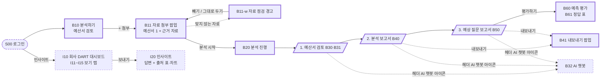
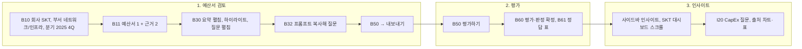
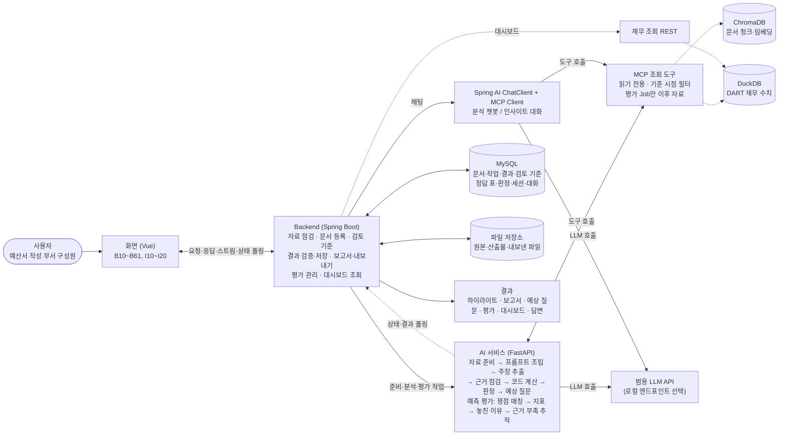

# 간략 설계서 (v3.1)

> 관련 문서: [1. 프로젝트정의요구사항서](1.%20프로젝트정의요구사항서.md), [2. 아키텍처정의서](2.%20아키텍처정의서.md)
> 출처: [../frontend/demo/ia.md](../frontend/demo/ia.md) (IA v03 최신), [../frontend/demo/departments.md](../frontend/demo/departments.md), 데모 [../frontend/demo/index.html](../frontend/demo/index.html)
> 기본 형식: 사용자 흐름도 + 화면 스케치 + 구성도. 화면 ID(B10, I10 …)는 Figma 프레임, 데모, Vue route name에 같이 쓰는 공통 키예요.

## 표지

| 항목 | 내용 |
|---|---|
| 팀명 | Vamos |
| 프로젝트명 | Telescope \| 기업 경영실적 다면·심층 분석 AI Agent |
| 팀원 및 역할 | 김준영(PM, FE, BE), 성민기(BE, AI, FE), 윤혜정(BE, Infra), 안중범(AI), 임진섭(AI, Infra), 주윤겸(Infra, AI). 상세는 [정의·요구사항서 표지](1.%20프로젝트정의요구사항서.md#표지) |
| 작성일 / 버전 | 2026.11.12 / v3.1 |
| 프로젝트 기간 | 2026.10.30 ~ 2026.12.16 |

---

## 1. 설계 개요

| 항목 | 내용 |
|---|---|
| 프로젝트명 | Telescope \| 기업 경영실적 다면·심층 분석 AI Agent |
| 설계 대상 MVP 기능 | • `must` **분석 Agent(예산서 검토)**: 회사·부서·분기를 고르고 예산서 1개 + 근거 자료를 첨부하면(첨부 순간 자료 점검 경고), 원문 위에 근거 부족(빨강 점선)과 예상 질문(노랑 점선)을 하이라이트하고 오른쪽 `분석 / 질문` 패널에 주장, 근거, 부족한 점, 계산 과정, 출처를 보여 준다.<br>• `must` **분석 보고서·예상 질문 보고서**: 점검 항목별로 정리하고 선택 항목을 Markdown/PDF로 내보낸다(내보내기 팝업은 should).<br>• `must` **예측 평가**: 예상 질문을 기준 시점 이후 리포트 쟁점(정답 표)과 비교해 AI가 1차 판정하고 사람이 확정한다. 정밀도·재현율, 놓친 쟁점과 이유, 근거 부족 추적을 보여 준다.<br>• `must` **근거 데이터 적재**: 통신 3사 공시·IR·재무 데이터를 출처와 기준 시점을 달아 적재(화면 없는 파이프라인).<br>• `should` 범용 설정 6항목(입력 자료 종류, 추출 항목, 출력 양식, 검토 기준, 프롬프트, AI 모델)은 구현되는 데까지.<br>• `추가` AI 챗봇(B32), 인사이트 Agent(I10~I20, 회사 DART 대시보드 + 질의응답), 로그인(S00) |
| 설계 기준 요구사항 ID | `must` FR-01, FR-02, FR-03, FR-05 / `should` FR-04, FR-06, NFR-01, NFR-02 |
| 대상 사용자 | 예산서를 작성하는 부서 구성원(주 사용자). 분석 담당자·설정 관리자·평가 담당자는 서비스 역할이고, 권한을 나누지 않아 모두가 세 역할을 다 씀(사용자 카드에 역할 태그만) |
| 핵심 사용자 시나리오 | 네트워크/인프라 부서 구성원이 **SKT 2025 4Q 예산서**(데모: SKT 2025 사업보고서 II-3 설비투자 절, 기준 시점 2026-03-17)를 제출 전에 검토한다. ① B10에서 회사 SKT, 부서 네트워크/인프라, 분기 2025 4Q를 고르고 `+`로 예산서 1개와 근거 자료 2개를 첨부한다(다른 회사·기준 시점 이후 자료는 B11-w 경고). ② B20 진행 뒤 B30에서 요약을 펼쳐 근거 부족과 예상 질문을 확인하고, 하이라이트를 눌러 계산 과정과 출처를 본다. ③ 질문의 프롬프트를 복사해 AI 챗봇(B32)에 더 묻는다. ④ B50 예상 질문 보고서를 내보내고 `평가하기`로 B60에서 이후 리포트 쟁점과 견준 결과를 확인·확정한다. ⑤ 사이드바 `인사이트`로 SKT DART 대시보드를 보고 CapEx를 질문해 출처 표·차트와 함께 답을 받는다. |

---

## 2. 사용자 흐름도

핵심 사용자 흐름 2개: ① 분석 Agent(예산서 검토 → 보고서 → 평가), ② 인사이트 Agent(대시보드 → 질의응답).

### 2-1. 전체 흐름 (IA v03)



범례: 굵은 테두리 = must, 점선 테두리 = 추가. B41은 화면 목록상 should.

### 2-2. 데모 시나리오 흐름



### 2-3. 공통 셸 (왼쪽 사이드바)

```
Telescope (로고)            → B10 (홈, 분석하기와 같음)
[분석하기]                 → B10 (분석 Agent)
[인사이트]                 → I10 (인사이트 Agent)
분석 단계 (예산서 검토 세션을 열었을 때만)
  1 예산서 검토              → B30
  2 분석 보고서              → B40
  3 예상 질문 보고서         → B50 (맨 아래 평가하기 → B60)
분석 세션                   → 예산서 검토 세션 목록. 누르면 B30
대화 세션 (점)              → 인사이트 대화 기록만. 누르면 그 대화(I20)
사용자 카드 + 역할 태그
```

- 메뉴는 버튼이 아니라 아이콘 + 글자 줄. 지금 화면의 메뉴만 연회색 배경.
- 단계 색: 대기 회색, 진행 중 파랑, 완료 진한 색. 완료 단계만 이동. B60, B61에서는 3단계가 활성.
- 헤더(B30~B61): 왼쪽 제목 `SKT 2025 4Q 예산서`, 오른쪽 태그 `회사 SKT` `부서 네트워크/인프라` `분기 2025 4Q` `기준 시점 2026-03-17`, 끝에 AI 챗봇 아이콘.

---

## 3. 화면 또는 서비스 스케치

| 화면/기능 ID | 화면·기능명 | 사용자 입력 | 시스템 처리 | 사용자에게 보이는 결과 |
|---|---|---|---|---|
| UI-01 (B10, B11, B11-w) | 분석하기, 자료 첨부 팝업, 자료 점검 경고 | 회사·부서·분기 토글, AI 모델 토글(범용/로컬), `+`로 예산서 1개(PDF, HTML)와 근거 자료 여러 개(PDF, HTML, XLSX, CSV), 경고마다 `빼기`/`그대로 두기`, 분석 시작 | 첨부 순간 자료 점검(회사 불일치, 기준 시점 이후, 형식 불일치), 원본 저장, 문서(역할)·버전 등록, 기준 시점·허용 문서·검토 기준 버전 확정 | 경고 띠 `확인이 필요한 자료가 N개 있어요`와 파일 줄 사유, 확인 전 `첨부` 꺼짐, 예산서가 있어야 켜지는 `분석 시작` |
| UI-02 (B20, B30, B31) | 분석 진행, 예산서 검토 | 하이라이트 클릭, 요약 펼치기, `분석 / 질문` 탭, 아코디언, 질문별 프롬프트 복사 | 자료 준비 → 프롬프트 조립(애널리스트 + 공통 점검 + 부서) → 주장 추출 → MCP 근거 조회(기준 시점 이후 차단) → 코드 계산·대조 → 판정 → 예상 질문, 상태 폴링 | B20 단계별 완료/진행 중/대기. 원문 위 하이라이트, 요약(근거 부족 N개, 질문 N개), 분석 탭(주장, 근거, 부족한 점, 계산 과정, 출처), 질문 탭(질문, 왜 묻나요, 준비할 근거, 원문 위치, 프롬프트) |
| UI-03 (B40, B41) | 분석 보고서, 내보내기 | 목차 이동, `내보내기`에서 항목 체크와 형식 선택 | 판정을 점검 항목별로 집계, 선택 항목만 파일 생성 | 고정 제목·작성 일자 줄, 고정 목차, 1 총평(점검 항목별 주장·근거 충분·부족·질문 수) 2 점검 항목별 검토 3 보완하면 좋을 근거, 출처 |
| UI-04 (B50) | 예상 질문 보고서 | 목차 이동, 내보내기, `평가하기` | 예상 질문을 점검 관점별·우선순위로 정리, 원문 위치 연결 | 점검 관점별 질문(예: 투자 효과(CapEx), 재무 영향(감가상각)), 출처 없는 숫자 0건 |
| UI-05 (B60, B61) | 예측 평가, 정답 표 | `평가하기`, 질문별 판정 펼쳐 맞힘/부분/빗나감 고르고 `확정`, B61 `기준 고치기`, `쟁점 추가` | 기준 시점 이후 리포트 쟁점과 쟁점 매칭(AI 1차 판정), 정밀도 = (맞힘 + 부분 × 0.5) ÷ 예상 질문 수, 재현율 = 잡은 쟁점 ÷ 리포트 쟁점 수, 놓친 이유, 다음 분기 IR로 근거 부족 추적(평가 Job만 이후 자료 허용) | B60: 1 총평 2 질문별 판정(판정자, 판정 이유 `AI` 태그) 3 놓친 쟁점(출처, 놓친 이유) 4 근거 부족 추적. B61: 판정 기준, 리포트 쟁점(요약, 대응한 예상 질문). 리포트 원문은 저장하지 않음 |
| UI-06 (B32) | AI 챗봇 | 헤더 AI 챗봇 아이콘, 텍스트 질문(복사한 프롬프트) | ChatClient 분석 챗봇 모드: 서버 주입 값(허용 문서·기준 시점·analysisRunId)으로 MCP 조회 후 응답 | B30은 오른쪽 패널 아래 절반, B40~B61은 오른쪽 사이드바(폭 400). 대화 아래 정렬, 답변에 출처 |
| UI-07 (I10~I15) | 인사이트 대시보드 | 보기 탭 6개, 기준 토글(`SKB 포함` / `SKT 단독`), 기간 토글(연간/분기), 차트별 `질문하기` | 대시보드 조회 → 재무 조회 REST(DuckDB) | 주요 지표 6개와 차트, 차트마다 기준 태그, 헤더 고정, 하단 고정 입력창 |
| UI-08 (I20) | 인사이트 답변 | 하단 입력창 질문 | ChatClient 인사이트 모드(회사 주입) + MCP 재무 조회 + LLM | 답변 문단 + 숫자 태그(공시/계산/AI) + 출처 차트·표·줄, 이어 묻기 추천 3개 |
| UI-09 (S00) | 로그인 | 계정 정보 | 인증은 MVP 제외, 화면만 | 역할 태그가 붙은 사용자 카드 |

### 3-1. 화면 목록 (IA v03 7장)

| ID | Agent | 화면 | 요구 수준 | Figma node |
|---|---|---|---|---|
| S00 | 공통 | 로그인 | 추가 | v02 재사용 |
| B10 | 분석 | 분석하기 | must | `193:405` |
| B11 | 분석 | 자료 첨부 팝업 | must | `193:481` |
| B11-w | 분석 | 자료 첨부 팝업, 자료 점검 경고 | must | `226:716` |
| B20 | 분석 | 분석 진행 | must | v02 재사용 |
| B30 | 분석 | 예산서 검토 (분석 펼침) | must | `186:56` |
| B31 | 분석 | 요약 펼침, 질문 펼침, 프롬프트 | must | `186:206` |
| B32 | 분석 | AI 챗봇 열림 (패널 아래 절반) | 추가 | `186:350` |
| B40 | 분석 | 분석 보고서 (챗봇 열림) | must | `186:758` |
| B41 | 분석 | 내보내기 팝업 | should | `187:480` |
| B50 | 분석 | 예상 질문 보고서 (챗봇 열림, 평가하기) | must | `186:1031` |
| B60 | 분석 | 예측 평가 (챗봇 열림) | must | `186:1267` |
| B61 | 분석 | 정답 표 (챗봇 열림) | must | `186:1578` |
| I10 | 인사이트 | 인사이트, 대시보드 한눈에 | 추가 | `193:597` |
| I11~I15 | 인사이트 | 손익 / 재무상태 / 현금흐름 / 설비투자 / 동종사 비교 탭 | 추가 | `215:586` `215:947` `215:1308` `215:1669` `215:2030` |
| I20 | 인사이트 | 인사이트 답변 (질의응답) | 추가 | `193:731` |

### 3-2. 화면 스케치 / 와이어프레임

- Figma: https://www.figma.com/design/Rkb5EPMzqkdENuzD5bQR6y/Telescope , 페이지 `v03` (`179:1940`), IA 다이어그램 `195:481`
- HTML 데모: `planning/v03/demo/index.html` (https://claude.ai/artifact/6D5pViHp3msnAcLDNEhQzY)

**B30 예산서 검토 (핵심 화면) 배치**

```
┌───────────┬──────────────────────────────────────────────────────────────┐
│ Telescope │ 헤더: SKT 2025 4Q 예산서   [회사 SKT][부서 네트워크/인프라]     │
│ 분석하기   │                          [분기 2025 4Q][기준 시점 2026-03-17] (AI)│
│ 인사이트   ├───────────────────────────────────┬──────────────────────────┤
│ 분석 단계  │ [요약  근거 부족 2개 질문 2개 펼치기] │  [ 분석 | 질문 ]          │
│ 1 예산서   │                                   │  ▸ 1. 5G 투자 안정화 ...   │
│ 2 분석보고 │  원문(흰 카드, 연회색 배경)        │    주장 / 근거 / 부족한 점 │
│ 3 질문보고 │  ... ┄┄빨강 점선(근거 부족)┄┄ ...  │    계산 과정(회색 박스)    │
│ 분석 세션  │  ... ┄┄노랑 점선(질문)┄┄ ...       │    출처                    │
│ 대화 세션  │                                   │  ▸ 2. 감가상각비 점진 감소 │
│ 사용자카드 │                                   │  (챗봇 열면 아래 절반 채팅) │
└───────────┴───────────────────────────────────┴──────────────────────────┘
```

**B11-w 자료 점검 경고**

| 사유 | 조건 | 문구 | 버튼 |
|---|---|---|---|
| 회사 불일치 | 파일 회사 ≠ 설정 줄 회사 | 회사가 달라요. KT 자료예요 (선택한 회사 SKT) | 빼기 / 그대로 두기 |
| 기준 시점 이후 | 공시·작성일 > 기준 시점 | 기준 시점(2026-03-17) 이후 자료예요. 예측 평가가 공정하지 않아요 | 빼기 / 그대로 두기 |
| 형식 불일치 | 예산서 영역에 PDF·HTML 외 | 예산서는 PDF, HTML만 받아요 | 빼기 |

**B41 내보내기 팝업**

```
내보내기
  내보낼 항목                    [모두 선택]
    분석   ☑ 1. 5G 투자 안정화로 효율적 집행
           ☑ 2. 감가상각비 점진 감소
           ☐ 3. 네트워크 운영비 절감
    질문   ☑ Q1. AI 인프라 투자 규모
           ☑ Q2. CapEx 2년 연속 감소와 5G 품질
  형식   (•) Markdown  ( ) PDF
                                  [취소] [내보내기]
```

**B60 예측 평가 본문 (데모 샘플)**

```
예측 평가                                        [정답 표 확인하기]
예상 질문 6개, 기준 시점 2026-03-17 이전 자료로 예측 / 비교한 리포트 4건
1. 총평       정밀도 58%, 재현율 57%. 근거 부족 4개 중 2개는 다음 분기 IR에서 보완
2. 질문별 판정 예상 질문 | 대응한 리포트 쟁점 | 판정 | 판정자  (펼치면 판정 이유 AI, 맞힘/부분/빗나감, 확정)
3. 놓친 쟁점   리포트 쟁점 | 출처 | 놓친 이유
4. 근거 부족 추적
```

### 3-3. 범용 설정 6항목 위치 (should)

| 항목 | 화면 위치 | 동작 |
|---|---|---|
| 입력 자료 종류 | B11 | 영역마다 받는 형식 지정. 예산서 PDF, HTML / 근거 자료 PDF, HTML, XLSX, CSV. 형식별로 파서를 고름 |
| 추출 항목 | B41 | 내보낼 분석 항목과 질문을 체크해서 고름 |
| 출력 양식 | B41 | Markdown, PDF |
| 검토 기준 | B10 `부서` 토글 | 애널리스트 고정 + 공통 점검 항목 7개 + 부서 집중 포인트(8개 부서, 데모는 네트워크/인프라). 부서별 Agent를 따로 두지 않고 프롬프트에 부서 행만 바꿔 넣음 |
| 프롬프트 | B31 질문 항목 안 `프롬프트` 토글 | 질문마다 추가 조사용 프롬프트, 복사 아이콘 |
| AI 모델 | B10 입력창 | `AI 모델` 토글(범용 LLM / 로컬 LLM 엔드포인트). 인사이트 Agent에는 없음 |

### 3-4. 값 표시 규칙

| 규칙 | 표시 |
|---|---|
| 값 유형 | 숫자마다 `공시`, `계산`, `AI` 태그 |
| 기준 시점 | 숫자마다 기준일 |
| 근거 상태 | 하이라이트 점선 색(빨강 근거 부족, 노랑 질문) + 글자 표식 |
| 리포트 | 원문 대신 쟁점 요약과 출처 링크만 |
| 기준 표기(인사이트) | 화면에 "연결/별도" 대신 `SKB 포함`(연결), `SKT 단독`(별도), `SKT+SKB 합산`(CapEx 비교), `각 사 자회사 포함`(동종사) |
| 차트 제목 | 지표 이름(명사) + 기간 괄호 |

---

## 4. 간략 구성도 및 데이터 흐름

기본 흐름: [사용자] → [화면/서비스] → [핵심 처리 기능 또는 AI 도구] → [데이터 저장소/외부 서비스] → [결과]



상세 구성도는 [2. 아키텍처정의서 3장](2.%20아키텍처정의서.md#3-전체-시스템-아키텍처-구성도)에 있어요.

| 구성요소 | 역할 | 사용 도구·기술 |
|---|---|---|
| 사용자 화면 | 자료 첨부·점검 경고, 예산서 검토(하이라이트, 분석/질문 패널), 보고서·내보내기, 평가·판정 확정, AI 챗봇, 인사이트 대시보드·답변 | Vue 3 + Vite + TS |
| 핵심 기능 | 자료 점검, 자료 준비, 검토 기준 조립, 주장 추출, 근거 점검 Agent, 코드 계산·대조, 판정·예상 질문, 보고서, 예측 평가, 채팅, 대시보드 조회 | Spring Boot, Spring AI(채팅), FastAPI(Python), MCP 서버 |
| 데이터/문서 | 원본(예산서·근거 자료), 문서·작업·결과·대화, 검토 기준 버전, 정답 표·판정, 문서 청크·임베딩, DART 재무 수치(2018년~) | 파일 저장소, MySQL, ChromaDB, DuckDB |
| 외부 도구/API | LLM 생성, 공시·재무 데이터 수집, 빌드·배포 | 범용 LLM API, OpenDART API, Jenkins, Docker Compose |

> 상세 UML, ERD, API 명세는 필수가 아닙니다.

---

## 5. 요구사항 추적표 초안

설계 항목 ID: UI = 3장 화면, MOD = 처리 모듈, CMP = [아키텍처 4장](2.%20아키텍처정의서.md#4-구성요소-정의) 구성요소. MOD-01 수집·적재, MOD-02 자료 준비, MOD-03 근거 점검·코드 계산·판정, MOD-04 예상 질문, MOD-05 예측 평가, MOD-06 범용 설정, MOD-07 MCP 조회 도구, MOD-08 파인튜닝, MOD-09 인사이트(추가).

| 요구 ID | 요구 수준 | 설계 항목 | 아키텍처 | 구현 예정 기능 | 테스트 ID |
|---|---|---|---|---|---|
| FR-01 | must | MOD-01, MOD-02, MOD-07 | CMP-04 ①, CMP-05, CMP-06, CMP-07 | 통신 3사 공시·IR·리포트 메타 수집, 형식별 파싱, 표준 항목 매핑, 단위·연결/별도 표준화, 발행일·출처·기준 시점 부착, 결측 표시, DuckDB·ChromaDB 적재 | TC-01 |
| FR-02 | must | UI-01, UI-02, UI-03 / MOD-02, MOD-03, MOD-07 | CMP-02a, CMP-04 ②, CMP-05 | 자료 점검 경고 3종, 주장 추출, MCP 근거 검색·재무 조회, 코드 계산·대조, 판정·이유 JSON(점검 항목, 하이라이트 위치), 원문 하이라이트와 계산 과정·출처, 분석 보고서 | TC-02 |
| FR-03 | must | UI-02, UI-03, UI-04 / MOD-04 | CMP-04 ②, CMP-02c | 예상 질문(왜 묻나요, 준비할 근거, 원문 위치, 프롬프트), 중복 제거·우선순위, 예상 질문 보고서, 내보내기 | TC-03 |
| FR-04 | should | UI-01, UI-02, UI-03 / MOD-06 | CMP-02b, CMP-02c, LLM 라우팅 | 부서 토글(검토 기준), 입력 자료 형식, 추출 항목·출력 양식, 질문별 프롬프트, AI 모델 토글, 검토 기준 버전 | TC-04 |
| FR-05 | must | UI-05 / MOD-05, MOD-07 | CMP-04 ③, CMP-02d, CMP-05 | 예측 단계 기준 시점 이후 검색 차단(검색 로그), 정답 표·판정 기준 편집, AI 1차 판정 + 사람 확정, 정밀도·재현율, 놓친 이유, 근거 부족 추적 | TC-05 |
| FR-06 | should | UI-05 / MOD-08 | CMP-04 파인튜닝(선택) | 기준 시점 이전 리포트로 학습 데이터(분할 기록), 파인튜닝, 기본 모델 대비 비교, 버전 | TC-06 |
| NFR-01 | should | UI-02~UI-08 / MOD-03, MOD-04, MOD-09 | CMP-02 결과 검증, 4-2 결과 JSON | 숫자마다 공시/계산/AI 태그와 기준 시점, 출처 없는 숫자 0건 검사 | TC-07 |
| NFR-02 | should | UI-01 / MOD-01, MOD-02 | CMP-04 ① | 회사·연도별 하드코딩 없는 파서, 통신 3사 외 기업 1곳 설정만 바꿔 적재 | TC-08 |
| 추가 | 추가 | UI-06 | CMP-03 분석 챗봇 | analysisRunId 범위 질의응답, 출처 | TC-09 |
| 추가 | 추가 | UI-07, UI-08 / MOD-09 | CMP-02e, CMP-03 인사이트, CMP-05 재무 조회 REST | 대시보드 6탭·기준·기간, 질의응답 + 출처 표·차트 | TC-10 |

---

## 열린 질문 (세 문서 공통)

- 부서 목록과 부서별 집중 포인트가 현업과 맞는지, SKT 실제 예산 제출 단위와 양식
- 판정 기준: "같은 쟁점"의 범위와 부분 일치 점수
- 로컬 LLM: 서버 구축 없이 엔드포인트만 연결하는 범위로 충분한지, 품질 차이를 화면에 알릴지
- 인사이트 답변 출처를 DART 적재 데이터로만 한정할지
- 권한 분리 여부(MVP는 모든 계정이 모든 기능 사용): 분석 실행, AI 모델 전환, 판정 수정

> 템플릿 정보: 6주 팀프로젝트 산출물 템플릿 | P02 | 파일명: [팀명]_P02_[산출물명]_v1.0.pdf · 분량 10p 내외(표지 제외)
