# Telescope 서비스 기획서

> **서비스 한 줄 요약**
> 흩어진 공시·IR·리포트·뉴스·사내 자료를 협업 캔버스에 모아 정리하면, AI가 근거의 충분성과 오류를 검토하고 애널리스트 예상 질문을 도출하며 다음 분기 실적·리포트로 예측을 사후 검증하는 **기업 재무 근거 협업 및 심층 분석 AI 플랫폼**입니다.

| 항목 | 내용 |
|---|---|
| **서비스명** | **Telescope** = **Tele**(com / SK Telecom) + **Scope**(렌즈·범위) |
| **태그라인** | 텔레스코프로 보면, 인사이트가 보여요. |
| **문서 기준일** | 2026.11.27 (이슈 #137 기준, 기획서·설계서 통합본) |
| **핵심 사용자** | 기업 사업부서(CIC·본부) 재무기획 담당자 및 같은 부서 협업자 |
| **적용 대상 / 최종 목표** | MVP: 통신 3사 + SKB(SKT·SKB·KT·LGU+) 공개 데이터 및 가상 사내 자료 → 최종 목표: 사내 예산·사업계획 검토 |
| **핵심 서비스 흐름** | **(사용자) 근거 탐색·수집 → 협업 정리(캔버스) → (AI) 근거 검토 → 예상 질문 예측 → 다음 분기 사후 평가** |
| **관련 기준 문서** | [공용 규칙(CLAUDE.md)](../../CLAUDE.md) · [화면별 IA](../frontend/ia.md) · [프런트엔드 API 명세](../frontend/api-spec.md) · [백엔드 API 규약](../backend/api-spec.md) · [ERD](../erd/entities.md) · [BI 가이드](../brand/bi.md) |

---

## 한눈에 보는 Telescope

기업의 예산서·사업기획서·투자계획서를 준비할 때 가장 많은 시간이 드는 일은 **공시·IR·뉴스·사내 자료를 찾아 숫자의 기준을 맞추고, 심의자나 시장(애널리스트)의 질문에 대비하는 과정**입니다.

Telescope는 이 업무를 **하나의 페이지(= 협업 캔버스 + AI 분석 화면)** 안에서 완결합니다.

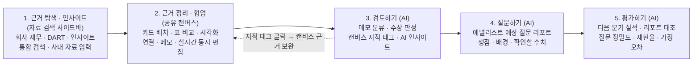

### Telescope가 해결하는 4가지 핵심 가치

1. **한곳에서 찾고 비교하는 근거 수집**: DART 공시 표, 재무 대시보드, 3사 비교 인사이트, IR·애널리스트 리포트(AR)·뉴스, 사내 자료를 캔버스 옆 사이드바에서 끌어다 놓고 회사별 다른 계정명을 개념 사전으로 맞춰 비교·시각화합니다.
2. **맥락이 남는 실시간 부서 협업**: 부서 재무기획 담당자와 사업·기술 동료가 같은 캔버스에서 실시간 동시 편집·커서 공유로 자료를 연결하고 메모를 남겨, "어떤 숫자를 왜 썼는지" 맥락이 유실되지 않습니다.
3. **숫자 환각 없는 근거 검증과 예상 질문**: 모든 숫자 계산과 단위 환산은 코드가 수행하고, LLM은 해석·판정·질문 문장만 작성하되 모든 수치에 **근거 ID**를 강제합니다. 클릭 한 번으로 원문 카드로 돌아가 검증할 수 있습니다.
4. **시점 통제 기반의 사후 검증 루프**: 기준 시점(`as_of_date`) 이후 자료를 서버가 원천 차단해 미래 정보 누수를 막고, 다음 분기 실적과 애널리스트 리포트가 들어오면 예상 질문 적중률과 가정 오차를 객관적으로 평가합니다.

---

## 1. 추진 배경과 문제 정의

### 1.1 기업 예산·사업계획 검토 업무의 페인포인트

사업 조직(CIC·본부 등)에서 예산서·사업기획서·투자계획서를 작성하고 심의를 거치는 과정에는 다섯 가지 구조적 병목이 존재합니다.

| ID | 페인포인트 | 현재 업무 상황 | 업무 영향 |
|---|---|---|---|
| **P1** | **근거 데이터 산발** | DART 공시, IR 자료, 애널리스트 리포트, 뉴스, 사내 엑셀·보고서가 각기 다른 곳에 다른 단위(원/백만원/억원)·기준(연결/별도)으로 흩어져 있음 | 자료를 찾고 단위·계정 기준을 맞추는 데 작성 시간 대부분을 소모 |
| **P2** | **부서 안 근거 공유 단절** | 담당자별로 모은 근거와 현장 수치가 개인 파일·메신저에 남아, 특정 수치를 선택한 맥락이 공유되지 않음 | 같은 근거를 부서원이 중복 탐색하고, 검토 시 출처 확인과 보완 요청이 반복됨 |
| **P3** | **근거 → 검토·작성의 수작업** | 흩어진 근거를 문서 양식에 옮겨 쓰거나 일반 LLM에 넣으려 해도 근거를 구조화된 컨텍스트로 정리하기 어려움 | 출처 없는 숫자, 기간·기준이 뒤섞인 수치가 보고서에 유입될 위험 |
| **P4** | **심의·시장 질문 예측 어려움** | 전사 재무기획(CFO 조직), 부서장, 시장 애널리스트가 어떤 지점을 문제 삼을지 제출·발표 이후에야 알게 됨 | 심의 단계에서 보완 요청과 재제출이 반복됨 |
| **P5** | **결과물 품질의 사후 검증 부재** | 당시 세운 가정과 예상 질문이 실제 다음 분기 실적·시장 쟁점과 맞았는지 추적·평가하지 않음 | 조직의 근거 정리와 검토 역량이 누적·개선되지 않음 |

### 1.2 공공 데이터 대체 전략과 확장 경로

실제 기업의 사내 예산서와 내부 재무 시스템은 보안상 외부 연동 및 학습·시연이 불가능합니다. 따라서 Telescope는 **공개 데이터로 업무 구조와 AI 정확도를 먼저 검증하고, 이후 사내 환경으로 확장하는 2단계 전략**을 따릅니다.

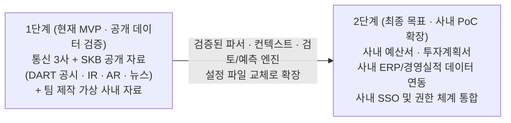

- **왜 통신 3사 + SKB인가**: 고객사(SKT)와 경쟁사(KT·LGU+), 주요 연결 자회사(SKB)는 동일한 산업군 안에서 설비투자(CapEx), 감가상각비, 영업이익률, 배당, AI 데이터센터(AIDC) 등 동일한 핵심 경영 지표를 공유하므로, **회사 간 계정 대응·비교 검토·애널리스트 질문 예측·다음 분기 사후 평가**의 전 과정을 실제 공시 구조로 검증할 수 있습니다.
- **데이터 보안 경계**: 이번 단계(MVP)에서는 사내 시스템 연동이나 실제 사내 문서의 파싱·적재·LLM 전송을 수행하지 않으며, 사내 자료 첨부 기능(F-03)은 팀이 제작한 **가상 사내 자료**로만 시연합니다.

### 1.3 기대 효과 및 성공 기준

| 구분 | 기대 효과 | 검증 기준 (초안) |
|---|---|---|
| **근거 수집 효율화** (P1, P2) | 공시·IR·뉴스·사내 자료 탐색과 3사 계정 비교를 캔버스 한 화면에서 완료 | 대표 시나리오의 근거 수집을 캔버스 안에서 완결 (외부 파일·사이트 왕복 최소화) |
| **근거 신뢰성 확보** (P3) | 모든 숫자는 코드 계산 + 공시 대조, LLM 출력은 서버가 근거 ID 존재 여부를 검증 | 검토·질문 내 모든 인용 수치의 **근거 ID 인용률 100%**, 원문 카드 즉시 추적 |
| **사전 리스크 대응** (P4) | 제출·발표 전에 근거 부족·기준 혼재(연결/별도)·수정값을 카드 단위로 지적받고 예상 질문 리포트 확보 | 모든 주장에 판정(충분/보통/부족)과 보완 안내 제공, 근거 부족 항목 캔버스 표시 |
| **시점 통제 및 품질 개선** (P5) | 기준 시점 이후 자료 차단 및 다음 분기 리포트 대비 적중률·가정 오차 정량 기록 | 기준 시점 이후 자료 혼입 **0건**, 다음 분기 쟁점 대비 정밀도·재현율 및 가정 오차(±5% 기준) 산출 |
| **향후 사내 PoC 지표** | 반복 탐색과 심의 재제출 감소 | 결과물 1건당 근거 수집 소요 시간 단축, 심의 보완 제출 횟수 감소 (도입 전후 비교) |

---

## 2. 목표 사용자와 이해관계자

### 2.1 이해관계자 정의

**부서 재무기획 담당자**는 CIC·본부 같은 사업 조직 내부에서 해당 조직의 사업계획·예산·투자계획을 수립하고 실적을 관리하는 실무 책임자입니다.

| 구분 | 이해관계자 | 소속 예시 (SKT 기준) | Telescope에서의 역할과 행동 |
|---|---|---|---|
| **핵심 사용자** | **부서 재무기획 담당자** | 네트워크센터, AIDC사업본부, 세일즈마케팅본부, 프로덕트브랜드본부 [1][3][4] | 예산서·사업기획서 작성 책임자. 페이지 생성 및 협업자 초대, 근거 탐색·캔버스 정리, AI 검토·질문 확인, 근거 보완 및 사후 평가 확인 |
| **부사용자** | **같은 부서 사업·기술·동료 담당자** | 핵심 사용자와 같은 사업 조직 | 현장 수치(사내 자료)와 공시·IR·뉴스 근거를 캔버스에 함께 올리고, 실시간 동시 편집과 메모·연결로 맥락과 의견을 공유 |
| **관계자** | **부서장, 전사 재무기획, IR 담당** | 사업 조직, 코퍼레이트센터(CFO) [2] | 결과물 컨펌·심의(`보기 가능` 권한으로 캔버스 근거와 맥락 확인). IR·시장 리포트는 예상 질문과 쟁점의 기준 출처 |
| **시스템 관리자** | **서비스 운영 관리자 (`ADMIN`)** | 플랫폼 운영 담당 | 공용 문서(DART 공시·IR·리포트 등) 수집·적재·삭제 관리 (`USER`는 공용 문서 삭제 불가) |

### 2.2 권한 체계

- **서비스 역할 (`role`)**: `ADMIN`(공용 문서 수집·삭제 가능) / `USER`(일반 사용자).
- **페이지(캔버스) 권한**: 페이지마다 **소유자(만든 사람 1명)**가 있고, 소유자가 사내 사용자를 **`편집 가능`** 또는 **`보기 가능`**으로 직접 초대합니다.
  - **일반 액세스(회사 전체 공개)는 두지 않습니다.** 페이지는 소유자와 직접 초대받은 사람만 볼 수 있으며, 부서는 표시용일 뿐 권한 판정에 쓰지 않습니다.
  - 공유 설정(초대·권한 변경·내보내기)과 페이지 삭제는 **소유자만** 수행합니다.

| 기능 | 소유자 | 편집 가능 | 보기 가능 | 권한 없음 |
|---|---|---|---|---|
| 페이지 열기, 카드 선택·강조, 실시간 구독·커서 보기, 공유 명단 보기 | ○ | ○ | ○ | 차단 (403) |
| 카드·연결·메모 편집, 자료 검색에서 올리기, 사내 자료 업로드, 이름 변경 | ○ | ○ | 차단 (403) | 차단 (403) |
| 공유 설정 변경(초대·권한 변경·내보내기), 페이지 삭제 | ○ | 차단 (403) | 차단 (403) | 차단 (403) |
| 분석 실행 및 분석 결과 조회 | ○ | ○ | 실행 가능 *(조회 범위 조율 중 — 7.2장)* | 차단 (403) |

---

## 3. 서비스 구성과 핵심 흐름

### 3.1 핵심 개념과 용어 사전

기획서, 요구사항서, 화면설계([ia.md](../frontend/ia.md)), 백엔드 문서([api-spec.md](../backend/api-spec.md), [entities.md](../erd/entities.md))에서 사용하는 핵심 용어를 아래와 같이 통일합니다.

| 용어 | 정의 |
|---|---|
| **페이지 (Page)** | Telescope의 작업 단위. 하나의 페이지 안에 **캔버스(근거 수집·정리)**와 **분석(검토·질문·평가)** 두 화면이 함께 들어 있습니다. *(백엔드 API 경로는 `/api/v1/canvases` 사용)* |
| **캔버스 (Canvas)** | 여러 협업자가 공시 표, 대시보드, 문서(IR·AR·뉴스·사내 자료), 비교표, 시각화, 메모를 카드로 배치하고 선으로 연결하는 공유 작업 공간입니다. |
| **분석 세션 (Analysis Session)** | 캔버스 상태를 기준으로 실행한 AI 분석 묶음(검토 → 질문 → 사후 평가). 기존 결과를 수정하지 않고 새 세션 또는 같은 세션의 새 버전(`v2`, `v3`…)으로 누적합니다. |
| **기준 시점 (`as_of_date`)** | 페이지를 만들 때 지정하는 기준 분기/날짜(예: `2026년 1분기`). 검토와 예상 질문은 반드시 **기준 시점 이전 발행 자료만** 사용하며, 기준 시점 이후 자료는 **평가**에만 사용합니다. |
| **근거 ID (Citation ID)** | AI 출력의 모든 수치·서술에 붙는 원문 추적 식별자. 클릭하면 캔버스의 해당 카드로 이동·강조됩니다. • 공시 표 셀: `[표ID#r행c열]` • 대시보드 값: `[dash:패널ID#인코딩된행이름@열인덱스]` • 문서 수치: `[doc:문서ID#f번호]` • 문서 내용: `[doc:문서ID]` |
| **값 유형 4종** | 화면과 분석에서 혼동하지 않도록 값의 성격을 4가지로 엄격히 구분합니다. 1) **공시 원본 숫자** (DART XBRL 원문 표) 2) **문서 수치** (IR·AR·뉴스·사내 자료 추출 수치) 3) **계산값** (비율·합계·증감률·십억원 환산 — **코드만 계산**) 4) **AI 해석** (`AI 해석` 태그로 사실과 시각적으로 분리) |

### 3.2 두 축의 AI 역할과 하나의 서비스 흐름

Telescope는 기존 구상의 **인사이트 탐색 기능**과 **근거 분석·예측·평가 기능**을 별개 서비스로 쪼개지 않고, **하나의 페이지 안에서 자연스럽게 이어지는 4단계 흐름**으로 통합했습니다.

| 축 | 단계 | 핵심 역할 | 입력 자료 | 처리 방식 (AI vs 코드) | 주요 산출물 | 대응 페인포인트 |
|---|---|---|---|---|---|---|
| **탐색 · 인사이트** *(자료 검색 & 캔버스)* | **1. 근거 탐색 · 수집 · 정리** | 흩어진 공시·재무 지표·3사 비교 인사이트·IR·AR·뉴스·사내 자료를 탐색하고 캔버스에서 협업 정리 | DART XBRL·원문 XML, IR PDF·엑셀, AR 목록·쟁점 요약, 뉴스 기사, 사내 자료(11종 포맷) | • **코드**: 재무 지표·비율·증감 계산, 포맷·4사 회사 검증, 계정 대응 비교, 실시간 이벤트 저장 • **파서/임베딩**: 문서 구조화(Docling·VLM), 혼합 검색(BM25+임베딩+개념사전) • **LLM**: 3사 비교·연간 AI 해석 문장 생성(사실 표 기반 검증) | 캔버스 카드 6종(공시 표·비교·시각화·대시보드·문서·메모), 연결선, 실시간 공유 캔버스 | P1, P2 |
| **분석 · 검토 · 예측 · 평가** *(분석 화면)* | **2. 검토하기** | 캔버스에 모인 메모와 근거의 논리적 충분성과 수치 정합성을 다면 점검 | 캔버스 컨텍스트(L0~L4: 출처·카드·수정값·연결·메모) + 기준 시점(`as_of_date`) | • **코드**: 변화율·비교 계산, 연결/별도 혼재·단위 환산·수정값·미연결 카드 감지, 근거 ID 존재 검증 • **LLM**: 메모 문장 분류(지시/근거/의견), 주장 추출, 충분/보통/부족 판정 이유, AI 인사이트 해석 | 검토 보고서(총평, 주장별 판정·보완 안내, AI 인사이트), **캔버스 카드 위 빨간 지적 태그**, 컨텍스트/프롬프트·Markdown 내보내기 | P2, P3 |
| | **3. 질문하기** | 심의자·애널리스트 관점에서 나올 핵심 날카로운 질문 예측 | 검토 완료된 컨텍스트 + 검토 결과 + 질문 기준 설정 (`as_of_date` 이전 자료만 허용) | • **코드**: 기준 시점 이전 허용 문서 강제, 근거 ID 검증, 평가용 기준 분기 가정(원본값) 추출 • **LLM**: 애널리스트 리포트 형식 예상 질문·배경 생성 | **애널리스트 예상 질문 리포트**(총평, 핵심 쟁점, 쟁점별 질문·배경·확인할 수치 근거 ID, Markdown 내보내기) | P4 |
| | **4. 평가하기** | 다음 분기 실제 실적과 리포트가 들어오면 이전 예측과 가정을 사후 검증 | 이전 분석 세션의 예상 질문·기준 분기 가정 + 다음 분기 DART 실적 + 이후 발행 AR 쟁점 | • **코드**: 기준 분기 유지 가정 vs 실제 실적 차이율(±5% 유지 기준), 정밀도·재현율 계산 • **임베딩/판정**: 질문-실제 쟁점 매칭(적중/놓침/빗나감) | **예측 평가 보고서**(정밀도·재현율, 적중·빗나감·놓친 쟁점, 가정과 실적 비교표) | P5 |

> **AI 캐릭터 확장(참고)**: 브랜드 아이덴티티([docs/brand/bi.md](../brand/bi.md))에서는 "망원경으로 보는 별(사실 하나) → 별자리(AI 해석)" 세계관에 따라 Chat Agent 캐릭터 **스텔라(Stella)**(사실 모드: 회색 / 인사이트 모드: 크림 노랑)를 정의했습니다. 현재 v02 캔버스 화면에는 채팅 UI가 포함되지 않아 별도 확장 자산으로 관리합니다.

### 3.3 핵심 설계 원칙 (신뢰성과 추적성)

1. **숫자는 코드가 계산하고, LLM은 근거 ID가 있는 값만 인용한다**: 단위 변환(원 → 억원/십억원), 증감률, 비율, 합산은 모두 코드가 처리합니다. LLM 응답 속 근거 ID는 서버가 컨텍스트와 대조해 실존하는 항목만 유지합니다.
2. **기준 시점 통제와 폴백 금지**: 검토·질문은 `as_of_date` 이전 발행 자료만, 평가는 `as_of_date` 이후 자료만 사용합니다. 허용 문서 목록은 서버가 고정 주입하며, 필터 결과가 비어도 전체 문서로 넓히는 폴백을 두지 않습니다.
3. **원본 불변 · 이력 누적**: 공시 원본과 문서 버전, 분석·예측·평가 결과는 수정하지 않고 새로 쌓습니다.
   - 사용자가 표 셀을 수정해도 원본은 툴팁으로 보존되며, 검토에서 `사용자 수정값`으로 지적하고 평가용 가정에서는 기준 분기 원본값만 사용합니다.
   - 캔버스가 바뀌면 분석 화면에 `"캔버스가 변경되었습니다."` 안내와 함께 **`업데이트`**(같은 세션의 새 버전 `v2` 누적, 이전 버전·평가 보존)와 **`새로 분석하기`**(새 세션)를 제공합니다.
4. **낮은 입력 마찰(메모 통합 · 관계 태그 생략)**: 사용자는 메모 종류(지시/근거/의견)나 연결선 관계(근거/설명/반박)를 일일이 고르지 않습니다. 자유롭게 메모를 남기고 선을 이으면 분석 시 AI가 문맥을 분류·판단합니다. 단, 의견 메모는 검토 대상 주장으로만 다루고 사실 근거로 인용하지 않습니다.
5. **데이터 성격별 색상 체계**: 캔버스에서 자료 출처가 한눈에 구분되도록 카드 색과 강조 테두리를 성격별로 고정합니다.
   - 공시 표: **회색** / IR·AR: **초록** / 뉴스: **주황** / 사내 자료: **검정** / 비교·시각화·대시보드: **파랑(흰 블러 카드)** / 메모: **노랑** / 검토 지적 태그: **빨강**
6. **저작권·외부 리포트 준수**: 애널리스트 리포트(AR)는 원문 전체를 저장·노출하지 않고 **쟁점 요약과 출처 링크**만 다룹니다.
7. **범용 설정 분리**: 대상 회사(현재 4사: `SKT · SKB · KT · LGU+`), 평가 가정 계정, 질문 기준 등은 코드에 하드코딩하지 않고 설정으로 관리해 타 산업·사내 양식으로 확장할 수 있게 합니다.

---

## 4. 주요 화면 구성과 사용자 경험 (User Flow)

> 화면 ID(`S00`, `C00`, `C10~C25`)와 세부 인터랙션은 [화면별 IA](../frontend/ia.md)를 기준으로 합니다.

### 4.1 전체 화면 구조 및 이동 흐름

로그인(`S00`) 후 **페이지 홈(`C00`)**에서 작업을 선택하거나 새 페이지(`C14`)를 만들면 **페이지**로 진입합니다. 페이지 안에서는 상단 헤더 오른쪽 **`[캔버스 | 분석]`** 전환 버튼으로 캔버스(`C10`)와 분석(`C20`)을 오갑니다.

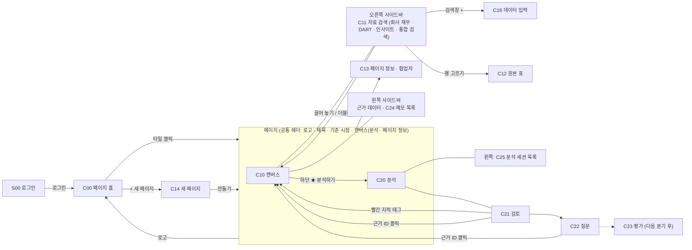

### 4.2 주요 화면별 구성과 사용자 흐름

실제 화면을 따라 사용자가 각 페이지에서 수행하는 주요 행동을 정리했습니다.

#### 1) 로그인 (`S00`) · 페이지 홈 (`C00`) · 새 페이지 (`C14`)

<table>
  <tr>
    <th width="50%">S00 로그인</th>
    <th width="50%">C00 페이지 홈</th>
  </tr>
  <tr>
    <td>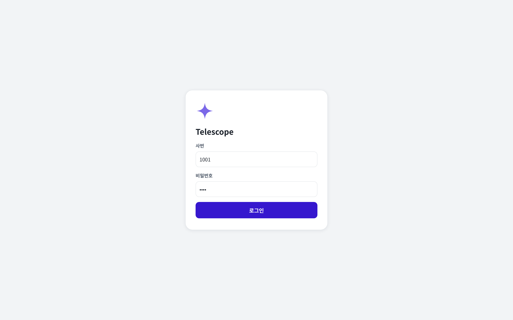</td>
    <td>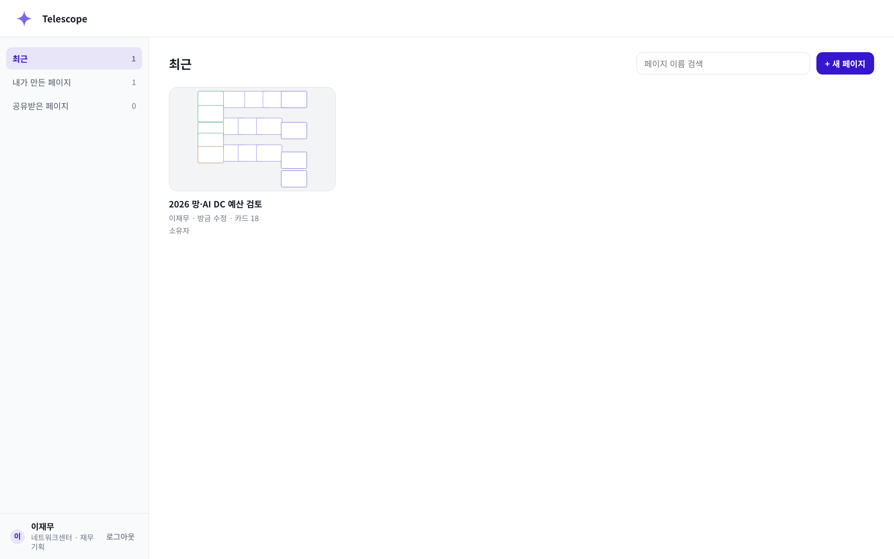</td>
  </tr>
  <tr valign="top">
    <td>
      <ul>
        <li>사번과 비밀번호를 입력해 로그인</li>
        <li>로그인 성공 시 페이지 홈(<code>C00</code>)으로 이동</li>
        <li>새로고침 시 기존 로그인 상태와 보던 페이지 자동 복원</li>
      </ul>
    </td>
    <td>
      <ul>
        <li>왼쪽 메뉴(<code>최근 / 내가 만든 / 공유받은</code>)와 상단 검색창으로 페이지 필터링</li>
        <li>카드 배치가 미리 그려진 타일을 클릭해 캔버스 열기</li>
        <li><code>+ 새 페이지</code>로 새 작업 생성, 소유한 페이지는 타일에서 삭제</li>
      </ul>
    </td>
  </tr>
</table>

##### C14 새 페이지 생성

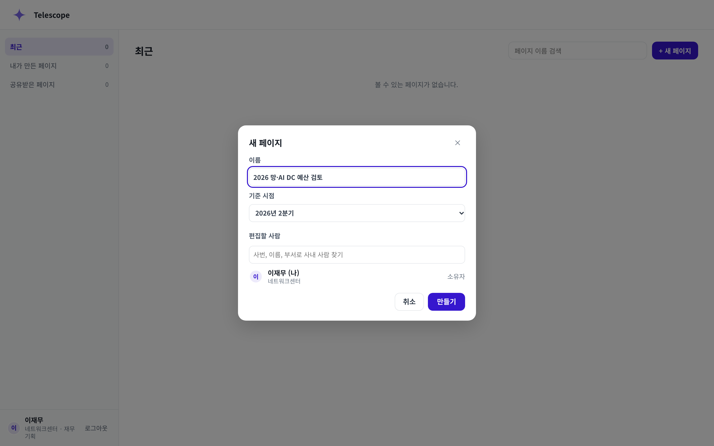

- 페이지 이름과 기준 시점(`2025년 1분기`~`2026년 4분기`) 선택
- 함께 편집할 사내 동료를 사번·이름·부서로 검색해 추가
- `만들기` 클릭 시 즉시 `C10 캔버스` 진입

---

#### 2) 자료 검색 사이드바 (`C11`) — 회사 재무 · DART · 인사이트 · 통합 검색

##### C11 자료 검색 — `회사 재무` 탭

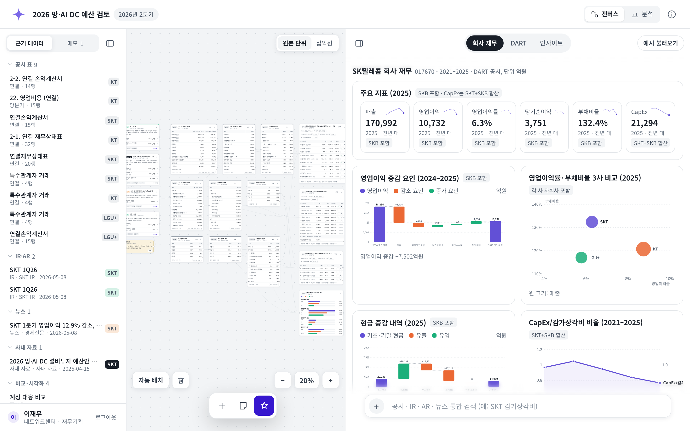

- `⌘K`로 오른쪽 자료 검색 사이드바 열기·닫기 (경계선 드래그로 폭 조절)
- 상단 주요 지표(KPI 6)·영업이익 증감 워터폴·3사 산점도·현금 증감·CapEx/감가상각비 비율 확인
- 하위 탭(`손익/재무상태/현금흐름/설비투자/동종사 비교`) 전환 후 필요한 패널을 캔버스로 끌어 놓기(또는 더블클릭)

##### C11 자료 검색 — `DART` 탭

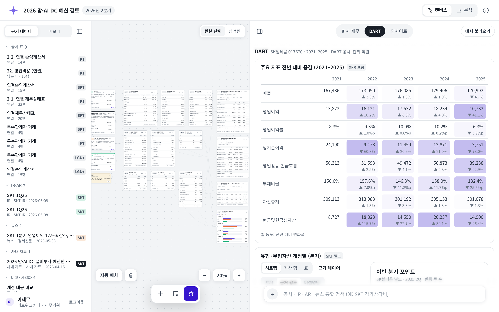

- 연도별 주요 지표 전년 대비 증감 히트맵(2021~2025)에서 급변 구간 확인
- SKT 별도 분기 유형·무형자산 계정을 `히트맵 / 자산 맵 / 표` 보기로 전환하며 변동 포인트 탐색
- 근거로 쓸 패널을 캔버스로 끌어 놓아 대시보드 카드로 추가

##### C11 자료 검색 — `인사이트` 탭

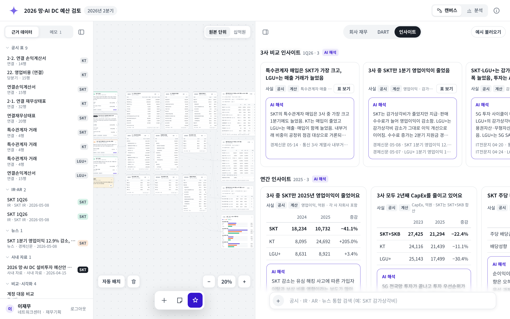

- 3사 비교 인사이트에서 `표 보기`로 근거 수치를 확인하고 캔버스로 끌어 놓기(3사 공시 표 + 비교 카드 동시 생성)
- 연간 인사이트(영업이익·CapEx·배당) 카드를 캔버스로 끌어 놓아 대시보드 카드로 추가
- 회사 필터로 관련 뉴스(썸네일)를 걸러 원문을 열거나 캔버스에 문서 카드로 추가

##### C11 자료 검색 — 하단 고정 통합 검색

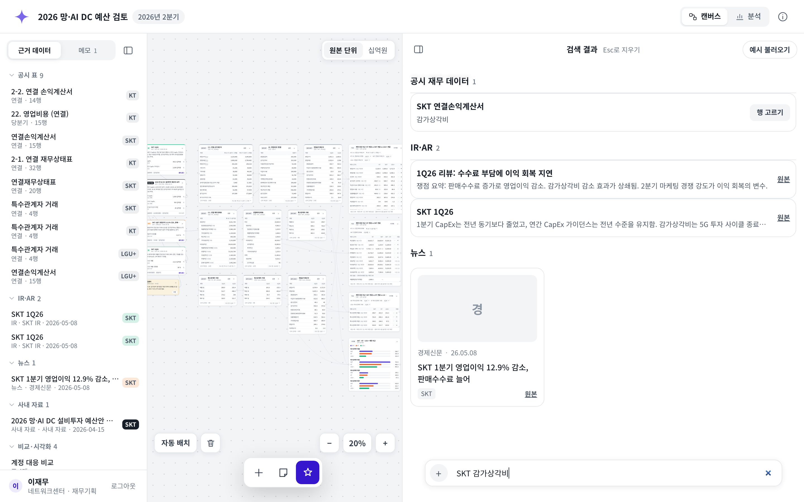

- 하단 검색창에 계정명·주제어 입력(Enter 없이 공시 재무 데이터·IR·AR·뉴스 즉시 표시)
- 원하는 공시·문서·뉴스 항목을 캔버스로 바로 끌어 놓기
- 공시 항목의 `행 고르기` 클릭 시 `C12 원본 표` 열기, `Esc`로 검색어를 지우고 탭 화면 복귀

---

#### 3) 원본 표 정밀 선택 (`C12`) · 사내 자료 입력 (`C16`)

<table>
  <tr>
    <th width="50%">C12 원본 표 (행·열 고르기)</th>
    <th width="50%">C16 사내 자료 입력</th>
  </tr>
  <tr>
    <td>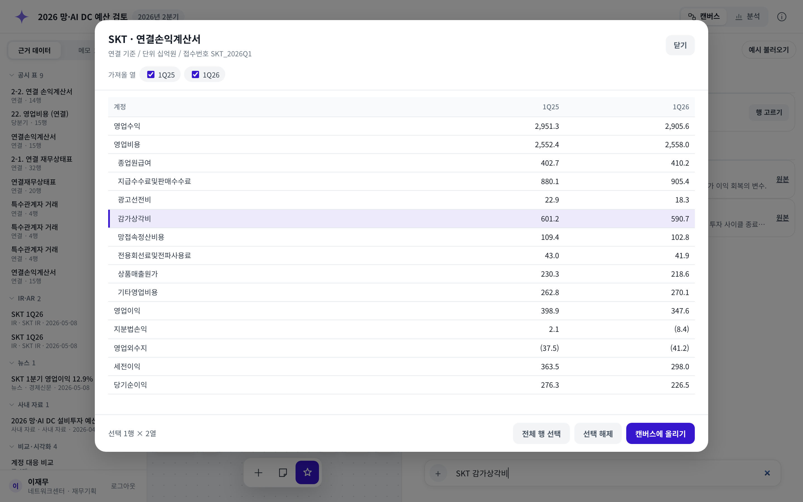</td>
    <td>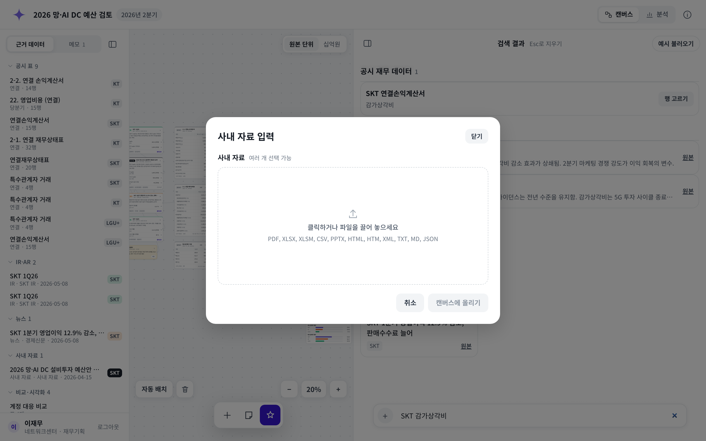</td>
  </tr>
  <tr valign="top">
    <td>
      <ul>
        <li>상단 체크박스로 가져올 기간 열 선택</li>
        <li>원본 표에서 필요한 행을 드래그해 선택하거나 <code>전체 행 선택 / 선택 해제</code></li>
        <li>행 옆 주석(<code>주n</code>) 클릭으로 연결 주석 표 이동</li>
        <li><code>캔버스에 올리기</code> 또는 <code>카드에 반영</code>으로 공시 표 카드 생성·갱신</li>
      </ul>
    </td>
    <td>
      <ul>
        <li>검색창 왼쪽 <code>+</code> 클릭으로 창 열기</li>
        <li>대상 회사(4사)와 발행일 선택(서버 모드) 후 파일 여러 개 선택·드래그</li>
        <li>포맷(11종·50MB)·대상 회사 검증 실패 파일 제외</li>
        <li>통과한 파일만 <code>캔버스에 올리기</code>로 사내 자료 카드 추가</li>
      </ul>
    </td>
  </tr>
</table>

---

#### 4) 협업 캔버스 (`C10` · `C24`) · 페이지 정보 및 공유 (`C13`)

##### C10 캔버스 전체 작업 화면 (왼쪽 근거 데이터·`C24` 메모 목록 + 카드 6종 + 지적 태그)

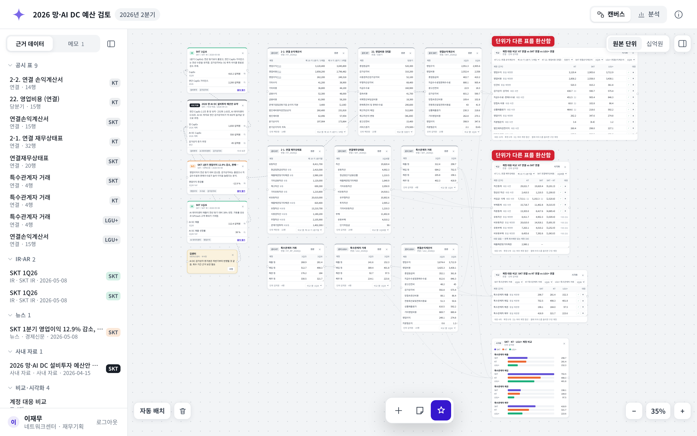

- 카드를 배치하고 좌우 점을 끌어 선으로 연결, 카드 `+`나 하단 메모 버튼으로 메모 카드·연결 메모 작성
- `Shift+클릭`으로 공시 표 2장 이상 선택 → `표 생성` / `시각화 생성`, 메모와 카드 함께 선택 → `메모 연결`
- 왼쪽 사이드바(`근거 데이터` / `C24 메모`) 항목 클릭으로 해당 카드·연결선 즉시 이동
- `자동 배치`, 휴지통(`전체 지우기` / `근거 부족 지우기`), 표시 단위 전환(`원본 단위` / `십억원`) 사용
- 하단 보라색 ★(`분석하기`) 클릭으로 AI 분석 시작, 카드 위 빨간 지적 태그 클릭으로 해당 분석 항목 이동

##### C13 페이지 정보 · 협업자 권한 관리

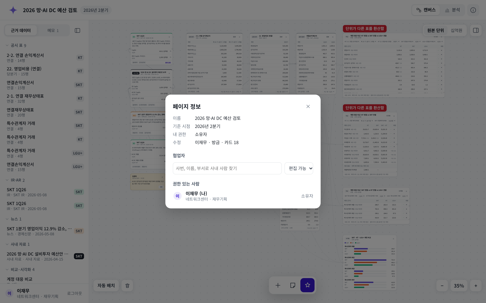

- 헤더 오른쪽 `(i)` 아이콘 클릭으로 페이지 이름·기준 시점·내 권한·수정 이력 확인
- 사번·이름·부서로 사내 사용자 검색 후 `편집 가능` 또는 `보기 가능`으로 초대(소유자만 가능)
- 기존 협업자의 권한 변경 또는 권한 삭제(소유자만 가능)

---

#### 5) AI 분석 화면 (`C20` · `C25`) — 검토 (`C21`) · 질문 (`C22`) · 평가 (`C23`)

##### C21 검토 내역 (분석 1단계)

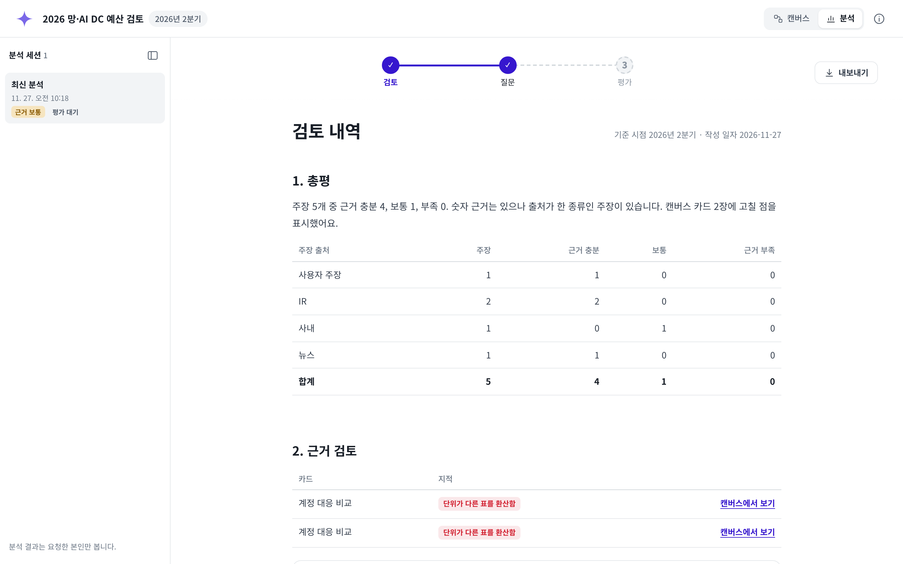

- 왼쪽 `C25 분석 세션` 목록에서 과거 세션·버전(`v1`, `v2`…) 전환 또는 목록에서 숨기기
- 총평에서 출처별 주장 수와 `충분 / 보통 / 부족` 판정 확인
- 지적 표의 `캔버스에서 보기`나 주장별 근거 ID 클릭으로 캔버스 해당 카드로 이동해 근거 보완
- 캔버스 수정 후 상단 안내 바에서 `업데이트`(같은 세션 새 버전) 또는 `새로 분석하기`(새 세션) 선택
- 오른쪽 위 `내보내기`로 LLM 프롬프트 복사 또는 Markdown 파일 다운로드

##### C22 애널리스트 예상 질문 리포트 (분석 2단계)

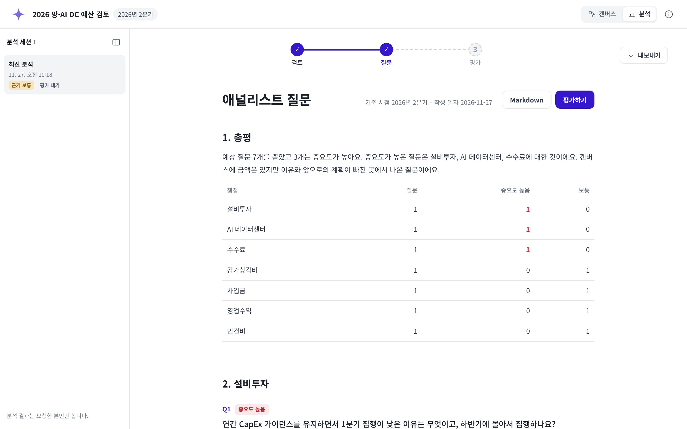

- 상단 프로세스 바에서 `질문` 단계 선택
- 쟁점별 중요도 표와 예상 질문(`Q1`, `Q2`…)·질문 배경(`왜 묻나요`) 확인
- `미리 준비할 근거`의 근거 ID를 눌러 캔버스 원문 수치와 즉시 대조
- 상단 `Markdown` 버튼으로 예상 질문 리포트 내려받기, `평가하기`로 다음 단계 이동

##### C23 예측 평가 (분석 3단계 — 다음 분기 자료 반영 후)

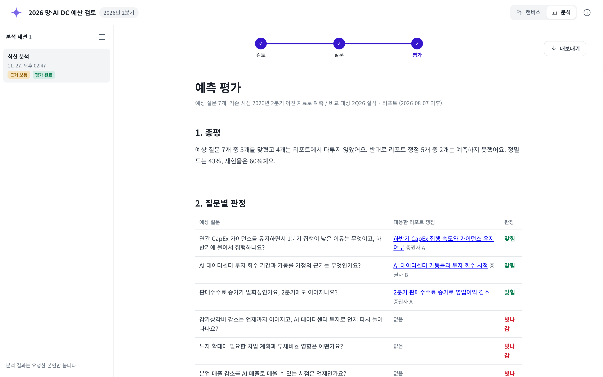

- 다음 분기 자료 도착 전까지 대기 상태 확인(데모에서는 `다음 분기 자료 반영` 버튼으로 실행)
- 총평에서 예상 질문 정밀도·재현율 확인
- 질문별 `맞힘` / `빗나감` 판정과 대응 리포트 쟁점 링크, 놓친 쟁점 점검
- 기준 분기 값 유지 가정과 다음 분기 실제 실적 차이율(`유지` / `재검토`) 확인

### 4.3 캔버스 카드 6종

| 카드 종류 | 성격색 | 담기는 내용 | 주요 조작 |
|---|---|---|---|
| **공시 표 카드** | 회색 | DART 공시 표에서 가져온 계정·기간 열·단위 | 원본 표(`C12`) 열기, 주석(`주n`) 보기, 열 정렬, 셀 수정(원본 툴팁 유지), 비교 기준 열 선택 |
| **비교 카드** | 파랑 (흰 블러) | Shift로 고른 여러 공시 표의 계정 대응 비교 결과 (공통 계정 없으면 `표 모음`) | 계정 대응 확정(`✓`)·거부(`✗`)·취소, 원본 표 기간 변경, 시각화 카드로 전환 |
| **시각화 카드** | 파랑 (흰 블러) | 고른 공시 표의 계정별 회사 비교 막대 차트 (공통 계정 없으면 `계정별 값`) | 원본 표 변경 시 자동 재계산 |
| **대시보드 카드** | 파랑 (흰 블러) | `회사 재무`·`DART`·연간 인사이트 탭에서 끌어 온 KPI·차트·히트맵·자산 계정 패널 | 자산 계정 보기 전환(히트맵/자산 맵/표), 패널 값 표를 분석 컨텍스트에 자동 포함 |
| **문서 카드** | 초록(IR·AR) / 주황(뉴스) / 검정(사내) | 제목, 회사/발행처/발행일, 뉴스 썸네일, 요약, 핵심 수치(`f번호`), 개념 태그 | 원문 `출처 열기` (사내 자료는 `사내 보관` 표시) |
| **메모 카드** | 노랑 | 작성자·부서·직무, 자유 텍스트 메모 (종류 구분 없음) | 카드 `+` 또는 하단 버튼으로 생성, 여러 카드에 연결(`Shift` → `메모 연결`), Enter 저장·수정 |

*(※ 연결선에도 메모를 달 수 있으며, 메모가 있는 선은 실선 + 작성자 아바타로 표시됩니다. 예전 저장본의 카드 안 메모 칸은 읽기 전용으로만 호환합니다.)*

### 4.4 대표 사용자 시나리오 (End-to-End)

> **상황**: SKT 네트워크센터 재무기획 담당자 **이재무(1001)**와 같은 부서 기술 담당자 **박망(1002)**이 KT·LGU+와 비교하며 **2026년 망·AI 데이터센터 예산서 근거**를 정리하고, 부서장/관계자 **최예산(2001)**에게 공유하는 흐름입니다. *(기준 시점: `2026년 1분기`, 평가 분기: `2026년 2분기`)*

| 단계 | 사용자 조작 | 화면에서 일어나는 일 | 관련 기능 |
|---|---|---|---|
| **1. 시작** | 이재무(`1001`) 로그인 → `+ 새 페이지`에서 이름, 기준 시점(`2026년 1분기`), 편집자 박망(`1002`) 지정 | 새 페이지 생성 후 캔버스 진입. 헤더에 기준 시점 칩과 `[캔버스 \| 분석]` 표시 | F-08, F-15, F-19 |
| **2. 대시보드·인사이트 탐색** | 오른쪽 `C11` 사이드바의 `회사 재무` · `DART` · `인사이트` 탭에서 주요 지표 패널·3사 비교 인사이트·썸네일 뉴스를 캔버스로 끌어 놓기 | 대시보드 카드, 3사 공시 표·비교 카드, 뉴스 카드가 성격별 색상으로 생성 | F-02, F-17, F-18 |
| **3. 통합 검색** | 아래 검색창에 `'SKT 감가상각비'` 입력(Enter 불필요) → 결과 끌어 놓기 또는 `행 고르기`(`C12`) → `Esc` | 공시 재무 데이터·IR·AR·뉴스가 즉시 함께 표시되고 원하는 행만 정밀 추출 | F-01, F-02 |
| **4. 사내 자료 검증·첨부** | 검색창 `+` → `C16 데이터 입력`에서 대상 회사 선택 후 파일 첨부 (포맷 오류·타사 파일·정상 SKT 자료) | 포맷 불일치(`FORMAT_MISMATCH`)·회사 불일치(`COMPANY_MISMATCH`) 차단, 통과한 자료만 파싱·요약되어 사내 자료 카드로 등록 | F-03 |
| **5. 협업 정리 · 메모 · 비교** | 박망과 동시 편집하며 카드 `+`로 메모 카드 추가, 연결선 잇기·연결 메모 입력, `Shift+클릭`으로 공시 표 2장 → `시각화 생성`, 비교표 `✓/✗`로 계정 대응 확정·거부 | 실시간 커서·변경 반영, 왼쪽 `C24`에 근거·메모 목록 집계, 대응 확정·거부 즉시 반영 | F-05, F-06, F-07, F-08, F-18, F-20 |
| **6. AI 검토 실행** | 하단 ★ `분석하기` 클릭 | `C20 분석` 화면 전환, 프로세스 바 `검토 ─ 질문` 진행. 총평·지적 표·주장별 판정(충분/보통/부족)·AI 인사이트 제공 | F-10, F-17 |
| **7. 지적 추적 · 보완** | `캔버스`로 돌아가 카드 위 빨간 지적 태그(`근거 부족`, `연결·별도 섞임`, `사용자 수정값` 등) 확인 및 클릭 | 해당 분석 항목으로 즉시 이동. 누락된 근거·메모를 캔버스에 보완 | F-10, F-11 |
| **8. 예상 질문 · 내보내기** | 프로세스 바 `질문` 클릭 → 애널리스트 리포트 확인, 근거 ID로 캔버스 카드 검증, `내보내기`로 프롬프트 복사 또는 Markdown 저장 | 쟁점별 질문·배경·확인할 수치 확보, 보고서/프롬프트 활용 | F-09, F-11, F-13 |
| **9. 변경 후 재분석** | 보완한 캔버스에서 `분석` 화면 진입 → `"캔버스가 변경되었습니다."` 바에서 `업데이트` 또는 `새로 분석하기` 선택 | `업데이트`는 같은 세션의 `v2`로 누적(이전 버전 보존), 판정 개선 확인 | F-10 |
| **10. 사후 평가** | 다음 분기(`2026년 2분기`) 실적·리포트 반영 → 프로세스 바 `평가` 확인 | 예상 질문 정밀도·재현율, 적중·놓친 쟁점, 기준 분기 가정 대비 실적 오차 확인 | F-14, F-15 |
| **11. 관계자 공유** | 헤더 `(i)` → `C13 페이지 정보`에서 최예산(`2001`)을 `보기 가능`으로 초대 | 최예산은 `보기 전용`으로 근거와 맥락을 안전하게 열람 | F-08 |

---

## 5. 기능 명세와 범위 (MVP · 후속 · 구현 현황)

### 5.1 범위 분류 기준

- **MVP (Must)**: 핵심 사용자 흐름(`근거 수집 → 협업 정리 → 검토 → 질문 → 평가`)과 신뢰성 원칙(시점 통제·근거 추적·인증/권한·실시간 동시 편집)을 성립시키는 필수 기능
- **Should**: 탐색 정확도·비교 편의성·운영 확장성을 높이는 기능
- **추가**: 일정 여유 시 제공하는 부가 편의 기능
- **MVP 제외 (후속 확장)**: 콜백 방식 작업 통지(폴링으로 통일), 실제 사내 시스템·사내 문서 연동, 사내 SSO, 글자 단위 공동 편집(OT/CRDT), 오프라인 병합, 멀티 백엔드 인스턴스 간 WebSocket 브로드캐스트, 팀 단위 고정 프로필, 캔버스 소유권 이전

### 5.2 기능 명세 전체표 (F-01 ~ F-20)

> **구현 상태 표기 원칙**: 실제 서버·파이프라인 코드로 동작하는 것과 프론트엔드 로컬 데모(`src/local/` 규칙·목업 데이터)로만 구현된 것, 아직 미구현인 것을 명확히 구분합니다.

| ID | 기능명 | 등급 | 상세 설명 | 페인포인트 | 관련 화면 | 현재 구현 현황 (2026.11.27 기준) |
|---|---|---|---|---|---|---|
| **F-01** | 공시 재무 데이터 검색·올리기 | **Must** | 통합 검색에서 계정명·개념으로 DART 공시 표를 찾고 끌어다 올림. `C12 원본 표`에서 행·열 정밀 선택, 셀마다 셀 ID 부여 | P1 | C11, C12, C10 | **프론트 데모 구현** (로컬 BM25+개념사전) / **파이프라인 구현** (DART 수집·파싱·DuckDB 적재) / **MCP 조회·서버 연동 예정** |
| **F-02** | IR·AR·뉴스 검색·올리기 | **Must** | 통합 검색에서 IR·AR·뉴스 조회, `인사이트` 탭에서 썸네일 뉴스 추천. 요약·핵심 수치·발행일·출처 링크 제공 (AR은 쟁점 요약+링크만) | P1 | C11, C10 | **프론트 데모 구현** (로컬 목업 + v01 실제 뉴스 13건) / **파이프라인 일부 구현** (AR 목록 수집 `naver_research.py`, IR 파서) / **MCP 조회·서버 연동 예정** |
| **F-03** | 사내 자료 첨부·요약 | **Must** | `C16 데이터 입력`에서 대상 회사(4사)·발행일(선택)과 파일을 올려 포맷(11종·50MB)·회사 검증 후 파싱·요약해 문서 카드로 생성 (MVP는 가상 사내 자료) | P1 | C16, C10 | **백엔드·프론트 업로드 연동 완료** (`POST /documents/uploads`, S3 저장, `Job` 폴링, `D001` 검증) / **범용 파서 구현 완료** / **AI 요약 파이프라인 등록(`real` 모드) 예정** (현재 `ai/server`는 `fake` 모드, 로컬 데모는 텍스트 요약) |
| **F-04** | 공시 임베딩 검색 | Should | 공시 XBRL 계정·주석을 임베딩해 유사 표현(`망 투자` 등)까지 혼합 검색(BM25+임베딩+개념사전) 후 원본 셀 ID 반환 | P1 | C11 | **미구현** (파서 항목 매칭 `align.py` 및 XBRL 표준 매칭 로직은 구현, 통합 검색 API·Chroma 색인은 예정; 데모는 BM25+개념사전으로 대체) |
| **F-05** | 계정 대응 비교 | Should | `Shift+클릭`으로 공시 표 2장 이상 선택 → `표 생성`. 회사별 상이한 계정명을 개념 사전으로 매칭(공통 계정 없으면 `표 모음`), `✓` 확정·`✗` 거부·취소 지원 | P1 | C10 | **프론트 데모 구현** + **백엔드 `confirm_mapping` 이벤트·`CanvasMapping` 저장 구현** / **서버 비교 계산 API 예정** |
| **F-06** | 관계 연결 | **Must** | 카드 좌우 점을 끌어 선으로 연결(관계 태그 없음, 분석 시 AI가 근거·설명·반박 판단). 연결 바에서 `연결 해제`·`메모 입력` | P2 | C10 | **프론트·백엔드 구현 완료** (`CanvasLink`, 이벤트 저장 및 실시간 동기화 포함) |
| **F-07** | 메모 | **Must** | 메모를 한 종류로 통합: 메모 카드(카드 `+`, 하단 버튼, 다중 카드 `메모 연결`) + 연결 메모. 분석에서 AI가 지시·근거·의견으로 자동 분류 | P2, P3 | C10, C24 | **프론트·백엔드 저장 구현 완료** (글 버전 충돌 409 방어 포함) / **AI 메모 분류는 로컬 규칙 기반 목업** (LLM 연동 예정) |
| **F-08** | 동시 편집·권한 | **Must** | 페이지별 권한(`소유자/편집/보기`, 소유자만 공유 설정, 일반 액세스 없음), HTTP 이벤트 저장 + WebSocket(STOMP) 실시간 동시 편집·커서 공유·접속자·권한 알림 | P2 | C00, C13, C10 | **백엔드·프론트 동기화 계층 구현 완료** (`canvas` CRUD/권한/이벤트/STOMP, `frontend/src/sync/` `VITE_CANVAS_SYNC=server`) / 기본 실행은 로컬 목업 모드 |
| **F-09** | 컨텍스트 추출 · 내보내기 | 추가 | 분석 화면 `내보내기` 팝업에서 `프롬프트로 추출`(클립보드 복사)과 `Markdown으로 내보내기`(검토·질문·평가 통합 파일) 제공 | P3 | C20 | **프론트 데모 구현 완료** |
| **F-10** | 근거 검토 | **Must** | 메모 분류 → 주장 추출 → 근거 충분/보통/부족 판정 및 보완 안내 → 캔버스 카드 빨간 지적 태그(근거 부족, 연결/별도 섞임, 단위 환산, 사용자 수정값, 미연결). 세션·버전(`업데이트`/`새로 분석하기`) 누적 및 목록 숨김 | P2, P3 | C20, C21, C25, C10 | **프론트 데모 구현** (규칙 기반 목업 `local/ai.ts`) / **백엔드 DB 스키마(`V6`)·Job 구조 구현** / **백엔드 분석 API·AI LLM 파이프라인 미구현** |
| **F-11** | 근거 추적 | **Must** | 검토·질문의 근거 ID 클릭 시 `C10` 해당 카드로 이동·강조, `C10` 카드 위 빨간 지적 태그 클릭 시 `C21` 해당 항목으로 양방향 이동 | P3 | C21, C22, C10 | **프론트 데모 구현 완료** |
| **F-12** | 양식·기준 설정 | Should | 대상 회사, 평가용 가정 계정, 질문 기준, 개념 사전을 코드가 아닌 설정 파일로 관리 | P3, P4 | — | **프론트 데모(`analysis.json`) 및 백엔드 업로드 회사 설정 구현** / **통합 서버 설정 관리 예정** |
| **F-13** | 애널리스트 예상 질문 | **Must** | 캔버스 근거와 검토 결과를 바탕으로 애널리스트 리포트 형식(총평·핵심 쟁점·쟁점별 질문·배경·확인할 수치 근거 ID) 생성 및 Markdown 내보내기 | P4 | C22 | **프론트 데모 구현** (질문 뱅크 목업) / **백엔드 DB 스키마(`V7`)·Job 구조 구현** / **백엔드 예측 API·AI LLM 파이프라인 미구현** |
| **F-14** | 다음 분기 평가 | **Must** | 다음 분기 실적·AR 리포트 반영 전까지 회색 대기, 반영 후 예상 질문 적중(정밀도·재현율, 적중/빗나감/놓침)과 기준 분기 유지 가정 vs 실제 실적 오차(±5%) 산출 | P5 | C23 | **프론트 데모 구현** (데모 반영 버튼) / **백엔드 DB 스키마(`V7`) 구현** / **백엔드·AI 평가 파이프라인 미구현** |
| **F-15** | 시점 통제 | **Must** | 헤더 기준 시점 표시. 검토·질문은 `as_of_date` 이전 발행 자료만 허용하고 이후 자료는 서버가 차단, 평가는 이후 자료만 사용 | P5 | 헤더, C14, C23 | **프론트 데모(데이터 분리) 및 `ai/server` `JobContext` 고정 주입 구현** / **백엔드 분석·예측 도메인 적용 예정** |
| **F-16** | 정답표 관리 | Should | 사후 평가에 쓸 애널리스트 리포트 쟁점(요약+출처 링크) 등록·수정 및 사람의 경계 사례 최종 판정 | P5 | 화면 없음 | **미구현** |
| **F-17** | 인사이트 (3사 비교 AI 해석) | **Must** | `C11 인사이트` 탭의 3사 분기 비교·연간 인사이트(영업이익·CapEx·배당) 및 `C21` 캔버스 표 급변 계정 코드 계산 + AI 해석 | P1, P4 | C11, C21 | **프론트 데모 구현** (`analysis.json` + v01 연간 인사이트) / **서버·AI 생성 파이프라인 미구현** |
| **F-18** | 비교 시각화·대시보드 | Should | `회사 재무`·`DART` 탭 패널(KPI·워터폴·산점도·히트맵·자산 계정·재무제표)을 대시보드 카드로 투입, Shift 선택으로 막대 차트 시각화 생성 | P1 | C11, C10 | **프론트 데모 구현** (v01 실제 DART 공시값 `dart.ts`, `dashboard.ts`) + **백엔드 `dash`/`chart` 카드 저장 구현** / **MCP DuckDB 조회 연동 예정** |
| **F-19** | 로그인·인증·페이지 메뉴 | **Must** *(인증)* / Should *(메뉴)* | 사번+비밀번호 JWT 로그인, `GET /users/me`, 사내 사용자 검색, 페이지 홈·새 페이지·헤더 전환 | P2 | S00, C00, C14, 헤더 | **백엔드 JWT 인증·로그인·사용자 검색 완료(#34)** (회원가입·관리자 시드 #133 예정) / **프론트 UI 구현 완료** (현재 로컬 목업, JWT 연동 예정) |
| **F-20** | 근거 데이터·메모 목록 | Should | `C10` 왼쪽 사이드바에서 올린 근거(성격별 묶음)와 전체 메모를 모아 보고 클릭 시 해당 카드·선으로 이동 | P2, P3 | C10, C24 | **프론트 구현 완료** |

### 5.3 영역별 현재 구현 현황 요약 (2026.11.27 기준)

| 영역 | 폴더 | 구현 완료 | 진행 중 / 미구현 |
|---|---|---|---|
| **Frontend** | `frontend/` | 전체 화면(`S00`, `C00`, `C10~C16`, `C20~C25`) UI·인터랙션, Vue Flow 캔버스·SVG 차트·Electron 실행, 실시간 동기화 계층(`src/sync/`), 서버 문서 업로드 연동, 로컬 데모 엔진(`src/local/`) | JWT 로그인 연동, 검색·대시보드·비교·분석·질문·평가 실서버 API 연결, `demo.html` 최신 빌드 갱신 |
| **Backend** | `backend/` | Spring Security + HS256 JWT 인증·인가(`user`, #34), 협업 캔버스 CRUD·권한·이벤트·글 충돌 방어(`canvas`, #82·#123), WebSocket/STOMP 실시간 동기화·커서·접속자(#83), 비동기 `Job` 상태·결과 저장 확정(#35·#63), 사용자 문서 업로드·검증·S3/로컬 저장(`document`, #89·#111), `PythonAiClientHttp`(#114), PostgreSQL Flyway 전체 스키마(`V1~V13`) | 회원가입·초기 관리자 시드(#133), `analysis`·`prediction`·`datasync`·`chat` 도메인 API, `mcp-server` 클라이언트 연동 |
| **AI Server (껍데기)** | `ai/server/` | FastAPI 작업 엔드포인트(`/internal/v1/jobs/*`), SQLite 상태 저장, `asyncio.Queue` 워커, `X-Internal-Api-Key` 인증, `PIPELINE_MODE=fake/real` 레지스트리, S3/로컬 파일 준비, `JobContext` 기준 시점·허용 문서 고정 주입(#48·#86) | 실제 AI 파이프라인 등록(`PIPELINE_MODE=real`) 및 Docker 이미지 파서·모델 의존성 포함(#109) |
| **Pipelines** | `pipelines/` | OpenDART XBRL·원문 XML 수집(`collectors`), 네이버 증권 AR 목록 수집, 범용 문서 파서 11종·Docling PDF·VLM(OpenAI) 라우팅·표 검산·마크다운 청킹·항목 임베딩 매칭(`parsers`, `vision`), XBRL → DuckDB 원본 적재·표준 개념 매칭·원자 교체(`loaders/xbrl.py`) | IR/뉴스 자동 수집기, ChromaDB 적재(ingest) 배치, 분석·검토·예상 질문·평가 LLM 파이프라인 |
| **MCP Server** | `mcp-server/` | 디렉토리 구조 준비 | DuckDB·ChromaDB 읽기 전용 조회 도구 구현 예정 |
| **Infra** | `infra/` | K8s 매니페스트(`frontend`, `backend`, `ai-server`, `chroma`, `pg-proxy`, `ingress`), Docker Compose, AWS RDS(PostgreSQL)·S3·ChromaDB 구성 | `ai-server` 실제 모드 리소스·IRSA 최종 반영 및 Ingress 업로드 크기 제한 정합 확인 |

---

## 6. 데이터 전략과 시스템 아키텍처

### 6.1 데이터 확보 방침 및 데모 데이터 구성

- **공개 데이터 + 가상 사내 자료 원칙**: 실제 사내 시스템·사내 문서는 MVP에서 다루지 않습니다.
- **현재 프론트엔드 데모 데이터 구성**:
  - **실제 공시값 · 실제 기사 (`frontend/` git 포함)**: v01에서 이식한 실제 DART 공시값(`src/local/dart.ts`, 2021~2025 연간 · 24.1Q~26.2Q 분기 · 배당 · SKT 별도 분기 자산 계정, 억원)과 기준 시점(2026-03-17) 이전 실제 뉴스 헤드라인 13건(`src/local/news.json`). *(자산 계정의 근거 칸 상태는 화면 설명용 예시)*
  - **팀 제작 목업 데이터 (`data/demo/` → 빌드용 `src/local/data.json`)**: 공시 표 11장(3사 1Q26 손익·재무상태·특수관계자 거래 등), 문서 19건(IR 4 · AR 4 · 뉴스 8 · 가상 사내 자료 3), `analysis.json`(3사 분기 인사이트, 가정 계정, 질문 뱅크, 평가용 2Q26 실적·리포트 쟁점).

### 6.2 자료 유형별 수집 · 파싱 · 적재 · 카드 매핑

| 자료 유형 | 원본 형식 | 수집 · 파싱 · 적재 방식 | 캔버스 카드 |
|---|---|---|---|
| **DART 공시** | XBRL zip, 원문 XML zip | `collectors`(`dart_xbrl.py`, `dart_document.py`) 원본 보관 → `parsers` 병합 셀 복원·셀 정규화 → `loaders/xbrl.py`가 DuckDB에 원본·표시순서·표준 매칭 적재(임시 파일 검증 후 교체, 정정공시 자동 대체) | 공시 표 카드, 대시보드 카드 |
| **IR 자료** | PDF, 엑셀 | 수집 → `parsers`(Docling + VLM 라우팅)로 문단·표 추출·합계 검산 → 장·절 마크다운 요약·임베딩, 표 수치는 XBRL과 `facts.py` 대조 | 공시 표 카드 또는 IR 카드 |
| **애널리스트 리포트(AR)** | 목록·상세 HTML | `collectors/naver_research.py` 수집 → **원문 비저장**, 쟁점 요약(3~5줄)·증권사·발행일·출처 링크만 저장. 기준일 이전분은 근거, 이후분은 평가 정답 | AR 카드 |
| **뉴스** | 기사 본문·메타 | 수집 → 요약, 핵심 수치, 개념 태그, 출처 링크, `og:image` 썸네일 저장 | 뉴스 카드 |
| **사내 자료** | 11종 (`pdf, xlsx, xlsm, csv, pptx, html, htm, xml, txt, md, json`, 최대 50MB) | `POST /documents/uploads` 포맷·4사 회사 검증 → S3 저장 → `ai/server` 자료 준비 작업(`parsers.parse()` + 요약·핵심 수치·개념 태그 추출). **ChromaDB에 적재하지 않고 해당 캔버스에만 귀속** | 사내 자료 카드 |

### 6.3 시스템 전체 아키텍처와 저장소 경계

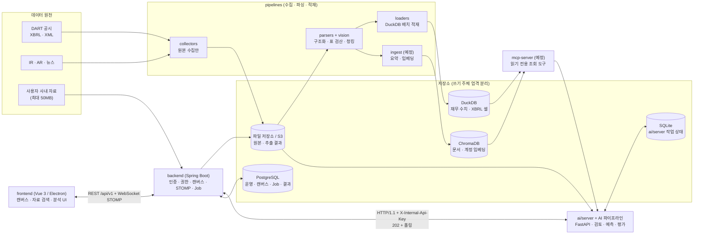

| 저장소 | 쓰기 주체 | 읽기 주체 | 원칙 |
|---|---|---|---|
| **PostgreSQL** (`app` 스키마) | `backend`만 | `backend` | 운영 데이터(사용자·문서 메타·Job·캔버스·이벤트·분석·예측·평가) 전담 |
| **DuckDB** | `pipelines/loaders` 배치만 | `mcp-server` (읽기 전용) | `backend`는 직접 열지 않음. 새 파일 생성·검증 후 원자 교체 |
| **ChromaDB** | 자료 준비(`ingest`)만 | `mcp-server`, `ai` | `backend`는 직접 열지 않음. 사용자 업로드 사내 자료는 적재하지 않음 |
| **파일 저장소 (S3 / 로컬)** | `backend`(사용자 업로드), `ai`(공시 등) | `backend`, `ai/server` | `ai/server`가 S3에서 임시 경로로 내려받아 파이프라인에 전달 후 정리 |
| **SQLite** | `ai/server`만 | `ai/server` | 단일 인스턴스 비동기 작업 상태·결과 영구 보관(재시작 시 미종료 작업 `FAILED` 확정) |

### 6.4 컨텍스트 컴파일(L0~L4)과 AI/코드 역할 경계

캔버스 조작은 모두 불변 이벤트(`CanvasEvent`)로 기록되며, 분석 시 아래 **5개 층(Layer)**으로 컴파일해 LLM에 전달합니다. 앞 층(`L0~L2`)이 바뀌지 않으면 LLM **prefix 캐시**를 재사용해 응답 속도와 비용을 절감합니다.

| 층 | 포함 내용 | 변경 시점 |
|---|---|---|
| **L0_system** | 역할, 근거 ID 인용 규칙, 메모(지시/근거/의견)·연결선 해석 규칙, 개념 사전 | 거의 고정 |
| **L1_sources** | 출처 목록 (공시 접수번호, 문서 ID·종류·발행처·발행일) | 자료 카드 추가·삭제 |
| **L2_workspace** | 카드 본문 (공시 표 셀, 대시보드 패널 값 표, 문서 요약·수치, 메모 카드) | 카드·행·열·메모 카드 변경 |
| **L3_edits** | 사용자 수정값, 비교 기간, 대응 확정·거부, 비교·시각화 원본, 연결선, 연결 메모 | 편집·연결·메모 변경 |
| **L4_task** | 실행 요청 (검토 / 예상 질문) | 분석 실행 시 |

- **역할 경계 요약**:
  - **코드**: 재무 수치 조회, 단위 환산, 비율·증감률·가정 오차 계산, 포맷·회사 검증, 기준 시점 필터 강제, LLM 출력 속 근거 ID 실존 검증
  - **임베딩 + 키워드 + 개념 사전**: 계정명·표현 차이 매칭, 문서·뉴스 유사 검색, 예상 질문-실제 쟁점 매칭 보조
  - **LLM**: 메모 문장 분류(지시/근거/의견), 주장 판정 사유, 3사 비교·연간 인사이트 해석 문장, 애널리스트 예상 질문·배경 생성

---

## 7. 확정 사항과 미확정 사항

### 7.1 확정된 주요 의사결정

| 영역 | 확정 내용 | 반영 근거 |
|---|---|---|
| **인증·계정** | JWT(HS256, 1시간, 리프레시 토큰 없음)로 통일, 사내 SSO는 MVP 이후. 회원가입은 누구나(`USER`), 첫 관리자는 배포 환경변수로 시드 예정 | #34, #133, `docs/backend/api-spec.md` 3장 |
| **실시간 협업** | 실시간 동시 편집과 커서 공유를 MVP(`Must`)에 포함. 편집 저장은 HTTP(트랜잭션·`requestId` 멱등·글 버전 충돌 409), 변경 수신·커서·접속자는 WebSocket(STOMP) | #82, #83, #84, `docs/backend/canvas.md` |
| **공유 권한** | 페이지 공유 설정은 **소유자만** 변경, 회사 전체 공개(일반 액세스) 없음 | #100, `docs/backend/api-spec.md` 4장 |
| **캔버스 구조** | 페이지 = 캔버스 + 분석(헤더 `[캔버스 \| 분석]` 전환), 메모 한 종류 통합(메모 카드 + 연결 메모), 연결선 관계 태그 제거(AI 판단), 시각화 카드 독립 저장(`create_compare` `view: chart`) | #97, #122, #123 |
| **사내 자료 업로드** | 1요청 1파일, 대상 회사(`SKT·SKB·KT·LGU+`) 사용자 선택, 발행일 선택 입력(미입력 시 업로드일), 50MB 상한, 파서 지원 11종 확장자 임시 제한, ChromaDB 미적재 | #111, `docs/backend/document.md` |
| **비동기 작업** | 콜백 없이 `202` + `GET /api/v1/jobs/{id}` 폴링. 결과 저장 성공과 완료 확정을 한 트랜잭션으로 처리. `ai/server` 상태 저장은 SQLite | #35, #48, #63, #86, #114 |

### 7.2 아직 확정되지 않은 사항 (임의 결정 금지 · 논의 필요)

> 루트 [CLAUDE.md](../../CLAUDE.md) 7장 및 관련 산출물 간 조율이 필요한 항목을 누락 없이 모았습니다.

| # | 미확정 / 조율 항목 | 현재 상태 및 충돌 내용 | 확인 대상 |
|---|---|---|---|
| **1** | **분석 결과(세션) 조회 범위** *(문서 간 불일치)* | • 백엔드 규약([backend/api-spec.md](../backend/api-spec.md) 4장, [ERD](../erd/entities.md) 5장, `CLAUDE.md` 1장): **캔버스에 권한이 있는 사람 모두** 조회 • 프론트 IA·데모([ia.md](../frontend/ia.md) 3장·8장, [frontend/api-spec.md](../frontend/api-spec.md) 7장): **분석을 요청한 본인만** 조회 | 팀 전체 · 현업 멘토링 (구현 전 단일화 필요) |
| **2** | **예산 보고서의 실제 파일 형식 및 사내 양식** | 현재 파서 지원 11종으로 임시 제한, 데모는 `analysis.json` 양식 사용. 실제 사내 사업기획서·예산서 양식과 결과물 초안 생성 재포함 여부 미정 | 현업 멘토링 (`CLAUDE.md` 7장) |
| **3** | **문서 보관·삭제 정책 및 일회성 업로드 문서 접근 범위** | 업로드 파일은 캔버스에 귀속되어 현재 캔버스 권한자가 조회(#111). 올린 사용자만 볼지 여부, S3/DB 보관 기간·만료·삭제 시 기존 분석 참조 처리 미정 | 팀 전체 · 현업 (`CLAUDE.md` 7장) |
| **4** | **채팅 기능 포함 범위와 응답 방식** | 백엔드 ERD(`ChatSession`, `ChatMessage`)와 BI(스텔라)는 존재하나 응답 방식(일반 JSON vs SSE) 및 v02 캔버스 화면 반영 여부 미정 | 팀 전체 (`CLAUDE.md` 7장) |
| **5** | **신규 자료 자동 반영·알림 및 다음 분기 평가 트리거** | 다음 분기 실적·리포트 도착을 무엇으로 판정할지(수집 배치 시점 vs 관리자 등록), 평가를 자동 실행할지 수동 실행할지, 신규 자료 알림 포함 여부 미정 | backend · ai · infra (`CLAUDE.md` 7장) |
| **6** | **공시 임베딩 모델 및 통합 검색 API 구조** | `PARSER_EMBED_MODEL` 공용 vs v01 DART 계정 미세조정 모델 비교, 프론트가 공시·문서를 나눠 호출할지 통합 `GET /search`로 합칠지 미정 | backend · ai · frontend |
| **7** | **LLM 메모 분류·주장 판정·예상 질문 적중 기준 및 정답표 주체** | 데모 규칙 기반 판정을 LLM으로 전환할 때의 평가 기준, AR 쟁점 요약 생성 주체(수집 시 LLM vs 사람 정답표 F-16), 적중 판정 임계값 미정 | ai · 교수진/현업 멘토링 |
| **8** | **데이터 입력 대상 회사 확장 및 추가 검증** | 현재 4사(`SKT·SKB·KT·LGU+`) 설정 기반 검증. 4사 외 확장 여부 및 기준 시점 이후 자료 업로드 차단 여부 미정 | 팀 내부 |
| **9** | **자산 계정 근거 칸 생성 방식 및 CapEx 본문 표 적재 규칙** | `DART` 탭 자산 계정의 근거 강도·미설명 변동 산출 방식(현재 예시)과 재무제표 외 사업보고서 본문 표(CapEx 등) 표준 적재 규칙 미정 | ai 담당 |
| **10** | **부서 재무기획 실무 적용 범위** | 실제 첫 적용 부서, 동시 편집 적정 인원, 뉴스 수집 이용 조건(요약·링크만 보관 범위) 확인 필요 | 현업 멘토링 · 주관 팀 |

---

## 8. 관련 문서 및 참고 자료

### 저장소 내 기준 문서

| 문서 | 경로 | 역할 |
|---|---|---|
| 프로젝트 공용 규칙 | [CLAUDE.md](../../CLAUDE.md) | 영역별 담당, 저장소 쓰기/읽기 경계, 데이터·분석 원칙, Git Flow |
| 화면별 IA | [docs/frontend/ia.md](../frontend/ia.md) | 화면 ID(`S00~C25`), 화면별 클릭→결과, 상태·예외, 값 표시 규칙 |
| 프런트엔드 API 명세 | [docs/frontend/api-spec.md](../frontend/api-spec.md) | 화면 호출 API 경로·요청/응답 스키마 초안 |
| 백엔드 API 규약 | [docs/backend/api-spec.md](../backend/api-spec.md) | 공통 응답·에러 코드, JWT 인증, 캔버스 권한, STOMP 실시간 규약 |
| 협업 캔버스 설계 | [docs/backend/canvas.md](../backend/canvas.md) | 캔버스 이벤트·동시성·실시간 전달 결정 기록 |
| 사용자 문서 업로드 설계 | [docs/backend/document.md](../backend/document.md) | 업로드 검증(`D001`), S3 저장, `Job` 연동 결정 기록 |
| ERD (엔티티 정리) | [docs/erd/entities.md](../erd/entities.md) | PostgreSQL 8개 도메인 22개 엔티티 및 전체 업무 흐름 |
| Backend ↔ AI 규약 / AI Server | [ai-contract.md](../backend/ai-contract.md) · [ai-server-design.md](../backend/ai-server-design.md) | 내부 작업 호출 규약, `JobContext` 시점·문서 강제, SQLite 워커 |
| 브랜드 BI (스텔라) | [docs/brand/bi.md](../brand/bi.md) | 서비스명 Telescope 의미 및 챗봇 캐릭터 스텔라 시안 |
| 프론트엔드 실행 가이드 | [frontend/README.md](../../frontend/README.md) | 로컬 실행(브라우저·Electron), 데모 확인 순서, 코드 구성 |

### 외부 참고 자료

1. 뉴스토마토, 「정재헌호 SKT 첫 조직개편 단행…"MNO·AI 체제 도입"」, https://newstomato.com/ReadNews.aspx?no=1281501
2. 스마트투데이, 「SKT, 조직개편 단행..신임 임원 인사」, https://www.smarttoday.co.kr/ko-kr/articles/96206
3. 포인트경제, 「SK텔레콤, 2025 조직개편 단행…'MNO·AI 양대 CIC 체제' 도입」, https://www.pointe.co.kr/news/articleView.html?idxno=61679
4. 머니투데이, 「SKT, B2B 담당 '엔터프라이즈 TF' 신설…AI DC는 영역별 세분화」(2026.04.21), https://www.mt.co.kr/tech/2026/04/21/2026042117233438986
