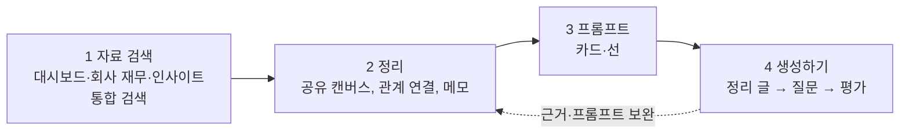

# Telescope 기획서

> 작성일 2026.11.24, 수정 2026.11.25(#97), 2026.11.26(#97 추가 수정: 메모 복원, 자료 검색 3탭 · 통합 검색, 생성하기 = 캔버스 정리 글) / 설계서 [설계서.md](설계서.md) / 기준 문서 [README.md](../../README.md) / 데모 [v02-canvas 데모](../frontend/demo.html) / 프론트엔드 설명 [frontend/README.md](../../frontend/README.md)

---

## 0. 서비스 정의

부서 재무기획 담당자와 같은 부서 사람들이 공시·IR·뉴스·사내 자료를 공유 캔버스에 모아 정리하고, 카드·연결마다 프롬프트로 활용 방향을 지시하고 메모로 의견을 나눈 뒤, 캔버스 내용을 근거 ID가 붙은 컨텍스트 글로 정리해 예산서·사업기획서 작성에 쓰고, 애널리스트 예상 질문을 뽑아 다음 분기 실적으로 평가하는 재무 근거 협업 플랫폼

---

## 1. 이해관계자

□ 부서 재무기획 담당자는 CIC·본부 같은 사업 조직 안에서 그 조직의 사업계획·예산·투자계획을 작성하고 실적을 관리하는 담당자임

| 구분 | 이해관계자 | 소속 예 (SKT) | 서비스에서 하는 일 |
|---|---|---|---|
| 핵심 사용자 | **부서 재무기획 담당자** | 네트워크센터, AIDC사업본부, 세일즈마케팅본부, 프로덕트브랜드본부 [1][3][4] | 예산서·사업기획서 작성 책임. 근거 수집, 캔버스 정리, 프롬프트 작성, 컨텍스트 글 생성 · 다듬기, 질문·평가 확인 |
| 부사용자 | 같은 부서 사업·기술·동료 담당자 | 핵심 사용자와 같은 부서 | 현장 수치(사내 자료)와 공시·IR·AR·뉴스 근거를 함께 올리고 프롬프트로 활용 방향 지시, 메모 · 보완 요청으로 의견 공유 |
| 관계자 | 부서장, 전사 재무기획, IR 담당 | 사업 조직, 코퍼레이트센터(CFO) [2] | 결과물 컨펌·심의(보기 권한으로 캔버스 확인, 보완 요청 메모). IR은 예상 질문·쟁점의 출처 |

---

## 2. 페인포인트

| ID | 페인포인트 | 현재 상황 | 영향 |
|---|---|---|---|
| P1 | 근거 데이터 산발 | 공시(DART), IR 자료, 뉴스, 사내 엑셀·보고서가 각각 다른 곳, 다른 단위·기준으로 있음 | 근거를 찾고 단위·기준을 맞추는 데 작성 시간 대부분을 씀 |
| P2 | 부서 안 근거 공유 단절 | 담당자별로 모은 근거와 현장 수치가 개인 파일에 남음. 어떤 수치를 왜 썼는지 맥락이 공유되지 않음 | 같은 근거를 부서원마다 다시 찾음. 검토 때 출처 확인과 보완 요청이 반복됨 |
| P3 | 근거 → 문서 작성의 수작업 | 모은 근거를 사업기획서·투자계획서·예산서 양식에 옮겨 쓰는 과정이 수작업임. LLM에 넣으려 해도 근거를 프롬프트로 정리하기 어려움 | 출처 없는 숫자, 기간·기준이 섞인 숫자가 초안에 들어감 |
| P4 | 검토·시장 질문 예측 어려움 | 심의자나 애널리스트가 무엇을 물을지 제출·발표 뒤에야 앎 | 보완 요청과 재제출이 반복됨 |
| P5 | 결과물 품질의 사후 검증 부재 | 초안의 가정과 예상 질문이 다음 분기에 맞았는지 확인하지 않음 | 근거 정리 방식이 개선되지 않음 |

---

## 3. 솔루션

□ 한 흐름

| 단계 | 하는 일 | 대응 페인포인트 | 쓰는 기술 |
|---|---|---|---|
| 1 자료 검색 | 자료 검색 화면은 입력 전 대시보드 · 회사 재무 · 인사이트 3탭을 Tab으로 오감. 대시보드는 KPI · 영업이익/현금 증감 워터폴 · 3사 산점도 · 전년 대비 히트맵 · 자산 계정(히트맵 · 자산 맵 · 근거 패널), 회사 재무는 손익 · 재무상태 · 현금흐름 · 설비투자 · 동종사 비교, 인사이트는 3사 비교 · 연간 인사이트(AI 해석)와 썸네일 뉴스. 입력창은 탭과 무관한 통합 검색으로, 입력하는 즉시 공시 재무 데이터 · IR·AR · 뉴스가 뜸. 누르면 선택 목록에 담고 입력창 오른쪽 추가하기로 캔버스에 올림. 길게 누르면 바로 끌어다 놓음. 사내 자료는 입력창 왼쪽 +로 첨부 | P1 | DART XBRL 적재, 공시 임베딩 검색, 문서 파서 모델, LLM 해석 |
| 2 정리 | 공유받은 사람끼리 쓰는 캔버스에서 카드를 관계(근거·설명·반박·관련)로 잇고, 같은 개념끼리는 자동 연결. 상단 메모로 메모 · 보완 요청 카드를 남김(의견, 사실 근거 아님) | P1, P2 | 개념 사전(온톨로지), 이벤트 로그 |
| 3 프롬프트 | 카드를 누르면 그 근거를 어떻게 활용할지, 선을 누르면 그 관계를 어떻게 쓸지 프롬프트를 적음(프롬프트만 담는 카드는 없음). 왼쪽 프롬프트 목록에서 모아 보고 누르면 해당 카드·선으로 이동 | P2, P3 | 컨텍스트 컴파일러(프롬프트 층) |
| 4 생성하기 | 상단 생성하기를 누르면 오른쪽 패널(화면 절반, 접기 · 펴기)이 열려 캔버스 정리 글 → 애널리스트 질문 → 평가를 한 번에 진행. 정리 글은 캔버스의 카드 · 연결 · 프롬프트 · 메모를 근거 ID가 붙은 글로 옮긴 컨텍스트이며 근거 부족 판정은 하지 않음. 글은 고칠 수 있고 복사 · Markdown으로 내보내 문서 작성에 씀. 가로 프로세스 바로 단계 전환. 질문은 Markdown으로 내보냄 | P3, P4, P5 | LLM, 평가 모듈(코드 계산) |

□ 설계 원칙
- 숫자는 근거 ID와 함께만 씀
  - 공시 표 값 `[표ID#r행c열]`, 대시보드 값 `[dash:패널ID#행이름]`, 문서 수치 `[doc:문서ID#f번호]`, 문서 내용 `[doc:문서ID]`
  - 근거 ID를 누르면 캔버스의 해당 카드로 이동함
- 값 유형 구분: 공시(원본 숫자), IR·AR·뉴스·사내(문서 수치), 계산(코드로 낸 값), AI 해석
- 프롬프트는 작성 지시로만, 메모는 팀원 의견으로만 씀. 둘 다 사실 근거로 인용하지 않음
- 카드 색은 데이터 성격별: 공시 회색, IR·AR 초록, 뉴스 주황, 사내 자료 검정. 비교·시각화·대시보드는 색 없는 흰 블러, 메모는 연노랑(보완 요청은 빨간 윗선), 프롬프트는 보라
- 원본은 불변, 편집은 별도 층에 쌓음. 화면 좌표 이동은 컨텍스트를 바꾸지 않음
  - 사용자가 고친 값은 정리 글에서 '사용자 수정값'으로 표시하고, 다음 분기 가정에는 기준 분기 원본값만 씀
- 근거 · 프롬프트 · 메모가 바뀌면(기간 선택, 행 제거, 카드 추가·삭제, 프롬프트 수정) 이미 만든 정리 글·질문에 다시 생성 안내를 띄움
- 시점 통제: 생성 단계는 기준일 이전 자료만, 기준일 이후 자료는 평가에만 씀
- 회사·양식·평가 기준은 코드가 아닌 설정에서 바꿈(README 범용 설정)
- 애널리스트 리포트는 원문 대신 쟁점 요약과 출처 링크만 다룸

---

## 4. 기능 명세

□ 등급 기준: must는 README 3장·데모 흐름에 직접 나오거나 한 흐름을 잇는 데 필요한 기능, should는 품질을 높이는 기능, 추가는 일정 여유 시 기능

| ID | 기능 | 등급 | 설명 | 페인포인트 | README 대응 | 데모 |
|---|---|---|---|---|---|---|
| F-01 | 공시 재무 데이터 검색·올리기 | must | 자료 검색 화면 통합 검색(입력 즉시)에서 계정명·개념으로 공시 표 검색, 결과는 재무 데이터 리스트. 행을 누르면 원본 표 창에서 행을 골라 선택 목록에 담음. 셀마다 셀 ID | P1 | 근거 데이터 수집 | 구현 |
| F-02 | IR·AR·뉴스 검색·올리기 | must | 통합 검색에서 IR·AR(애널리스트 리포트) · 뉴스 리스트, 인사이트 탭에서 관련 뉴스(썸네일). 카드에 요약·핵심 수치·출처 링크·발행일. AR은 쟁점 요약과 링크만 | P1 | 근거 데이터 수집 | 구현 (키워드 + 개념 사전, 캔버스 기준 추천, 회사 필터) |
| F-03 | 사내 자료 첨부·요약 | must | 입력창 왼쪽 +로 파일을 고르면 파서 모델이 본문·표를 요약하고 수치·개념 태그를 뽑아 선택 목록에 담음. 이번 단계는 팀이 만든 가상 사내 자료로만 시연하고 실제 사내 데이터 처리는 범위 밖(5장) | P1 | 자료 파싱 | 목업 (txt·md·csv만, 캔버스와 함께 저장) |
| F-04 | 공시 임베딩 검색 | should | 공시 XBRL 계정·주석을 임베딩해 검색. 결과를 원본 셀 ID로 되돌려 행 선택 | P1 | 근거 데이터 수집 | 미구현 (키워드 + 개념 사전으로 대신) |
| F-05 | 계정 대응 비교 | should | 회사마다 다른 계정명을 개념 사전으로 맞춰 비교, 대응 확정·거부 | P1 | 자료 파싱과 근거 점검 | 구현 |
| F-06 | 관계 연결(온톨로지) | must | 카드끼리 근거·설명·반박·관련 관계로 연결. 같은 개념의 문서·표 카드는 자동 연결 | P2 | 자료 파싱과 근거 점검 | 구현 |
| F-07 | 메모 · 프롬프트 | must | 카드 프롬프트(카드를 누르면 보라 칸), 선 프롬프트(선을 누르면 관계 태그와 함께). 왼쪽 프롬프트 목록에서 누르면 해당 카드·선으로 이동. 정리 글에 작성 지시로 들어감. 상단 메모로 메모 · 보완 요청 카드(팀원 의견, 정리 글의 메모 섹션) | P2, P3 | 범용 설정(프롬프트) | 구현 (목업 AI는 카드 줄 아래 `지시:`로 반영) |
| F-08 | 동시 편집·권한 | 추가 | 여러 명이 실시간으로 같은 캔버스 편집, 캔버스별 권한(소유자 · 편집 가능 · 보기 가능)과 공유 | P2 | 범위 밖 | 권한만 목업 (로고 팝업의 정보 수정 → 공유 창: 사람 초대 · 권한 변경 · 일반 액세스는 초대한 사람만 / 회사 전체 보기, 보기 권한은 보기 전용). 실시간 동시 편집은 미구현 |
| F-09 | 컨텍스트 복사 · 내보내기 | 추가 | 정리 글(고친 내용 포함)을 복사하거나 Markdown으로 내려받음. 층별 컨텍스트(L0 역할·규칙 / L1 출처 / L2 카드·메모 / L3 조작·연결·사용자 프롬프트 / L4 요청)는 서버 안에서만 씀 | P3 | 범용 설정(프롬프트) | 구현 |
| F-10 | 캔버스 정리(컨텍스트 글) | must | 생성하기의 첫 단계. 캔버스의 공시 표 · 대시보드 · 비교 · 문서 · 연결 · 카드/선 프롬프트 · 메모를 섹션별 글로 정리. 숫자마다 근거 ID, 단위 환산은 코드, 근거 부족 판정 없음. 편집 가능, 캔버스가 바뀌면 다시 생성 안내 | P3 | 출력 양식 | 목업 (규칙 기반) |
| F-11 | 근거 추적 | must | 정리 글·질문의 근거 ID를 누르면 해당 카드로 이동·강조 | P3 | 자료 분석 화면 | 구현 |
| F-12 | 양식·기준 설정 | should | 질문 기준, 평가 기준(가정 계정 · 쟁점)을 설정 파일로 변경 | P3, P4 | 범용 설정 | 구현 (`analysis.json`) |
| F-13 | 애널리스트 예상 질문 | must | 정리 글에 이어 캔버스 근거로 질문, 이유, 중요도, 준비할 근거 ID 생성. Markdown 내보내기 | P4 | 애널리스트 질문 예측 | 목업 (질문 뱅크) |
| F-14 | 다음 분기 평가 | must | 생성하기의 세 번째 단계. 예상 질문을 다음 분기 리포트 쟁점과 대조해 적중·놓침·빗나감, 정밀도·재현율. 기준 분기 공시값 유지 가정과 실제 실적 차이율 | P5 | 예측 평가 | 목업 |
| F-15 | 시점 통제 | must | 생성 단계에서 기준일 이후 자료 차단, 평가 자료 분리 | P5 | 예측 평가 | 데이터 분리로 표현 |
| F-16 | 정답표 관리 | should | 리포트 쟁점(요약 + 출처 링크) 등록·수정, 사람의 최종 판정 | P5 | 예측 평가 | 미구현 |
| F-17 | 인사이트(3사 비교 AI 해석) | must | 인사이트 탭에서 3사 공시 수치 증감 비교(분기)와 연간 인사이트(영업이익 · CapEx · 배당), AI 해석, 관련 뉴스를 보여 줌. 분기 비교는 3사 표와 비교 카드로, 연간 인사이트는 대시보드 카드로 캔버스에 올림 | P1, P4 | 자료 파싱과 근거 점검 | 목업 (`analysis.json`, v01 DART 대시보드 인사이트) |
| F-18 | 비교 시각화·대시보드 | should | 대시보드 탭(KPI · 워터폴 · 산점도 · 히트맵 · 자산 계정)과 회사 재무 탭(손익 · 재무상태 · 현금흐름 · 설비투자 · 동종사 비교)의 패널을 하나씩 캔버스 카드로 올림. 비교 카드는 막대그래프 카드로 바꿈. 흰 블러 카드로 다른 카드와 구분 | P1 | 자료 분석 화면 | 구현 (v01-stella DART 대시보드 값: 2021~2025 연간, 24.1Q~26.2Q 분기, SKT 별도 자산 계정) |
| F-19 | 로그인·캔버스 메뉴 | should | 로그인하면 캔버스 홈. 캔버스 안에서는 로고를 누르면 사이드 팝업(홈 / 나의 캔버스 탭, 지금 캔버스 정보와 정보 수정 → 공유 창). 새 캔버스는 이름 · 분기 · 편집할 사람을 정해 만듦 | P2 | 인증과 사용자 관리 | 목업 (사번 + 비밀번호 미검사, 브라우저 저장) |
| F-20 | 근거 데이터·프롬프트 목록 | should | 왼쪽 패널 근거 데이터 탭은 캔버스에 올린 자료를 성격별(공시 표, IR·AR, 뉴스, 사내 자료, 비교·시각화, 메모)로 묶어 보여 주고 누르면 카드로 이동. 프롬프트 탭은 입력한 카드 · 선 프롬프트를 모아 보여 주고 누르면 해당 카드·선으로 이동 | P2, P3 | 자료 분석 화면 | 구현 |

---

## 5. 데이터와 모델

□ 데이터 확보 방침
- ○ 공시·IR·뉴스·사내 자료 모두 팀이 직접 만든 데이터를 씀
  - 공시는 DART 원문 XML 형식, IR·뉴스는 공개 자료 형식을 따른 목업, 사내 자료는 가상 문서로 만듦
  - 숫자·기사·링크가 목업임을 문서(frontend README, 이 기획서)에 표시함. 단, 대시보드 · 회사 재무 값과 썸네일 뉴스 13건은 v01-stella에서 가져온 실제 공시값 · 실제 기사임. 화면에는 표시하지 않음
- ○ 실제 사내 데이터 처리는 이번 단계 범위 밖임
  - 사내 시스템 연동, 실제 사내 문서의 파싱·적재·LLM 전송을 하지 않음
  - 사내 자료 기능(F-03)은 팀이 만든 가상 사내 자료로만 시연함

□ 데모 데이터 구성 (저장소 루트 `data/demo/`, git 제외, 팀 안에서 따로 공유)
- ○ 공시 표 11장: SKT·KT·LGU+ 1Q26 손익·재무상태, KT 영업비용·부문별 보고, 3사 특수관계자 거래
- ○ 문서 19건: IR 4건, AR(애널리스트 리포트 쟁점 요약) 4건, 뉴스 8건, 사내 자료 요약 3건(요약, 핵심 수치, 개념 태그, 출처 링크)
- ○ 뉴스 13건(썸네일): v01-stella 데모의 실제 기사 헤드라인, 기준 시점 2026-03-17 이전 발행(`frontend/src/local/news.json`, git 포함)
- ○ 대시보드 · 회사 재무 값: v01-stella DART 대시보드의 실제 공시값(억원). SKT 연결 · 별도 2021~2025 손익 · 재무상태 · 현금흐름, 3사 매출 · 영업이익 · 부채 · 자본 · CapEx · 감가상각비, 24.1Q~26.2Q 분기 매출 · 영업이익, 배당, SKT 별도 분기 유형 · 무형자산 계정(`frontend/src/local/dart.ts`, git 포함). 자산 계정의 근거 칸 상태는 화면 설명용 예시
- ○ `analysis.json`: 3사 비교 AI 분석, 양식별 가정 계정, 질문 뱅크, 평가용 2Q26 실적과 리포트 쟁점

□ 자료 종류와 적재

| 자료 | 형태 | 적재 방식 | 카드 |
|---|---|---|---|
| DART 공시 | 원문 XML(XBRL 표) | 병합 셀 복원 → 표·행·셀 저장, 셀 ID `표ID#r행c열` | 공시 표 카드 |
| IR 자료 | PDF, 엑셀 | 문서 파서 모델 → 표는 CSV 형태, 본문은 요약 | 공시 표 카드 또는 IR 카드 |
| 뉴스 | 기사 본문 | 수집 → 요약, 핵심 수치, 개념 태그, 출처 링크 | 뉴스 카드 |
| 사내 자료 | 엑셀, 워드, 한글, PDF | 업로드 → 문서 파서 모델 요약본 | 사내 자료 카드 |
| 애널리스트 리포트(AR) | 리포트 | 쟁점 요약 + 출처 링크만 저장. 기준일 이전 발행분은 근거, 이후 발행분은 평가에만 사용 | AR 카드 |

□ 모델 활용 (세부 전략은 [설계서.md](설계서.md))
- 문서 파서 모델: IR PDF·사내 자료의 본문과 표를 구조화하고 요약본을 만듦
- 임베딩 모델: 계정명·문서 요약을 임베딩해 공시·IR·뉴스·사내 자료를 한 번에 검색(v01의 DART 계정 표기 미세조정 모델 재사용 검토)
- 개념 사전: 회사별 계정명 대응(예: 감가상각·상각비 = KT 3개 계정 합, SKT 1개 계정). 카드 자동 연결과 질문 생성의 공통 기준
- LLM: 컨텍스트 층을 받아 캔버스 정리 글·질문을 생성(숫자는 컨텍스트 값만, 근거 ID 검증). 앞 층(L0~L2)이 같으면 prefix 캐시를 재사용해 비용 절감

---

## 6. 데모 시나리오

□ 시나리오: SKT 네트워크센터 재무기획 담당자(이재무)와 같은 부서 기술 담당자(박망)가 KT·LGU+와 비교하며 2026년 망·AI 데이터센터 예산서를 함께 만듦
- 데이터: 회사명은 SKT·KT·LGU+, 숫자·기사·링크는 모두 목업. 기준 분기 1Q26, 평가 분기 2Q26
- 저장: 캔버스는 브라우저에 저장되어 같은 브라우저 안에서만 공유됨

| 순서 | 사용자 조작 | 화면에서 확인할 것 | 기능 |
|---|---|---|---|
| 1 | 이재무(1001)로 로그인 → 캔버스 홈에서 새 캔버스(분기, 편집할 사람 박망 1002) | 캔버스 홈, 새 캔버스 창, 제목 옆 분기, 오른쪽 패널 없음 | F-19 |
| 2 | 자료 검색 → 예시 불러오기 | 공시 표 9, 비교 3, 시각화 1, IR·뉴스·사내 자료 4, 부서장 보완 요청 메모 1, 관계 연결 4. 카드 색이 데이터 성격별 | F-01, F-05, F-06, F-18 |
| 3 | 자료 검색 → 대시보드 · 회사 재무 탭 확인 → 'SKT 감가상각비' 입력 | KPI · 워터폴 · 히트맵 · 자산 계정, 손익 · 재무상태 등 하위 탭. 입력하는 즉시 공시 재무 데이터 · IR·AR · 뉴스 리스트. 재무 행 → 원본 표에서 행 고르기 → 선택 목록 칩. 입력을 지우면 탭 화면으로 돌아옴 | F-01, F-02, F-18 |
| 4 | Tab → 인사이트 | 3사 비교 · 연간 인사이트(AI 해석)와 썸네일 뉴스. 눌러 칩에 담음 | F-17, F-02 |
| 5 | 입력창 왼쪽 + 로 사내 자료 첨부 → 추가하기 | 파서 요약 카드가 칩에 담기고 추가하기로 캔버스에 한 번에 올라감 | F-03 |
| 6 | 대시보드 패널(예: 자산 계정 히트맵)을 길게 눌러 캔버스로 끌어다 놓기 | 칩 목록과 별개로 그 패널만 대시보드 카드(흰 블러)로 생김 | F-18 |
| 7 | 표 카드를 눌러 카드 프롬프트, 선을 눌러 선 프롬프트, 상단 메모로 보완 요청 작성 | 보라 칸, 메모 카드, 왼쪽 프롬프트 탭 목록, 목록을 누르면 해당 카드·선으로 이동 | F-07, F-20 |
| 8 | 생성하기 | 오른쪽 패널이 화면 절반으로 열림, 프로세스 바가 생성 → 질문 → 평가 순으로 진행. 정리 글에 섹션별 카드 내용 · 관계 · 메모, 근거 ID, 카드 줄 아래 지시. 근거 ID 눌러 카드 이동 | F-10, F-11 |
| 9 | 정리 글 편집 → 복사 · Markdown, 질문 Markdown 내려받기, 패널 접기 · 펴기 | 파일 이름에 캔버스 이름·종류·날짜 | F-09, F-10, F-13 |
| 10 | 프로세스 바에서 평가 | 2Q26 쟁점 대비 정밀도·재현율, 놓친 쟁점(보안), 기준 분기 값 유지 가정 오차 | F-14, F-15 |
| 11 | 로고 → 정보 수정 → 최예산(2001) 보기 가능으로 초대 → 최예산으로 열기 | 사이드 팝업(홈 / 나의 캔버스), 공유 창, 보기 권한이면 편집 도구 없음 | F-08, F-19 |
| 12 | 근거·프롬프트 보완 후 다시 생성 | 다시 생성 안내, 재현율 변화 | F-10, F-14 |

---

## 7. 산출물 작성 가이드

□ 공통 규칙
- 이 기획서의 기능 ID(F-xx), 페인포인트 ID(P1~P5), 이해관계자 명칭을 네 문서에서 그대로 씀
- 요구사항 등급은 must / should / 추가로 표기
- 화면 ID는 Figma 프레임, 데모, Vue route에서 같게 씀. 화면 설계는 IA 대신 User Flow로 관리
- v01 문서(`1_planning/v01-stella/`)의 표지·양식·운영 방식(2장)은 재사용하고 내용만 바꿈

□ 문서별 작성 포인트

| 문서 | 이 기획서에서 가져올 내용 | 작성 포인트 | v01 대비 바꿀 점 |
|---|---|---|---|
| 1. 프로젝트정의요구사항서 | 1장(이해관계자), 2장(페인포인트), 3장(솔루션), 4장(기능), 6장(시나리오) | 프로젝트 캔버스의 '해결하려는 문제'는 P1~P5, '대상 사용자'는 1장 표, 'MVP'는 must 기능을 4~5개 묶음(수집, 정리·공유, 컨텍스트 정리, 질문·평가)으로 작성. 기능 요구사항은 F-xx를 FR로 묶고, 비기능은 근거 ID 인용률·시점 통제·응답 시간. 범위 밖(제약 사항)에 '실제 사내 데이터 처리(사내 시스템 연동, 실제 사내 문서 파싱·적재·LLM 전송)는 이번 단계에서 하지 않으며, 공시·IR·뉴스·사내 자료는 팀이 만든 데이터를 씀'을 명시(5장 데이터 확보 방침) | 대상 사용자를 '예산 요청 부서/심의 부서'에서 '부서 재무기획 담당자와 같은 부서 공동 편집자'로 바꿈. MVP를 '주장 검증'에서 '근거 수집 → 컨텍스트 정리 → 질문 · 평가'로 바꿈 |
| 2. 아키텍처정의서 | 3장(흐름), 5장(데이터와 모델) | 구성요소: 캔버스 프런트(Vue Flow), 이벤트 로그·컨텍스트 컴파일러 백엔드, 수집 파이프라인(DART·IR·뉴스, 파서 모델, 임베딩), 저장소(표·셀, 문서 요약, 임베딩, 이벤트 로그), LLM 서버(prefix 캐시), 평가 모듈. 데이터 흐름은 3장 6단계를 그대로 시퀀스로 그림 | 분석 Agent 중심 구조에서 이벤트 로그 + 컨텍스트 컴파일러 중심 구조로 바꿈. 사내 자료 업로드·뉴스 수집 경로 추가 |
| 3. 설계서 | 4장(기능), 6장(시나리오), 3장 설계 원칙 | User Flow는 6장 시나리오 순서로 그림. 화면 목록 예시(`docs/frontend/ia.md` 7장과 같음): S00 로그인, C00 캔버스 홈, C10 캔버스(왼쪽 패널 근거 데이터·프롬프트), C11 자료 검색 화면, C12 원본 표, C13 공유, C14 새 캔버스, C15 메뉴 팝업, C21 정리 글, C22 질문, C23 평가. 값 표시 규칙(근거 ID, 값 유형 4종), 상태와 예외(빈 캔버스, 업로드 실패, 캔버스 변경 후 재생성 알림, 결과 패널 접힘) | 단계별 분석 화면에서 로그인 → 캔버스 홈 → 캔버스(왼쪽 패널 + 캔버스 + 오른쪽 결과 패널) + 자료 검색 화면 구조로 바꿈. IA 대신 User Flow |
| 4. 테스트결함조치결과서 | 4장(must 기능), 6장(시나리오), 3장 설계 원칙 | must 기능마다 테스트 케이스 1개 이상, 6장 시나리오를 E2E 케이스로 작성. 측정 항목: 정리 글 숫자의 근거 ID 인용률, 기준일 이후 자료 사용 0건, 예상 질문 정밀도·재현율, 가정 오차 | 판정 정확도 중심 테스트에서 근거 추적·시점 통제·평가 지표 중심으로 바꿈 |

□ 성공 기준 초안 (1번 문서에 옮길 때 수치 확정)
- 수집: 데모 시나리오의 근거 수집 단계가 캔버스 안에서 끝남(외부 파일 열기 0회)
- 정리 글: 캔버스의 모든 카드 · 연결 · 프롬프트 · 메모가 글에 들어가고, 모든 숫자에 근거 ID가 붙음(인용률 100%)
- 평가: 다음 분기 리포트 쟁점 대비 예상 질문 정밀도·재현율을 산출하고, Baseline 대비 개선을 기록함
- 종료 후 사내 PoC: 결과물 1건당 근거 수집 시간, 보완 제출 횟수를 도입 전후 비교

---

## 8. 열린 질문

| # | 질문 | 확인 대상 | 영향 문서 |
|---|---|---|---|
| 1 | 부서 재무기획 담당의 실제 팀 구성과 공동 편집 인원, 적용할 첫 부서 | 현업 멘토링 | 1, 3 |
| 2 | 사내 사업기획서·투자계획서·예산서의 실제 섹션 양식 | 현업 멘토링 | 1, 3 (`analysis.json` 양식) |
| 3 | 사내 자료의 주된 형식(엑셀, 한글, PDF)과 파서 모델 적용 범위 | 현업 멘토링, AI 담당 | 2 |
| 4 | 예상 질문 적중 판정 기준(주제 일치 수준)과 정답표 작성 주체 | 교수진 멘토링 | 1, 4 |
| 5 | 뉴스 수집 범위와 이용 조건(요약·링크만 보관 여부) | 주관 팀 | 1, 2 |
| 6 | 팀 공유를 실시간 동시 편집까지 할지, 저장·불러오기 수준으로 할지 | 팀 내부 | 2, 3 |
| 7 | 정리 글 다음에 결과물(예산서·사업기획서·투자계획서) 생성을 다시 둘지와 사내 양식. 고친 정리 글을 저장 · 공유할지 | 현업 멘토링 | 1, 3 |

---

## 참고 자료

1. 뉴스토마토, 「정재헌호 SKT 첫 조직개편 단행…"MNO·AI 체제 도입"」, https://newstomato.com/ReadNews.aspx?no=1281501
2. 스마트투데이, 「SKT, 조직개편 단행..신임 임원 인사」, https://www.smarttoday.co.kr/ko-kr/articles/96206
3. 포인트경제, 「SK텔레콤, 2025 조직개편 단행…'MNO·AI 양대 CIC 체제' 도입」, https://www.pointe.co.kr/news/articleView.html?idxno=61679
4. 머니투데이, 「SKT, B2B 담당 '엔터프라이즈 TF' 신설…AI DC는 영역별 세분화」(2026.4.21), https://www.mt.co.kr/tech/2026/04/21/2026042117233438986
5. 예산 검토 일반 절차: 원본 작업공간의 `1_planning/주제/예산 검토 업무.md`
6. v01 산출물: 원본 작업공간의 `1_planning/v01-stella/`
