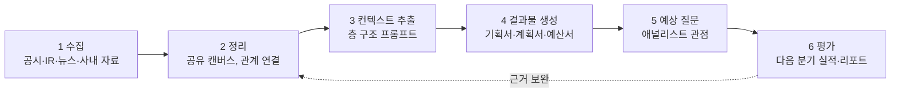

# Telescope 기획서

> 작성일 2026.11.24 / 기준 문서 [README.md](../../README.md) / 데모 [v02-canvas 데모 초안](demo/index.html)

---

## 0. 서비스 정의

부서 재무기획 담당자와 같은 부서 사람들이 공시·IR·뉴스·사내 자료를 공유 캔버스에 모아 정리하고, 그 근거로 LLM 프롬프트·결과물 초안·예상 질문을 만들어 다음 분기 실적으로 평가하는 재무 근거 협업 플랫폼

---

## 1. 이해관계자

□ 부서 재무기획 담당자는 CIC·본부 같은 사업 조직 안에서 그 조직의 사업계획·예산·투자계획을 작성하고 실적을 관리하는 담당자임

| 구분 | 이해관계자 | 소속 예 (SKT) | 서비스에서 하는 일 |
|---|---|---|---|
| 핵심 사용자 | **부서 재무기획 담당자** | 네트워크센터, AIDC사업본부, 세일즈마케팅본부, 프로덕트브랜드본부 [1][3][4] | 투자계획서·예산서 작성 책임. 근거 수집, 캔버스 정리, 결과물 생성, 질문·평가 확인 |
| 부사용자 | 같은 부서 사업·기술·동료 담당자 | 핵심 사용자와 같은 부서 | 현장 수치(사내 자료)와 공시·IR·뉴스 근거를 함께 올리고 메모로 설명 |
| 관계자 | 부서장, 전사 재무기획, IR 담당 | 사업 조직, 코퍼레이트센터(CFO) [2] | 결과물 컨펌·심의, 보완 요청 메모. IR은 예상 질문·쟁점의 출처 |

---

## 2. 페인포인트

| ID | 페인포인트 | 현재 상황 | 영향 |
|---|---|---|---|
| P1 | 근거 데이터 산발 | 공시(DART), IR 자료, 뉴스, 사내 엑셀·보고서가 각각 다른 곳, 다른 단위·기준으로 있음 | 근거를 찾고 단위·기준을 맞추는 데 작성 시간 대부분을 씀 |
| P2 | 부서 안 근거 공유 단절 | 담당자별로 모은 근거와 현장 수치가 개인 파일에 남음. 어떤 수치를 왜 썼는지 맥락이 공유되지 않음 | 같은 근거를 부서원마다 다시 찾음. 검토 때 출처 확인과 보완 요청이 반복됨 |
| P3 | 근거 → 문서 작성의 수작업 | 모은 근거를 사업기획서·투자계획서·예산서 양식에 옮겨 쓰는 과정이 수작업임. LLM에 넣으려 해도 근거를 프롬프트로 정리하기 어려움 | 출처 없는 숫자, 기간·기준이 섞인 숫자가 초안에 들어감 |
| P4 | 검토·시장 질문 예측 어려움 | 심의자나 애널리스트가 무엇을 물을지 제출·발표 뒤에야 앎 | 보완 요청과 재제출이 반복됨 |
| P5 | 결과물 품질의 사후 검증 부재 | 초안의 가정과 예상 질문이 다음 분기에 맞았는지 확인하지 않음 | 근거 정리 방식이 개선되지 않음 |

---

## 3. 솔루션

□ 한 흐름

| 단계 | 하는 일 | 대응 페인포인트 | 쓰는 기술 |
|---|---|---|---|
| 1 수집 | 공시 표는 계정 검색으로, IR·뉴스는 주제 검색으로 찾아 캔버스에 끌어다 놓음. 사내 자료는 올리면 요약 카드가 됨 | P1 | DART XBRL 파서, 문서 파서 모델, 임베딩 검색 |
| 2 정리 | 카드를 관계(근거·설명·반박·관련)로 잇고, 같은 개념끼리는 자동 연결. 메모·보완 요청 메모로 부서원과 의견 공유 | P1, P2 | 개념 사전(온톨로지), 이벤트 로그 |
| 3 컨텍스트 추출 | 캔버스 상태를 LLM에 바로 넣을 수 있는 프롬프트로 정리. 숫자마다 근거 ID가 붙음 | P3 | 컨텍스트 컴파일러(L0~L4 층, prefix 캐시) |
| 4 결과물 생성 | 원하는 양식의 초안을 생성. 문장마다 근거 ID, 근거 없는 항목은 '근거 부족' | P3 | LLM, 양식 설정 |
| 5 예상 질문 | 캔버스 근거를 애널리스트 관점으로 읽고 질문과 준비할 근거를 제시 | P4 | LLM, 질문 기준 설정 |
| 6 평가 | 다음 분기 실적·애널리스트 리포트 쟁점과 대조해 적중률과 초안 가정 오차를 산출 | P5 | 평가 모듈(코드 계산) |

□ 설계 원칙
- 숫자는 근거 ID와 함께만 씀
  - 공시 표 값 `[표ID#r행c열]`, 문서 수치 `[doc:문서ID#f번호]`, 문서 내용 `[doc:문서ID]`
  - 근거 ID를 누르면 캔버스의 해당 카드로 이동함
- 값 유형 구분: 공시(원본 숫자), IR·뉴스·사내(문서 수치), 계산(코드로 낸 값), AI 해석
- 원본은 불변, 편집은 별도 층에 쌓음. 화면 좌표 이동은 컨텍스트를 바꾸지 않음
- 시점 통제: 생성 단계는 기준일 이전 자료만, 기준일 이후 자료는 평가에만 씀
- 회사·양식·평가 기준은 코드가 아닌 설정에서 바꿈(README 범용 설정)
- 애널리스트 리포트는 원문 대신 쟁점 요약과 출처 링크만 다룸

---

## 4. 기능 명세

□ 등급 기준: must는 README 3장·데모 흐름에 직접 나오거나 한 흐름을 잇는 데 필요한 기능, should는 품질을 높이는 기능, 추가는 일정 여유 시 기능

| ID | 기능 | 등급 | 설명 | 페인포인트 | README 대응 | 데모 |
|---|---|---|---|---|---|---|
| F-01 | 공시 표 검색·올리기 | must | 계정명·개념으로 공시 표 검색, 원본 표에서 행 선택 또는 드래그로 카드 생성. 셀마다 셀 ID | P1 | 근거 데이터 수집 | 구현 |
| F-02 | IR·뉴스 검색·올리기 | must | 주제·회사로 IR·뉴스 검색, 결과를 캔버스로 드래그. 카드에 요약·핵심 수치·출처 링크·발행일 | P1 | 근거 데이터 수집 | 구현 (키워드 + 개념 사전) |
| F-03 | 사내 자료 업로드·요약 | must | 파일을 올리면 파서 모델이 본문·표를 요약하고 수치·개념 태그를 뽑아 카드로 만듦 | P1 | 자료 파싱 | 목업 (텍스트 파일만) |
| F-04 | 임베딩 통합 검색 | should | 공시·IR·뉴스·사내 자료를 임베딩으로 한 번에 검색 | P1 | 근거 데이터 수집 | 미구현 (검색창 자리만) |
| F-05 | 계정 대응 비교 | should | 회사마다 다른 계정명을 개념 사전으로 맞춰 비교, 대응 확정·거부 | P1 | 자료 파싱과 근거 점검 | 구현 |
| F-06 | 관계 연결(온톨로지) | must | 카드끼리 근거·설명·반박·관련 관계로 연결. 같은 개념의 문서·표 카드는 자동 연결 | P2 | 자료 파싱과 근거 점검 | 구현 |
| F-07 | 메모·팀 공유 | must | 일반 메모와 보완 요청 메모 카드, 작성자·역할 표시, 활동 기록. 보완 요청은 공동 편집자끼리 또는 검토자(부서장·전사)가 남김 | P2 | (팀 단위 사용) | 목업 (작성자 전환) |
| F-08 | 동시 편집·권한 | 추가 | 여러 명이 실시간으로 같은 캔버스 편집, 팀·역할별 권한 | P2 | 범위 밖 | 미구현 |
| F-09 | 컨텍스트 추출 | must | 캔버스를 L0 역할·규칙 / L1 출처 / L2 카드 내용 / L3 조작·연결 / L4 요청 층 프롬프트로 추출. 복사, messages JSON | P3 | 범용 설정(프롬프트) | 구현 |
| F-10 | 결과물 초안 생성 | must | 사업기획서·투자계획서·예산서 중 골라 섹션별 초안 생성. 근거 ID 인용, 근거 부족 표시, Markdown 내보내기 | P3 | 출력 양식 | 목업 (규칙 기반) |
| F-11 | 근거 추적 | must | 초안·질문의 근거 ID를 누르면 해당 카드로 이동·강조 | P3 | 자료 분석 화면 | 구현 |
| F-12 | 양식·기준 설정 | should | 결과물 섹션, 질문 기준, 평가 기준을 설정 파일로 변경 | P3, P4 | 범용 설정 | 구현 (`analysis.json`) |
| F-13 | 애널리스트 예상 질문 | must | 캔버스 근거로 질문, 이유, 중요도, 준비할 근거 ID 생성 | P4 | 애널리스트 질문 예측 | 목업 (질문 뱅크) |
| F-14 | 다음 분기 평가 | must | 예상 질문을 다음 분기 리포트 쟁점과 대조해 적중·놓침·빗나감, 정밀도·재현율. 초안 가정과 실제 실적 차이율 | P5 | 예측 평가 | 목업 |
| F-15 | 시점 통제 | must | 생성 단계에서 기준일 이후 자료 차단, 평가 자료 분리 | P5 | 예측 평가 | 데이터 분리로 표현 |
| F-16 | 정답표 관리 | should | 리포트 쟁점(요약 + 출처 링크) 등록·수정, 사람의 최종 판정 | P5 | 예측 평가 | 미구현 |
| F-17 | 3사 비교 AI 분석 | should | 자료 추가 화면에서 3사 공시 수치 증감, AI 해석, 근거 뉴스를 분석 카드로 보여 주고 비교 카드로 올림 | P1, P4 | 자료 파싱과 근거 점검 | 목업 (`analysis.json`) |
| F-18 | 비교 시각화 | 추가 | 비교 카드를 계정별 회사 막대그래프 카드로 바꿔 보여 줌. 프롬프트 추출에는 넣지 않음 | P1 | 자료 분석 화면 | 구현 |

---

## 5. 데이터와 모델

□ 자료 종류와 적재

| 자료 | 형태 | 적재 방식 | 카드 |
|---|---|---|---|
| DART 공시 | 원문 XML(XBRL 표) | 병합 셀 복원 → 표·행·셀 저장, 셀 ID `표ID#r행c열` | 공시 표 카드 |
| IR 자료 | PDF, 엑셀 | 문서 파서 모델 → 표는 CSV 형태, 본문은 요약 | 공시 표 카드 또는 IR 카드 |
| 뉴스 | 기사 본문 | 수집 → 요약, 핵심 수치, 개념 태그, 출처 링크 | 뉴스 카드 |
| 사내 자료 | 엑셀, 워드, 한글, PDF | 업로드 → 문서 파서 모델 요약본 | 사내 자료 카드 |
| 애널리스트 리포트 | 리포트 | 쟁점 요약 + 출처 링크만 저장, 평가에만 사용 | (평가 자료) |

□ 모델 활용
- 문서 파서 모델: IR PDF·사내 자료의 본문과 표를 구조화하고 요약본을 만듦
- 임베딩 모델: 계정명·문서 요약을 임베딩해 공시·IR·뉴스·사내 자료를 한 번에 검색(v01의 DART 계정 표기 미세조정 모델 재사용 검토)
- 개념 사전: 회사별 계정명 대응(예: 감가상각·상각비 = KT 3개 계정 합, SKT 1개 계정). 카드 자동 연결과 질문 생성의 공통 기준
- LLM: 컨텍스트 프롬프트를 받아 초안·질문을 생성. 앞 층(L0~L2)이 같으면 prefix 캐시를 재사용해 비용 절감

---

## 6. 데모 시나리오

□ 시나리오: SKT 부서 재무기획 담당자와 같은 부서 사업·기술 담당자가 KT·LGU+와 비교하며 2026년 망·AI 데이터센터 투자계획서 초안을 함께 만듦
- 데이터: 회사명은 SKT·KT·LGU+, 숫자·기사·링크는 모두 목업. 기준 분기 1Q26, 평가 분기 2Q26

| 순서 | 사용자 조작 | 화면에서 확인할 것 | 기능 |
|---|---|---|---|
| 1 | 예시 불러오기 | 공시 표 9, 비교 3, 시각화 1, IR·뉴스·사내 자료 4, 보완 요청 메모 1, 관계 연결 4 | F-01, F-05, F-06, F-18 |
| 2 | IR·뉴스 탭에서 '마케팅' 검색 → 기사 드래그 | 뉴스 카드 생성, 같은 개념 표 카드와 점선 자동 연결 | F-02, F-06 |
| 3 | 사내 자료 탭에서 파일 올리기 | 파서 요약 카드, 뽑은 수치(f번호)와 개념 태그 | F-03 |
| 4 | 카드 오른쪽 점을 다른 카드로 끌기, 작성자를 사업·기술 담당자로 바꿔 메모 추가, 보완 요청 메모 확인 | 관계선, 메모 종류(일반·보완 요청), 활동 기록에 작성자와 역할 | F-06, F-07 |
| 5 | 컨텍스트 추출 | L0~L4 층 프롬프트, 근거 ID, 층별 해시, 복사 | F-09 |
| 6 | 결과물 생성 → 투자계획서 | 섹션별 초안, 근거 ID, '근거 부족' 항목, 근거 ID 눌러 카드 이동 | F-10, F-11 |
| 7 | 질문 생성 → 평가 | 예상 질문과 준비할 근거, 2Q26 쟁점 대비 정밀도·재현율, 놓친 쟁점, 초안 가정 오차 | F-13, F-14, F-15 |
| 8 | 근거 보완 후 다시 평가 | 놓친 쟁점 관련 자료를 올리면 재현율 변화 | F-14 |

---

## 7. 산출물 작성 가이드

□ 공통 규칙
- 이 기획서의 기능 ID(F-xx), 페인포인트 ID(P1~P5), 이해관계자 명칭을 네 문서에서 그대로 씀
- 요구사항 등급은 must / should / 추가로 표기
- 화면 ID는 Figma 프레임, 데모, Vue route에서 같게 씀. 화면 설계는 IA 대신 User Flow로 관리
- v01 문서(`1_planning/v01-stella/`)의 표지·양식·운영 방식(2장)은 재사용하고 내용만 바꿈

□ 문서별 작성 포인트

| 문서 | 이 기획서에서 가져올 내용 | 작성 포인트 | v01 대비 바꿀 점 |
|---|---|---|---|
| 1. 프로젝트정의요구사항서 | 1장(이해관계자), 2장(페인포인트), 3장(솔루션), 4장(기능), 6장(시나리오) | 프로젝트 캔버스의 '해결하려는 문제'는 P1~P5, '대상 사용자'는 1장 표, 'MVP'는 must 기능을 4~5개 묶음(수집, 정리·공유, 컨텍스트·결과물, 질문·평가)으로 작성. 기능 요구사항은 F-xx를 FR로 묶고, 비기능은 근거 ID 인용률·시점 통제·응답 시간 | 대상 사용자를 '예산 요청 부서/심의 부서'에서 '부서 재무기획 담당자와 같은 부서 공동 편집자'로 바꿈. MVP를 '주장 검증'에서 '근거 수집 → 결과물 생성 → 평가'로 바꿈 |
| 2. 아키텍처정의서 | 3장(흐름), 5장(데이터와 모델) | 구성요소: 캔버스 프런트(Vue Flow), 이벤트 로그·컨텍스트 컴파일러 백엔드, 수집 파이프라인(DART·IR·뉴스, 파서 모델, 임베딩), 저장소(표·셀, 문서 요약, 임베딩, 이벤트 로그), LLM 서버(prefix 캐시), 평가 모듈. 데이터 흐름은 3장 6단계를 그대로 시퀀스로 그림 | 분석 Agent 중심 구조에서 이벤트 로그 + 컨텍스트 컴파일러 중심 구조로 바꿈. 사내 자료 업로드·뉴스 수집 경로 추가 |
| 3. 설계서 | 4장(기능), 6장(시나리오), 3장 설계 원칙 | User Flow는 6장 시나리오 순서로 그림. 화면 목록 예시: C10 캔버스, C11 자료 패널, C12 원본 표, C20 컨텍스트, C21 결과물, C22 질문, C23 평가, C24 활동. 값 표시 규칙(근거 ID, 값 유형 4종), 상태와 예외(빈 캔버스, 근거 부족, 업로드 실패, 캔버스 변경 후 재생성 알림) | 단계별 분석 화면에서 단일 캔버스 + 좌우 패널 구조로 바꿈. IA 대신 User Flow |
| 4. 테스트결함조치결과서 | 4장(must 기능), 6장(시나리오), 3장 설계 원칙 | must 기능마다 테스트 케이스 1개 이상, 6장 시나리오를 E2E 케이스로 작성. 측정 항목: 초안 숫자의 근거 ID 인용률, 기준일 이후 자료 사용 0건, 예상 질문 정밀도·재현율, 초안 가정 오차 | 판정 정확도 중심 테스트에서 근거 추적·시점 통제·평가 지표 중심으로 바꿈 |

□ 성공 기준 초안 (1번 문서에 옮길 때 수치 확정)
- 수집: 데모 시나리오의 근거 수집 단계가 캔버스 안에서 끝남(외부 파일 열기 0회)
- 결과물: 초안의 모든 숫자에 근거 ID가 붙음(인용률 100%), 근거 없는 항목은 '근거 부족'으로 표시됨
- 평가: 다음 분기 리포트 쟁점 대비 예상 질문 정밀도·재현율을 산출하고, Baseline 대비 개선을 기록함
- 종료 후 사내 PoC: 결과물 1건당 근거 수집 시간, 보완 제출 횟수를 도입 전후 비교

---

## 8. 열린 질문

| # | 질문 | 확인 대상 | 영향 문서 |
|---|---|---|---|
| 1 | 부서 재무기획 담당의 실제 팀 구성과 공동 편집 인원, 적용할 첫 부서 | 현업 멘토링 | 1, 3 |
| 2 | 사내 사업기획서·투자계획서·예산서의 실제 섹션 양식 | 현업 멘토링 | 1, 3 (`analysis.json` 양식) |
| 3 | 사내 자료의 주된 형식(엑셀, 한글, PDF)과 파서 모델 적용 범위 | 현업 멘토링, AI 담당 | 2 |
| 4 | 예상 질문 적중 판정 기준(주제 일치 수준)과 정답표 작성 주체 | 교수진 멘토링 | 1, 4 |
| 5 | 뉴스 수집 범위와 이용 조건(요약·링크만 보관 여부) | 주관 팀 | 1, 2 |
| 6 | 팀 공유를 실시간 동시 편집까지 할지, 저장·불러오기 수준으로 할지 | 팀 내부 | 2, 3 |

---

## 참고 자료

1. 뉴스토마토, 「정재헌호 SKT 첫 조직개편 단행…"MNO·AI 체제 도입"」, https://newstomato.com/ReadNews.aspx?no=1281501
2. 스마트투데이, 「SKT, 조직개편 단행..신임 임원 인사」, https://www.smarttoday.co.kr/ko-kr/articles/96206
3. 포인트경제, 「SK텔레콤, 2025 조직개편 단행…'MNO·AI 양대 CIC 체제' 도입」, https://www.pointe.co.kr/news/articleView.html?idxno=61679
4. 머니투데이, 「SKT, B2B 담당 '엔터프라이즈 TF' 신설…AI DC는 영역별 세분화」(2026.4.21), https://www.mt.co.kr/tech/2026/04/21/2026042117233438986
5. 예산 검토 일반 절차: 원본 작업공간의 `1_planning/주제/예산 검토 업무.md`
6. v01 산출물: 원본 작업공간의 `1_planning/v01-stella/`
