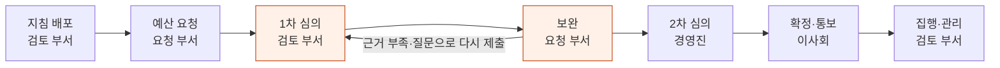
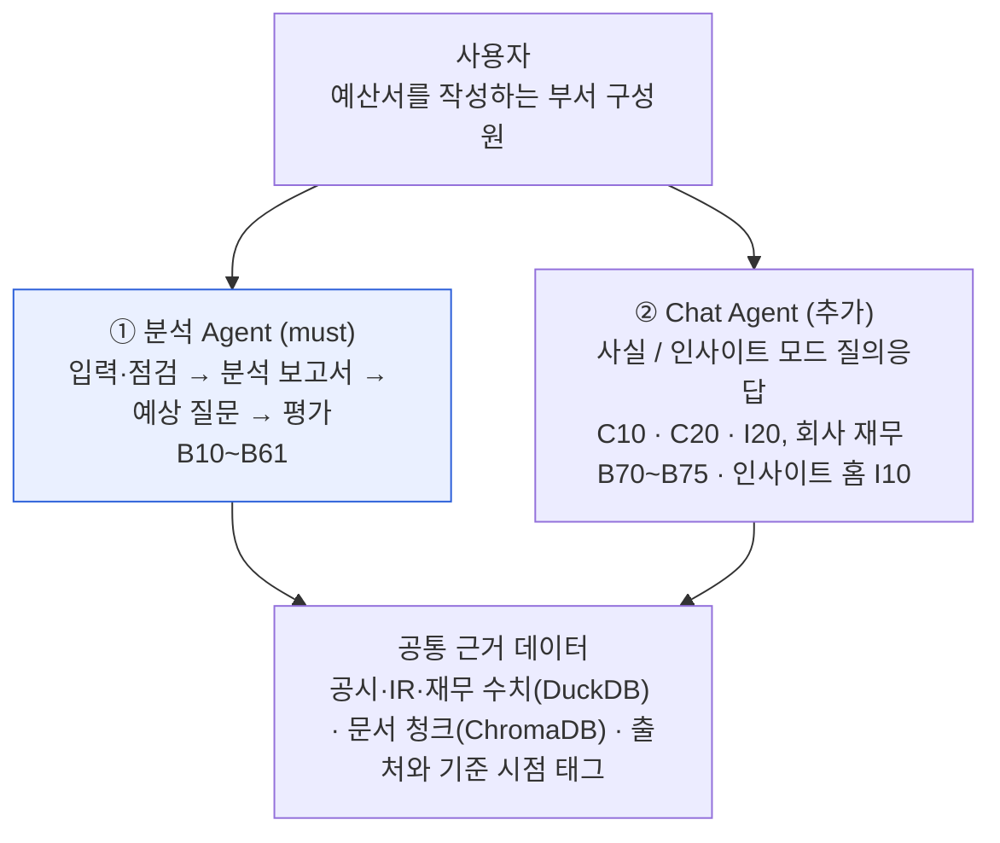
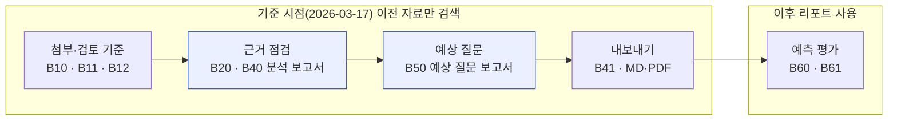
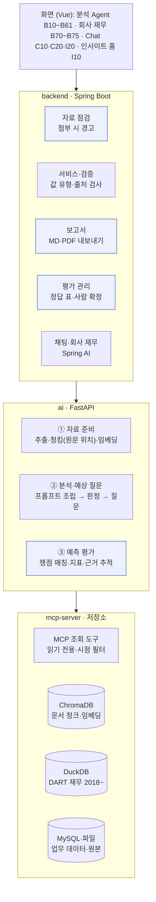

# Telescope | 예산서 검토 AI Agent

> 기획서 · v4.0 (최종 화면설계 기준)

예산서를 내기 전에 검토자의 눈으로 먼저 읽어, 근거가 부족한 곳과 받을 질문을 원문 위치와 함께 보고서로 알려 주는 AI Agent입니다.

| 항목 | 내용 |
|---|---|
| 제안 팀 | Vamos \| 김준영, 성민기, 윤혜정, 안중범, 임진섭, 주윤겸 |
| 주 사용자 | 예산서를 작성하는 부서 구성원 |
| 주제 | 기업 경영실적 다면·심층 분석 AI Agent (공개 데이터로 검증한 뒤 사내 예산 검토로 확장) |
| 작성일 | 2026.11.13 · 기간 2026.10.30 ~ 12.16 |

## 목차

1. [개요](#1-개요)
2. [이해관계자](#2-이해관계자)
3. [페인포인트](#3-페인포인트)
4. [솔루션](#4-솔루션)
5. [비즈니스 가치와 차별점](#5-비즈니스-가치와-차별점)
6. [아키텍처](#6-아키텍처)
7. [요구사항과 화면](#7-요구사항과-화면)
8. [성공 기준과 KPI](#8-성공-기준과-kpi)
9. [일정과 리스크](#9-일정과-리스크)
10. [결론 및 요청 사항](#10-결론-및-요청-사항)
11. [출처](#11-출처)

---

## 1. 개요

### 1.1 제안 요약

| 구분 | 내용 |
|---|---|
| 과제 | 예산서를 낸 뒤 검토 부서의 질문과 근거 보완 요청을 받고 여러 번 다시 제출함. 근거가 되는 실적·투자 자료는 공시, IR, 엑셀에 형식과 단위가 제각각인 채로 흩어져 있음 |
| 제안 | 예산서 1개와 근거 자료, 검토 기준을 넣으면 점검 항목별 **근거 부족**과 **예상 질문**을 보고서로 정리하고, 숫자는 코드로 계산해 공시와 대조하는 **분석 Agent**. 적재한 데이터에 사실·인사이트 모드로 묻는 **Chat Agent**와 회사 재무·인사이트 홈(추가) |
| 주 사용자 | 예산서를 작성하는 부서 구성원. 분석 담당자·평가 담당자는 서비스 안의 역할이며 모두가 다 씀 (2장) |
| 검증 방식 | 실제 예산서는 사내 기밀이므로 구조가 닮은 공개 데이터로 검증. 사업보고서 설비투자 절을 예산서로, 이후 애널리스트 리포트 쟁점을 검토 의견(정답)으로 씀 |
| 차별점 | 검토자 관점 + 사용자가 쓰는 검토 기준 · 숫자는 코드가 계산 · 공시/계산/AI 구분과 기준 시점 · 기준 시점 이후 자료 차단 · 예측을 이후 쟁점과 견줘 정밀도·재현율로 증명 |
| 데모 범위 | SKT 2025 4Q 예산서(회사·분기·기준 시점은 예산서에서 식별), 기준 시점 2026-03-17. 통신 3사(SKT, KT, LG U+) 공시·IR 데이터 적재 |

| 지표 | 값 | 출처 |
|---|---|---|
| 평균 예산 편성 기간 | **8.7주** | AFP 2026 (2025년 기준) |
| FP&A 시간 중 데이터 수집·검증 | **47%** | FP&A Trends 2026 |
| 상위 그룹 예산 완료 기간 | **25일 이하** | APQC (CFO.com) |
| SKT 단독 CapEx 전년 대비 | **−19.4%** | DART, 2025 사업보고서 |

---

## 2. 이해관계자

### 2.1 예산 검토에 등장하는 사람

예산 검토는 요청 부서가 예산서를 내고 검토 부서가 심의하는 구조입니다. Telescope의 주 사용자는 **예산서를 작성하는 요청 부서 구성원**입니다.

| 구분 | 누구 | 하는 일 | Telescope와의 관계 |
|---|---|---|---|
| **요청 부서** | 예산서를 작성하는 현업 부서 구성원 (예: 네트워크/인프라) | 예산 요구서와 근거 자료를 내고, 질문을 받으면 보완해 다시 냄 | 주 사용자. 제출 전에 근거 부족과 예상 질문을 받아 미리 보완 |
| 검토 부서 | 경영기획, 재무(FP&A) | 지침을 내리고 요구서를 심의, 질문과 피드백 | Agent가 흉내 내는 관점. 왕복이 줄면 심의 부담도 줄어듦 |
| 의사결정자 | 경영진, 예산심의위원회, 이사회 | 우선순위를 조정하고 최종 승인 | 근거가 갖춰진 예산안을 받음 |

출처: 나눔경영컨설팅 예산 심의·확정 절차, Stratex CapEx 승인 절차 (팀 메모 「예산 검토 업무」 정리)

### 2.2 서비스 안의 역할

분석 담당자와 평가 담당자는 사람을 나눈 것이 아니라 **서비스 안에서 하는 일의 이름**입니다. 역할별 기능 제한이 없어 모든 사용자가 두 역할을 모두 씁니다. 화면에는 사용자 카드의 이름과 역할로만 보입니다.

| 역할 | 하는 일 | 쓰는 화면 |
|---|---|---|
| 분석 담당자 | 예산서와 근거 자료를 올리고 검토 기준·AI 모델을 정해 분석, 분석 보고서·예상 질문 보고서를 확인하고 내보냄. 회사 재무와 Chat으로 근거를 더 찾음 | `B10`~`B50`, `B70`~`B75`, Chat |
| 평가 담당자 | 예상 질문을 이후 리포트 쟁점과 견주고 판정을 확정, 정답 표의 기준과 쟁점을 고침 | `B60` `B61` |

> **정리.** 나눌 수 있는 권한(분석 실행, AI 모델 전환, 판정 수정)은 후보로만 적어 두고 현업에 확인합니다. MVP에서는 **모든 계정이 모든 기능**을 씁니다.

---

## 3. 페인포인트

### 3.1 1차 심의와 보완 사이의 왕복

예산 검토 일곱 단계 중 시간이 가장 많이 드는 곳은 1차 심의와 보완 사이의 왕복입니다. 검토자의 질문은 대부분 정해진 관점(산출 근거, 전년 대비, 투자 효과, 재무 영향)에서 나오는데도, 요청 부서는 질문을 받고 나서야 보완합니다.

주황색이 여러 번 오가는 구간입니다. Telescope는 요청 부서가 제출하기 전(예산 요청 단계)에 검토자의 눈으로 먼저 읽어, 이 왕복을 미리 겪게 합니다.

### 3.2 문제 정리

| 문제 | 발생하는 일 | 결과 |
|---|---|---|
| **P1 질문 예측** | 검토자가 무엇을 물을지 제출 전에는 알 수 없음 | 보완 요청을 받고 다시 제출, 왕복 반복 |
| **P2 주장-숫자 대조** | "투자 효율화" 같은 주장마다 받쳐 줄 숫자가 있는지 하나씩 확인해야 함 | 근거 없는 주장이 그대로 제출됨 |
| **P3 자료 분산** | 공시, IR, 실적 엑셀에 형식·단위·연결/별도 기준이 제각각 | 근거 숫자를 찾고 맞추는 데 시간이 듦 |
| **P4 양식 변동** | 회사마다 항목명이 다르고(핸드폰, 핸드셋, 단말기) 해마다 표 구조가 바뀜 | 파서를 회사·연도별로 다시 만듦 |
| **P5 검증 불가** | "미리 짚은 질문이 맞았는가"를 잴 기준이 없음 | 도구를 믿고 쓰기 어려움 |

### 3.3 예산 업무의 시간 구조

공개 조사에서도 예산 편성은 두 달 가까이 걸리고, 재무 조직 시간의 절반 가까이가 분석이 아니라 데이터 수집과 검증에 쓰입니다.

**예산 편성 기간 (2025)** · 단위 주

| 구분 | 기간 |
|---|---|
| 시나리오 플래닝 미사용 | 9.2주 |
| **전체 평균** | **8.7주** (2022년 8.5주) |
| 시나리오 플래닝 사용 | 8.1주 |

출처: AFP FP&A Benchmarking Survey 2026

**FP&A 데이터 수집·검증 시간 비중 (2025–2026)** · 단위 %, 전체 업무 시간 대비

| 연도 | 비중 |
|---|---|
| 2025 | 46% |
| **2026** | **47%** (응답 475명) |

출처: FP&A Trends Survey 2025, 2026

APQC 조사(3,900여 조직)에서 상위 그룹은 연간 예산을 25일 이하에 마치며, 보통 그룹의 절반 수준입니다. 기간의 상당 부분은 다른 부서의 입력과 응답을 기다리는 시간입니다. (CFO.com, APQC Metric of the Month)

> **핵심.** 검토 왕복과 근거 수집은 조사 시간이 아니라 **기다리고 다시 맞추는 시간**입니다. 제출 전에 근거와 질문을 갖추면 이 시간을 줄일 수 있습니다. 사내 왕복 횟수와 기간은 측정 전이므로 이 기획서는 절감 수치를 제시하지 않습니다 (8장).

---

## 4. 솔루션

### 4.1 두 Agent

Telescope는 예산서를 검토하는 **분석 Agent**와, 적재한 데이터에 사실·인사이트 모드로 묻는 **Chat Agent**로 나뉩니다. 회사 재무와 인사이트 홈은 Chat Agent로 이어지는 탐색 화면입니다. 모두 같은 근거 데이터를 씁니다.

파란색이 MVP의 중심인 분석 Agent입니다. Chat Agent, 회사 재무, 인사이트 홈은 사용자 요청으로 더한 기능입니다.

### 4.2 분석 Agent의 흐름

자료를 첨부하는 순간부터 평가까지 한 흐름입니다. 예측은 기준 시점 이전 자료로만 하고, 평가 단계에서만 이후 리포트를 씁니다.

파란색 두 단계가 검토자의 눈으로 읽는 핵심입니다. 묶음은 쓸 수 있는 자료의 시점 범위입니다.

### 4.3 페인포인트와 대응

| 문제 | Telescope의 대응 | 화면 |
|---|---|---|
| **P1 질문 예측** | 애널리스트 관점 + 사용자가 쓴 검토 기준으로 예상 질문, 중요도, 왜 묻는지, 미리 준비할 근거를 원문 위치와 함께 제시 | `B50` |
| **P2 주장-숫자 대조** | 예산서의 주장을 뽑아 점검 항목별로 판정하고 원문 위치, 공시 근거, 부족한 근거를 정리. CapEx·감가상각은 코드로 계산해 공시와 대조하고 계산 과정 표시 | `B40` |
| **P3 자료 분산** | 통신 3사 공시·IR·재무 데이터를 출처·기준 시점을 달아 적재하고 회사 재무·Chat으로 조회. 첨부 시 회사 불일치·기준 시점 이후·형식 불일치 경고 | `B12` `B70`~`B75`, Chat |
| **P4 양식 변동** | 동의어 매핑으로 항목명을 표준 항목에 묶고, 회사·연도별 하드코딩 없는 파서 | (파이프라인) |
| **P5 검증 불가** | 기준 시점 이후 리포트 쟁점(정답 표)과 비교해 맞힘·부분·빗나감·놓침, 정밀도·재현율. AI 1차 판정 후 사람이 확정 | `B60` `B61` |

### 4.4 데모 시나리오

네트워크/인프라 부서 구성원이 SKT 2025 4Q 예산서를 제출 전에 검토하는 상황입니다. 데모 예산서는 SKT 2025 사업보고서의 설비투자 절입니다.

1. **첨부.** `B10`에서 `+`로 예산서 1개와 근거 자료를 첨부합니다. KT 자료나 기준 시점 이후 자료를 넣으면 `B12` 경고가 뜨고, 빼거나 확인해야 첨부됩니다.
2. **검토 기준.** "CapEx가 줄어든 근거가 충분한지 봐 주세요" 같은 기준을 쓰거나 예시 프롬프트를 골라 분석을 시작합니다. 회사·분기·기준 시점은 예산서에서 읽습니다.
3. **분석 보고서.** `B20` 진행 뒤 `B40`에서 "5G 투자 안정화로 효율적 집행" 항목의 공시 근거, 계산 과정(전년 대비 −19.4%), 부족한 근거를 봅니다.
4. **예상 질문.** 헤더 전환으로 `B50`에서 질문과 미리 준비할 근거를 보고, 항목을 골라 Markdown으로 내보냅니다.
5. **평가.** `평가하기`로 `B60`에 들어가 이후 리포트 쟁점과 견준 판정을 확정하고 `B61` 정답 표를 확인합니다.
6. **더 묻기.** `회사 재무` 설비투자 탭을 보고, 사실 모드와 인사이트 모드로 CapEx를 물어 사실과 AI 해석이 구분된 답을 받습니다. `인사이트` 홈에서 3사 비교와 관련 뉴스를 봅니다.

**SKT 단독 CapEx (2021–2025)** · 단위 억원 · 데모에서 Agent가 대조하는 공시값

| 연도 | 2021 | 2022 | 2023 | 2024 | **2025** |
|---|---|---|---|---|---|
| CapEx | 21,790 | 22,150 | 17,430 | 15,440 | **12,440** (전년 대비 −19.4%) |

출처: DART 사업보고서 (corp-finance-agent 적재 데이터, 2026-11-06 조회)

예산서의 "효율적 집행" 주장은 금액(공시)과 감소율(계산)로는 받쳐지지만, 5G 커버리지나 트래픽당 투자비 같은 효율 지표가 없어 근거 부족으로 표시됩니다. 주장 문구와 판정은 샘플입니다.

### 4.5 신뢰를 만드는 통제

| 통제 | 작동 방식 | 대응 문제 |
|---|---|---|
| 수치 신뢰 | CapEx·감가상각·증감률은 LLM이 아니라 코드(MCP 도구)가 계산. `공시` `계산` 태그와 `AI 판단`·`AI 해석` 라벨로 구분하고, 기준 시점과 출처 없는 숫자 0건을 서버가 검사 | P2 |
| 시점 신뢰 | 예측 단계는 기준 시점 이후 자료를 검색에서 차단하고 검색 로그를 남김. 첨부 경고를 확인해 남긴 이후 자료도 예측에 쓰지 않음. 이후 자료는 평가 Job만 조회 | P5 |
| 판정 신뢰 | 평가는 AI가 이유를 붙여 1차 판정하고 사람이 확정. 판정자와 시각을 이력으로 남김 | P5 |
| 자료 이용 | 애널리스트 리포트는 원문을 저장하지 않고 쟁점 요약과 출처 링크만 보관. 공시에 없는 값은 추정하지 않고 결측 | P3 |

### 4.6 범용 설정 6항목

별도 설정 화면 없이, 각 항목을 쓰는 화면 안에 둡니다. 회사·부서·분기를 고르는 입력 폼은 두지 않습니다. 요구 수준은 should로, 구현되는 데까지 합니다.

| 항목 | 위치 | 동작 |
|---|---|---|
| 입력 자료 종류 | `B11` | 예산서 PDF·HTML, 근거 자료 PDF·HTML·XLSX·CSV. 형식별 파서 선택 |
| 추출·내보내기 항목 | `B41` | 내보낼 분석 항목과 질문을 체크 |
| 출력 양식 | `B41` | Markdown(기본), PDF |
| **검토 기준** | `B10` 입력창 | 애널리스트 관점 고정 + 사용자가 요청마다 쓰는 검토 기준. 부서별 검토 포인트는 기준을 쓸 때 참고하는 자료이며, 부서별 Agent를 따로 두지 않음 |
| 프롬프트 | `B10` 입력창 | 직접 작성 또는 예시 프롬프트 3개 중 선택 |
| AI 모델 | `B10` 입력창 | 범용 LLM / 로컬 LLM 엔드포인트 전환 (로컬 서버 구축은 범위 밖) |

---

## 5. 비즈니스 가치와 차별점

### 5.1 기대 효과

| 효과 | 작동 방식 | 수혜 | 문제 |
|---|---|---|---|
| 제출 왕복 감소 | 제출 전에 예상 질문과 근거 부족을 받아 미리 보완 | 요청 부서, 검토 부서 | P1 |
| 근거 품질 표준화 | 애널리스트 관점과 점검 항목별 보고서 구조로 같은 틀을 매번 적용 | 요청 부서 | P1, P2 |
| 근거 수집 시간 단축 | 공시·IR·재무 데이터를 출처와 함께 적재하고 회사 재무·Chat Agent로 바로 조회 | 요청 부서 | P3 |
| 수치 오류 방지 | 숫자는 코드가 계산하고 공시와 대조, 값 유형과 기준 시점 표시 | 검토 부서, 의사결정자 | P2 |
| 검토 지식 축적 | 판정과 놓친 이유가 쌓여 검토 기준과 예시 프롬프트를 고치는 근거가 됨 | 검토 부서 | P5 |

### 5.2 대안 비교

| 기준 | 수작업 유지 | 사내 범용 챗봇 | BI 대시보드 | Telescope |
|---|---|---|---|---|
| 예상 질문 | 작성자 경험에 의존 | 물어야 답함 | 없음 | **검토자 관점 + 검토 기준으로 먼저 제시** |
| 주장-숫자 대조 | 수작업 | LLM 생성 수치 위험 | 숫자만 보여 줌 | **점검 항목별 근거·계산 과정 + 코드 계산 대조** |
| 근거 추적 | 낮음 | 문서 출처 일부 | 데이터만 | **숫자마다 출처·기준 시점·값 유형** |
| 시점 통제 | 없음 | 없음 | 없음 | **기준 시점 이후 자료 차단, 검색 로그** |
| 효과 검증 | 없음 | 없음 | 해당 없음 | **정답 표 대비 정밀도·재현율** |
| 다른 부서 확장 | - | 프롬프트 수작업 | 지표 재설계 | **검토 기준만 바꿔 같은 Agent 사용** |

### 5.3 공개 데이터에서 사내 예산 검토로

공개 데이터와 사내 예산 검토는 구조가 닮아 있어, 데이터와 검토 기준만 바꾸면 그대로 옮겨 쓸 수 있습니다.

| 이번 과제 (공개) | 사내 예산 검토 | 바꾸는 것 |
|---|---|---|
| 사업보고서 설비투자 절, IR 자료 | 예산 요구서와 근거 자료 | 입력 자료 종류 |
| CapEx, 감가상각 공시값 | 예산의 정량 근거, 전년 실적 | 적재 데이터 |
| 애널리스트 관점의 예상 질문 | 경영기획·재무의 질문과 피드백 | 검토 기준(검토 관점, 예시 프롬프트) |
| 이후 리포트 쟁점(정답 표) | 과거 검토 의견과 삭감 사유 | 평가 데이터 |

> **확장.** 사내 데이터 연결은 과제 종료 후 수행합니다. 과제에서는 **회사·부서에 맞춘 내용을 코드에 넣지 않고 설정으로 분리**하는 데까지 만듭니다.

---

## 6. 아키텍처

### 6.1 전체 구성

화면, 서비스 운영(Spring Boot), AI 처리(FastAPI), 읽기 전용 조회 서버(MCP)를 나눠 배포합니다. 채팅만 Spring AI로 처리합니다.

파란색은 분석 Agent의 검토·보고서·평가 흐름을 위해 새로 만드는 핵심 구성요소입니다. 상세 구성도와 연결 목록은 아키텍처정의서에 있습니다.

### 6.2 구성요소별 책임

| 구성요소 | 책임 | 근거 화면 |
|---|---|---|
| 자료 점검 | 첨부 순간 회사 불일치·기준 시점 이후·형식 불일치 판정, 문서 역할(예산서 1 / 근거 N) 등록 | `B11` `B12` |
| 서비스·검증 | 문서·버전 등록, 예산서에서 회사·분기·기준 시점 식별, 허용 문서 확정, 결과 JSON 검증(값 유형·기준 시점·출처), 상태 폴링 | `B20` `B40` |
| 검토 기준·모델 | 애널리스트 관점 + 사용자 검토 기준(요청마다), 예시 프롬프트, AI 모델 선택. 입력값은 분석 실행과 함께 저장 | `B10` |
| 보고서·내보내기 | 판정과 질문을 점검 항목별로 집계, 선택 항목을 Markdown/PDF로 생성 | `B40` `B41` `B50` |
| **평가 관리** | 정답 표·판정 기준 편집, AI 1차 판정의 사람 확정과 이력 | `B60` `B61` |
| 채팅·회사 재무 | Chat 사실/인사이트 모드와 대화 세션, 회사 재무 6탭 조회(재무 조회 REST), 인사이트 홈 3사 비교·뉴스 목록 | `C10` `C20` `I20` `B70`~`B75` `I10` |
| ai ① 자료 준비 | 텍스트·표 추출, 원문 위치(문서명·장·쪽)를 담은 청킹, 임베딩 | `B20` |
| ai ② 분석·예상 질문 | 프롬프트 조립 → 주장 추출 → 근거 점검 → 코드 계산·대조 → 판정 → 예상 질문 | `B40` `B50` |
| ai ③ 예측 평가 | 쟁점 매칭·1차 판정, 정밀도·재현율, 놓친 이유, 근거 부족 추적 | `B60` |
| MCP 조회 서버 | 문서 검색·재무 조회(읽기 전용), 기준 시점·허용 문서 필터, 예측 단계 이후 자료 차단, 평가 Job만 허용, 검색 로그 | 모든 분석 |

### 6.3 결과 데이터의 약속

AI가 만든 결과는 서버가 검증한 뒤에만 화면에 나갑니다. 검증 규칙은 결과 JSON 필드로 정합니다.

| 대상 | 필수 필드 | 검증 |
|---|---|---|
| 숫자 | `valueType`(공시/계산/AI), `asOf`, `sourceId`, 계산식 | 누락 0건, 예측 단계에서 `asOf` ≤ 기준 시점 |
| 주장·판정 | 점검 항목, 판정, 이유, 부족한 근거, 원문 위치(문서명·장·쪽), 근거 ID | 원문 위치 누락 0건 |
| 예상 질문 | 질문, 중요도, 왜 묻나요, 미리 준비할 근거, 원문 위치 | 원문 위치 누락 0건 |
| 평가 판정 | 판정, 이유, 판정자(AI 1차/평가 담당자), 메모, 확정 시각 | 확정 전 지표는 잠정 표시 |

---

## 7. 요구사항과 화면

### 7.1 요구사항

| ID | 요구사항 | 수준 | 화면 |
|---|---|---|---|
| `FR-01` | 통신 3사 공시·IR·리포트를 형식과 관계없이 파싱해 출처·기준 시점을 붙여 적재 | must | (파이프라인) |
| `FR-02` | 예산서·근거 자료 첨부 시 점검·경고, 주장·숫자를 뽑아 점검 항목별 판정, 코드로 계산해 공시와 대조, 분석 보고서 | must | `B10` `B11` `B12` `B20` `B40` |
| `FR-03` | 예상 질문과 미리 준비할 근거를 원문 위치와 함께 생성, 예상 질문 보고서·내보내기 | must | `B40` `B41` `B50` |
| `FR-04` | 범용 설정 6항목(입력 자료 종류, 내보내기 항목, 출력 양식, 검토 기준, 프롬프트, AI 모델)을 코드 수정 없이 변경 | should | `B10` `B11` `B41` |
| `FR-05` | 기준 시점 이전 자료로만 예측, 이후 리포트 쟁점과 비교해 정밀도·재현율 산출, AI 1차 판정 후 사람 확정 | must | `B50` `B60` `B61` |
| `FR-06` | 기준 시점 이전 리포트로 질문 예측 모델 파인튜닝 | should | `B60` |
| `NFR-01` | 공시·계산·AI 구분 표시, 모든 숫자에 출처와 기준 시점 | must | 숫자가 표시되는 모든 화면 |
| `NFR-02` | 새 회사·양식도 파서 수정 없이 적재 | should | (파이프라인) |

### 7.2 화면 목록

| ID | 화면 | 수준 |
|---|---|---|
| `B10` `B11` `B12` | 분석하기(검토 기준 입력·예시 프롬프트·AI 모델), 자료 첨부 팝업, 자료 점검 경고 | must |
| `B20` | 분석 진행 (4단계) | must |
| `B40` `B50` | 분석 보고서, 예상 질문 보고서 (헤더에서 전환) | must |
| `B41` | 내보내기 팝업 (항목·형식 선택) | should |
| `B60` `B61` | 예측 평가, 정답 표 | must |
| `B70`~`B75` | 회사 재무 6개 보기 탭 (한눈에, 손익, 재무상태, 현금흐름, 설비투자, 동종사 비교) | 추가 |
| `C10` `C20` `I20` | Chat 입력창(사실/인사이트 모드), 사이드 채팅, 대화 화면 | 추가 |
| `I10` | 인사이트 홈 (3사 비교 인사이트, 관련 뉴스) | 추가 |
| `S00` | 로그인 (사용자 카드만, 인증 제외) | 추가 |

예산서 원문 하이라이트 검토 화면은 MVP 범위에 포함하지 않습니다. 원문 위치는 보고서에 문서명·장·쪽 텍스트로 표시합니다.

---

## 8. 성공 기준과 KPI

### 8.1 과제 성공 기준

| KPI | 정의 | 목표 |
|---|---|---|
| 숫자 추출 정확도 | 정답 표 대비 추출한 숫자가 맞는 비율 | 95% 이상 (안) |
| 표준 항목 매핑 정확도 | 회사별 항목명이 올바른 표준 항목에 묶인 비율 | 90% 이상 (안) |
| 정밀도 | (맞힘 + 부분 × 0.5) ÷ 예상 질문 수 | 정답 표 구축 후 확정 |
| 재현율 | 잡은 쟁점 ÷ 리포트 쟁점 수 | 정답 표 구축 후 확정 |
| **근거성** | 출처 없는 숫자 수, 원문 위치 없는 예상 질문 수 | **0건** |
| 개선 폭 | 기본 프롬프트·파인튜닝 전 모델 대비 정밀도·재현율 변화 | 같은 정답 표로 비교 |

### 8.2 사내 적용 시 KPI

| KPI | 정의 | 측정 시점 |
|---|---|---|
| 제출 왕복 횟수 | 예산서 1건이 최종 통과까지 보완 제출된 횟수 | 사내 PoC |
| 심의 기간 | 최초 제출부터 1차 심의 통과까지 일수 | 사내 PoC |
| 질문 적중 | 검토 부서 실제 질문 대비 예상 질문 정밀도·재현율 | 사내 PoC |

> **측정 원칙.** 사내 효과는 현행 왕복 횟수와 심의 기간을 기준선으로 먼저 잰 뒤 같은 지표로 비교합니다. **측정 전 효과 수치를 제시하지 않습니다.**

---

## 9. 일정과 리스크

### 9.1 일정

| 날짜 | 마일스톤 |
|---|---|
| 2026.10.30 | 프로젝트 시작 |
| 2026.11.06 | 정의·요구사항서 |
| 2026.11.11 | 아키텍처 v3.0, 2차 현업 멘토링(데이터 적재 정확성 우선) |
| 2026.11.13 | 최종 화면설계, 기획 문서 v4.0 |
| **2026.11.20** | **중간점검: 한 흐름 관통(적재 → 점검 → 질문 → 평가)** |
| 2026.12.16 | 예선: 데모 시나리오 완주와 정밀도·재현율 제시 |

### 9.2 리스크와 대응

| 리스크 | 영향 | 대응 |
|---|---|---|
| 정답 표 구축 지연 | 평가와 개선 폭을 제시하지 못함 | 리포트 쟁점을 손으로 먼저 뽑고(진행 가이드), 판정 기준을 문서화 |
| 기준 시점 누수 | 예측 성능이 부풀려짐 | MCP 필터 강제, 검색 로그, 평가 Job만 이후 자료 허용 |
| 파싱 정확도 | 근거 점검 전체 품질 저하 | 정형은 코드, 반정형은 코드 후 LLM 보조, 결측은 추정하지 않음 |
| LLM 비용 | API Key 팀당 $350/월 초과 | 자료 준비 1회, 분석 중 조회만, 임베딩 재사용 |
| 검토 기준 편차 | 사용자가 쓴 기준에 따라 결과 품질이 달라지고 현업 질문과 다른 포인트를 점검 | 예시 프롬프트와 부서별 검토 포인트 자료를 제공하고, 인터뷰 후 예시를 수정 |
| 분석 범위 식별 실패 | 예산서에서 회사·기준 시점을 못 읽으면 경고와 시점 필터가 동작하지 않음 | 식별 실패 시 사용자 확인 절차를 확정(열린 질문) |
| 로컬 LLM 범위 | 화면(모델 선택)과 범위(구축 제외)가 어긋남 | 엔드포인트 연결까지만 하고 현업 확인 |

---

## 10. 결론 및 요청 사항

Telescope는 예산서를 내기 전에 검토자의 눈으로 먼저 읽어 근거 부족과 예상 질문을 원문 위치와 함께 보고서로 알려 줍니다. 숫자는 코드가 계산하고 출처와 기준 시점을 붙이며, 예측이 맞았는지는 이후 리포트 쟁점과 견줘 정밀도·재현율로 보입니다. 공개 데이터로 검증한 구조는 데이터와 검토 기준만 바꿔 사내 예산 검토에 옮길 수 있습니다.

현업에 다음을 요청합니다.

1. **부서와 양식 확인.** 실제 예산 제출 단위(부서 목록)와 부서별 예산서 양식이 검토 기준 참고 자료(부서별 검토 포인트)와 맞는지 확인해 주세요.
2. **자주 묻는 질문.** 검토 부서가 가장 자주 되돌려 보내는 사유와 질문 유형을 부서별 3~5개씩 알려 주세요.
3. **기준선.** 예산서 1건이 보통 몇 번, 며칠 동안 오가는지 알려 주세요. 사내 KPI 기준선으로 씁니다.
4. **판정 기준.** "같은 쟁점"의 범위와 부분 일치 점수를 확인해 주세요.
5. **범위 확인.** 로컬 LLM은 엔드포인트 연결까지로 충분한지, 인사이트 해석의 근거로 뉴스를 어디까지 쓸지 정해 주세요.

---

## 11. 출처

- [AFP – FP&A Benchmarking Survey Report: Integrated Planning](https://www.financialprofessionals.org/training-resources/resources/survey-research-economic-data/Details/afp-fpabenchmarking-survey-report-integrated-planning)
- [OneStream – The Readiness Gap: 10th Annual FP&A Trends Survey (2026)](https://www.onestream.com/blog/the-readiness-gap-new-10th-annual-fp-and-a-trends-survey-reveals-ai-is-outpacing-fp-and-a-s-foundations/)
- [FP&A Trends – 2025 FP&A Benchmarks and Trends](https://fpa-trends.com/article/2025-fpa-benchmarks-and-trends)
- [CFO.com – Cycle Time to Complete the Annual Budget (APQC Metric of the Month)](https://www.cfo.com/news/cycle-time-to-complete-the-annual-budget-metric-of-the-month/655292/)
- [나눔경영컨설팅 – 예산 심의·확정 절차](https://nanumcon.com/term/budget-review-and-approval)
- [Stratex – CapEx Approval Process](https://www.stratexonline.com/blog/capex-approval-process)
- [금융감독원 – OpenDART (SK텔레콤 2025 사업보고서, 2026-03-17 공시)](https://opendart.fss.or.kr/)
- 팀 문서 – 프로젝트정의요구사항서 v4.0, 아키텍처정의서 v4.0, 설계서 v4.0, 최종 화면설계 IA, 부서별 예산서 검토 포인트
