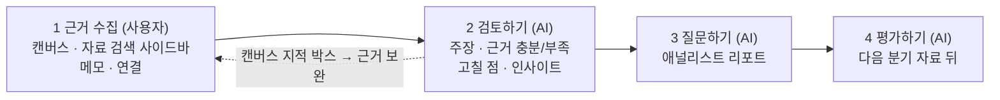

# Telescope 기획서

> 작성일 2026.11.24, 수정 2026.11.25(#97), 2026.11.26(#97 추가 수정: 메모 복원, 자료 검색 3탭 · 통합 검색 / 페이지 구조: 캔버스 · 분석, 메모 통합, 검토 · 질문 · 평가) / 설계서 [설계서.md](설계서.md) / 기준 문서 [README.md](../../README.md) / 데모 [v02-canvas 데모](../frontend/demo.html) / 프론트엔드 설명 [frontend/README.md](../../frontend/README.md)

---

## 0. 서비스 정의

부서 재무기획 담당자와 같은 부서 사람들이 공시·IR·뉴스·사내 자료를 페이지의 공유 캔버스에 모으고 메모와 연결로 맥락을 남기면, AI가 근거를 검토(주장 · 근거 충분/부족 · 고칠 점 · 인사이트)하고 애널리스트 예상 질문을 뽑으며, 다음 분기 자료가 들어오면 예측을 평가하는 재무 근거 협업 플랫폼. 흐름: (사용자) 근거 데이터 수집 → (AI) 검토하기 → 질문하기 → 평가하기

---

## 1. 이해관계자

□ 부서 재무기획 담당자는 CIC·본부 같은 사업 조직 안에서 그 조직의 사업계획·예산·투자계획을 작성하고 실적을 관리하는 담당자임

| 구분 | 이해관계자 | 소속 예 (SKT) | 서비스에서 하는 일 |
|---|---|---|---|
| 핵심 사용자 | **부서 재무기획 담당자** | 네트워크센터, AIDC사업본부, 세일즈마케팅본부, 프로덕트브랜드본부 [1][3][4] | 예산서·사업기획서 작성 책임. 근거 수집, 캔버스 정리 · 메모, 분석(검토 · 질문 · 평가) 확인 · 보완 |
| 부사용자 | 같은 부서 사업·기술·동료 담당자 | 핵심 사용자와 같은 부서 | 현장 수치(사내 자료)와 공시·IR·AR·뉴스 근거를 함께 올리고 메모(카드 메모 · 메모 카드 · 선 메모)로 지시 · 의견 공유 |
| 관계자 | 부서장, 전사 재무기획, IR 담당 | 사업 조직, 코퍼레이트센터(CFO) [2] | 결과물 컨펌·심의(보기 권한으로 페이지 확인, 각자 분석 실행). IR은 예상 질문·쟁점의 출처 |

---

## 2. 페인포인트

| ID | 페인포인트 | 현재 상황 | 영향 |
|---|---|---|---|
| P1 | 근거 데이터 산발 | 공시(DART), IR 자료, 뉴스, 사내 엑셀·보고서가 각각 다른 곳, 다른 단위·기준으로 있음 | 근거를 찾고 단위·기준을 맞추는 데 작성 시간 대부분을 씀 |
| P2 | 부서 안 근거 공유 단절 | 담당자별로 모은 근거와 현장 수치가 개인 파일에 남음. 어떤 수치를 왜 썼는지 맥락이 공유되지 않음 | 같은 근거를 부서원마다 다시 찾음. 검토 때 출처 확인과 보완 요청이 반복됨 |
| P3 | 근거 → 문서 작성의 수작업 | 모은 근거를 사업기획서·투자계획서·예산서 양식에 옮겨 쓰는 과정이 수작업임. LLM에 넣으려 해도 근거를 프롬프트로 정리하기 어려움 | 출처 없는 숫자, 기간·기준이 섞인 숫자가 초안에 들어감 |
| P4 | 검토·시장 질문 예측 어려움 | 심의자나 애널리스트가 무엇을 물을지 제출·발표 뒤에야 앎 | 보완 요청과 재제출이 반복됨 |
| P5 | 결과물 품질의 사후 검증 부재 | 초안의 가정과 예상 질문이 다음 분기에 맞았는지 확인하지 않음 | 근거 정리 방식이 개선되지 않음 |

---

## 3. 솔루션

□ 한 흐름

| 단계 | 하는 일 | 대응 페인포인트 | 쓰는 기술 |
|---|---|---|---|
| 1 근거 수집 | 페이지(= 캔버스 + 분석)의 캔버스에서 근거를 모음. 오른쪽 사이드바 자료 검색은 대시보드 · 회사 재무 · 인사이트 탭과 아래 고정 통합 검색(입력 즉시 공시 재무 데이터 · IR·AR · 뉴스)으로, 항목을 끌어 캔버스에 놓음. 사내 자료는 검색창 +의 데이터 입력 창에서 포맷 · 4사(SKT · SKB · KT · LGU+) 회사 검증 뒤 올림. 카드끼리 선으로 잇고(관계 태그 없음), 메모를 카드 · 메모 카드 · 선에 남김. Shift로 여러 표를 골라 비교표 · 시각화를 만듦 | P1, P2 | DART XBRL 적재, 공시 임베딩 검색, 문서 파서 모델, 개념 사전(온톨로지), 이벤트 로그 |
| 2 검토하기 | 캔버스 하단 분석하기 → 분석 화면. AI가 메모를 지시 · 근거 · 의견으로 가리고, 의견 메모와 문서의 주장을 뽑아 캔버스 근거로 충분 · 보통 · 부족을 판정. 근거 부족 · 기준 섞임 · 사용자 수정값 · 연결 없음 같은 고칠 점은 캔버스 카드에 박스로 표시. 캔버스 근거에서 나온 AI 인사이트(코드 계산 사실 + AI 해석)를 붙임 | P2, P3 | LLM(컨텍스트 층, 근거 ID 검증), 코드 계산 |
| 3 질문하기 | 애널리스트 관점의 예상 질문을 리포트 형식(요지 · 핵심 쟁점 · 쟁점별 질문 · 배경 · 확인할 수치)으로 만듦 | P4 | LLM, 질문 기준 설정 |
| 4 평가하기 | 다음 분기 실적 · 리포트가 들어오면 질문 적중(정밀도 · 재현율)과 가정 오차를 평가. 그 전에는 대기 | P5 | 평가 모듈(코드 계산), 시점 통제 |

분석 결과는 세션으로 관리하고 요청한 본인만 본다. 캔버스가 바뀌면 "캔버스가 변경되었습니다."와 함께 `업데이트`(보고 있는 세션의 새 버전)와 `새로 분석하기`(새 세션)를 띄운다. 결과는 고치지 않고 쌓으며, 필요 없는 세션은 목록에서 숨길 수 있다.

□ 설계 원칙
- 숫자는 근거 ID와 함께만 씀
  - 공시 표 값 `[표ID#r행c열]`, 대시보드 값 `[dash:패널ID#인코딩된행이름@열인덱스]`, 문서 수치 `[doc:문서ID#f번호]`, 문서 내용 `[doc:문서ID]`
  - 근거 ID를 누르면 캔버스의 해당 카드로 이동함
- 값 유형 구분: 공시(원본 숫자), IR·AR·뉴스·사내(문서 수치), 계산(코드로 낸 값), AI 해석
- 메모는 한 종류로 받고, 지시 · 근거 · 의견 구분은 AI가 함. 지시는 활용 방향에만, 의견은 검토할 주장으로만 쓰고 사실 근거로 인용하지 않음. 근거 메모도 카드의 공시 · 문서와 대조함
- 선은 관계 종류를 사용자가 고르지 않음. 두 카드 내용을 보고 AI가 근거 · 설명 · 반박을 판단
- 카드 색은 데이터 성격별: 공시 회색, IR·AR 초록, 뉴스 주황, 사내 자료 검정, 비교·시각화·대시보드 파랑(흰 블러 카드), 메모 노랑. 카드 강조도 같은 성격색
- 사용자 입력 자료는 형식과 대상 4사(MVP 기준)를 검증한 뒤에만 받음
- 원본은 불변, 편집은 별도 층에 쌓음. 화면 좌표 이동은 컨텍스트를 바꾸지 않음
  - 사용자가 고친 값은 검토에서 지적하고 '사용자 수정값'으로 표시하며, 다음 분기 가정에는 기준 분기 원본값만 씀
- 근거 · 메모 · 연결이 바뀌면 분석 화면에 "캔버스가 변경되었습니다." `업데이트` · `새로 분석하기`를 띄움. 업데이트는 같은 세션의 새 버전으로, 새로 분석하기는 새 세션으로 쌓임(결과는 고치지 않음). 세션 지우기는 목록에서 숨김
- 시점 통제: 검토 · 질문은 기준 시점 이전 자료만, 기준 시점 이후 자료는 평가에만 씀
- 회사·양식·평가 기준은 코드가 아닌 설정에서 바꿈(README 범용 설정)
- 애널리스트 리포트는 원문 대신 쟁점 요약과 출처 링크만 다룸

---

## 4. 기능 명세

□ 등급 기준: must는 README 3장·데모 흐름에 직접 나오거나 한 흐름을 잇는 데 필요한 기능, should는 품질을 높이는 기능, 추가는 일정 여유 시 기능

| ID | 기능 | 등급 | 설명 | 페인포인트 | README 대응 | 데모 |
|---|---|---|---|---|---|---|
| F-01 | 공시 재무 데이터 검색·올리기 | must | 캔버스 오른쪽 사이드바(자료 검색) 통합 검색(입력 즉시)에서 계정명·개념으로 공시 표 검색, 결과를 끌어 캔버스에 놓음. 행 고르기는 원본 표 창에서 행을 골라 바로 올림. 셀마다 셀 ID | P1 | 근거 데이터 수집 | 구현 |
| F-02 | IR·AR·뉴스 검색·올리기 | must | 통합 검색에서 IR·AR(애널리스트 리포트) · 뉴스 리스트, 인사이트 탭에서 관련 뉴스(썸네일). 카드에 요약·핵심 수치·출처 링크·발행일. AR은 쟁점 요약과 링크만 | P1 | 근거 데이터 수집 | 구현 (키워드 + 개념 사전, 캔버스 기준 추천, 회사 필터) |
| F-03 | 사내 자료 첨부·요약 | must | 검색창 +에서 파일을 여러 개 고른다. 서버 모드는 현재 캔버스와 사용자가 고른 회사(SKT · SKB · KT · LGU+)를 넣어 파일마다 업로드하고, 작업이 끝나면 카드 데이터를 받거나 파일별 실패 사유를 보여 준다. 발행일을 생략하면 업로드한 날로 저장한다. 이번 단계에서는 가상 사내 자료만 시연한다 | P1 | 자료 파싱 | 서버 업로드 연결, 로컬 데모는 형식·대상 회사 검증과 텍스트 요약 |
| F-04 | 공시 임베딩 검색 | should | 공시 XBRL 계정·주석을 임베딩해 검색. 결과를 원본 셀 ID로 되돌려 행 선택 | P1 | 근거 데이터 수집 | 미구현 (키워드 + 개념 사전으로 대신) |
| F-05 | 계정 대응 비교 | should | Shift로 공시 표 카드를 여러 장 골라 표 생성. 회사마다 다른 계정명을 개념 사전으로 맞춰 비교(공통 계정이 없으면 행을 그대로 모아 보여 줌), 대응 확정(다시 누르면 취소) · 거부(대응 없음으로 내림, 되돌리기) | P1 | 자료 파싱과 근거 점검 | 구현 |
| F-06 | 관계 연결(온톨로지) | must | 카드끼리 선으로 연결(관계 태그 없음, AI가 판단). 같은 개념의 문서·표 카드는 자동 점선 | P2 | 자료 파싱과 근거 점검 | 구현 |
| F-07 | 메모 | must | 메모를 한 종류로 통일. 카드 메모(카드를 누르면 펼쳐지는 칸), 메모 카드(카드 오른쪽 위 +로 그 카드에 이어 달기, 하단 메모 버튼, 메모 하나를 여러 카드에 연결 · Shift 선택 메모 연결), 선 메모(선을 누름). Enter · 입력 완료로 저장, 수정 버튼. 왼쪽 메모 목록에서 누르면 해당 카드·선으로 이동. 분석에서 AI가 지시 · 근거 · 의견으로 가림 | P2, P3 | 범용 설정(프롬프트) | 구현 (분류는 규칙 기반 목업) |
| F-08 | 동시 편집·권한 | must | 여러 명이 실시간으로 같은 페이지 편집, 페이지별 권한(소유자 · 편집 가능 · 보기 가능)과 공유. 분석 결과는 요청한 본인만 봄 | P2 | 범위 밖 | 권한만 목업 (헤더 정보 아이콘 → 페이지 정보 · 협업자: 소유자만 사람 초대 · 권한 변경, 페이지는 소유자와 초대한 사람만 볼 수 있음, 보기 권한은 보기 전용). 실시간 동시 편집 · 커서 공유는 서버 연동 모드에서 동작(로그인 연동 전) |
| F-09 | 컨텍스트 복사 · 내보내기 | 추가 | 검토 화면의 캔버스 정리 글(카드 · 연결 · 메모를 근거 ID가 붙은 글로)을 복사하거나 Markdown으로 내려받음. 질문 리포트도 Markdown. 층별 컨텍스트(L0 역할·규칙 / L1 출처 / L2 카드·메모 카드 / L3 조작·연결·메모 / L4 요청)는 서버 안에서만 씀 | P3 | 범용 설정(프롬프트) | 구현 |
| F-10 | 근거 검토 | must | 분석하기의 첫 단계. 메모 분류(지시 · 근거 · 의견), 주장 추출(의견 메모 + 문서 주장), 주장별 근거 충분 · 보통 · 부족 판정과 보완 안내, 고칠 점을 캔버스 카드 박스로 표시(근거 부족, 연결 · 별도 섞임, 단위 환산, 사용자 수정값, 연결 없음). 숫자는 코드로, 근거 ID 검증. 결과는 세션 · 버전으로 쌓고(업데이트 = 새 버전) 목록에서 숨길 수 있음, 본인만 봄 | P2, P3 | 자료 파싱과 근거 점검 | 목업 (규칙 기반) |
| F-11 | 근거 추적 | must | 검토 · 질문의 근거 ID와 캔버스에서 보기를 누르면 캔버스의 해당 카드로 이동·강조. 캔버스의 지적 라벨을 누르면 분석의 그 항목으로 | P3 | 자료 분석 화면 | 구현 |
| F-12 | 양식·기준 설정 | should | 질문 기준, 평가 기준(가정 계정 · 쟁점)을 설정 파일로 변경 | P3, P4 | 범용 설정 | 구현 (`analysis.json`) |
| F-13 | 애널리스트 예상 질문 | must | 검토에 이어 캔버스 근거로 애널리스트 관점 질문을 리포트 형식(요지, 핵심 쟁점, 쟁점별 질문 · 배경 · 확인할 수치 근거 ID)으로 생성. Markdown 내보내기 | P4 | 애널리스트 질문 예측 | 목업 (질문 뱅크) |
| F-14 | 다음 분기 평가 | must | 분석의 세 번째 단계. 다음 분기 자료가 들어오기 전에는 회색 대기, 들어오면 예상 질문을 다음 분기 리포트 쟁점과 대조해 적중·놓침·빗나감, 정밀도·재현율. 기준 분기 공시값 유지 가정과 실제 실적 차이율 | P5 | 예측 평가 | 목업 (데모 버튼으로 다음 분기 자료 반영) |
| F-15 | 시점 통제 | must | 헤더에 기준 시점 표시. 검토 · 질문에서 기준 시점 이후 자료 차단, 평가 자료 분리 | P5 | 예측 평가 | 데이터 분리로 표현 |
| F-16 | 정답표 관리 | should | 리포트 쟁점(요약 + 출처 링크) 등록·수정, 사람의 최종 판정 | P5 | 예측 평가 | 미구현 |
| F-17 | 인사이트(3사 비교 AI 해석) | must | 자료 검색 인사이트 탭에서 3사 공시 수치 증감 비교(분기)와 연간 인사이트(영업이익 · CapEx · 배당), AI 해석, 관련 뉴스. 검토 화면에는 캔버스 근거와 맞는 인사이트와 캔버스 표에서 크게 움직인 계정(코드 계산)을 AI 인사이트로 붙임 | P1, P4 | 자료 파싱과 근거 점검 | 목업 (`analysis.json`, v01 DART 대시보드 인사이트) |
| F-18 | 비교 시각화·대시보드 | should | 대시보드 탭(KPI · 워터폴 · 산점도 · 히트맵 · 자산 계정)과 회사 재무 탭(손익 · 재무상태 · 현금흐름 · 설비투자 · 동종사 비교)의 패널을 끌어 캔버스 카드로 올림. Shift로 고른 표로 시각화 생성(계정별 막대) | P1 | 자료 분석 화면 | 구현 (v01-stella DART 대시보드 값) |
| F-19 | 로그인·페이지 메뉴 | should | 로그인하면 페이지 홈. 페이지 안에서는 로고 = 홈, 최좌측 아이콘 레일로 캔버스 · 분석 전환, 헤더에 제목 · 기준 시점 · 페이지 정보. 새 페이지는 이름 · 기준 시점 · 편집할 사람을 정해 만듦 | P2 | 인증과 사용자 관리 | 목업 (사번 + 비밀번호 미검사, 브라우저 저장) |
| F-20 | 근거 데이터·메모 목록 | should | 캔버스 왼쪽 사이드바(플로팅 버튼으로 열고 닫음). 근거 데이터 탭은 올린 자료를 성격별(공시 표, IR·AR, 뉴스, 사내 자료, 비교·시각화)로 묶어 보여 주고 누르면 카드로 이동. 메모 탭은 카드 메모 · 메모 카드 · 선 메모를 모아 보여 주고 누르면 해당 카드·선으로 이동 | P2, P3 | 자료 분석 화면 | 구현 |

---

## 5. 데이터와 모델

□ 데이터 확보 방침
- ○ 공시·IR·뉴스·사내 자료 모두 팀이 직접 만든 데이터를 씀
  - 공시는 DART 원문 XML 형식, IR·뉴스는 공개 자료 형식을 따른 목업, 사내 자료는 가상 문서로 만듦
  - 숫자·기사·링크가 목업임을 문서(frontend README, 이 기획서)에 표시함. 단, 대시보드 · 회사 재무 값과 썸네일 뉴스 13건은 v01-stella에서 가져온 실제 공시값 · 실제 기사임. 화면에는 표시하지 않음
- ○ 실제 사내 데이터 처리는 이번 단계 범위 밖임
  - 사내 시스템 연동, 실제 사내 문서의 파싱·적재·LLM 전송을 하지 않음
  - 사내 자료 기능(F-03)은 팀이 만든 가상 사내 자료로만 시연함

□ 데모 데이터 구성 (저장소 루트 `data/demo/`, git 제외, 팀 안에서 따로 공유)
- ○ 공시 표 11장: SKT·KT·LGU+ 1Q26 손익·재무상태, KT 영업비용·부문별 보고, 3사 특수관계자 거래
- ○ 문서 19건: IR 4건, AR(애널리스트 리포트 쟁점 요약) 4건, 뉴스 8건, 사내 자료 요약 3건(요약, 핵심 수치, 개념 태그, 출처 링크)
- ○ 뉴스 13건(썸네일): v01-stella 데모의 실제 기사 헤드라인, 기준 시점 2026-03-17 이전 발행(`frontend/src/local/news.json`, git 포함)
- ○ 대시보드 · 회사 재무 값: v01-stella DART 대시보드의 실제 공시값(억원). SKT 연결 · 별도 2021~2025 손익 · 재무상태 · 현금흐름, 3사 매출 · 영업이익 · 부채 · 자본 · CapEx · 감가상각비, 24.1Q~26.2Q 분기 매출 · 영업이익, 배당, SKT 별도 분기 유형 · 무형자산 계정(`frontend/src/local/dart.ts`, git 포함). 자산 계정의 근거 칸 상태는 화면 설명용 예시
- ○ `analysis.json`: 3사 비교 AI 분석, 양식별 가정 계정, 질문 뱅크, 평가용 2Q26 실적과 리포트 쟁점

□ 자료 종류와 적재

| 자료 | 형태 | 적재 방식 | 카드 |
|---|---|---|---|
| DART 공시 | 원문 XML(XBRL 표) | 병합 셀 복원 → 표·행·셀 저장, 셀 ID `표ID#r행c열` | 공시 표 카드 |
| IR 자료 | PDF, 엑셀 | 문서 파서 모델 → 표는 CSV 형태, 본문은 요약 | 공시 표 카드 또는 IR 카드 |
| 뉴스 | 기사 본문 | 수집 → 요약, 핵심 수치, 개념 태그, 출처 링크 | 뉴스 카드 |
| 사내 자료 | PDF, XLSX, XLSM, CSV, PPTX, HTML, HTM, XML, TXT, MD, JSON | 업로드 → 문서 파서 모델 요약본 | 사내 자료 카드 |
| 애널리스트 리포트(AR) | 리포트 | 쟁점 요약 + 출처 링크만 저장. 기준일 이전 발행분은 근거, 이후 발행분은 평가에만 사용 | AR 카드 |

□ 모델 활용 (세부 전략은 [설계서.md](설계서.md))
- 문서 파서 모델: IR PDF·사내 자료의 본문과 표를 구조화하고 요약본을 만듦
- 임베딩 모델: 계정명·문서 요약을 임베딩해 공시·IR·뉴스·사내 자료를 한 번에 검색(v01의 DART 계정 표기 미세조정 모델 재사용 검토)
- 개념 사전: 회사별 계정명 대응(예: 감가상각·상각비 = KT 3개 계정 합, SKT 1개 계정). 카드 자동 연결과 질문 생성의 공통 기준
- LLM: 컨텍스트 층을 받아 검토(메모 분류 · 주장 · 판정 · 인사이트 해석) · 질문을 생성(숫자는 컨텍스트 값만, 근거 ID 검증). 앞 층(L0~L2)이 같으면 prefix 캐시를 재사용해 비용 절감

---

## 6. 데모 시나리오

□ 시나리오: SKT 네트워크센터 재무기획 담당자(이재무)와 같은 부서 기술 담당자(박망)가 KT·LGU+와 비교하며 2026년 망·AI 데이터센터 예산서를 함께 만듦
- 데이터: 회사명은 SKT·KT·LGU+, 숫자·기사·링크는 모두 목업. 기준 분기 1Q26, 평가 분기 2Q26
- 저장: 페이지는 브라우저에 저장되어 같은 브라우저 안에서만 공유됨. 분석 세션은 사용자별

| 순서 | 사용자 조작 | 화면에서 확인할 것 | 기능 |
|---|---|---|---|
| 1 | 이재무(1001)로 로그인 → 페이지 홈에서 새 페이지(기준 시점, 편집할 사람 박망 1002) | 페이지 홈, 새 페이지 창, 헤더 기준 시점, 아이콘 레일(캔버스 · 분석) | F-19 |
| 2 | 오른쪽 사이드바 예시 불러오기 | 공시 표 9, 비교 3, 시각화 1, IR·뉴스·사내 자료 4, 부서장 메모 카드 1, 연결 4. 카드 색이 데이터 성격별 | F-01, F-05, F-06, F-18 |
| 3 | 대시보드 · 회사 재무 · 인사이트 탭의 패널 · 뉴스를 캔버스로 끌어 놓기 → 'SKT 감가상각비' 입력 → 결과 끌어 놓기 → Esc | 입력하는 즉시 공시 재무 데이터 · IR·AR · 뉴스, Esc로 탭 화면 | F-01, F-02, F-17, F-18 |
| 4 | 검색창 + → 데이터 입력 창에 파일 3개(형식 다름, 다른 회사, SKT 자료) | 포맷 불일치 · 회사 불일치 · 통과, 통과한 것만 캔버스에 올림 | F-03 |
| 5 | 표 카드 메모(Enter), 카드 + → 메모 카드(의견), 선 메모 | 노랑 메모 칸 · 메모 카드 · 선 라벨, 왼쪽 메모 목록 | F-07, F-20 |
| 6 | Shift로 표 2장 → 시각화 생성, 비교표 ✓ · ✗ | 시각화 카드, 확정 표시 · 거부 행 이동 | F-05, F-18 |
| 7 | 하단 분석하기 | 분석 화면, 프로세스 바 검토 → 질문 진행 · 평가 회색. 주장과 근거 판정, 메모 분류, AI 인사이트 | F-10, F-17 |
| 8 | 캔버스로 돌아가 지적 박스 확인 → 라벨 누르기 | 근거 부족 · 점검 박스, 분석의 그 항목으로 이동 | F-10, F-11 |
| 9 | 질문 → 리포트 Markdown, 근거 ID로 카드 이동 | 애널리스트 리포트 형식 예상 질문 | F-11, F-13 |
| 10 | 평가 → 다음 분기 자료 반영 (데모) | 2Q26 쟁점 대비 정밀도·재현율, 놓친 쟁점, 가정 오차 | F-14, F-15 |
| 11 | 근거 · 메모 보완 → 업데이트 또는 새로 분석하기 | "캔버스가 변경되었습니다", 업데이트는 같은 세션의 v2 · 새로 분석하기는 새 세션, 판정 변화 | F-10, F-14 |
| 12 | 헤더 정보 아이콘 → 최예산(2001) 보기 가능으로 초대 → 최예산으로 열기 | 페이지 정보 팝오버, 보기 권한이면 편집 도구 없음, 분석 세션은 각자 것만 | F-08, F-19 |

---

## 7. 산출물 작성 가이드

□ 공통 규칙
- 이 기획서의 기능 ID(F-xx), 페인포인트 ID(P1~P5), 이해관계자 명칭을 네 문서에서 그대로 씀
- 요구사항 등급은 must / should / 추가로 표기
- 화면 ID는 Figma 프레임, 데모, Vue route에서 같게 씀. 화면 설계는 IA 대신 User Flow로 관리
- v01 문서(`1_planning/v01-stella/`)의 표지·양식·운영 방식(2장)은 재사용하고 내용만 바꿈

□ 문서별 작성 포인트

| 문서 | 이 기획서에서 가져올 내용 | 작성 포인트 | v01 대비 바꿀 점 |
|---|---|---|---|
| 1. 프로젝트정의요구사항서 | 1장(이해관계자), 2장(페인포인트), 3장(솔루션), 4장(기능), 6장(시나리오) | 프로젝트 캔버스의 '해결하려는 문제'는 P1~P5, '대상 사용자'는 1장 표, 'MVP'는 must 기능을 4~5개 묶음(근거 수집, 정리·공유, 검토, 질문·평가)으로 작성. 기능 요구사항은 F-xx를 FR로 묶고, 비기능은 근거 ID 인용률·시점 통제·응답 시간·업로드 검증. 범위 밖(제약 사항)에 '실제 사내 데이터 처리(사내 시스템 연동, 실제 사내 문서 파싱·적재·LLM 전송)는 이번 단계에서 하지 않으며, 공시·IR·뉴스·사내 자료는 팀이 만든 데이터를 씀'을 명시(5장 데이터 확보 방침) | 대상 사용자를 '예산 요청 부서/심의 부서'에서 '부서 재무기획 담당자와 같은 부서 공동 편집자'로 바꿈. MVP를 '근거 수집 → 검토 → 질문 → 평가'로 바꿈 |
| 2. 아키텍처정의서 | 3장(흐름), 5장(데이터와 모델) | 구성요소: 캔버스 프런트(Vue Flow), 이벤트 로그·컨텍스트 컴파일러 백엔드, 수집 파이프라인(DART·IR·뉴스, 파서 모델, 임베딩), 저장소(표·셀, 문서 요약, 임베딩, 이벤트 로그), LLM 서버(prefix 캐시), 평가 모듈. 데이터 흐름은 3장 6단계를 그대로 시퀀스로 그림 | 분석 Agent 중심 구조에서 이벤트 로그 + 컨텍스트 컴파일러 중심 구조로 바꿈. 사내 자료 업로드·뉴스 수집 경로 추가 |
| 3. 설계서 | 4장(기능), 6장(시나리오), 3장 설계 원칙 | User Flow는 6장 시나리오 순서로 그림. 화면 목록 예시(`docs/frontend/ia.md` 7장과 같음): S00 로그인, C00 페이지 홈, C10 캔버스, C11 자료 검색 사이드바, C12 원본 표, C13 페이지 정보, C14 새 페이지, C16 데이터 입력, C20 분석, C21 검토, C22 질문, C23 평가, C24 메모 목록, C25 분석 세션. 값 표시 규칙(근거 ID, 값 유형 4종, 근거 판정 색), 상태와 예외(빈 캔버스, 업로드 검증 실패, 캔버스 변경 후 새로 분석 알림, 평가 대기) | 로그인 → 페이지 홈 → 페이지(캔버스 · 분석 두 화면) 구조로 바꿈. IA 대신 User Flow |
| 4. 테스트결함조치결과서 | 4장(must 기능), 6장(시나리오), 3장 설계 원칙 | must 기능마다 테스트 케이스 1개 이상, 6장 시나리오를 E2E 케이스로 작성. 측정 항목: 검토 · 질문 숫자의 근거 ID 인용률, 업로드 검증 정확도, 기준일 이후 자료 사용 0건, 예상 질문 정밀도·재현율, 가정 오차 | 판정 정확도 중심 테스트에서 근거 추적·시점 통제·평가 지표 중심으로 바꿈 |

□ 성공 기준 초안 (1번 문서에 옮길 때 수치 확정)
- 수집: 데모 시나리오의 근거 수집 단계가 캔버스 안에서 끝남(외부 파일 열기 0회)
- 검토: 모든 주장에 판정(충분 · 보통 · 부족)과 근거 ID가 붙고, 근거 부족 주장은 캔버스 카드에 표시됨. 검토의 모든 숫자에 근거 ID(인용률 100%)
- 평가: 다음 분기 리포트 쟁점 대비 예상 질문 정밀도·재현율을 산출하고, Baseline 대비 개선을 기록함
- 종료 후 사내 PoC: 결과물 1건당 근거 수집 시간, 보완 제출 횟수를 도입 전후 비교

---

## 8. 열린 질문

| # | 질문 | 확인 대상 | 영향 문서 |
|---|---|---|---|
| 1 | 부서 재무기획 담당의 실제 팀 구성과 공동 편집 인원, 적용할 첫 부서 | 현업 멘토링 | 1, 3 |
| 2 | 사내 사업기획서·투자계획서·예산서의 실제 섹션 양식 | 현업 멘토링 | 1, 3 (`analysis.json` 양식) |
| 3 | 사내 자료의 주된 형식(엑셀, 한글, PDF)과 파서 모델 적용 범위 | 현업 멘토링, AI 담당 | 2 |
| 4 | 예상 질문 적중 판정 기준(주제 일치 수준)과 정답표 작성 주체 | 교수진 멘토링 | 1, 4 |
| 5 | 뉴스 수집 범위와 이용 조건(요약·링크만 보관 여부) | 주관 팀 | 1, 2 |
| 6 | ~~팀 공유를 실시간 동시 편집까지 할지, 저장·불러오기 수준으로 할지~~ → 실시간 동시 편집 + 커서 공유로 결정 (MVP) | 팀 내부 | 2, 3 |
| 7 | 검토 다음에 결과물(예산서·사업기획서·투자계획서) 생성을 다시 둘지와 사내 양식 | 현업 멘토링 | 1, 3 |
| 8 | 다음 분기 자료가 "들어왔다"를 판단하는 방법(리포트 수집 시점, 관리자 등록)과 평가 자동 실행 여부 | 팀 내부, backend · ai 담당 | 2, 3 |
| 9 | 메모 분류(지시 · 근거 · 의견)와 주장 판정(충분 · 보통 · 부족) 기준, 분석 결과를 협업자에게 공유할지 | 현업 · 교수진 멘토링 | 1, 3, 4 |
| 10 | 데이터 입력 검증 대상 회사를 4사 밖으로 넓힐지, 형식 · 회사 외 검증(기준 시점 이후 자료 등)을 넣을지 | 팀 내부 | 1, 2 |

---

## 참고 자료

1. 뉴스토마토, 「정재헌호 SKT 첫 조직개편 단행…"MNO·AI 체제 도입"」, https://newstomato.com/ReadNews.aspx?no=1281501
2. 스마트투데이, 「SKT, 조직개편 단행..신임 임원 인사」, https://www.smarttoday.co.kr/ko-kr/articles/96206
3. 포인트경제, 「SK텔레콤, 2025 조직개편 단행…'MNO·AI 양대 CIC 체제' 도입」, https://www.pointe.co.kr/news/articleView.html?idxno=61679
4. 머니투데이, 「SKT, B2B 담당 '엔터프라이즈 TF' 신설…AI DC는 영역별 세분화」(2026.4.21), https://www.mt.co.kr/tech/2026/04/21/2026042117233438986
5. 예산 검토 일반 절차: 원본 작업공간의 `1_planning/주제/예산 검토 업무.md`
6. v01 산출물: 원본 작업공간의 `1_planning/v01-stella/`
