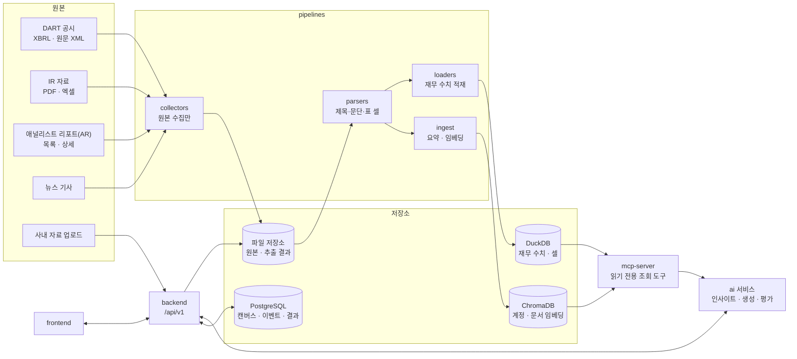
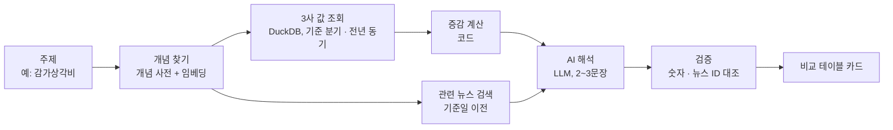

# Telescope 설계서: 기능별 데이터 출처와 AI 백엔드 전략

> 작성일 2026.11.25(#97), 수정 2026.11.26(#97 추가 수정: 대시보드 · 회사 재무 패널, 통합 검색, 메모, 생성하기 = 캔버스 정리 글) / 기준 문서 [기획서.md](기획서.md) / 화면 [ia.md](../frontend/ia.md) / API [api-spec.md](../frontend/api-spec.md)
> 저장소 규칙(`CLAUDE.md` 3장 저장소별 쓰기·읽기 주체, 4장 데이터·분석 원칙)을 따름. 7장의 미정 사항은 정하지 않고 9장 열린 질문에 둠

---

## 1. 범위

□ 기획서 4장 기능 중 데이터를 읽거나 AI를 부르는 기능의 데이터 출처, 처리 경로, 모델 역할을 정함

| 화면 | 기능 | 기능 ID | 이 문서 |
|---|---|---|---|
| 자료 검색 · 대시보드 · 회사 재무 탭 | KPI · 차트 · 히트맵 · 자산 계정, 재무제표별 패널 | F-18 | 3장 |
| 자료 검색 · 통합 검색 (입력 즉시) | 공시 재무 데이터, IR·AR, 뉴스 리스트 | F-01, F-02, F-04 | 4장 |
| 자료 검색 · 인사이트 탭 | 3사 비교(분기) · 연간 인사이트, 관련 뉴스(썸네일) | F-17, F-02 | 5장 |
| 자료 검색 · 입력창 `+` | 사내 자료 첨부·요약 | F-03 | 6장 |
| 캔버스 | 메모, 프롬프트(카드 · 선), 같은 개념 자동 연결 | F-06, F-07 | 7장 |
| 결과 패널 | 생성하기: 캔버스 정리 글 → 질문 → 평가 | F-10, F-13, F-14, F-15 | 8장 |

---

## 2. 전체 구조

□ 역할 경계
- ○ 숫자는 DuckDB에서 코드로 읽고 계산함. LLM은 숫자를 만들거나 단위를 바꾸지 않음
- ○ 문장 검색과 계정 이름 맞추기는 임베딩(ChromaDB)이 맡음. 결과는 항상 원본 위치(셀 ID, 문서 ID, 쪽)로 되돌림
- ○ LLM은 해석 문장, 캔버스 정리 글 문장, 질문 문장만 씀. 서버가 문장 속 근거 ID를 컨텍스트와 대조해 검증함
- ○ backend는 DuckDB·ChromaDB를 직접 열지 않고 ai 서비스·mcp-server를 거침

---

## 3. 대시보드 · 회사 재무 (F-18)

□ 화면: 자료 검색에서 입력이 비었을 때 `대시보드` · `회사 재무` 탭(v01-stella DART 대시보드를 패널 단위로 옮김). 패널 하나가 캔버스 대시보드 카드 하나

| 탭 | 패널 | 기준 | 계산 (모두 코드) |
|---|---|---|---|
| 대시보드 | KPI 6(매출 · 영업이익 · 영업이익률 · 당기순이익 · 부채비율 · CapEx) | SKB 포함, CapEx는 SKT+SKB | 전년 대비 증감률 · %p |
| | 영업이익 증감 요인 · 현금 증감 내역 워터폴 | SKB 포함 | 손익 · 현금흐름 계정 차이 |
| | 영업이익률 · 부채비율 3사 산점도 | 각 사 자회사 포함 | 영업이익 ÷ 매출, 부채 ÷ 자본 |
| | CapEx/감가상각비 비율, 주요 지표 전년 대비 히트맵 | SKT+SKB, SKB 포함 | 비율, 전년 대비 증감 |
| | 자산 계정(히트맵 · 자산 맵 · 표 + 근거 패널) | SKT 별도 분기 | 전분기 대비 증감 · 증감률, 분기 취득 = 누적 차이 |
| 회사 재무 | 손익(연간 · 분기), 재무상태, 현금흐름(배당), 설비투자, 동종사 비교 | 패널별 표기 | 영업이익률, 부채비율, FCF = 영업 + 투자, 누적 CapEx, 매출 지수(2021=100) |

□ 데이터 경로
- ○ DART 사업보고서·분기보고서 XBRL zip을 `pipelines/collectors`가 받아 파일 저장소에 원본 그대로 둠
- ○ `pipelines/parsers`가 XBRL 표를 셀 단위(행 경로 × 열 경로 × 값 × 단위 × 기간)로 읽음. 계정 표준 코드(`acode`)가 있으면 함께 저장
- ○ `pipelines/loaders`가 셀을 DuckDB에 적재함. 새 파일로 만들고 검증한 뒤 교체(`CLAUDE.md` 3장). 분기 값의 4Q는 연간 − 3Q 누적으로 계산
- ○ 패널 값은 `mcp-server`의 재무 조회 도구로 계정 표준 코드 기준 조회. 비율 · 합산 · 증감 · 단위 환산은 코드로 하고 LLM에 맡기지 않음
- ○ CapEx처럼 재무제표 본문에 없는 값은 사업보고서 `II. 사업의 내용 › 설비투자 현황` 표를 파서로 읽어 별도 계정으로 적재
- ○ 자산 계정 근거 패널: 분기 증감이 큰 칸에 분기 전후 뉴스 · IR과 이후 공시 주석을 붙임(근거 강도 · 미설명 변동). 근거 연결 방식은 ai 담당과 정함(9장)
- ○ 캔버스 대시보드 카드는 패널의 표 형태(행 × 열)를 컨텍스트 L2에 넣고, 근거 ID는 `dash:패널ID#행이름`, 값은 마지막 열을 십억원으로 환산

□ 데모: `frontend/src/local/dart.ts`(v01-stella 실제 공시값, 억원: 연간 2021~2025, 분기 24.1Q~26.2Q, 배당, SKT 별도 자산 계정)와 `local/dashboard.ts`(패널 정의 · 계산). 자산 계정의 근거 칸 상태는 화면 설명용 예시

---

## 4. 검색 (F-01, F-02, F-04)

□ 화면: 탭과 무관한 통합 검색. 입력하는 즉시(약 150ms 묶음, Enter 불필요) 공시 재무 데이터 · IR·AR · 뉴스 리스트가 함께 뜸. 재무 행은 원본 표 창에서 행을 골라 선택 칩에 담음
- ○ 데모는 공시 검색과 문서 검색을 같은 `q`로 함께 부름. 임베딩 검색이 들어오면 서버 한 API로 합칠지 정함(9장)

□ 재무 데이터: 공시 임베딩 검색
- ○ 색인 대상: DuckDB에 적재한 표의 행마다 `회사 | 표 제목 | 행 경로(상위 계정 > 계정) | 주석 번호 | 표준 계정 코드` 문장을 만들어 임베딩
- ○ 임베딩 모델: `pipelines/parsers/align.py`가 쓰는 `PARSER_EMBED_MODEL`을 같이 씀. v01의 DART 계정 표기 미세조정 모델을 후보로 비교(9장)
- ○ 검색 방식: 혼합 검색
  - 키워드(문자 bigram BM25): `감가상각비`처럼 정확한 계정명
  - 임베딩 유사도: `망 투자`, `설비 지출`처럼 표현이 다른 질의
  - 개념 사전 확장: 회사마다 다른 계정(예: KT 감가상각비 3개 계정 합 = SKT 1개 계정)
  - 세 순위를 RRF로 합친 뒤 표 단위로 묶어 점수 순 정렬
- ○ 질의 해석: 회사명(SKT·KT·LGU+)은 필터로 빼고, 나머지 낱말로 검색. 조사는 코드로 떼어 냄
- ○ 결과: 표 ID와 찾은 행 번호, 찾은 이유(직접 일치 · 대응 개념 · 유사 표현). 원본 표 창은 DuckDB 표를 그대로 다시 그림(병합 셀 복원)
- ○ 시점 통제: `as_of_date` 이후 접수된 공시는 서버가 색인 조회 단계에서 거름. 결과가 비어도 전체로 넓히지 않음

□ IR·AR
- ○ IR: IR 페이지의 실적 발표 자료(PDF·엑셀)를 수집 → `parsers`(Docling)로 문단·표 추출 → 장·절 단위 청크 요약 → 임베딩
  - 표 숫자는 셀로 따로 저장하고, 공시 XBRL 값과 겹치면 `facts.py`로 대조
- ○ AR(애널리스트 리포트): `pipelines/collectors/naver_research.py`로 목록과 상세 링크를 수집
  - 원문은 저장·표시하지 않음. 상세 페이지에서 쟁점 요약(3~5줄), 증권사, 발행일, 출처 링크만 남김
  - 기준일 이전 발행분은 근거(AR 카드), 이후 발행분은 평가 정답(8장)에만 씀
- ○ 문서 검색(IR·AR · 뉴스): 요약·제목 임베딩 + 개념 태그 일치 + 회사 필터. 뉴스는 기사 og:image를 썸네일(`img`)로 함께 저장. 메타데이터(회사, 종류, 발행일)로 ChromaDB `where` 필터

---

## 5. 인사이트 (F-17)

□ 화면: 인사이트 탭. 3사 비교(분기, 캔버스 개념과 겹치는 순) · 연간 인사이트(영업이익 · CapEx · 배당)와 썸네일 뉴스. 분기 비교는 3사 표 카드와 비교 카드로, 연간 인사이트는 대시보드 카드로 올라감. 주제 검색(`q`)은 API에 남겨 두되 화면은 지금 보내지 않음

□ 처리 단계

- ○ 개념 찾기: 주제를 개념 사전(`concepts`)의 이름·별칭과 맞추고, 못 찾으면 개념 설명 임베딩으로 가까운 개념 2개까지
- ○ 3사 값: 개념의 회사별 대응 계정(`members`)을 DuckDB에서 기준 분기·전년 동기로 읽어 합산. 십억원 환산은 코드
- ○ AI 해석: LLM 입력은 사실 표(숫자 확정본)와 뉴스 요약 3건, 출력은 해석 문장과 인용 뉴스 ID
  - 프롬프트 규칙: 표에 없는 숫자 금지, 원인 추정은 뉴스 인용이 있을 때만, 예산·질문 관점 한 문장 포함
  - 검증: 문장 속 숫자가 사실 표 값(반올림 허용)과 다르거나 인용 뉴스 ID가 입력에 없으면 그 문장을 버리고 다시 생성 1회
- ○ 캐시: `(개념 목록, 기준 분기, 뉴스 ID 목록)`이 같으면 이전 해석을 재사용. 결과는 고치지 않고 새로 쌓음
- ○ 관련 뉴스: 주제 임베딩으로 뉴스 요약 검색, 입력이 없으면 캔버스의 회사·개념과 겹치는 순

□ 데모: 분기는 `analysis.json`의 `insights`(미리 쓴 해석 3건), 사실 표는 `peerFacts()`가 공시 표에서 계산. 연간은 `local/dart.ts` `ANNUAL_INSIGHTS`(v01 해석 3건), 사실 표는 `local/dashboard.ts`가 계산. 뉴스 13건은 v01 실제 헤드라인(`local/news.json`)

---

## 6. 사내 자료 첨부 (F-03)

□ 화면: 입력창 왼쪽 `+` → 파일 선택 → 요약 카드가 선택 칩에 담김

- ○ 업로드는 backend가 받아 파일 저장소에 두고 ai 자료 준비 작업(job)을 시작(api-spec 5.3)
- ○ `parsers.parse()` → 제목·문단·표 셀. `to_markdown()` → 장·절 청크
- ○ 요약: 문서 요약 3줄, 핵심 수치 최대 4개(표 셀에서 고름, 단위·기간 포함), 개념 태그(개념 사전 대응)
- ○ 임베딩: 청크를 캔버스 범위 임시 컬렉션에 넣어 그 캔버스의 생성에만 씀
- ○ 이번 단계는 팀이 만든 가상 사내 자료만 씀. 실제 사내 문서는 처리하지 않음(기획서 5장)
- ○ 보관 기간·접근 범위는 정하지 않음(`CLAUDE.md` 7장, 9장)

---

## 7. 캔버스 컨텍스트, 메모와 프롬프트 (F-06, F-07)

□ 캔버스 조작은 모두 이벤트로 저장하고, 생성 때 이벤트 로그를 층 구조 컨텍스트로 컴파일함

| 층 | 내용 | 바뀌는 때 |
|---|---|---|
| L0_system | 역할, 인용 규칙, 개념 사전 | 거의 없음 |
| L1_sources | 출처 목록(공시 접수번호, 문서 ID · 종류 · 발행처 · 발행일) | 자료 추가 · 삭제 |
| L2_workspace | 카드 내용(공시 표 셀, 대시보드 패널 값 표, 문서 요약 · 수치), 메모 · 보완 요청(작성자) | 카드 · 행 · 열 · 메모 변경 |
| L3_edits | 수정값, 비교 기간, 대응 확정, 비교 카드, 연결과 관계, **사용자 프롬프트** | 편집 · 연결 · 프롬프트 |
| L4_task | 요청(캔버스 정리 글 · 질문) | 생성할 때 |

□ 메모
- ○ 메모 카드(`add_memo`, `edit_memo`, `set_memo_type`): 메모 / 보완 요청. 팀원 의견으로 L2에 들어가고, 시스템 규칙에 "메모는 사실 근거로 쓰지 않음"을 둠
- ○ 정리 글에서는 마지막 "팀 메모 · 보완 요청 (의견, 사실 근거 아님)" 섹션에만 씀

□ 프롬프트 두 종류 (프롬프트만 담는 카드는 없음)
- ○ 카드 프롬프트(`set_card_prompt`): 그 카드 근거를 어떻게 쓸지(예: 예산 증감 근거로만)
- ○ 선 프롬프트(`set_link_prompt`): 그 관계를 어떻게 쓸지(예: 반박 문단으로)
- ○ L3 `# 사용자 프롬프트` 절에 대상 카드 ID · 관계와 함께 들어감. 시스템 규칙에 "사실 근거로 쓰지 않고 작성 방향에만 반영"을 둠
- ○ 프롬프트가 근거 ID를 요구해도 컨텍스트에 없는 숫자는 만들지 않음(시스템 규칙이 우선)

□ prefix 캐시: 앞 층(L0~L2)이 같으면 LLM prefix 캐시를 재사용. 프롬프트는 L3에 있어 자주 바꿔도 앞 층 캐시가 유지됨

□ 같은 개념 자동 연결: 카드마다 개념 태그(공시 행의 대응 개념, 문서 태그)를 계산해 같은 개념끼리 점선. 태그 계산은 코드, 개념 사전 확장은 임베딩 보조

---

## 8. 생성하기: 캔버스 정리 글 → 질문 → 평가 (F-10, F-13, F-14, F-15)

□ 한 번의 생성하기가 세 작업을 차례로 부르고 가로 프로세스 바에 단계를 표시함. 결과 패널은 접고 펼 수 있음

| 단계 | 입력 | 모델 | 출력 | 검증 |
|---|---|---|---|---|
| 정리 글 | 컨텍스트 L0~L4 (카드 · 연결 · 메모 · 카드/선 프롬프트) | LLM (job `ANALYSIS`) | Markdown 정리 글(섹션별 문장, 근거 ID, 카드 줄 아래 지시) | 문장 속 숫자 = 인용 근거 값, 근거 ID 존재. 근거 부족 판정은 하지 않음 |
| 질문 | 같은 컨텍스트(정리 글), 질문 기준(쟁점 유형, 중요도) | LLM (job `PREDICTION`) | 질문, 이유, 중요도, 준비할 근거 ID | 근거 ID 존재, 같은 쟁점 중복 제거 |
| 평가 | 질문 묶음, 기준 분기 값 유지 가정, 다음 분기 실적, 이후 발행 AR 쟁점 | 코드 + 임베딩 | 적중 · 놓침 · 빗나감, 정밀도 · 재현율, 가정 오차 | 판정 기준 고정, 결과 새로 쌓음 |

□ 정리 글
- ○ 목적: 캔버스에 모은 근거와 지시를 사람이 읽고 다음 작업(문서 작성, 질문)의 컨텍스트로 쓰도록 글로 옮김. 새 판단을 더하지 않음
- ○ 섹션: 공시 재무(표 카드별 고른 기간 값, 원본 단위와 십억원 환산) · DART 대시보드 · 계정 대응 비교 · IR·AR · 뉴스 · 사내 자료 · 카드 사이 관계(선 관계 문장 + 선 프롬프트) · 팀 메모 · 보완 요청
- ○ 숫자는 컨텍스트 값을 그대로 옮기고 단위 환산은 코드로 함. AI 해석(인사이트 패널)은 "사실 아님"으로 표시
- ○ 사용자가 고친 값은 "사용자 수정값"으로 표시
- ○ 화면에서 고칠 수 있고 복사 · Markdown으로 내보냄. 고친 글의 저장 여부는 9장

□ 질문
- ○ 근거 줄과 정리 글에서 애널리스트가 물을 쟁점을 뽑음. 기준일 이전 AR 쟁점을 참고 예시로 넣되 그대로 베끼지 않게 함

□ 평가
- ○ 정답: 다음 분기 실적(DuckDB)과 이후 발행 AR 쟁점 요약
- ○ 질문 적중: 질문과 쟁점의 주제가 같으면 적중. 주제 판정은 쟁점 분류 + 임베딩 유사도 임계값, 경계 사례는 사람이 최종 판정(F-16)
- ○ 가정: 캔버스의 대상 회사 기준 분기 공시 원본값이 다음 분기에도 유지된다고 둠(양식별 가정 계정의 합집합, 사용자 수정값 · 다른 기간 열 제외)
- ○ 가정 오차: (가정 − 실적) ÷ 실적, 5% 이내면 유지
- ○ 시점 통제: 생성 단계는 `as_of_date` 이전 자료만. 서버가 허용 문서 목록을 확정해 ai에 넘기고 ai는 바꾸지 못함(`docs/backend/ai-contract.md` 2.9)

---

## 9. 열린 질문

| # | 질문 | 영향 |
|---|---|---|
| 1 | 공시 임베딩 모델: `PARSER_EMBED_MODEL` 공용 vs v01 DART 계정 미세조정 모델. 평가 기준(계정 검색 정답 세트) | 4장 |
| 2 | CapEx 같은 사업보고서 본문 표를 표준 계정으로 적재할 규칙 | 3장 |
| 3 | AR 쟁점 요약을 수집 시점에 LLM으로 만들지, 사람이 정답표로 쓸지 | 4장, 8장 |
| 4 | 인사이트 해석 캐시 무효화 시점(새 뉴스 · 새 공시) | 5장 |
| 5 | 사내 자료 임시 컬렉션의 보관 기간과 접근 범위 (`CLAUDE.md` 7장) | 6장 |
| 6 | 생성하기 세 단계를 한 job으로 묶을지, 단계별 job 세 개로 둘지 | 8장 |
| 7 | 화면에서 고친 정리 글을 새 버전으로 저장할지, 질문 입력으로 다시 쓸지 | 8장 |
| 8 | 질문 적중 판정의 임베딩 임계값과 사람 판정 범위 | 8장 |
| 9 | 자산 계정 근거 칸(근거 강도 · 미설명 변동)을 만드는 방식과 담당 | 3장 |
| 10 | 통합 검색을 서버 한 API로 합칠지, 화면이 공시 · 문서 검색을 나눠 부를지 | 4장 |
